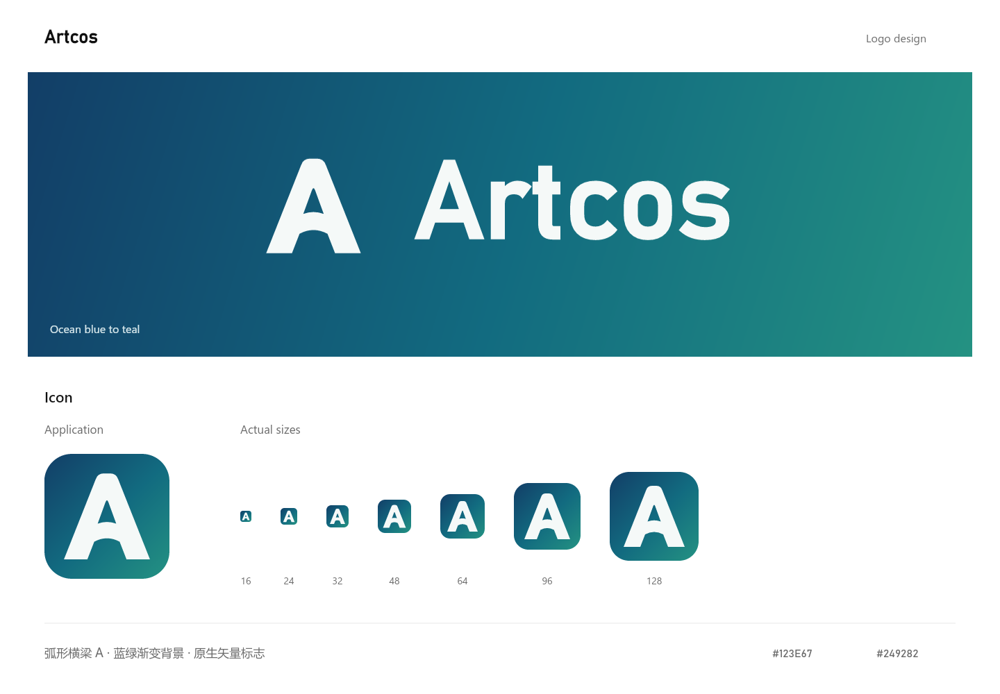

# Artcos 品牌资产

根据用户于 2026-10-27 的追加要求，为 **Artcos** 独立设计标志，主版本采用蓝绿色渐变背景。图形以 A 为核心，弧形横梁形成打开的创作空间。

## 文件

| 文件 | 用途 |
| --- | --- |
| [artcos-icon.svg](artcos-icon.svg) | 蓝绿渐变圆角背景与月白 A 图形，主图标 |
| [artcos-logo.svg](artcos-logo.svg) | 蓝绿渐变背景上的横向组合标志 |
| [artcos-mark.svg](artcos-mark.svg) | 透明背景的单色 A 图形，用于单色场景 |
| [artcos-logo-mono.svg](artcos-logo-mono.svg) | 透明背景的单色组合标志 |
| [artcos-icon-512.png](artcos-icon-512.png) | 512 × 512 主图标预览 |
| [artcos-logo-1600.png](artcos-logo-1600.png) | 1600px 宽的主组合标志预览 |
| [artcos-preview.png](artcos-preview.png) | 主视觉与实际尺寸对照 |

## 使用

- 渐变依次经过深蓝 `#123E67`、蓝青 `#126B80` 与青绿 `#249282`；前景为月白 `#F5F9F8`。
- 背景渐变直接保存在 SVG 中，使用 `userSpaceOnUse` 固定在源画布上，缩放时不改变相对位置。
- 图形源画布为 256 × 256，A 的弧形横梁与顶部轮廓为自行绘制的路径。
- 图形建议显示宽度为 24px 以上；16px 已渲染检查。横向组合标志建议宽度至少 160px。
- 保持名称大小写为 `Artcos`，使用原有留白并等比缩放。
- 字标基于 Bahnschrift 绘制后转为矢量轮廓，不含外部字体或内嵌位图。未分发字体文件。
- 单色 SVG 使用 `currentColor`；内联使用时可在根元素上设置 CSS `color`。

设计依据与验证范围见[标志方案](../../../design/2026-10-27-PingoAI与Artcos标志方案.md)。
