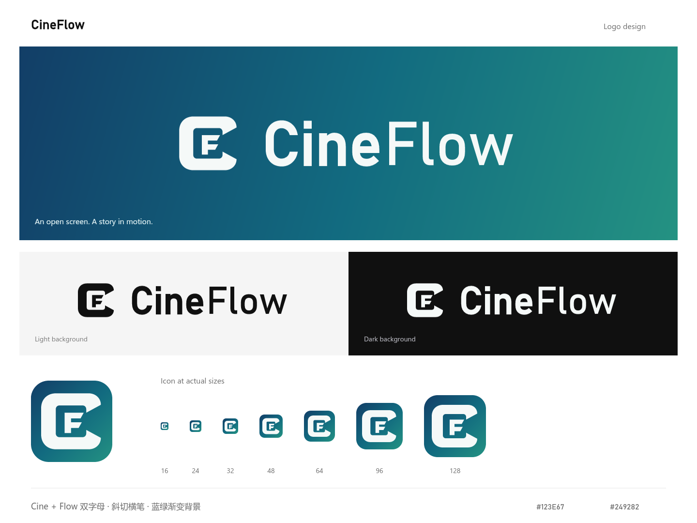

# CineFlow 品牌资产

用户于 2026-10-27 将产品名确认为 **CineFlow**。本目录为该名称的标志交付，大小写保持为 `CineFlow`。

## 设计

当前主图形采用 **C＋F 双字母组合**：外层保留画框式 C，内侧加入斜切横笔的 F，分别对应 Cine 与 Flow。C 的内侧留白上下各扩大 6 个源坐标单位，为 F 保留空间。主图标采用深蓝到青绿的背景渐变，月白前景；单色版本与当前炭黑工作台对应。

字标采用较实的 `Cine` 与较轻的 `Flow`，保持相同字号和基线。字标已转为轮廓路径。

## 文件

| 文件 | 用途 |
| --- | --- |
| [cineflow-icon.svg](cineflow-icon.svg) | 主应用图标，蓝绿渐变圆角背景 |
| [cineflow-logo-gradient.svg](cineflow-logo-gradient.svg) | 包含蓝绿渐变背景的完整横向 Logo |
| [cineflow-logo.svg](cineflow-logo.svg) | 透明背景、炭黑组合标志，用于浅色背景 |
| [cineflow-logo-light.svg](cineflow-logo-light.svg) | 透明背景、月白组合标志，用于深色背景 |
| [cineflow-mark.svg](cineflow-mark.svg) | 透明背景、炭黑独立图形 |
| [cineflow-mark-light.svg](cineflow-mark-light.svg) | 透明背景、月白独立图形 |
| [cineflow-mark-light-flow.svg](cineflow-mark-light-flow.svg) | 月白流线备选：C 内穿过一条向外延伸的流线 |
| [cineflow-mark-light-play.svg](cineflow-mark-light-play.svg) | 月白播放备选：C 内加入播放三角 |
| [cineflow-icon-512.png](cineflow-icon-512.png) | 512 × 512 主应用图标 |
| [cineflow-icon-1024.png](cineflow-icon-1024.png) | 1024 × 1024 主应用图标 |
| [cineflow-logo-1600.png](cineflow-logo-1600.png) | 1600px 宽、透明背景的炭黑组合标志 |
| [cineflow-preview.png](cineflow-preview.png) | 彩色、深浅背景与实际尺寸对照 |
| [cineflow-mark-comparison.png](cineflow-mark-comparison.png) | 原稿与 CF、流线、播放三个增强方向的对照 |
| [cineflow-mark-light-v1.svg](archive/cineflow-mark-light-v1.svg) | 归档的原始单字母 C，用于回看与对照 |

## 使用

- 颜色：深蓝 `#123E67`、蓝青 `#126B80`、青绿 `#249282`、月白 `#F5F9F8`、炭黑 `#101010`。
- 独立图形的源画布为 256 × 256，横向标志为 603 × 160。保持等比缩放与源文件留白。
- 图标建议显示宽度至少 24px；16px 版本已渲染检查。横向标志建议显示宽度至少 180px。
- `light` 指浅色前景，适合深色背景。透明单色版本使用 `currentColor`，内联使用时可在 SVG 根元素设置 CSS `color`；作为 `img` 使用时选择对应版本。
- 主图形为自行绘制的填充路径。字标基于 Bahnschrift 绘制并转为轮廓；交付文件不包含字体文件、位图或外部依赖。
- 本次交付为设计资产，应用页面与 favicon 尚未接入。设计和验证范围见[标志方案](../../../design/2026-10-27-CineFlow标志方案.md)。

本轮增强依据与验证见 [CineFlow 图形增强方案](../../../design/2026-10-27-CineFlow图形增强方案.md)。当前 6 个主 SVG 和配套 PNG 已同步使用 CF 图形；流线与播放 SVG 作为独立备选保留。
