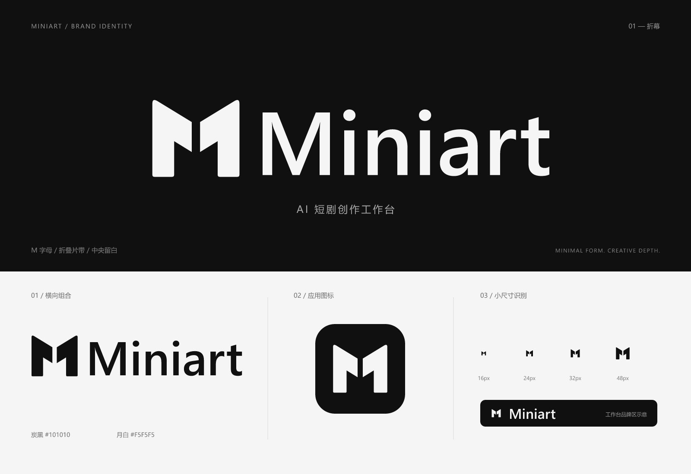

# Miniart 品牌标志

2026-11-04，用户确定项目名称为 **Miniart**，使用此大小写。本目录交付「折幕 M」设计稿与可用素材；目前未替换应用中的标志、页面名称和 favicon。

## 设计

Miniart 是从剧本、素材、分镜走向成片的 AI 短剧创作工作台。标志以名称首字母 M 为主要识别，将两片折叠片带合成一个整体轮廓；中央垂直留白表达折叠与镜头间的切口，连接文字创作与影像制作的产品特征。这是抽象语义，不要求用户在小图标中辨认具体器材。

图形采用实心轮廓、轻微圆角和单色结构。炭黑 `#101010` 与月白 `#F5F5F5` 延续现有工作台的中性色调。Miniart 字标基于 Segoe UI Semibold 绘制并转为矢量轮廓，不依赖使用方安装字体。

参考用户提供的 [LobeHub Icons](https://lobehub.com/zh/icons)，实际查看了其中 Runway、Krea、Midjourney 和 MiniMax 的单色 SVG。主要参考前两者的字母抽象、正负形关系与紧凑轮廓处理，Miniart 图形独立绘制。参考图仅用于过程观察，未打包到本目录。

## 文件

| 文件 | 用途 |
| --- | --- |
| [miniart-mark.svg](miniart-mark.svg) | 透明背景、炭黑图形，适合浅底 |
| [miniart-mark-light.svg](miniart-mark-light.svg) | 透明背景、月白图形，适合深底 |
| [miniart-logo.svg](miniart-logo.svg) | 透明背景、炭黑横向组合标志 |
| [miniart-logo-light.svg](miniart-logo-light.svg) | 透明背景、月白横向组合标志 |
| [miniart-app-icon.svg](miniart-app-icon.svg) | 炭黑圆角底应用图标，月白图形 |
| [miniart-app-icon-512.png](miniart-app-icon-512.png) | 512 × 512 应用图标 |
| [miniart-logo-1600.png](miniart-logo-1600.png) | 1600 × 475 透明背景组合标志 |
| [miniart-preview.png](miniart-preview.png) | 1600 × 1100 深浅底、应用图标与尺寸预览 |

## 使用

- 优先使用 SVG，保留文件中的留白并等比缩放。主标志源画布为 256 × 256，横向组合为 512 × 152。
- 单独图形建议以 24px 及以上尺寸展示。16px 已进行栅格化目视核验，可用于浏览器标签等受限位置；中央留白的呈现会受屏幕像素密度影响。
- 横向组合建议宽度至少 160px。仅有小面积位置时使用单独图形，不压缩字标。
- 在图形可见边缘外保留至少一条竖向笔画宽度的空间；应用图标自带安全留白。
- `light` 表示浅色前景，适合深底。作为 `img` 使用时选择对应版本；内联 SVG 可通过根元素的 CSS `color` 设置前景色。
- 不拉伸、不旋转、不添加阴影或描边。中间留白是图形结构的一部分，保持透明，不能用背景色补画。
- SVG 只包含路径与应用图标底板，不含位图、脚本、外链和字体依赖。PNG 从相同 SVG 渲染导出。

## 验证范围

已渲染并目视查看完整预览，以及深浅背景下 16、24、32、48px 图形的栅格化效果；已检查 SVG 的 XML 结构、外部依赖和 PNG 尺寸／透明通道。本次为品牌素材设计，没有运行应用功能测试，也没有进行实际页面替换后的浏览器验收。
