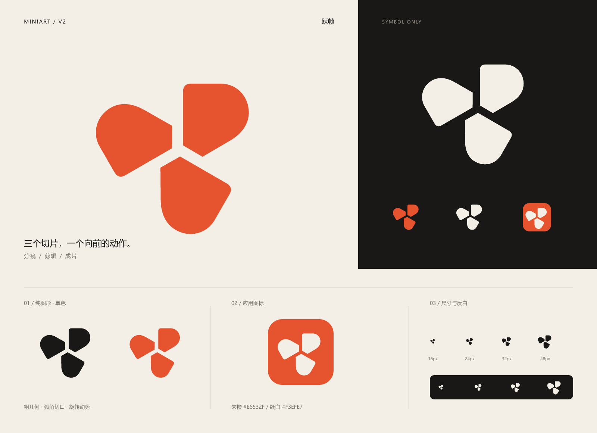

# Miniart V2 · 跃帧

2026-11-04，按用户要求新增第二版纯图形方案。[V1「折幕 M」](../README.md)及其全部素材保持原样，V2 独立保存。本次未替换应用中的 Logo 或 favicon。

## 概念

「跃帧」将三个弧角切片围绕共同中心旋转排布。切片像经过裁切的画面，整体借用镜头旋转与连续剪辑的动势，表达分镜、剪辑与成片的创作过程。中央留白与三个向外展开的切口构成结构性间隙，使各个画面既独立又组成整体。

本版采用纯图形，不使用文字、字母或字标。三个切片是抽象的画面符号，不表示三个固定功能或产品阶段。

将用户提出的“美式一点”落实为美国现代主义平面设计和独立电影海报常见的视觉表达：厚实块面、鲜明轮廓、硬切边与饱满曲线的组合，以及克制的高对比配色。使用朱橙增加创作品牌的活力，另备黑白版本适配现有工作台。

## 色彩

| 角色 | 色值 | 使用 |
| --- | --- | --- |
| 朱橙 | `#E6532F` | 彩色标志、应用图标背景 |
| 炭黑 | `#191816` | 浅色背景上的单色标志 |
| 纸白 | `#F3EFE7` | 深色背景上的反白标志 |

## 素材

| 文件 | 用途 |
| --- | --- |
| [miniart-v2-mark.svg](miniart-v2-mark.svg) | 透明背景、炭黑纯图形 |
| [miniart-v2-mark-light.svg](miniart-v2-mark-light.svg) | 透明背景、纸白纯图形 |
| [miniart-v2-mark-orange.svg](miniart-v2-mark-orange.svg) | 透明背景、朱橙纯图形 |
| [miniart-v2-mark-1024.png](miniart-v2-mark-1024.png) | 1024 × 1024 透明背景、炭黑图形 |
| [miniart-v2-app-icon.svg](miniart-v2-app-icon.svg) | 朱橙圆角底、纸白图形的应用图标 |
| [miniart-v2-app-icon-512.png](miniart-v2-app-icon-512.png) | 512 × 512 应用图标 |
| [miniart-v2-preview.png](miniart-v2-preview.png) | 1600 × 1160 展示板；其中的标题与说明不属于 Logo |

## 使用

- 优先使用 SVG，保留源画布留白并等比缩放。源画布为 256 × 256。
- 推荐显示尺寸为 24px 及以上；16px 已进行栅格化目视检查，小尺寸主要依靠三个块面构成的整体轮廓识别。
- 图形可见边缘之外至少保留源画布 24px 对应的净空；应用图标已内置安全留白。
- 中央切口保持透明，三片之间不连线，不填补空隙，不单独旋转其中一片。
- 单色版可通过内联 SVG 的 CSS `color` 设置前景色；作为 `img` 使用时选择对应文件。
- 不添加文字组合、描边、渐变或投影；朱橙版用于品牌展示，黑白版可融入现有中性色工作台。

## 验证

已查看完整展示板及深浅底下 16、24、32、48px 的栅格化结果。已核验 SVG XML 结构、无可见文字／字体／位图／脚本／外链依赖、PNG 尺寸与透明通道，并逐项比对 V1 原文件哈希。本次为品牌素材交付，未执行应用功能测试或实际页面替换后的浏览器验收。
