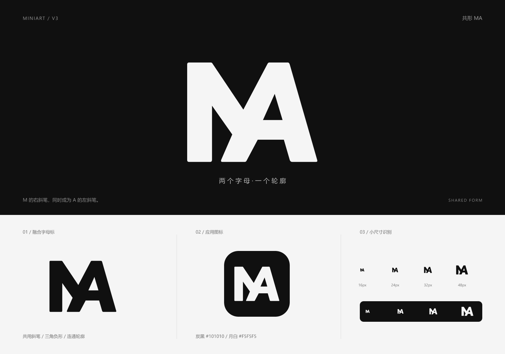

# Miniart V3 · 共形 MA

2026-11-04，按用户要求在 [V1「折幕 M」](../README.md)基础上制作 M 与 A 融合的字母标。V1 和 [V2「跃帧」](../v2/README.md)文件保持原样；本版独立保存，未替换应用中的 Logo 或 favicon。

## 设计

M 取自 Mini，A 取自 art。两个字母共用一条斜向主笔：它既是 M 从中央向右上升的笔画，也是 A 从峰顶向左下延伸的支撑。A 的横梁融入中央连接区域，三角内腔通过负形切出。最终由一个连通的实心轮廓构成，两个字母没有独立的分隔边界。

本版延续 V1 的厚实块面、微圆角、炭黑 `#101010` 与月白 `#F5F5F5`。为容纳 A 的内腔，将原 M 的右半边改为收尖的斜向结构，保留 M 上方的折线与负形。几何转折延续画面折叠和切口的抽象语言，与短剧创作工作台的视觉方向一致。

字母轮廓独立绘制，没有使用字体。展示板中的版本名、概念和尺寸标签仅供说明，不属于 Logo。

## 素材

| 文件 | 用途 |
| --- | --- |
| [miniart-v3-mark.svg](miniart-v3-mark.svg) | 透明背景、炭黑 MA 融合字母标 |
| [miniart-v3-mark-light.svg](miniart-v3-mark-light.svg) | 透明背景、月白 MA 融合字母标 |
| [miniart-v3-mark-1024.png](miniart-v3-mark-1024.png) | 1024 × 1024 透明背景字母标 |
| [miniart-v3-app-icon.svg](miniart-v3-app-icon.svg) | 炭黑圆角底、月白融合字母标 |
| [miniart-v3-app-icon-512.png](miniart-v3-app-icon-512.png) | 512 × 512 应用图标 |
| [miniart-v3-preview.png](miniart-v3-preview.png) | 1600 × 1120 深浅底、应用图标及尺寸展示板 |

## 使用

- 优先使用 SVG，源画布为 256 × 256，保留内置留白并等比缩放。
- 建议以 24px 及以上尺寸展示；16px 已进行栅格化目视检查，但 A 的三角内腔更适合在 24px 及以上观察。
- 在可见轮廓之外至少保留源画布 24px 对应的净空；应用图标已增加安全留白。
- 保持 A 的三角内腔透明；SVG 使用 `fill-rule="evenodd"` 实现真实镂空，不能填补或用背景色补画。
- 不拆分、错位或单独着色两个字母，不额外添加连接线，不拉伸、不旋转，不添加描边或阴影。
- `light` 是浅色前景版本，适合深底；作为 `img` 使用时选择对应文件。内联 SVG 可通过 CSS `color` 设置前景色。

## 验证范围

已渲染并查看完整展示板及深浅底下 16、24、32、48px 的栅格化效果。已核验 SVG XML 结构、无字体／位图／脚本／外链依赖，以及 PNG 尺寸和透明通道；使用栅格连通性检查确认主图形只有一个连通轮廓与一个封闭内腔。已逐项核对 V1、V2 文件哈希，确认原文件未变。

本次为品牌素材设计，没有运行应用功能测试，也未进行实际页面替换后的浏览器验收。
