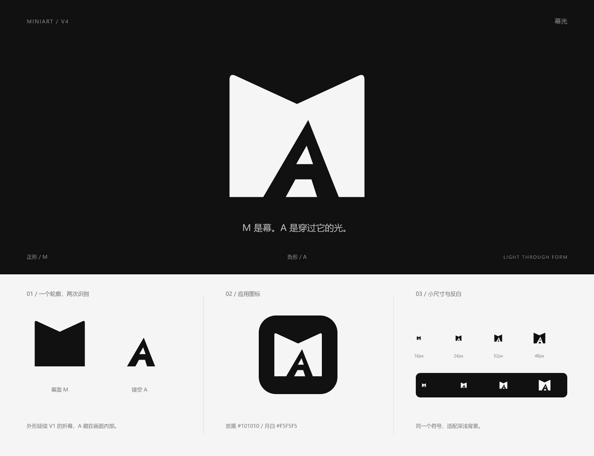

# Miniart V4 · 幕光

2026-11-04，用户认为 V3 的字母共笔缺少创意，要求重新设计。本版采用正负形的双重识别：实体构成 M，内部镂空构成 A。V1、V2、V3 原文件全部保留，本版未替换应用中的 Logo 或 favicon。

## 设计概念

**M 是幕，A 是穿过它的光。**

外轮廓延续 [V1](../README.md)的双侧折面，收成厚实的幕面 M。A 通过内部镂空呈现，略向右倾斜，上方收束、下方向外展开，像穿过幕面的光束。两个字母由实体与留白共同定义，观看时可以先读外轮廓，再发现隐藏的 A。

“幕与光”将 Miniart 的名称识别与短剧影像创作联系起来；M 对应 Mini，A 对应 art。整体保持炭黑 `#101010` 与月白 `#F5F5F5`，不依赖渐变、投影或附加图案。

A 的内腔与下方留白所形成的实体细节属于完整标志，不能随意删除。主图形为独立绘制的复合 SVG 路径，没有字体依赖。

## 素材

| 文件 | 用途 |
| --- | --- |
| [miniart-v4-mark.svg](miniart-v4-mark.svg) | 透明背景、炭黑图形 |
| [miniart-v4-mark-light.svg](miniart-v4-mark-light.svg) | 透明背景、月白图形 |
| [miniart-v4-mark-1024.png](miniart-v4-mark-1024.png) | 1024 × 1024 透明背景图形 |
| [miniart-v4-app-icon.svg](miniart-v4-app-icon.svg) | 炭黑圆角底、月白图形的应用图标 |
| [miniart-v4-app-icon-512.png](miniart-v4-app-icon-512.png) | 512 × 512 应用图标 |
| [miniart-v4-preview.png](miniart-v4-preview.png) | 1600 × 1230 概念、正负形及尺寸展示板 |

展示板中的 M 幕面、A 镂空图解仅用于解释形状关系；正式使用完整标志，不将图解排列作为字标使用。

## 使用

- 源画布为 256 × 256，优先使用 SVG 并保留内置留白。
- 建议显示尺寸至少 24px；32px 及以上更适合观察负形 A 的完整细节。16px 已目视检查，主要依赖整体轮廓识别。
- 在图形可见边缘外至少保留源画布 24px 对应的净空，应用图标已带安全留白。
- 镂空区域是真实透明区域，使用 `fill-rule="evenodd"` 实现；不填补镂空，不用背景色覆盖模拟，不删除 A 内腔形成的实体细节。
- 深底使用 `light` 版本，浅底使用炭黑版本。内联 SVG 可通过 CSS `color` 设置前景色。
- 不拆分字母、不拉伸、不旋转、不添加描边或阴影。

## 验证范围

已查看完整展示板及深浅底下 16、24、32、48px 栅格化效果，并检查 SVG XML 结构、无可见文字／位图／字体／脚本／外链依赖、PNG 尺寸与透明通道。已核对 A 镂空与内腔实体的像素，并逐项比对 V1、V2、V3 文件哈希，确认原文件未变。

本次仅交付品牌素材，没有运行应用功能测试，也未进行替换后页面的浏览器验收。
