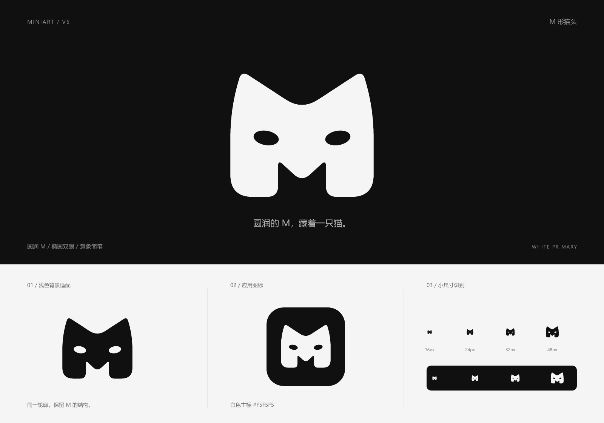

# Miniart V5 · M 形猫头

2026-11-05，根据用户明确要求制作：以 M 为主体，两个顶部角下方各有一个椭圆形眼睛，整体圆润、白色为主，形成意象简笔的猫头。V1 至 V4 文件保持原样，本版没有替换应用界面或 favicon。

## 设计

M 的上方两角收成圆润猫耳，中间凹弧构成额头；两侧笔画与底部圆角保持 M 的识别。保留下方开口，使猫头意象和字母结构共用一个轮廓。

两枚略微倾斜的椭圆眼睛位于两侧猫耳下方，采用透明镂空实现。造型仅由轮廓与双眼组成，保持简笔表达。

白色 `#F5F5F5` 为主标颜色，主要展示在炭黑 `#101010` 背景上；另提供适用于浅色背景的深色版本。图形独立绘制，无字体依赖。

## 文件

| 文件 | 用途 |
| --- | --- |
| [miniart-v5-mark.svg](miniart-v5-mark.svg) | 主版本：透明背景、白色 M 形猫头 |
| [miniart-v5-mark-dark.svg](miniart-v5-mark-dark.svg) | 浅色背景适配：透明背景、炭黑图形 |
| [miniart-v5-mark-1024.png](miniart-v5-mark-1024.png) | 1024 × 1024 白色主标，背景透明 |
| [miniart-v5-app-icon.svg](miniart-v5-app-icon.svg) | 炭黑圆角底、白色猫形 M 的应用图标 |
| [miniart-v5-app-icon-512.png](miniart-v5-app-icon-512.png) | 512 × 512 应用图标 |
| [miniart-v5-preview.png](miniart-v5-preview.png) | 1600 × 1120 主标、浅底适配及尺寸展示板 |

本版 `mark.svg` 是白色主标，与早期版本默认炭黑的命名约定不同；文件用途以本表为准。

## 使用

- 优先使用 SVG，源画布为 256 × 256。保留内置留白，等比缩放。
- 推荐显示尺寸为 24px 及以上；16px 已目视检查，眼睛细节会受到实际屏幕像素密度影响。
- 在可见轮廓外至少保留源画布 24px 对应的净空，应用图标已增加安全留白。
- 眼睛是透明孔洞，使用 `fill-rule="evenodd"` 实现，保留真实透明，不用背景色覆盖模拟。
- 白色主标用于深底，深色版用于浅底。内联 SVG 可通过 CSS `color` 设置前景色。
- 不单独移动眼睛，不添加鼻子、嘴、胡须、瞳孔、描边、投影或渐变；展示板的文字说明不属于 Logo。

## 验证范围

已查看完整展示板及深浅背景下 16、24、32、48px 的栅格化效果，检查 SVG XML 结构、无字体／位图／脚本／外链依赖、PNG 尺寸与透明通道，并检查主图形只有一个连通实体、两个封闭眼孔。已逐项核对 V1 至 V4 文件哈希，确认旧文件没有变化。

本次仅交付品牌素材，未运行应用功能测试或实际替换后页面的浏览器验收。
