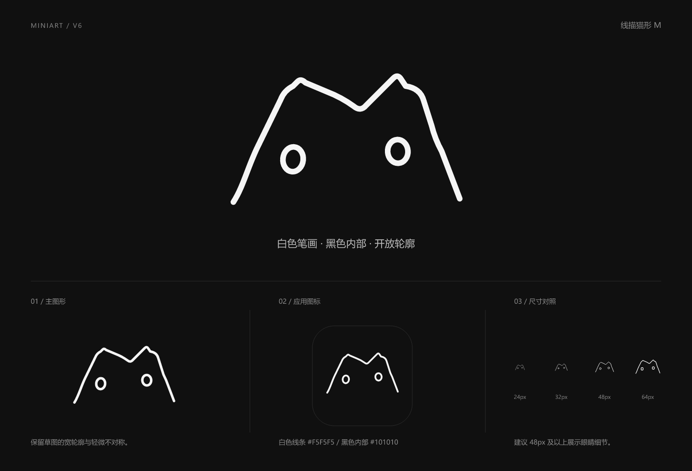

# Miniart V6 · 线描猫形 M

2026-11-05，根据用户提供的手绘草图重新绘制。用户进一步明确“笔画的颜色是白色，身体内部是黑色”。本版以该草图为造型依据，保留双角、中央凹口、向下舒展的两侧，以及两个空心眼睛。V1 至 V5 原文件保留，本版未替换项目界面或 favicon。

## 造型

白色线描构成开放底部的 M 猫头轮廓，身体内部为炭黑。两只椭圆眼睛也采用白色描边、黑色内部。保留草图中右侧略高、双眼轻微错位的特点，并将手绘锯齿整理为平滑曲线。

不画底部白色横线，不增加下巴、嘴、鼻子或胡须。黑色填充通过独立闭合路径实现，外轮廓描边仍保持开放；眼睛采用椭圆描边，无字体依赖。

## 素材

| 文件 | 用途 |
| --- | --- |
| [miniart-v6-mark.svg](miniart-v6-mark.svg) | 白色轮廓、黑色内部，身体外部透明 |
| [miniart-v6-mark-1024.png](miniart-v6-mark-1024.png) | 1024 × 1024 透明画布主图形 |
| [miniart-v6-app-icon.svg](miniart-v6-app-icon.svg) | 炭黑圆角底应用图标 |
| [miniart-v6-app-icon-512.png](miniart-v6-app-icon-512.png) | 512 × 512 应用图标 |
| [miniart-v6-preview.png](miniart-v6-preview.png) | 1440 × 980 图形、应用图标及尺寸展示板 |

## 使用

- 源画布 256 × 256，白色线条 `#F5F5F5`，黑色内部 `#101010`。
- 轮廓与眼睛统一使用 5 个源画布单位的线宽，端头、连接处圆润处理；等比缩放，不单独改变线宽。
- 以深色背景展示为主，推荐宽度至少 48px；24px、32px 已渲染查看，线条与眼睛细节在这些尺寸下较弱。
- 黑色身体与眼睛内部是实际填充，不是透明孔洞。图形外围保持透明，应用图标另带黑色圆角底。
- 不为开放底部添加白色封口，不将身体改为白色实心，不添加额外表情细节。
- 图形可见边缘外建议至少留出源画布 16px 对应的空间。预览中围住应用图标的细框仅用于区分展示区域，不属于导出的应用图标。

## 验证范围

已查看完整展示板及 24、32、48、64px 的栅格化结果，检查 SVG XML、开放描边与椭圆结构、无字体／位图／脚本／外链依赖，以及 PNG 尺寸、透明外围、黑色身体和眼睛内部。已比对 V1 至 V5 文件哈希，确认旧文件未变。

本次仅交付品牌素材，没有运行应用功能测试或实际替换后的浏览器验收。
