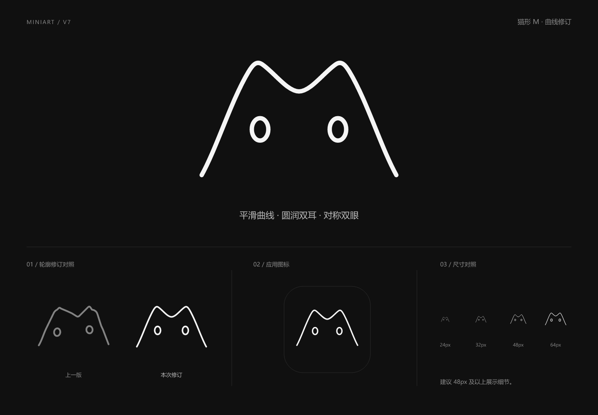

# Miniart V7 · 猫形 M 曲线修订

2026-11-05，用户明确手绘图仅表达造型意图，线条不平滑来自人工绘制，不应原样保留。本版重新设计曲线与比例，延续白色线描 M 猫头、黑色内部和椭圆空心双眼。V1 至 V6 文件保持原样，未替换应用界面或 favicon。

## 调整

- 双耳、中央凹口及两侧轮廓由六段三次贝塞尔曲线组成，五处衔接保持相同切线方向，去掉上一版肩部的小折角。
- 轮廓以画布中心为轴对称，双耳统一圆润度；两侧向下自然舒展，底部继续开放。
- 双眼统一为同尺寸、同高度的竖椭圆，位置对应两侧耳峰下方。
- 描边统一为源画布 4.5px，使用圆端头；白色 `#F5F5F5`，内部黑色 `#101010`。

## 素材

| 文件 | 用途 |
| --- | --- |
| [miniart-v7-mark.svg](miniart-v7-mark.svg) | 主图形，身体外围透明 |
| [miniart-v7-mark-1024.png](miniart-v7-mark-1024.png) | 1024 × 1024 透明画布主图形 |
| [miniart-v7-app-icon.svg](miniart-v7-app-icon.svg) | 黑色圆角底应用图标 |
| [miniart-v7-app-icon-512.png](miniart-v7-app-icon-512.png) | 512 × 512 应用图标 |
| [miniart-v7-preview.png](miniart-v7-preview.png) | 1440 × 1000 展示板，含上一版与本次修订对照 |

## 使用与验证

源画布为 256 × 256。等比缩放并保留内置留白；推荐宽度至少 48px，24px、32px 的细线和眼睛细节较弱。黑色身体与眼睛内部为实际填充，底部没有白色封口，不增加嘴、鼻子或胡须。展示板围住应用图标的细框仅供展示，不属于图标素材。

已检查完整展示板及 24、32、48、64px 的栅格化效果、SVG XML 结构、五处曲线衔接方向、双眼几何一致性、PNG 尺寸与像素颜色，并核对 V1 至 V6 文件哈希。素材不依赖字体、位图、脚本或外链。

本次仅交付品牌素材，未运行应用功能测试或实际替换后页面的浏览器验收。
