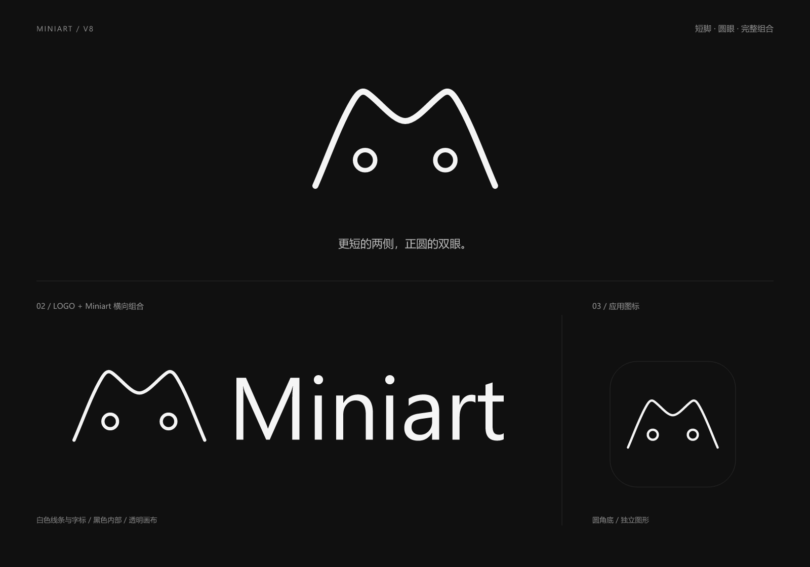

# Miniart V8 · 短脚圆眼与完整组合

2026-11-05，按用户要求缩短 M 的两侧脚边、将双眼改为正圆，并交付独立 Logo、Logo + Miniart 横向组合、应用图标。白色线条、黑色内部、底部开放和顺滑轮廓保持延续。V1 至 V7 文件原样保留，本版未替换项目界面或 favicon。

## 调整

两侧曲线沿 V7 原有曲线对称裁短，端点由源坐标 `y=180` 调整至约 `y=158.62`；保留双耳和中央凹口的形状，五处曲线连接继续保持切线方向一致。

双眼为半径 10 的正圆，中心同高、左右对称。颜色为月白 `#F5F5F5`；身体及双眼内部为炭黑 `#101010`。

2026-11-05 按用户后续要求，仅将独立 Logo 的 M 外轮廓由源画布 4.5px 加粗至 6px；眼睛仍为 4.5px。独立 Logo 的 SVG、PNG 与展示板同步更新，横向组合及应用图标保持 4.5px 原线宽。

横向组合在独立图形右侧使用 **Miniart**，保留指定大小写。字标基于 Segoe UI Regular 绘制并转为路径，不依赖字体安装，未分发字体文件。较轻字重与图形的线描粗细相呼应。

## 素材

| 类型 | SVG | PNG |
| --- | --- | --- |
| 独立 Logo | [miniart-v8-mark.svg](miniart-v8-mark.svg) | [1024 × 622](miniart-v8-mark-1024.png) |
| Logo + Miniart 横向组合 | [miniart-v8-logo.svg](miniart-v8-logo.svg) | [1600 × 339](miniart-v8-logo-1600.png) |
| 应用图标 | [miniart-v8-app-icon.svg](miniart-v8-app-icon.svg) | [512 × 512](miniart-v8-app-icon-512.png) |
| 完整预览 | — | [1600 × 1120](miniart-v8-preview.png) |

## 使用

- 独立 Logo 和横向组合的外围画布透明，身体及眼睛内部为实际黑色填充；应用图标带炭黑圆角底。
- 主图形采用紧凑画布：独立 Logo 的 SVG 尺寸为 448 × 272，`viewBox` 为 `16 43 224 136`；横向组合为 472 × 100，`viewBox` 为 `0 30 472 100`；应用图标为 256 × 256。
- 等比缩放，不将独立 Logo 强制压成正方形；需要方形素材时直接使用应用图标。
- 独立 Logo 建议宽度至少 48px，横向组合建议宽度至少 240px。较小显示时眼睛和线条细节会变弱。
- 保留画布留白，不单独调整线宽，不给底部加白色横线，不改变双眼为椭圆，不分开移动组合中的字标。
- 主要用于深色背景。展示板围住应用图标的细框仅供区分展示区域，不属于导出图标。

## 验证范围

已检查完整展示板、32／48／64／96px 独立图形及横向组合的实际尺寸渲染；核验 SVG XML、五处曲线连接方向、两个正圆的几何与对称位置、开放底部、字标无字体依赖、PNG 尺寸与透明通道，并比对 V1 至 V7 文件哈希。

本次为品牌素材交付，未运行应用功能测试或实际替换后的浏览器验收。
