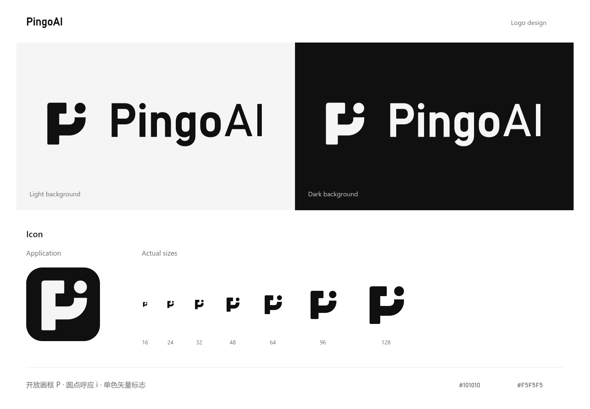

# PingoAI 品牌资产

用户于 2026-10-27 确认项目名为 **PingoAI**，保留此大小写。图形由开放画框式的 P 和独立圆点构成，圆点呼应名称中的 i。

## 文件

| 文件 | 用途 |
| --- | --- |
| [pingoai-icon.svg](pingoai-icon.svg) | 透明背景、炭黑图形，用于浅色背景 |
| [pingoai-icon-light.svg](pingoai-icon-light.svg) | 透明背景、月白图形，用于深色背景 |
| [pingoai-logo.svg](pingoai-logo.svg) | 透明背景、炭黑横向组合标志 |
| [pingoai-logo-light.svg](pingoai-logo-light.svg) | 透明背景、月白横向组合标志 |
| [pingoai-app-icon.svg](pingoai-app-icon.svg) | 炭黑圆角背景的应用图标 |
| [pingoai-app-icon-512.png](pingoai-app-icon-512.png) | 512 × 512 应用图标预览 |
| [pingoai-logo-1600.png](pingoai-logo-1600.png) | 1600px 宽、透明背景的组合标志 |
| [pingoai-preview.png](pingoai-preview.png) | 深浅背景与实际尺寸对照 |

## 使用

- 主色为炭黑 `#101010` 与月白 `#F5F5F5`，与当前工作台的中性色调对应。
- 图形源画布为 256 × 256；图形与字标采用填充轮廓，不含位图和外部字体。
- 单独图形建议显示宽度为 24px 以上；16px 已渲染检查，适合空间受限的图标位置。横向组合标志建议宽度至少 160px。
- 使用 SVG 中已有的留白，等比缩放；在图形可见边缘之外保留至少一个圆点直径的空间。
- `*-light.svg` 的 light 指浅色前景，适合深色背景。作为 `img` 使用时选对应文件；内联 SVG 可以直接设置根元素的 CSS `color`。
- 字标基于 Bahnschrift 绘制并转为轮廓；i 的圆点经过单独调整，与图形圆点呼应。未分发字体文件。

设计依据、调研来源与验证范围见[标志方案](../../../design/2026-10-27-PingoAI与Artcos标志方案.md)。
