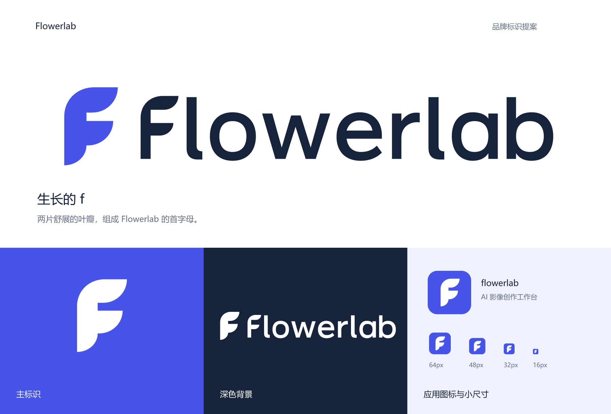

# Flowerlab · 新版标识

2026-10-28。按本次选定的「现代创意工具：简洁、有辨识度，适合软件品牌」方向设计。

## 概念：生长的 f

两片向右舒展的叶瓣组成 Flowerlab 的首字母 **f**，下端以曲线收束。以字母建立识别，以叶瓣回应名称中生长、创作的意味。主图形是一个连续的实心轮廓，依靠外形和两片叶瓣之间的开口辨识。

字标固定拼写为 **flowerlab**，全部小写，逐字绘制为矢量路径。字母 f 延续图形的叶瓣形状，o、e、a、b 使用相同的圆弧语言，l 的弯脚帮助区分相邻字母。

## 色彩

| 颜色 | HEX | 用途 |
| --- | --- | --- |
| 鸢尾蓝 | `#4655E8` | 主图形、应用图标底色 |
| 深蓝墨 | `#17233B` | 浅底字标、深色展示背景 |
| 雾蓝白 | `#F0F2FF` | 浅底应用图标、展示底色 |
| 白色 | `#FFFFFF` | 深底反白图形与字标 |
| 黑色 | `#000000` | 单色印刷与水印 |

## 文件

以下相对链接均指向本目录中的交付文件。

| 文件 | 用途 |
| --- | --- |
| [总览 PNG](flowerlab-overview.png)、[总览 SVG](flowerlab-overview.svg) | 查看完整设计、深浅底和小尺寸效果 |
| [横版组合 SVG](flowerlab-lockup.svg)、[横版组合 PNG](flowerlab-lockup.png) | 图形与字标组合；PNG 为透明底，2400 × 512 |
| [反白组合 SVG](flowerlab-lockup-inverse.svg)、[反白组合 PNG](flowerlab-lockup-inverse.png) | 深色背景中的组合标识；PNG 为透明底 |
| [单色组合 SVG](flowerlab-lockup-mono.svg) | 单色输出 |
| [独立字标 SVG](flowerlab-wordmark.svg) | 仅展示产品名称 |
| [主图形 SVG](flowerlab-mark.svg)、[透明 PNG](flowerlab-mark-1024.png) | 独立标识，PNG 为 1024 × 1024 |
| [单色图形 SVG](flowerlab-mark-mono.svg)、[单色透明 PNG](flowerlab-mark-mono-1024.png) | 黑色图形 |
| [反白图形 SVG](flowerlab-mark-inverse.svg)、[反白透明 PNG](flowerlab-mark-inverse-1024.png) | 白色图形，需放在深底上查看 |
| [应用图标 SVG](flowerlab-icon.svg) | 鸢尾蓝圆角方形底、白色图形 |
| [1024](flowerlab-icon-1024.png)、[512](flowerlab-icon-512.png)、[256](flowerlab-icon-256.png) | 应用图标、品牌头像、大图展示 |
| [64](flowerlab-icon-64.png)、[48](flowerlab-icon-48.png)、[32](flowerlab-icon-32.png)、[16](flowerlab-icon-16.png) | 工具栏、侧栏和浏览器标签图标，单位为 px |
| [浅底图标 SVG](flowerlab-icon-light.svg)、[浅底图标 PNG](flowerlab-icon-light-1024.png) | 雾蓝白底、蓝色图形 |

正式 SVG 均不依赖字体、外部图片或脚本。总览中的说明文字也已转为路径；标识和字标可直接在矢量设计工具中继续编辑。

## 使用建议

- 应用图标最小建议 16px；独立图形建议从 24px 起使用；横版组合建议宽度至少 180px。
- 小尺寸直接使用对应 PNG，或由 SVG 按最终尺寸渲染。
- 横版组合周围建议保留至少字标小写字母高度三分之一的空白。
- 图形与字标保持原始比例和既定间距。深色背景优先使用反白版。

## 验证范围

已查看整体设计，以及图标和独立图形在 16、24、32、48、64、128px 下的深浅底渲染；已检查交付 PNG 的尺寸与透明通道、SVG 的独立可渲染性、本文链接和原始文件保留情况。

本次交付为设计资产，应用代码未接入新版标识；未执行应用功能测试。图形与字标直接绘制为矢量路径，PNG 由矢量文件渲染导出，未调用图像生成 API。
