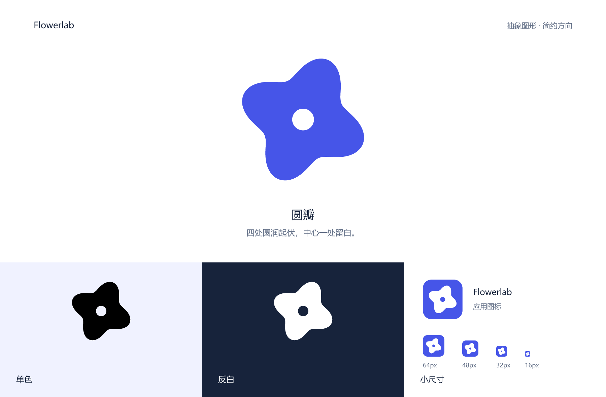

# Flowerlab · 圆瓣

2026-10-28。本轮方向：简约、纯图形，不以字母或首字母构成标识。

## 图形

四处圆润起伏，中心一处圆形留白。花瓣收成连续、紧凑的轮廓，以圆弧与留白表达 Flowerlab 的花形意象。图形没有细线、描边或叠色，在蓝色、黑色和反白输出中使用同一轮廓。

主色为鸢尾蓝 `#4655E8`，深底为 `#17233B`，浅底为 `#F0F2FF`。总览中的产品名称与说明文字仅用于展示，不属于标识图形。

## 文件

| 文件 | 用途 |
| --- | --- |
| [总览 PNG](flowerlab-overview.png)、[总览 SVG](flowerlab-overview.svg) | 完整展示与深浅底对照 |
| [主图形 SVG](flowerlab-mark.svg)、[透明 PNG](flowerlab-mark-1024.png) | 独立图形，PNG 为 1024 × 1024 |
| [黑色 SVG](flowerlab-mark-mono.svg)、[黑色透明 PNG](flowerlab-mark-mono-1024.png) | 单色输出 |
| [反白 SVG](flowerlab-mark-inverse.svg)、[反白透明 PNG](flowerlab-mark-inverse-1024.png) | 深色背景使用 |
| [应用图标 SVG](flowerlab-icon.svg) | 蓝底白色图形，圆角方形 |
| [浅底图标 SVG](flowerlab-icon-light.svg)、[浅底图标 PNG](flowerlab-icon-light-1024.png) | 浅底蓝色图形 |
| [1024](flowerlab-icon-1024.png)、[512](flowerlab-icon-512.png)、[256](flowerlab-icon-256.png) | 大图标、品牌头像，单位为 px |
| [64](flowerlab-icon-64.png)、[48](flowerlab-icon-48.png)、[32](flowerlab-icon-32.png)、[16](flowerlab-icon-16.png) | 工具栏、侧栏与浏览器标签图标，单位为 px |

独立图形建议从 24px 起使用，应用图标可从 16px 起使用。保持原始比例，图形周围建议至少留出中心圆孔直径一半的空白。

全部 SVG 可独立渲染，不依赖字体、外部图片或脚本；总览文字已转为路径。PNG 从矢量稿直接渲染，独立图形保留透明背景及中心透明孔。

## 验证范围

已查看图形和应用图标在 16、24、32、48、64、128px 下的深浅底效果；已核对 PNG 尺寸、透明通道、SVG 渲染与本文链接，并校验此前版本文件的哈希值。

本次为设计素材交付，未接入应用界面，未执行应用功能测试；未调用图像生成 API。
