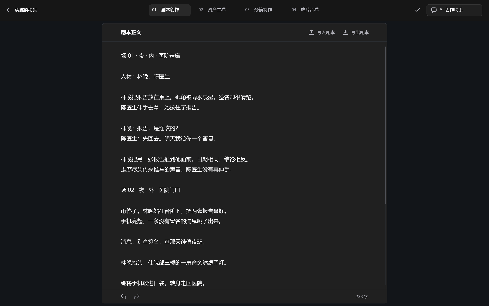
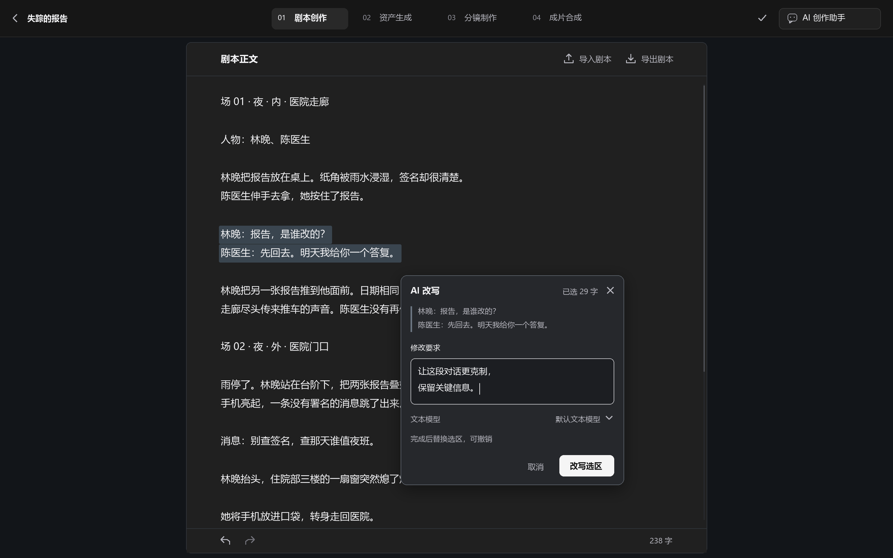
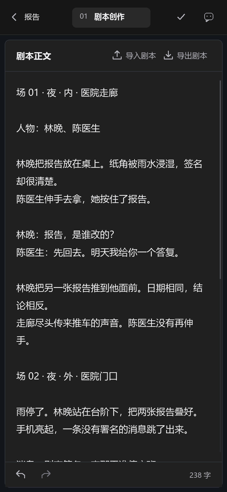

# 剧本正文单页聚焦设计

> 后续实施记录（2026-10-27）：页面已按本方案改版，代码范围、实际截图及验证边界见[剧本单页聚焦改版验收](../reviews/2026-10-27-剧本单页聚焦改版验收.md)。以下保留设计交付时的原始记录。

> 日期：2026-10-27。状态：设计提案，尚未实施。适用：创作模式 `/projects/:id/source`。
> 本文定义这次精简改版的目标，不表示当前页面已经具有图示行为。设计方法采用 impeccable 与 frontend-design；现状以本次读取的工作区源码和接口为准。

## 1. 设计结论

**页面只围绕一篇可直接编辑的剧本展开。中央是连续正文，两侧是安静的冷灰留白；AI 改写跟随选区出现。**

创作者进入页面后，可以立即写作、粘贴或导入剧本，不需要先选择文档类型、填写故事设定或启动生成。正文标题行仅保留“导入剧本”“导出剧本”两个文件操作。日常编辑依靠熟悉的选字、复制、粘贴、撤销与自动保存。

本页属于 **Operate**：服务于中文短剧创作者持续读稿、改台词和局部润色。高级感来自稳定的阅读宽度、清晰的文字、准确的间距和克制的工具，而不是增加装饰。

“便携”在本方案中落实为两个结果：桌面上随手编辑，窄屏和触屏上仍能完成导入、改写、撤销与导出。

### 本次范围

| 对象 | 目标行为 |
| --- | --- |
| 左侧“小说原文 / 故事大纲 / 剧本正文” | 移除整块目录及其切换逻辑；窄屏也不保留对应目录按钮或抽屉 |
| 中间剧本正文 | 成为唯一编辑文档，保持完整连续，不按场拆成卡片 |
| “生成剧本”及其他来源生成入口 | 从本页移除，包括空态文案、弹窗入口和快捷入口 |
| 导入、导出 | 保留，统一显示完整名称“导入剧本”“导出剧本” |
| AI 修改 | 保留选区能力，面向用户统一命名为“AI 改写” |
| 底部“进入素材提取” | 移除重复导航；继续通过顶部“资产生成”进入下一阶段 |
| 顶部四阶段、作品名称、保存状态 | 沿用现有工作台外壳 |
| 顶部“AI 创作助手” | 保留现有独立入口，默认关闭；它与被移除的“生成剧本”是不同功能 |
| 历史小说、大纲数据 | 本次仅移除页面入口，不删除数据、表或兼容 API |
| 其他三个阶段、无限画布 | 不在本次设计范围内 |

## 2. 现状依据与改版重点

已核对 [产品范围](../../frontend/PRODUCT.md)、[设计约定](../../frontend/DESIGN.md)、[剧本工作台接口](../api/writing-workspace.md)及以下实现：

- [ScriptDesk](../../frontend/src/features/projects/script-desk/ScriptDesk.tsx)：240px 三文档目录、导入导出、生成入口、任务条和底栏。
- [ScriptSceneEditor](../../frontend/src/features/projects/script-desk/ScriptSceneEditor.tsx)：单个 textarea、同度量显示层、中文输入、选区浮钮与会话内撤销。
- [NovelScriptGeneration](../../frontend/src/features/projects/NovelScriptGeneration.tsx)：整篇生成弹窗和选区修改浮层。
- [写作请求](../../frontend/src/features/projects/script-desk/writing-requests.ts)：选区快照、版本及 Unicode 区间转换。
- [写作生成服务](../../backend/src/short_drama/service/writing_generation_service.py)：冻结来源、整篇目标锁、精确替换和任务回写。

当前已具备连续编辑、自动保存、TXT 导入导出、选区修改及单步撤销的基础。最值得调整的是页面的信息层级和交互可见性，无需先替换编辑器框架。

历史设计截图仍包含场次目录、格式条、候选或故事设定；它们与当前代码已经不同，仅作为视觉背景。本次示意图重新绘制，不是当前应用截图，也不是已接通功能的交互原型。图内剧本是排版用示例；顶部外壳仅示意其位置，实际沿用现有实现。图片以两倍尺寸导出，桌面和手机的逻辑视口分别为 1440×900、390×844。

| 现状 | 本次设计处理 |
| --- | --- |
| 三个文档入口占据左侧，正文中心偏移 | 去掉目录，正文在可用工作区内居中 |
| 正文和周边表面接近同色 | 正文稍亮、两侧略冷，通过大面积底色区分层次 |
| 顶部最醒目的动作是生成 | 顶部只有两个低强调文件操作；写作本身成为默认动作 |
| 改写要求层出现后，原选区不够明确 | 保持选区高亮，同时显示准确范围摘要 |
| 撤销主要依赖快捷键 | 底栏提供小型撤销、重做按钮，覆盖鼠标与触屏 |
| 任务提示建议编辑其他文档 | 改为说明当前剧本暂时只读，进度放入固定底栏 |

## 3. 页面布局

### 3.1 桌面默认态



```text
┌──────────────────── 现有 60px 工作台顶栏 ────────────────────┐
│ 作品名        剧本创作 / 资产生成 / 分镜制作 / 成片合成  保存 助手 │
├──────────────┬───────────────────────────┬─────────────────┤
│              │ 剧本正文       导入剧本  导出剧本 │                 │
│              ├───────────────────────────┤                 │
│              │                           │                 │
│ 冷灰留白     │ 场 01 · 夜 · 内 · 医院走廊 │ 冷灰留白        │
│              │                           │                 │
│              │ 林晚把报告放在桌上。      │                 │
│              │ 林晚：报告，是谁改的？    │                 │
│              │                           │                 │
│              │ 一篇连续、可自由编辑的正文 │                 │
│              │                           │                 │
│              ├───────────────────────────┤                 │
│              │ 撤销 重做          字数   │                 │
└──────────────┴───────────────────────────┴─────────────────┘
```

布局由三种区域构成，但只有中央是功能区：

1. **工作台顶栏**：保留现有阶段定位、保存状态和助手入口。
2. **中央文档**：标题与文件操作、正文、底栏组成一个连续表面。标题、正文起始位置与底栏左侧对齐。
3. **两侧留白**：仅用于衬托正文，不承载目录、卡片、推荐、AI 输入框或额外按钮。

正文始终左对齐，整张文档居中。长行自然换行，遵循中文标点避头尾规则，不两端强制对齐，不拉大中文字符间距。正文从头连续到底，不制造 A4 分页、页码、纸张阴影或中断阅读的分场卡片。

### 3.2 尺寸与滚动

以 **实际剧本区域的容器宽度** 判断布局，不能只看浏览器宽度。打开已有 AI 创作助手后，正文在剩余区域重新居中。

| 项目 | 规格 |
| --- | --- |
| 外层工作区 | 沿用满高布局及 8px 外围留白 |
| 桌面文档宽度 | 容器宽 ≥1000px 时为 840px；1920px 屏幕也不继续拉宽 |
| 桌面正文内距 | 左右 56px，上 32px，下 64px；实际文字宽 728px |
| 中等宽度 | 容器宽 700–999px：文档宽 `min(840px, 容器宽 - 32px)`，正文左右内距 32px |
| 窄屏 | 容器宽 <700px：文档填满容器，正文左右内距 20px；≤360px 时为 16px |
| 文档标题行 | 54px；左右内距与正文对齐 |
| 文档底栏 | 桌面 40px，触屏至少 44px；手机增加底部安全区 |
| 控件 | 桌面可见高度 32px；触屏点击范围至少 44×44px |
| 正文滚动 | 标题行和底栏固定，仅正文纵向滚动；页面外层不出现第二根纵向滚动条 |
| 圆角 | 文档外框 8px，按钮 7px，改写浮层 10px |

1440px 视口、外围 8px 时，840px 文档两侧各有 292px 留白；1920px 时各有 532px。留白扩大不会增加正文每行的阅读距离。16px 中文正文每行约 45 个全角字，手机约 20–22 个。

不新增“专注模式”开关：默认状态就是专注状态。用户主动打开助手时，沿用既有侧列／抽屉机制，局部改写不另开一列。

## 4. 视觉规范

### 4.1 六个基础色

沿用项目炭黑工作台及近白操作色，只为剧本区域补充局部底色与选区色，不修改其他页面的全局主题。

| 名称 | 色值 | 用途 |
| --- | --- | --- |
| 冷灰留白 | `#121519` | 中央正文两侧，微冷、低明度 |
| 正文炭灰 | `#202020` | 中央文档底，包括标题与底栏 |
| 正文白 | `#F3F3F5` | 正文、标题、关键操作文字 |
| 辅助灰 | `#B4B4BC` | 字数、次级图标、范围和模型说明 |
| 细边线 | `#30343A` | 文档边界、标题与底栏分隔 |
| 选区蓝灰 | `#3A454F` | 文本选择与要求层打开后的选区标记 |

近白主按钮继续使用全局 `accent-fill / on-accent`（`#F5F5F5 / #171717`）；悬停、焦点、成功、警告、错误也复用项目语义色。细边线只负责非交互分区；输入边界和键盘焦点沿用对比更强的全局控件 token。

中央表面比两侧略亮，让正文成为视线落点。两侧保持同色、对称，不做一冷一暖的拼色，不使用渐变、光晕或材质纹理。

### 4.2 字体与节奏

| 层级 | 字体与尺寸 | 使用规则 |
| --- | --- | --- |
| 正文 | 现有系统字体栈，16px / 1.9，400 | 保持长期中文编辑的熟悉感，不引入展示字体或字体下载 |
| 文档标题 | 15px / 1.4，600 | 仅“剧本正文”，不重复放大作品名称 |
| 操作 | 13px / 1.5，500 | 图标配中文；导入、导出同等强调 |
| 辅助信息 | 12px / 1.5，400 | 字数、模型与选区范围，不低于 12px |

字体栈沿用 `"Segoe UI", "PingFang SC", "Microsoft YaHei", sans-serif`。正文不加入等宽字体、强制缩进、自动加粗人物名或花式场头。用户输入的段落、空行和场次格式就是文档结构。

只有用户打开改写要求层时，“改写选区”使用近白实心按钮。日常编辑态没有抢眼的主 CTA。

### 4.3 方向校准

最初容易出现的方案是“白纸卡片 + 两侧工具栏 + 常驻 AI 面板”。本次将其收敛为深色连续文档：既匹配已有工作台，也符合删除左栏、聚焦中间正文的要求。场次卡片、格式条和候选对比均会重新增加管理负担，本版不引入。

本页最有辨识度的细节只有一个：**选中文字后，改写工具就地出现；结束后，页面回到完整正文。**

## 5. 正文编辑器

### 5.1 编辑的基本约定

- 一个连续编辑区域，支持跨段、跨场选择、粘贴、剪切和删除；没有标准场头的文字也可以完整编辑。
- 保留空格、空行、标点和手动换行；粘贴按纯文本处理，不从 Word 或网页带入字体样式。
- 中文输入法组合期间不保存半成品、不触发 AI 浮钮；组合结束后再记录编辑事务。
- 自动保存继续使用现有串行队列、版本保护和离开页面保护；不新增“保存”按钮，不逐次弹“保存成功”。
- 整篇只有一个可访问输入区域。显示层对辅助技术隐藏；输入层与显示层在字体、换行、滚动和缩放下必须完全重合。
- 底栏左侧固定撤销、重做两个小图标，具有文字提示和可访问名称；不可用时保留位置并禁用。它们属于编辑控制，不进入顶部文件操作组。
- 保留当前会话的插入点、滚动位置和撤销栈，不能因打开改写层或改变容器宽度而重建编辑器。

字数沿用现有正文统计口径：不计空白，按 Unicode 码点统计；使用辅助灰显示。不要增加预计时长、目标字数、钩子数量、人物统计或完成度。

### 5.2 常用快捷操作

| 操作 | 行为 |
| --- | --- |
| 拖动、双击、Shift + 方向键 | 遵循系统文本选择习惯，不接管为场次选择 |
| Ctrl/Cmd + A | 编辑器获得焦点时选择整篇正文 |
| Ctrl/Cmd + Z | 撤销最近一次编辑；一次 AI 替换、一次导入各为一个事务 |
| Ctrl/Cmd + Shift + Z；Windows Ctrl + Y | 重做 |
| Ctrl/Cmd + K | 有有效选区时打开 AI 改写；无选区时就近提示“先选中需要改写的文字” |
| Escape | 先关当前菜单，再关闭改写层，恢复选区和编辑器焦点 |

快捷键只在编辑器作用域生效，不全站拦截浏览器快捷键。初版不额外加入格式工具栏、斜杠指令、字号面板或场次管理。

### 5.3 撤销边界

改写成功后保留新文字的短暂范围标记，底栏提供可见撤销入口；一次撤销恢复改写前内容，再通过正常队列保存。之后有人工编辑时，撤销按真实编辑顺序执行，不能跳过新输入直接回滚整篇。

当前历史为会话内、最多 100 条记录。设计不把它描述成持久版本管理，也不承诺刷新后仍可撤销；跨刷新任务恢复和撤销历史是不同能力。

## 6. 选区与 AI 改写

### 6.1 选择范围

默认态不出现 AI 改写按钮。用户选中非空文字后，出现一个小型浮钮：**“AI 改写”**。不同时弹出精简、扩写、翻译等多项功能菜单。

- 鼠标拖动时只显示选区；释放鼠标后再出现浮钮。键盘选择同样可用。
- 浮钮优先位于可见选区上方，距离约 8px；空间不足放在下方，始终留在当前视口内。
- 长选区以当前可见的选择末端定位，不能追随屏幕外的起点；滚动时可以隐藏浮钮，但必须保留真实选区。
- 点击浮钮或进入要求输入框后，原文字仍保留蓝灰高亮，不因输入焦点离开而丢失范围。
- 空白选区、折叠光标、只读状态和中文组合输入均不触发。
- 对区间的处理严格使用所选起止位置；不自动扩成整段、整场或全文。同一句话出现多次也只替换被选中的一次。

浮钮只有一个可交互按钮。完整范围统计放入改写层，避免日常选择时出现过长工具条。

### 6.2 改写要求层



```text
┌────────────────────────────────────┐
│ AI 改写                    已选 N 字 │
│ 原选区的首尾摘要……                  │
│                                    │
│ 修改要求                           │
│ ┌────────────────────────────────┐ │
│ │ 让这段对话更克制，保留关键信息。│ │
│ └────────────────────────────────┘ │
│ 文本模型                  默认模型 ▾│
│ 完成后替换选区，可撤销              │
│                   取消  改写选区   │
└────────────────────────────────────┘
```

桌面宽度 360px，内容内距 16px，在选区附近用 portal／统一浮层能力展示，无全屏暗幕，不增加常驻侧栏。优先避开被选文字；视口不足时上下翻转，浮层距离视口至少 12px。高内容只在浮层内部滚动，提交区保持可达。

内容按使用顺序排列：

1. **范围**：“已选 N 字”；如果选择全文，明确显示“全文 N 字”。这里的 N 按选中文字中的非空白 Unicode 码点计数，保持与底栏口径一致；实际替换范围仍包含全部选中空白和换行。
2. **原文摘要**：最多两行，长选区展示首尾片段与省略号；摘要仅供定位，提交仍使用完整选区。
3. **修改要求**：唯一必填输入，默认聚焦，约三行。示例占位：“希望这段文字怎样改写？”
4. **文本模型**：复用现有模型选择器，默认使用已有选择或本人默认模型；不展示参数、提示词模板或供应商配置。
5. **行为说明与提交**：“完成后替换选区，可撤销”；按钮为“取消”“改写选区”。

模型选择需要保留：当前模型选择器位于即将移除的整篇生成弹窗中，不能删掉入口后让用户失去调整改写模型的方式。缺少可用模型时，在该操作层说明原因并提供现有模型配置入口。

点击浮层外部或按 Escape 只收起面板，不启动任务；同一次选区的要求在本页会话内保留，重新打开可继续。变更选区后清楚更新范围，不能将旧要求与旧范围悄悄一起提交。

### 6.3 提交与完成

交互顺序：**选字 → AI 改写 → 填写要求 → 改写选区 → 原位替换 → 必要时撤销**。

保留现有直接替换模式，不增加候选页、对比栏、采用确认或二次审核流程。提交按钮已经明确说明将修改所选正文。

| 阶段 | 用户看到什么 | 行为边界 |
| --- | --- | --- |
| 提交前 | 选区、原文摘要、修改要求 | 先完成待保存内容；保存失败则留在原层，保留选区和要求 |
| 请求中 | “改写选区”按钮 loading | 防止重复提交，不提前清空要求 |
| 已受理 | 面板收起，底栏显示“正在改写选区”及“停止” | 当前接口锁定整篇剧本；正文暂时只读，但可浏览、复制、导出当前内容 |
| 成功 | 新文字在原位置出现，替换范围轻标记，撤销可用 | 不跳到文首，不打开新窗口；结果作为一个编辑事务 |
| 停止中 | 底栏“停止中…” | 等待服务端确认，不能假装已停止并立即解除锁定 |
| 失败／确认取消 | 原文仍在，相关操作恢复 | 保留要求与可恢复范围；沿用统一反馈详情 |
| 受理不明／连接断开 | 固定状态入口提供“核对原任务” | 保留原请求，不把断网当作未受理而重建任务 |

任务状态替换底栏中的统计区域，不新增改变正文高度的进度条。不能继续显示“可以先编辑其他文档”，也不能承诺生成期间可编辑选区外正文。

AI 一次性提交完整替换结果，不逐字流入可编辑正文；恢复、刷新和任务重复回执不得导致二次替换。

### 6.4 参考内容的透明边界

当前服务端改写除选区和前后文外，还自动加入已保存大纲。移除大纲入口后，创作者无法在该页检查这份背景。

**目标设计决定：本页改写默认只参考选区及当前剧本前后文，不再隐式使用已隐藏的大纲。** 保留现有前后各最多 2000 码点的上下文范围，写回仍仅限选区。模型行附近的帮助可简写为“参考当前剧本上下文”。

这是需要随页面实施的服务端提示上下文调整，不是现有能力声明；历史大纲数据和其他兼容生成入口继续保留，不因此删表。不能仅改前端文案就宣称已经移除了大纲参考。

## 7. 导入、导出和空态

### 导入剧本

复用现有 TXT 通道：最大 1 MiB；按已有 UTF-8／GB18030 解码与换行规范处理，解码后 UTF-8 内容也须满足上限。空文件、无效文件和超限文件在修改当前正文前拒绝。

点击“导入剧本”打开文件选择器。选择有效文件后，将其作为一次完整编辑事务载入并自动保存；本页不增加导入来源向导。已有未保存编辑先处理保存，失败时保留当前内容并暂缓替换。导入前正文保留在撤销栈；导入后保存失败时显示实际未保存状态，不能宣称导入已经落库。

输入已有内容时，导入按钮提示“导入后替换当前正文，可撤销”。上传接收范围、失败原因和恢复操作使用现有反馈组件。

### 导出剧本

导出 UTF-8 TXT，包含当前可见正文，包括尚未成功保存的本机修改；这是用户带走内容的出口，不被服务端保存错误阻断。文件名建议为 `作品名称-剧本.txt`，对系统不允许的文件名字符做处理。

无有效正文时禁用导出并提供可聚焦的原因提示。AI 正在处理时，可以导出当前仍显示的原文；结果更新后再次导出即为新正文。不在本版承诺 PDF、Word 或专业剧本格式导出。

### 空态

空态就是空白编辑器，插入点位于正文起始处，不出现欢迎卡、插画、来源选择或生成按钮。

建议占位文案：

> 在这里写剧本，也可以导入 TXT 文件。

首次使用时，在原底栏区域轻提示“选中文字，可用 AI 改写”；用户开始编辑后隐藏，帮助仍可从编辑器说明读取。不在正文中持久插入操作提示。

## 8. 手机与触屏



- 390px 宽度下保留一篇正文，两侧仅保留已有外距，宽留白自动收起。
- “导入剧本”“导出剧本”仍有文字标签；正文 16px，不缩小字体来塞入桌面布局。
- 顶部外壳沿用现有窄屏规则，四阶段只在自身区域横向滚动，整页不能横向溢出。
- 长按选择使用原生选择手柄与复制菜单，不遮挡手柄。触屏的“AI 改写”入口显示在已有底栏操作位置，避开系统选字菜单；触摸扩选时不跟手抖动。
- 改写要求改为底部面板，宽度 100%，最大高度不超过可见视口的 85%；保留范围摘要、输入框、模型和提交区。
- 键盘弹出后按可见视口重算可用空间，输入框与提交按钮可滚动到达；应用安全区，避免底部按钮被系统手势条挡住。
- 虚拟键盘显示时收起非必要字数和帮助，撤销入口继续可达；不触发页面自动跳回顶部。
- 同时只显示一个局部操作层；若共享助手已打开，进入局部改写时先收起助手，保留助手草稿，不叠两层抽屉。

平板遵循容器宽度规则，不单独建立一套编辑流程。屏幕方向或助手宽度变化后，选区的字符范围保持，浮层仅重新定位。

## 9. 反馈、可访问性与边界状态

反馈遵循 [创作反馈规则](创作反馈规则.md)，不新增整页常驻 Alert。自动保存继续由顶部固定保存图标表达，错误消失后恢复入口仍能在详情中找到。

| 状态 | 设计要求 |
| --- | --- |
| 首次读取 | 在中央正文范围显示少量骨架行；只读，避免把未加载误认为空稿 |
| 读取失败 | 当前区域提供重试；不能用空白文档覆盖缓存或触发空稿保存 |
| 保存失败 | 保留本机输入、撤销与导出；固定状态入口提供重试 |
| 409 冲突 | 保留本机内容，提供现有下载、核对、重新载入路径；不静默覆盖 |
| 改写前原文变化 | 停止提交，提示“原文已变化，请重新选择”，保留修改要求 |
| 任务恢复 | 恢复真实任务状态与只读锁；有可靠范围快照才恢复高亮，不能猜测选区 |
| 只读／失去权限 | 停止保存和新改写，清楚说明原因；本机已有文本的导出恢复能力沿用权限与恢复规则 |
| 长正文 | 支持现有 1 MiB 上限；不卡住输入、光标和选择，不用固定高度裁掉后文 |

可访问性要求：

- 正文及辅助文字对比度至少 4.5:1，交互控件和焦点指示至少 3:1；不能以装饰边线代替控件焦点。
- 选区高亮仍显示可读文字；改写层另有“已选 N 字”的文字范围说明，不只靠颜色表达。
- Tab 可到达文件操作、编辑器、撤销重做和浮钮；保留既有 Ctrl/Cmd+K。浮层按真实交互模式设置 dialog 语义与焦点行为，关闭后回到原编辑位置。
- 状态变化用适量 `aria-live` 通知，字数不随每次按键朗读。
- 支持 200% 缩放和长中文作品名，不因字体或缩放造成显示层与输入层错位。
- 动效仅用于操作响应，约 150ms；结果范围标记约 1.2s 后消退。降低动态效果时取消动画，反馈文字及撤销能力保留。

## 10. 实施衔接

本次交付只有本文与示意图。以下是实施时的改动地图，不是已完成清单。

| 位置 | 必要调整 |
| --- | --- |
| `ScriptDesk.tsx` | 移除目录、文档切换、生成入口及本页旧大纲迁移弹窗；固定当前正文；调整文件操作和底栏；保留真实任务恢复 |
| `script-desk.css` | 单页居中、局部底色、纸面宽度与响应式、固定头尾、选区与浮层几何 |
| `ScriptSceneEditor.tsx` | 明确冻结选区视觉、跨屏选区定位、触屏入口、撤销重做可见控件；保持单编辑器和输入法处理 |
| `editor-history.ts` | 复用历史事务，按需暴露是否可撤销／重做；避免把 AI 回写或导入拆成多步 |
| `NovelScriptGeneration.tsx` | 从本页移除整篇生成 UI；收敛改写要求层，补回模型选择；保持已有恢复与反馈机制 |
| `writing-requests.ts`、`useWritingGeneration.ts` | 保留版本、快照、幂等和请求恢复；来源过期时明确失败，不采用模糊字符串搜索 |
| `writing-session.ts`、`useEpisodeWriting.ts` | 复用串行保存与导航保护；隐藏文档仍被兼容 API 读写时，项目版本变化继续正确处理 |
| `writing_generation_service.py`、`ai/prompts/script_rewrite/system.md` | 仅调整本页改写的隐式大纲上下文，维持精确区间回写、原子提交和服务端锁 |
| 写作单元／浏览器测试 | 将旧三文档目录断言替换为单页断言，补齐交互与恢复覆盖 |

服务端偏移继续使用 Unicode 码点半开区间 `[start,end)`，前端 textarea 偏移仍是 UTF-16；沿用已存在的转换和逐字比对。不能为简化页面而删除这些校验。移除生成按钮也不意味着可以立即删除兼容场景或其正在执行的任务。

初版继续使用现有纯文本编辑器，不新增依赖。长文性能以输入与选择实测决定是否进一步优化；未遇到实际瓶颈前，不引入富文本框架、分场虚拟列表或独立文档模型。

实施后需同步 README、PRODUCT、DESIGN、系统架构与数据流、创作模式维护说明；改写参考语义变化同步 writing-workspace API 文档。本文作为设计记录保留，不用“已完成”文字替代实施验收。

## 11. 验收标准

### 视觉与操作

- [ ] 默认首屏没有三文档目录、目录抽屉按钮或“生成剧本”；空态也不残留生成提示。
- [ ] 标题行只有“导入剧本”“导出剧本”；正文在可用区域居中，两侧无新增功能面板。
- [ ] 1440、1920、1024 和 390px 下正文可读，200% 缩放可操作，整页无横向滚动。
- [ ] 打开／调整共享助手后，正文按实际容器宽度适配，选择范围和编辑历史保留。
- [ ] 默认态只有正文和必要工具；选中非空文字后才出现 AI 改写入口。
- [ ] 改写层聚焦要求输入时，原选区仍清晰可见；浮层不越过视口，不遮挡所选文字的主要部分。
- [ ] 手机长按、原生选择手柄、键盘与底部改写面板能配合使用；触屏可撤销。

### 内容与恢复

- [ ] 跨段选区、重复台词、emoji、中文组合输入、首尾空白和换行均不会错位或丢失。
- [ ] AI 只替换所选范围，区间之外逐字不变；一次改写可一次撤销。
- [ ] 改写参考不再隐式携带不可见大纲；服务端断言证明，而非只核对 UI 文案。
- [ ] AI 处理中整篇只读，停止、离页、刷新和受理不明恢复遵循真实任务状态。
- [ ] 导入合法 TXT 后可撤销；非法／超限文件不改变当前稿件；导出包含可见未保存正文。
- [ ] 409、保存失败、读取失败和失去权限不静默覆盖本机内容；恢复入口始终可达。
- [ ] 1 MiB 上限附近的正文仍能连续输入、选字和滚动，输入层与显示层不漂移。

实施时先执行 `node scripts/test.mjs --changed --dry-run`，再按改动范围执行 `standard.writing` 的快速与浏览器验证；若调整服务端上下文，同步运行相关生成测试。交付前运行 `node scripts/check-docs.mjs` 与 `node scripts/check-quality.mjs`。真实模型效果需独立验证，HTTP 测试替身和静态示意图都不能替代。

## 12. 本次设计交付核对

交付物为一份设计文档及桌面、选区改写、手机三张静态示意图。产品代码、数据库和现有历史方案均未修改。示意图核对用于检查层级、排版、文字与尺寸关系；真实浏览器交互、移动端键盘、长文性能及模型改写质量留待实施后验证。

本次已执行：

- 三张示意图的批量视觉检查；修正手机示例中的行首标点及操作字号后完成复核。
- 本文 12 项相对链接与图片路径检查，全部有效。
- 配色对比计算：正文 14.70:1、辅助文字 7.91:1、选区文字 8.84:1；实际浏览器控件与焦点仍需实施时核验。
- `node scripts/check-docs.mjs` 通过：32 份维护文档、120 张表、34 个路由模块。

纯设计交付未执行应用构建、功能测试或真实模型调用，不代表页面已经实施或功能已经验收。
