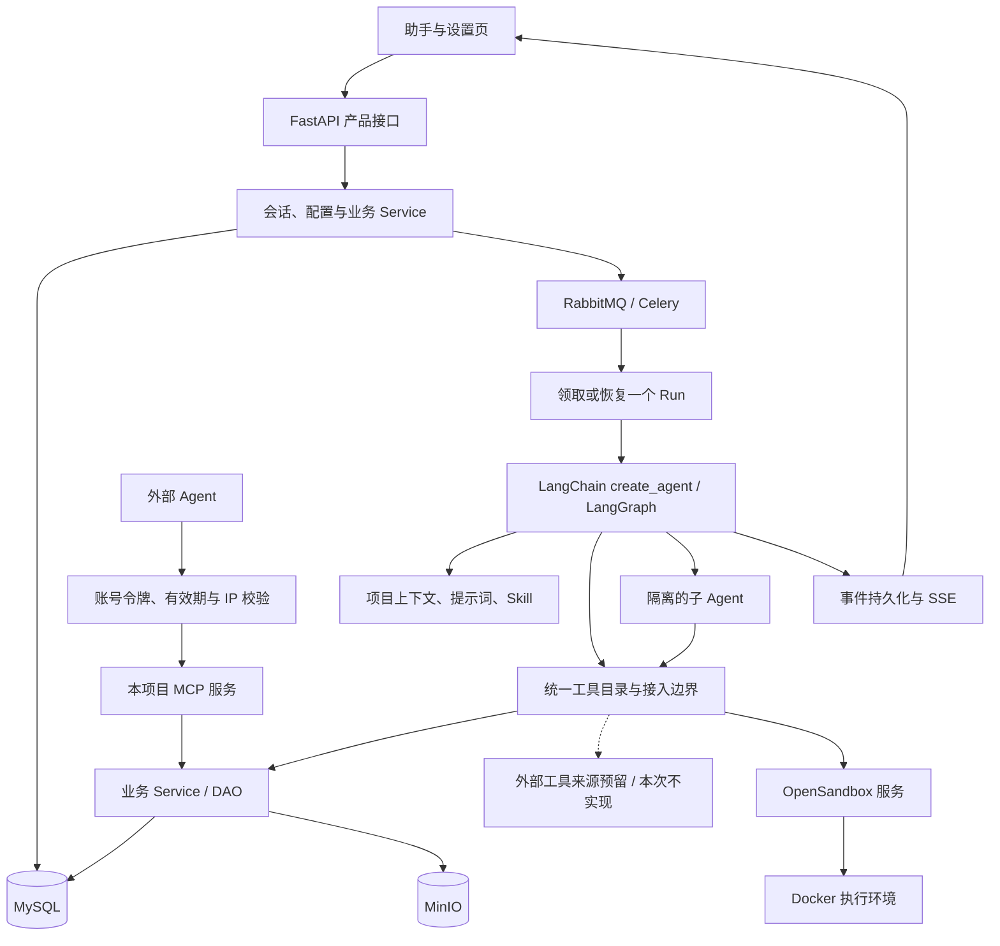

# 创作助手运行时与工具扩展重构设计

日期：2026-10-29
状态：已确认，进入实施计划阶段
范围：单一通用创作助手、框架运行时、统一工具与对外 MCP 业务能力、Skill、子 Agent、OpenSandbox + Docker、前端执行轨迹；外部工具接入仅作设计预留。

本文描述目标设计，不表示功能已经实现。当前行为以维护文档和源码为准；用户已确认设计，具体目录调整、关键代码、任务和验证见[实施计划](../plans/2026-10/2026-10-29-创作助手运行时与工具扩展重构实施.md)。当前仍未安装新依赖、启动沙箱或修改业务代码。

2026-10-29 工具与 Skill 复核补充：根据当前项目、Toonflow 和 BeefTV 的实际源码，细化工具子包、`ask_user` 持久问答、渐进式 Skill、用户设置、具体目标轨迹及真实文本模型验收。逐工具边界和关键契约见[工具与渐进式 Skill 详细设计](2026-10-29-创作助手工具与渐进式Skill详细设计.md)；本次仍只修订设计与计划。

2026-10-29 审阅修订：外部工具接入与设置页管理不进入本次实现；对外 MCP 长期只开放操控工作台的业务工具；长期不提供子 Agent 独立会话聊天；当前沙箱只保证 Python、Node.js。

2026-10-29 后续讨论：采用业务任务异步提交、显式等待和同步并行子任务；补充账号级 MCP 令牌的名称、可选有效期、可选 IP 白名单及删除能力。用户已确认首版沙箱提供联网能力，支持在线安装依赖、下载资料和脚本访问外部 API。

## 1. 目标与已经确认的产品边界

核心目标是减少项目自行编写的 Agent 编排代码，让 LangChain / LangGraph 负责模型与工具之间的完整执行循环。项目保留产品配置、业务上下文、会话与存储接入、工具和 Skill 扩展、提示词及业务执行边界。

用户已经确认：

- 只有一个通用的项目内助手，不做多个助手预设或固定的编剧、分镜角色。
- 主 Agent 判断是否完成；移除每次结束前强制调用独立 reviewer 的流程。具体工作标准由提示词或 Skill 提供。
- 外部工具接入只预留设计：未来可在设置页接入、配置、测试和启停远程 MCP 或部署服务器上的本地 stdio MCP。本次不实现连接管理、客户端调用、相关页面或数据表。
- 本项目向外提供操控工作台的 MCP 业务工具，由外部 Agent 自行编排；这是长期产品边界，始终不提供通过 MCP 委托本项目助手执行完整任务的能力。
- 对外 MCP 必须使用账号在设置中创建的访问令牌；名称必填，有效期与访问 IP 白名单可选，支持删除并撤销后续访问。
- 图片、视频等异步生成先返回任务身份，主 Agent 可继续独立工作；需要结果时显式等待，任务完成后自动恢复并继续，用户可随时停止助手。
- 前端展示模型实际提供的思考文本或摘要、助手说明、工具调用、Skill 加载、子任务及等待恢复轨迹，支持刷新回看与断线续传。
- 子 Agent 用于隔离上下文和委派复杂子任务，由主模型按任务需要调用；默认同步等待汇总，可并行委派。长期不提供用户打开子会话直接聊天的功能，用户统一在主会话交流。
- 当前代码环境先支持 Python、Node.js，提供公网联网及 pip / npm 在线安装能力；具体部署边界见第 10.3 节。FFmpeg 和数据、媒体依赖的批量预装不在本次实现范围。
- 沙箱采用免费开源、自部署的 **OpenSandbox + Docker**，不依赖 E2B 等厂商云服务。

本方案进一步明确的首版取舍，随整份草案一起审阅：主运行时使用 `create_agent` 组合必要中间件；MCP 对外先用可撤销访问令牌；子任务只开放一层委派；沙箱工作区按执行范围隔离，并以文件恢复为保证，不承诺宿主故障后恢复进程内存。

## 2. 现状问题与重构对应关系

| 当前实现与问题 | 目标改变 |
| --- | --- |
| `agent/harness/runtime.py` 每次 broker 投递推进一次模型决策及工具批次，下一轮仍由项目外层调度 | 一次 Worker 领取后运行框架图，直到完成、持久等待、停止或失败；普通工具调用后继续执行由框架决定 |
| `agent/harness/supervision.py` 与任务要求机制控制候选答复、独立验收和回到执行 | 删除强制 reviewer、候选答复闸门及其专用重入循环；保留事实性的业务结果、错误与预算记录 |
| `agent/tools/contracts.py`、`registry.py` 与 `OVERRIDES` 存在多处工具定义和覆盖 | 业务参数、描述与处理器有一个定义入口；内部助手与对外 MCP 复用业务能力 |
| `autonomous_scope` 等执行边界要求内部 Task、Run、Operation 及已应用输入，难以直接对外开放 | 拆开业务调用身份与内部运行身份；外部 MCP 通过可信账号和授权项目调用业务 Service |
| Skill 包校验在 `platform_tool_issues` 中直接依赖内置 `REGISTRY` | 面向统一工具目录解析当前已实现工具的依赖，设计上容纳未来外部来源；本次不接入外部工具 |
| checkpointer 的身份包含投递版本，且只接受根 `checkpoint_ns` | 一个 Run 在暂停、恢复及重复投递期间保持同一个 thread，支持框架生成的子图 namespace |
| 图状态只保存 ID 和阶段，恢复主要由项目重建 Turn / Operation 驱动 | 框架 checkpoint 保存必要的 messages、工具结果和执行状态；产品表负责业务事实与展示 |
| 前端 `ThinkBlock` 主要聚合 Operation，`silent` 操作不进入时间线 | 将模型可用思考、普通说明、完整工具记录和子任务轨迹分别表达，默认摘要、展开详情 |

这些问题是运行时职责与扩展边界问题，不代表现有权限、事务、媒体受理与事件基础设施都应重写。

## 3. 技术路线与职责

### 3.1 选定的运行时组合

采用 **LangChain `create_agent` + LangGraph checkpoint / interrupt + Deep Agents 的必要中间件 + OpenSandbox SDK / backend**。

`create_agent` 负责完整模型与工具循环。按需复用 `SubAgentMiddleware` 及沙箱文件、执行工具相关能力，不直接引入完整 `create_deep_agent` 默认栈来同时接管项目已有的记忆、Skill 和上下文体系。

OpenSandbox 上游已经提供 LangGraph、Deep Agents 示例。Deep Agents 示例使用独立发布的 `langchain-sandbox-opensandbox` 适配包；它不是 LangChain 自带实现，必须核对其与项目锁定版本、子任务隔离和恢复要求是否匹配。通过验证后复用；若现有适配不能表达必要的连接恢复，仅补一个围绕 OpenSandbox SDK 的薄适配，不建立第二套沙箱实现。

没有选用完整 Deep Agents SDK，是因为当前项目已具备会话、资源引用、记忆和 Skill 管理；一并迁入其默认体系会扩大首版变更。保留自研外层决策循环则不符合本次重构目标。

### 3.2 目标结构

图中虚线仅表示设计预留，不代表本次交付外部 MCP 客户端或设置页管理能力。

| 框架或组件 | 负责 | 项目保留的接入工作 |
| --- | --- | --- |
| LangChain / LangGraph | 模型调用与工具循环、状态推进、checkpoint、interrupt / resume、子图执行与流式事件 | 模型配置、可信身份、上下文装配、存储适配、业务等待接入 |
| Deep Agents 中间件 | 隔离子任务，以及所选 backend 的文件和命令工具 | 子任务的业务范围、预算、事件关联、沙箱执行范围 |
| OpenSandbox | 沙箱创建与查询、连接、命令与文件操作、资源限制、生命周期接口 | 镜像、工作区绑定、文件导入导出、任务关联和清理入口 |
| Celery 与现有调度设施 | 启动 Run、故障后重投、业务等待结束后唤醒 | 不再按每次模型决策或普通工具批次投递 |
| 项目业务层 | 账号与项目权限、版本校验、事务、生成受理、幂等、业务数据和产物 | 继续沿用 API → Service → DAO → ORM |

数据库事务不跨模型请求、MCP 网络调用和沙箱执行。SDK 对象、数据库 Session、凭据和进程句柄不写入框架 checkpoint。

## 4. Run、会话与恢复

### 4.1 状态归属

Conversation / Message 继续承载用户可见的会话；Task 保留用户任务及作品范围；Run 表示一次连续执行。一个 Run 有稳定 thread，由 owner 与 run ID 派生，不包含 broker 投递版本。

新 Run 开始时从会话、任务、资源和记忆装配初始上下文一次。恢复同一 Run 时读取框架 checkpoint，只应用尚未消费的新输入，不重新注入整段初始历史。新 Run 的上下文则从已有会话与已结算成果构建，避免因新执行重复创建作品。

框架 checkpoint 是内部执行状态的依据；Operation、异步任务、业务表和 MinIO 是副作用与产物的依据；AgentEvent 是前端展示依据。Turn 可保留模型调用审计用途，但不再成为另一个驱动模型和工具循环的执行器。

现有 MySQL saver 需要支持完整框架状态、pending writes、父 checkpoint 和子图 namespace，不能继续限制为根 namespace 或仅含轻量 ID。文本和有界工具结果可以持久化；大正文、媒体和大文件通过资源引用关联。

### 4.2 正常执行与异步生成

1. API 保存输入并受理 Run，Celery Worker 取得执行租约。
2. Worker 调用框架执行，模型和普通工具持续交替，直到到达终态或持久等待。
3. 内部生成提交工具复用业务受理能力，立即返回异步任务身份。主 Agent 根据任务依赖继续处理无需该结果的工作；生成提交本身不触发 interrupt。
4. 主 Agent 在下一步需要生成结果时调用显式等待工具。工具先读取真实状态：已结算则直接返回结果；尚未完成才登记等待并触发 LangGraph interrupt。
5. 当前可执行的并行工具或子任务分支均已完成或进入可持久恢复的等待后，结束本次图执行并释放 Worker，不因其中一个分支挂起而丢弃其他在途执行。
6. 业务任务结算后，现有可靠发布 / 恢复设施投递唤醒消息。等待登记关联 run、工具调用、interrupt 及待完成的任务集合。
7. Worker 使用相同 thread 恢复图。等待工具返回实际生成结果，主 Agent 继续后续工作，无需用户点击继续。

提交、查询和等待各有明确职责。模型根据工具说明、提示词及 Skill 判断工作依赖；运行时负责状态检查、checkpoint 和恢复，不增加一套自动分析依赖或按模型轮次调度的执行器。用户要求取得最终成果时，主 Agent 应等待所需任务并核对结果后再结束；用户明确只要求提交时可以交付任务凭据。

普通模型调用、读取、修改、短脚本和子 Agent 委派不因开始执行而触发 interrupt。业务长等待使用持久暂停；本次新增的 `runtime__ask_user` 在缺少关键输入、存在无法从上下文消除的选择或用户要求确认时，也通过同一框架机制持久暂停。一般工作说明直接用消息，不为每次业务写入增加问答闸门。用户停止沿取消路径处理。

对外 MCP 的生成提交工具直接返回任务 ID，提供查询工具；不隐式创建本项目 Agent Run，也不要求外部 Agent 跟随内部等待机制。

多个工具或子图同时等待时按 interrupt 身份关联，使用框架的恢复机制，不用全局单个“当前等待任务”覆盖彼此。重复或迟到的完成通知不能重复推进已经恢复的等待。

### 4.4 向用户提问与定向回答

`ask_user` 先以稳定 scope / tool call 登记一个 Operation，`wait_state.kind=user_input`，保存问题版本和受控字段，再调用 `interrupt`；系统等待使用 `kind=generation`。问题支持文本、多行文本、单选、多选、数字和布尔字段，不接受模型提供任意前端组件或脚本。默认附补充说明入口；关闭卡片不等于跳过，跳过不代表同意，停止表示取消整个 Run。

回答通过 `POST /api/v1/assistant/operations/{operation_id}/answer`，提交 `question_version/outcome/values/additional_text`，复用 Cookie、CSRF 和请求幂等。服务端按已持久化的问题校验答案、保存真实用户消息来源，再唤醒原 Run；客户端不能指定 graph namespace、interrupt ID 或 `Command`。相同答案重放返回原回执；旧版本、已终止或已回答不同内容返回冲突，越账号不可见。普通聊天消息不能误当作某个问题的回答。

幂等查询在验权后、待答及终态检查之前：答案已成功受理后，即使 Run 随后完成或停止，相同答案重试仍返回原回执；终态只拒绝尚未受理的新答案。

等待期间可释放 Worker，刷新和重连从快照恢复问题。回答早于 interrupt 绑定时先保存就绪，安全暂停后恢复；停止作废未回答问题，迟到答案不能复活旧 Run。新增 Run / Task 的 `waiting_input` 状态及相应 Operation、工具调用、DTO、前端白名单；仍有其他分支运行时保持 running。用户问题和系统等待同时存在时，界面优先提示“需要回答”。

子 Agent 的问题带来源显示在主会话，只出现一个可提交表单；回答定向恢复原子图，不提供子会话聊天。现有剧本建议的预览、差异和采用接口继续负责真实采用及版本核对，问答不能替代该写入接口。

### 4.3 停止与故障

- 用户停止后及时停止新的模型调用与工具执行，并取消仍可取消的沙箱命令。生成等待期间立即停止助手的后续编排，不再等待图片或视频结算后才响应停止。
- 已提交的图片、视频任务有独立生命周期；停止助手不代表供应商任务被撤销。已生成成果仍归档，界面明确其状态。
- 停止后的普通消息可以创建新 Run，带入已结算成果与必要的任务历史；不恢复已被用户取消的旧 Run。
- Worker 崩溃后依靠租约与 checkpoint 恢复；继续保留现有发布账本、围栏与补偿能力，但删除按模型轮次安排下一次执行的部分。
- 同一会话的运行写入继续串行领取。停止、故障重投与迟到通知都通过租约和业务状态校验，不由前端决定执行归属。

checkpoint 不保证外部副作用只执行一次。生成提交与等待分离；等待恢复以查询原任务为准，不重新提交生成。内部写入与生成受理仍按稳定的执行范围和工具调用 ID 幂等；重放 interrupt 前的工具代码必须能查回原受理结果。对外业务 MCP 入口同样按稳定请求标识处理重复请求。

模型推理与 checkpoint 写入之间也存在崩溃窗口；不能把框架恢复描述成模型请求绝不重复。复用模型 SDK 后仍需记录实际调用与费用，并区分已确认结果和受理不明。

沿用现有 Run 的有限决策与输出预算，优先通过框架调用 / token 限制中间件落实，父子调用统一计量。预算耗尽保留已完成成果，普通消息创建新的 Run 才获得新额度；不恢复旧的无限循环或零成果 reviewer 重试机制。

## 5. 工具定义与扩展

### 5.1 一份业务定义，多个接入入口

每项内置业务能力只有一份业务参数模型、说明和处理器，处理器调用现有 Service，不在工具层复制事务和业务规则。目录记录工具身份、来源、业务类别及结果形式，提供列表、按需发现和查找。

`tools/` 根只放 `contracts.py`、`registry.py`、`langchain.py`、`scope.py` 等基础职责；项目自有工具按 `ask_user/`、`media_generation/`、`standard/`、`canvas/`、`resources/`、`skill/`、`memory/`、`context/` 等子包组织，每个工具一个文件。沙箱资源导入导出绑定放 `sandbox/`；框架原生委派和执行工具直接复用，只有实际绑定职责才建 `subagent/` 或相应文件，不制造空包或转发实现。

`ToolSpec` 定义在 `tools/contracts.py`，每个工具文件导出自身 `SPEC`，`registry.py` 显式聚合，避免工具文件与注册表循环导入。LangChain 入口统一生成 `StructuredTool`；它已经继承 `BaseTool`，不要求每个工具再写 `_run/_arun`。框架原生工具保留实际对象，不为满足目录形式复制实现。effect 与展示目标解析属于这份定义；effect 只说明执行边界，不成为新调度器，MCP 外放逐项显式声明。

内部助手、对外 MCP 和产品接口复用相同业务参数与 Service。它们可以有不同的接入元数据：内部有 run / tool call 身份；外部有访问令牌及请求幂等身份。接入元数据不混进业务参数，不要求外部调用者伪造 Task、已应用用户消息或 Operation。

本次实现业务工具与框架执行工具两类来源，工具目录在设计上允许未来接入外部 MCP 来源。只有明确开放的工作台业务工具进入对外 MCP。子任务委派、助手完整任务执行、Skill 加载、内部记忆和任意沙箱执行均不外放。

工具名称包含稳定的来源命名空间，避免同名覆盖。身份不随页面显示名称改变；调用时保留来源和外部原名。模型名称长度与字符限制由统一适配处理，不再通过散落的 `OVERRIDES` 修补。

### 5.2 按需加载与配置

本次统一已实现业务与框架执行工具的目录，工具集合由注册定义、业务范围和部署配置确定；不提供外部工具的设置页管理。替换固定的 `enable_tool_group` 手写分组流程，优先复用框架工具发现与选择能力：先向模型呈现紧凑目录，按用户任务、Skill 依赖和模型选择加载 schema。

一个 Run 固定非实时配置版本，便于恢复与审计。提示词、额度和并发配置默认在新 Run 生效；Skill 按版本加载，恢复不能换成最新正文。停止当前 Run 随时有效。账号权限、媒体生成总开关和访问令牌撤销在实际调用入口实时校验；不能把媒体开关冻结到 Run 后绕过用户关闭。

工具结果返回可区分的成功、失败、异步受理与结果不明状态，以及业务资源引用。大输出保存为可读取的产物，不将完整日志、媒体或大 JSON 无界塞入上下文。

### 5.3 业务能力扩展与外部来源预留

开发者新增业务能力时，定义一次 Pydantic 业务参数、工具说明和调用 Service 的处理器，再登记到统一目录。内部助手据此生成 LangChain 工具；允许外放的能力据此生成 MCP 工具，不再增加另一份参数 schema、覆盖表或手写前端工具清单。

未来实现用户外部能力接入时，可在设置页建立 MCP 连接、测试并选择工具，无需改动业务工具定义；这条功能本次仅保留设计。当前 Skill 可组合已实现工具和沙箱脚本，Skill 描述做法，工具提供实际执行能力。

## 6. 对外 MCP 与外部工具接入预留

### 6.1 用户接入外部工具：仅设计预留，本次不实现

设计允许未来增加设置页连接列表和详情，包括名称、传输方式、地址或部署命令预设、认证配置、连接测试、工具清单、启停及最近连接错误。本次不建设这些页面、API、连接或凭据数据表，不引入外部 MCP 客户端依赖，也不安排其运行验收。

- 未来远程服务接入采用 Streamable HTTP；具体认证配置随该功能单独设计。
- 服务器本地 stdio 服务由部署者登记可用命令、参数模板和环境变量项，未来由用户在页面选择与配置，不开放普通账号任意宿主 shell 命令。
- “本地”指部署本项目的服务器，设计不包含用户电脑上的额外连接器。
- 未来需要发现、协议和 LangChain 工具转换时，优先复用成熟框架适配。当前核对过的 `langchain.mcp.MCPAdapter` 仅作参考，不因这一预留提前引入依赖或实现空适配层。
- 未来工具按账号隔离，凭据不进入模型参数、checkpoint 和可见日志；结果不明且服务不支持幂等的写调用不自动重试。

本次只保证业务工具定义、运行身份和目录不绑定某一种外部协议，便于以后增加来源。不为未来接入提前创建占位页面、feature flag 或冗余数据字段；连接缓存、离线反馈、OAuth 等均不进入当前交付范围。

### 6.2 本项目向外提供业务工具

使用 FastMCP 提供 Streamable HTTP 业务入口。外部 Agent 能查询授权项目、读取和修改相应作品资源、提交生成及查询任务，具体工具以可复用业务能力和明确开放列表为准。

该入口长期只提供操控工作台的业务能力，不提供助手任务委托、会话聊天或 Agent 运行控制工具；以后也不把“让本项目助手完成整项任务”加入对外 MCP。

首版使用账号创建的可撤销访问令牌，保存摘要并绑定账号、项目范围与工具范围。调用身份从令牌解析，不能由工具参数中的 `user_id` 改写。写入继续受作品版本和幂等受理约束，调用审计区分内部助手与外部 MCP。

令牌由已登录账号在设置页创建、查看列表和删除，只能管理自己的令牌。创建表单包含以下内容：

| 配置 | 要求与含义 |
| --- | --- |
| 令牌名称 | 必填，供用户识别用途，不作为认证密钥 |
| 有效期 | 可选；不设置则持续有效，直到删除或所属账号失去访问资格；设置时必须为未来时间，到期后拒绝访问 |
| 访问 IP 白名单 | 可选；为空表示不限制来源 IP，仍必须验证令牌；非空时仅允许匹配的 IPv4 / IPv6 地址或 CIDR 网段 |
| 授权范围 | 绑定账号获准的项目与业务工具范围，不能扩大账号本身的权限 |

服务端生成高随机性的独立令牌，完整密钥仅在创建成功时显示一次，后续列表只展示掩码等识别信息。服务端只保存令牌摘要及管理信息，不保存可回显的完整密钥；密钥不进入 URL、模型上下文、checkpoint 或日志。首版不增加刷新令牌、OAuth 或令牌独立角色体系。

所有 MCP 协议请求统一通过 `Authorization: Bearer <token>` 认证，包括初始化、工具发现和工具调用；MCP 会话 ID 不能替代认证。入口检查令牌、账号状态、到期时间与来源 IP，调用业务工具时检查其授权范围。缺少、无效、过期或已删除令牌返回 401，IP 或业务范围不允许时返回 403；不回退到匿名访问或浏览器登录态。

IP 默认取连接对端地址；部署明确配置可信反向代理时，才解析该代理提供的客户端来源，不直接信任任意请求的 `X-Forwarded-For`。有效期由服务端统一按 UTC 时间判定。这些检查由 MCP 接入边界统一完成，不在各工具中重复实现。

删除令牌即撤销其后续访问权限，已有 MCP 会话的后续请求也必须重新通过认证。删除不撤回已经受理的业务操作或独立生成任务；历史调用审计保留必要的令牌身份，不保留完整密钥。

MCP 写入也需要稳定的请求幂等身份。对外写工具使用包含 `request_id` 与 `arguments` 的调用外层，`arguments` 直接复用业务参数模型；外部 Agent 为一次业务意图生成请求标识，重试沿用原标识。同账号、同工具的相同标识返回原受理结果；参数不一致时返回冲突。内部适配从框架工具调用身份生成对应标识，无需模型自行编写来源 hash。只读工具不要求此调用外层。

业务数据权限由同一 Service / DAO 规则执行。对外调用不自动访问助手会话、Skill 私有资源、宿主文件或沙箱控制接口。

## 7. 上下文、记忆与 Skill

### 7.1 保留现有资产，收敛装配入口

复用 `agent/context/`、`resources/`、`memory/` 的项目范围、资源引用、媒体水合、记忆来源与历史下界能力；通过框架 middleware / runtime context 接入，不再把它们嵌进外层决策调度器。

维持一个上下文装配入口，负责用户当前问题、项目状态、选中主体、附件、相关历史、记忆和活动 Skill。完整工具消息组、tool call ID 与必要的供应商内容块交给框架消息模型和序列化处理，不在多个层分别重建。

上下文裁剪与摘要只保留一套策略。资源读取按需水合，二进制和签名 URL 不作为长期 checkpoint 数据；历史来源被遗忘或权限失效后不能因恢复而重新注入。

### 7.2 Skill 管理与执行

沿用已有 Skill 导入、编辑、版本与资源管理，运行时保留紧凑目录、按需加载、固定版本和阶段释放。用户手选 Skill 与明确要求优先；自动加载不扩大业务权限。

Run 开始冻结可见目录的身份、不可变版本引用及有界元数据，不读取全部正文和资源。搜索、首次加载、release 后重载及恢复沿用同一版本目录；release 只撤当前 scope 的上下文激活，不切换为最新版本。

现行主链已经实现渐进披露：L1 为目录元数据，L2 经 `load_skill` 才读冻结正文，L3 按激活版本及 checksum 读取资源。旧的全量注入分支不在当前 Harness 主链，不能据此判定现状是全量加载。手选方法直接加载该方法、匹配后自动加载，以及压缩时保留已加载方法，都符合按需原则；不得预载所有正文和资源。

本次补齐四个已核对的问题：frontmatter 中的 `exclusions` 未进入目录和加载结果；搜索与常驻索引共用 180 字符截断且没有截断提示；导入 schema、解析器和前端仍拒绝 `scripts/` 及 Python / JavaScript 文件；当前 task 级激活状态不适合子 Agent 隔离。L1 增加有界适用/排除摘要，搜索给命中片段及截断标记，L2 返回完整冻结排除条件，L3 单独读取或导入所需文件；排除条件是选择方法的说明，不是业务权限机制。

激活、释放、已进入上下文的正文及压缩保留资格按 execution scope 隔离；父子可共享不可变版本引用，不能共享可变 loaded/active 标记。子任务仅继承委派需要的目录及版本引用，自行按需加载，父图只接收子任务摘要和产物，不自动接收子图 Skill 全文。

Skill 依赖引用统一工具目录，本次校验实际已实现的业务与框架执行工具，不继续直接依赖硬编码 `REGISTRY`。工具不存在或在当前业务范围不可用时给出明确原因；声明尚未实现的外部工具来源时明确提示“尚未接入”，不因此增加外部发现、离线检测或客户端调用功能。

加载 Skill 只加载所需说明。扩展现有资源类型和导入链，支持 `scripts/` 下 `.py/.js/.mjs`，保持路径、体积和 checksum 校验；默认只公开清单，读取脚本也是有界按需读取，执行前显式导入当前 scope 的沙箱。模板和输入资源同样按需导入，脚本依赖安装在该范围的 Python 虚拟环境或 npm 工作目录中。Skill 不在 API / Worker 宿主环境直接执行脚本，也不自动导入整包。

## 8. 单助手提示词控制

保留一套通用助手身份，设置页允许用户编辑自定义指令，并可恢复默认内容，不新增角色或助手预设表。

系统基础说明、用户自定义指令、项目上下文、Skill 方法说明和工具说明各有一个来源。系统基础说明定义真实执行能力及业务边界；用户指令定义工作习惯和输出要求；项目事实、Skill 和工具结果按其来源传入，不能覆盖认证与事务规则。

每个 Run 保存所用提示词版本与用户配置版本。子 Agent 的任务说明在此基础上补充委派目标、可用范围和交付格式，不另建用户可选角色体系。

删除旧 reviewer、强制 completion contract 和外层 continuation 循环专用提示词。用户需要的验收清单放在主助手提示词或 Skill 中，由主 Agent 使用现有读取工具自行核对；不会把提示词描述的“已保存”当成真实业务写入。

工具说明与主提示词明确：生成先提交，可先推进独立工作，需要结果时调用等待；按用户要求取得成果后再交付。子任务说明列明适用目标、所需背景和交付结果，由模型按需委派，不按文本长度、工具数量或耗时阈值硬编码拆分。

## 9. 子 Agent

首版使用同步隔离子任务：主模型依据工具描述、提示词、Skill 和当前任务决定是否调用框架的 `task` 能力，不由程序按复杂度阈值自动拆分。子 Agent 有自己的消息上下文，可多步使用获准工具，完成后返回结果摘要与产物引用。子任务是执行记录，长期不创建供用户单独聊天的子 Conversation。

同步表示父调用等待子任务交付结果，主 Agent 在结果返回前不进入下一轮；同一轮的独立子任务可以并行。调用子 Agent 本身不触发 interrupt；子任务等待业务结果或通过 `ask_user` 请求必要输入时，通过子图持久暂停并定向恢复。首版不提供后台子 Agent 调度、父空闲唤醒或 Agent Protocol 常驻服务。

适用场景包括长篇资料整理、独立资料核对、多个素材候选的分析。普通批量图片生成继续使用现有异步任务系统，不为每张图创建 Agent。

子任务只接收明确的任务背景、必要资料引用与业务范围，不复制完整父历史。权限不得超过父 Run。首版只允许一层委派，最多三个子任务并发，不给子 Agent 再次委派的工具；调用与费用归属父 Run 的预算。

子任务的 tool call、graph namespace 与父委派调用关联。前端可展开查看状态、轨迹、错误和结果；独立聊天入口始终不在产品范围内。用户在主会话补充要求，由主助手协调新的子任务或后续工作。

需要代码执行的子任务拥有独立沙箱工作区；父子通过明确产物引用交接文件，避免并行脚本共同修改一个工作目录。

## 10. OpenSandbox + Docker

### 10.1 部署与镜像

首版单机部署 OpenSandbox 服务，使用 Docker runtime。业务 API / Worker 使用 Python SDK 调用它；不把 Docker socket 或沙箱服务凭据交给模型或沙箱代码。

在现有 Compose 部署基础上增加服务配置，使用固定版本镜像。OpenSandbox 自身的管理元数据可使用其默认 SQLite 文件并持久化；这不是业务数据的新来源，不新增 PostgreSQL、Redis 或 Kubernetes 作为首版沙箱依赖。

准备精简的项目专用执行镜像，当前只保证 Python 3.12、Node.js LTS 及 pip / npm 包管理能力。FFmpeg、NumPy / Pandas / Pillow 等数据或媒体依赖的批量预装不纳入当前交付；浏览器桌面、VSCode、Java / Go 也不作为默认环境。

额外 Python 包可在线安装到工作区虚拟环境，npm 包可在线安装到工作区项目目录。需要新系统库的依赖由部署者更新基础镜像；首版不承诺任意原生依赖都能在运行中安装成功。

CPU、内存、命令超时与输出上限由部署配置统一限定，子任务同样受限；模型不能通过工具参数提高这些上限。

### 10.2 执行范围与恢复保证

只有第一次需要代码执行时才创建沙箱。主 Run 有一个执行范围；每个使用代码的子任务有独立范围。同一范围内连续调用复用环境。

项目保存执行范围、OpenSandbox 服务标识、sandbox ID、工作区卷身份、镜像版本和生命周期状态。工作区使用该范围独有的持久卷，脚本、依赖目录和中间文件位于工作区；业务产物仍以归档后的 MinIO 对象为准。

持久等待时，在确认没有仍需执行的前台命令后释放容器、保留工作区卷；恢复时按固定镜像重新创建并挂载工作区。普通短工具调用之间不重建容器。运行完成或取消时销毁沙箱，并清理无需保留的工作区；清理失败由现有恢复 / 清理任务补做。

首版保证工作区文件与业务引用可恢复，不依赖 Python 变量、Jupyter kernel 或后台进程内存续存。宿主磁盘丢失时，从 MinIO 已归档产物与业务事实继续，并明确说明未归档中间文件已丢失，不能宣称工作区完整恢复。

OpenSandbox 的 Docker `pause` 只是冻结容器进程，不等价于释放内存；不把它作为首版节省等待资源的依据，也不引入虚机内存快照体系。

### 10.3 网络、文件与可见日志

首版提供沙箱公网出站能力，支持 pip / npm 在线安装、下载公开资料及通过 Python / Node.js 脚本调用外部 API；不采用运行期完全断网或仅开放包仓库的产品限制。联网通过已有沙箱命令执行能力使用，不另外实现联网调度器、搜索服务或浏览器运行环境。

网络目的地、代理和额外限制属于部署配置，优先复用 OpenSandbox 的网络能力，不自行开发联网代理，也不为每次正常联网增加用户确认。部署者可以按环境收紧策略；模型不能修改部署策略。网络请求继续受命令超时、输出和资源上限约束，下载文件使用当前执行范围的工作区。访问需要认证的外部服务时，不自动获得后端密钥或扩大现有授权范围。

已核对 OpenSandbox 1.2.0：省略或传空 `networkPolicy` 可能按允许全部出网启动，实施时需记录实际 Docker / egress 配置并验证联网行为，不能把 SDK 默认行为当成本项目验收。部署若额外限制出网，需核对所选模式：仅 DNS 过滤不能宣称网络层已阻止其他目的地，IP / CIDR 的强制限制需核对 `dns+nft` 模式。

沙箱出站网络与 MCP 入站认证分别管理。对外 MCP 的令牌、有效期和来源 IP 白名单继续生效，沙箱联网不会赋予匿名 MCP 访问权限，也不会改变 API / Worker 既有模型及媒体供应商调用方式。

素材通过已授权资源引用导入，Skill 资源按目录导入；输出按清单导出，经现有上传与媒体 Service 保存到 MinIO。沙箱代码不直接连接业务 MySQL，不读取后端 `.env`，不直接修改业务表。

执行工具输出命令摘要、开始 / 结束时间、stdout / stderr 流、退出状态和产物引用。大日志归档并有界展示。用户停止时取消在途命令；取消不支持或结果不明时如实反馈，不能仅关闭前端动画后宣称后台已经停止。

## 11. 前端执行轨迹与设置

### 11.1 轨迹契约

复用 AgentEvent、递增 seq、SSE 游标和恢复查询。框架原始事件在后端转换成项目事件，前端不依赖 LangGraph 的内部节点名或私有 state。

事件统一关联 conversation、run、执行范围、父调用、tool call / subtask 身份及时间。终态事件持久化后可回看；文本和日志增量按原有有界缓冲方式落库，重连不重复追加。

| 内容 | 展示要求 |
| --- | --- |
| 模型实际提供的思考文本 / 摘要 | 单独可折叠展示，保留来源；模型未提供时不伪造、不声称能展示完整内部推理 |
| 助手对用户的说明与最终答复 | 作为正常消息，和思考通道区分 |
| 工具调用 | 名称、来源、参数、运行状态、耗时、结果 / 错误；摘要默认可读，完整记录可展开 |
| Skill | 加载的名称与版本、用途、资源和脚本执行关联 |
| 子任务 | 委派目标、状态、子轨迹和汇总结果，可展开查看 |
| 沙箱 | 命令与安装日志、退出状态、导入导出及产物 |
| 运行状态 | 等待生成、恢复、停止、失败及预算耗尽，状态与后端一致 |

完整记录不能继续因 `visibility=silent` 被完全过滤；可以放进折叠详情，避免挤满主会话。模型思考、计划说明与工具日志分别命名，避免将 Operation 聚合直接标为模型思考。

工具轨迹必须带具体目标。服务端从可信目录、参数定位及业务读回生成 `action/target/title`；`target` 包含 `kind/id/display_name/version/path` 的适用字段，不能依赖模型随意填写一个名称。示例：“加载 Skill《对白方法》· v3”“读取 Skill《对白方法》的 references/dialogue.md”“运行脚本 scripts/check.py”“委派子任务：核对第三章人物关系”。搜索、加载、读资源、执行脚本分别记录，失败也保留目标及原因。

具体缺口在于当前 `tool_label()` 只有工具名，OperationRead 缺目标，ThinkBlock 又按相同 label 合并。目标字段应从后端贯穿 Operation / trace DTO、快照、SSE 和前端。聚合键至少含工具、目标、版本、scope，不合并不同 Skill / 素材 / 片段。展开给有界输入、输出、状态、错误、耗时和资源引用；“查看本次使用版本”读取冻结 Skill 版本及实际片段，不能打开最新版本冒充当时内容，也不展示凭据或内部 locator。

### 11.2 设置入口

本次复用 `/ai_config` 的“创作助手”标签，保留已有媒体总开关，增加以下单助手设置和对外 MCP 令牌管理；不新建多助手配置页。下表是本次采纳的配置范围，不把部署运维参数全部暴露给用户。

| 参数 | 默认值及限制 | 生效时机 |
| --- | --- | --- |
| 允许调用媒体模型 | `true`；一个总开关控制图片、视频、音频 | 实时检查新的生成受理；已提交任务继续归档 |
| 自定义指令 | `null` 使用服务端默认；最多 16000 字符；可恢复默认 | 新 Run 保存实际内容和版本 |
| 单 Run 模型调用上限 | 240；20–2000 | 新 Run 冻结；主、子、工具选择、摘要调用共享 |
| 单 Run 总输出 token 上限 | 2,000,000；100,000–20,000,000 | 新 Run 冻结；父子共享；这是用量额度，不是金额预算 |
| 子任务最大并发 | 3；1–3 | 新 Run 冻结；不改变只开放一层委派 |
| 默认任务媒体数量上限 | 图片、视频、音频分别 `null`；可设 0–1000 | 创建 Task 时继承；显式任务参数可覆盖；0 表示禁止该类 |

用户额度与部署硬上限取更严格值，设置响应提供 `deployment_limits`，页面显示实际可设上限；部署 cap 低于表中推荐默认时取 cap，不把默认 240 次伪装成可突破的部署上限。媒体数量 `null` 表示无额外数量限制，不能绕过媒体总开关或业务权限。Task 创建时省略整个 `media_limits` 才继承账号默认；提供该对象表示整体覆盖，其省略子字段沿现有 DTO 取 null，例如只传 images=3 表示视频/音频无额外数量限制。页面始终提交完整三项。Task 创建后数量额度固定，同 Task 新 Run 保留，不再继承账号新默认，本次不增加修改既有任务数量额度的入口。

现有 TaskMediaLimits DTO 不等于已经有前端编辑入口，本次补默认设置与任务创建覆盖入口。模型配置仍使用现有产品，不在 Agent 设置重复保存 API Key 或未经验证的上下文窗口；本次不新增“自动选 Skill / 允许子任务 / 允许代码执行”三个额外开关，也不暴露任意上下文裁剪参数。

继续用现有 `policy_version` 保护实时媒体开关；其余非实时字段复用 AgentPreference，共用一个 `settings_version`，不为每项字段增加版本。新增 `GET/PATCH /api/v1/assistant/settings`（指令也在其中，不再另设 instructions API），使用 CAS，冲突保留前端草稿。Run 冻结非实时设置；Task 冻结数量额度；恢复不得读取新偏好覆盖旧值。两个版本分别对应实时政策和下一次执行的偏好，不混淆生效时机。

不实现外部工具的接入、配置、连接测试或启停页面。Skill 继续复用现有管理界面，并补充已实现工具依赖和脚本环境说明。OpenSandbox 镜像、CPU、内存、服务地址、超时、队列、租约和网络策略属于部署配置。

令牌设置提供创建、列表和删除：创建时填写名称，可选到期时间和 IP 白名单，并选择授权范围；成功后一次性显示完整密钥并允许复制。列表显示名称、掩码、创建时间、到期时间或“无到期时间”、IP 限制与有效状态；删除后从可用列表移除。没有设置有效期或白名单的用户无需补填这两项。

## 12. 数据与代码边界

| 数据或能力 | 承载位置 |
| --- | --- |
| 会话、消息、任务、运行与业务结果 | 复用现有 MySQL 模型，删除退役的 reviewer / 自研循环状态 |
| 框架 checkpoint 与 pending writes | 扩展现有 graph 表与 MySQL saver；按稳定 Run 和完整 namespace 隔离 |
| 自定义指令、对外访问令牌 | 新增必要的账号级配置持久化；令牌保存摘要、名称、归属和授权范围、可空的到期时间与 IP 白名单及创建时间，不保存完整密钥 |
| 外部工具连接及其凭据 | 仅设计预留，本次不新增连接配置表、凭据存储或管理 API |
| 子任务与等待关联 | 复用 Run、ToolCall、Operation 和事件，增加必要的执行范围与父调用关联；不创建子 Conversation |
| 沙箱关联与工作区清理信息 | 保存可跨 Worker 读取的执行范围绑定；不只放在进程内字典或 SDK 对象上 |
| 图片、视频、音频、导出文件与大日志 | MinIO；数据库保存引用、版本和元信息 |

实施时主要涉及以下模块；具体文件拆分、迁移 SQL 和 API DTO 在实施计划中列出：

- `agent/harness/`、`agent/runtime/`、`agent/coordinator/`：替换执行入口，保留调度、租约和恢复基础，删除第二层决策循环。
- `agent/gateway/`：复用模型配置与必要传输保护，收敛为框架模型接入；不再自己解析 function calling 来驱动循环。
- `agent/tools/`、`service/assistant/operations/`：统一定义与调用身份，复用业务 Service，新增对外 MCP 业务边界；外部工具来源仅设计预留。
- `agent/context/`、`agent/resources/`、`agent/skill/`、`service/skills/`、`ai/prompts/assistant/`：改为框架扩展点，保留已有资源及 Skill 产品能力。
- `service/assistant/execution/graph.py`、`dao/assistant/execution/graph.py`、`domain/assistant/execution/graph.py`：支持真实恢复与子图 state。
- `frontend/src/features/assistant/` 及对应 API / types、设置功能：展示实际轨迹、子任务详情与配置。
- `compose.yaml`、`docker/`、后端配置与锁文件：增加 OpenSandbox 与 Python / Node.js 执行镜像、固定依赖版本；不增加外部 MCP 客户端依赖。

只删除本次重构造成的旧执行分支、重复定义及专用状态，不借机整理无关业务。

## 13. 完成标准与验证

在大范围替换前，先用最小验证工程确认版本组合；验证代码必须进入正式测试或明确移除，不留下并行的产品实现。

1. `create_agent` 能连续调用多个真实工具再结束；普通模型轮次不经过 Celery 再投递。
2. 真实 MySQL checkpoint 能恢复工具等待、pending writes 和子图；重复投递不重复写作品或提交生成。
3. 生成提交返回任务身份后仍可推进独立工作；显式等待已完成任务时直接返回，未完成时持久暂停并在结算后恢复。批次失败能返回工具错误供主 Agent 判断，停止中的 Run 不被迟到通知复活，恢复不重复提交生成。
4. OpenSandbox + Docker 能运行 Python、Node.js，实际完成 pip / npm 在线安装、公开文件下载及对受控外部 HTTP API 的脚本请求，流式返回日志，取消执行并清理资源。网络行为符合部署配置，命令超时与资源限制生效；不以 FFmpeg 或预装媒体依赖作为验收项。
5. Worker 退出后，同一执行范围能重建沙箱并访问工作区；父子任务工作区相互隔离。
6. 对外 MCP 只开放授权的工作台业务工具，权限和幂等使用真实业务边界验证；不提供助手完整任务委托。验证账号只能管理自己的令牌、名称必填、有效期和 IP 白名单可空、到期失效、IP / CIDR 匹配、删除撤销及完整密钥仅展示一次；无令牌或用旧 MCP 会话均不能绕过认证，可信代理来源解析符合部署配置。外部工具接入、连接管理及客户端调用不进入本次验收。
7. 子任务由模型按需委派，隔离上下文，支持同步并行汇总、子图等待恢复和子轨迹展示；子调用不强制 interrupt，不提供后台子任务调度，不能递归无限委派，且不创建用户可独立聊天的子会话。
8. 模型思考与日志可实时展示、刷新回看、断线去重；没有思考字段的模型仍能正常展示工具和状态。轨迹显示具体 Skill / 资源 / 脚本 / 子任务目标，能查看本次实际版本，不能误合并不同目标。
9. `ask_user` 问题刷新不丢失；提交、跳过、补充说明、定向恢复、子问题来源和重复回答均可验证。停止后问题作废；普通消息不会误恢复问题；等待生成与需要用户回答分别表达，自动完成的系统等待无需点击继续。
10. 长上下文、附件、Skill 版本、记忆来源及普通消息续执行不重复注入或重复创建成果；L1/L2/L3、排除条件、搜索截断、脚本导入与 scope 隔离均有真实路径验证。
11. 主 Agent 可正常给出最终答复，没有独立 reviewer 和强制 completion contract 才能结束的依赖；设置的实时生效与下次执行生效符合表述。

框架流程测试可使用受控模型，MySQL、Docker、OpenSandbox 与 MCP 边界使用真实基础设施验证。受控模型测试不能称为真实模型验收；真实供应商验证单独记录模型、范围、费用与实际结果。

### 13.1 已授权的真实文本模型验收

用户已授权在全部实施完成后充分调用真实文本模型验证，不限费用额度；主站为 `https://T8API.COM`，备用为 `https://sub2.de5.net`，模型均为 `gpt-6.1-terra`。凭据仅在执行时通过进程内凭据解析器或环境注入，不写入本方案、仓库、命令行、日志、checkpoint 或验收报告。当前未使用凭据、未探测服务、未产生模型费用，不能预先宣称这些服务支持所需端点、流式或工具协议。

真实验收通过新正式 runtime、真实 MySQL saver、工具和 Skill 链运行，模型输出和框架循环不得 mock。图片、视频及其他非文本生成供应商统一替换为测试适配器，真实执行受理、任务状态、回调、查询和等待恢复，不真实请求生成供应商。沙箱也不得绕过该边界触达真实生成端点。

场景覆盖长任务、多步与并行工具、两层资源读取的 Skill、同步子任务、等待与跨 Worker 恢复、问答、停止后新 Run、至少两次真实模型摘要压缩及轨迹刷新回看。先作最小文本协议探测，再分别运行确定性目标场景和不规定工具顺序的自然任务，重复验证，不靠一次成功结论。具体规模、通过条件和故障点见实施计划第 5.3 节。

主站确实不可用或协议不兼容时记录原因后使用备用；受理不明的模型请求不能跨站盲重放。不限额度不表示无限循环或无限自动重试，仍保留可观测用量、停止能力及单场景边界。此范围已有授权，无需再次询问费用；新增其他模型或真实媒体调用需另有明确指令。

代码阶段先执行 `node scripts/test.mjs --changed --dry-run`，再按功能测试映射选择验证，并同步维护文档、执行 `check-docs` 与质量检查。本文属于纯设计文档，不据此宣称任何运行验证已经通过。

## 14. 交付顺序与切换

后续实施计划按四个可验证部分拆分：运行时与 checkpoint；统一工具目录与对外 MCP 业务能力；子 Agent 与 Python / Node.js 沙箱；助手指令、对外令牌、执行轨迹和端到端验收。外部工具接入及其设置页管理仅保留设计，不进入这四部分的依赖、迁移、测试或交付。这里只确定依赖顺序，不在本阶段开始实现。

项目处于开发阶段，不保留旧新两套运行时或兼容工具注册表。切换前停止接收新的旧运行并处理在途任务；保存会话与业务成果，对旧执行状态显式终结或要求重新发送，不把旧 checkpoint 当成新图可无缝恢复。迁移步骤不得自动删除作品或撤销已经提交的生成任务。

代码落地时同步 README、系统架构、Harness 运行机制、Agent 部署排障、Skill 维护、接口和数据库文档。历史设计及验收保留原记录，通过说明关联新方案，不改写历史事实。

## 15. 核对依据与限制

本设计依据当前仓库源码、[Harness 运行机制](../instruction/AI创作助手Harness运行机制.md)、[系统架构与数据流](../instruction/系统架构与数据流.md)、[代码索引](../instruction/代码索引.md)及本次讨论。

参考 Toonflow 的隔离委派、子任务事件、显式文件导入导出和取消思路；其受限 WASM 沙箱不覆盖本项目完整 Python / Node.js 运行与扩展依赖的目标，因此运行环境选用 OpenSandbox。

截至 2026-10-29，已核对当前项目的 LangChain / LangGraph 依赖、Deep Agents 中间件源码和以下上游资料：

- [LangChain Agent](https://docs.langchain.com/oss/python/langchain/agents)
- [LangChain MCP](https://docs.langchain.com/oss/python/langchain/mcp)（外部工具来源的设计参考，不代表本次实现客户端）
- [Deep Agents 子任务](https://docs.langchain.com/oss/python/deepagents/subagents)
- [Deep Agents 异步子任务](https://docs.langchain.com/oss/python/deepagents/async-subagents)（本次不引入其 Agent Protocol 服务，仅用于比较执行模式）
- [LangGraph interrupt](https://docs.langchain.com/oss/python/langgraph/interrupts)
- [Claude Code 子 Agent](https://code.claude.com/docs/en/sub-agents)（产品行为参考，不据此推断其内部使用 LangGraph）
- [OpenSandbox 架构](https://github.com/opensandbox-group/OpenSandbox/blob/main/docs/architecture/index.md)
- [OpenSandbox Python SDK](https://github.com/opensandbox-group/OpenSandbox/blob/main/sdks/sandbox/python/README.md)
- [OpenSandbox 1.2.0 网络架构](https://github.com/opensandbox-group/OpenSandbox/blob/release-1.2.0/docs/architecture/network/egress.md)
- [OpenSandbox 1.2.0 服务端配置](https://github.com/opensandbox-group/OpenSandbox/blob/release-1.2.0/server/configuration.md#egress)
- [Claude Code 沙箱网络](https://code.claude.com/docs/en/sandboxing#network-isolation)与 [E2B 网络配置](https://docs.e2b.dev/network/internet-access)（网络策略比较，不引入这些产品作为运行依赖）
- [OpenSandbox Deep Agents 示例](https://github.com/opensandbox-group/OpenSandbox/blob/main/docs/examples/deep-agents.md)
- [OpenSandbox 1.2.0 发布](https://github.com/opensandbox-group/OpenSandbox/releases/tag/release-1.2.0)

当前项目已锁定 LangChain 1.4.7、LangGraph 1.2.17；本次核对的 Deep Agents 为 0.7.32，OpenSandbox 为 1.2.0。实现前冻结经过验证的兼容组合并同步锁文件，不把上游最新 main 的能力自动等同于已发布版本。

LangChain 内置持久 `ShellToolMiddleware` 当前明确不支持 interrupt，故本设计不以它作为持久沙箱恢复方案。OpenSandbox 示例中的上游测试结果不属于本项目验收。本次尚未运行真实沙箱、模型、MCP 或恢复测试，也没有资源占用基准数据。

本轮新增复核使用本机 Toonflow / BeefTV 源码与项目已安装库：Toonflow 可借鉴目录/按需读取和问答表单，但其内存问题等待不等于持久恢复；BeefTV 可借鉴 Skill 名称/版本标签和按目标合并规则。两者均不能直接证明已实现本设计的完整轨迹。此次公开网页获取超时、GitHub CLI 未认证，未把失败请求记作在线核对成功；本轮具体判断以本地源码证据为准。
