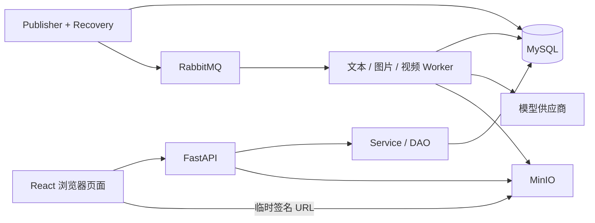

# 系统架构与数据流

> 2026-10-28：Agent Worker 已统一为 Harness，单 Run 的决策次数和输出 token 有有限预算；停止后发送普通消息创建新 Run。下文关于旧引擎保留及决策／输出无限的描述为历史记录。

宿主与无限画布均只支持内容视口 ≥1280 CSS px 的桌面浏览器。根布局使用桌面最小宽度；四阶段按钮、设置、助手、声音及检查器统一桌面呈现，不保留设备切换分支。组件内排布、桌面调宽与内部滚动继续工作。现行设计约束见[设计约定](../../frontend/DESIGN.md)。

本文说明当前实现的边界与不变量；启动见[开发与运行](开发运行与验证.md)，请求格式见[接口约定](../api/README.md)，表结构见[数据库设计](../database/README.md)。

2026-10-21 起，作品直接使用项目身份，原标准模式更名创作模式；删除分集、三层素材库关联、成员与邀请。项目资料只有名称，生成参数来自请求／私人草稿／模型默认，成片输出比例在导出设置中管理。当前产品、数据归属和切换约定见[创作模式维护说明](创作模式维护说明.md)。

## 运行结构

MySQL 是任务状态和业务结果的持久化依据。RabbitMQ 承载调度消息，Celery 不保存业务结果；浏览器通过轮询读取状态，离开页面不会停止后台任务。MinIO 保存图片和视频文件，数据库保存稳定定位值和媒体元信息。

> 2026-10-28：独立任务管理页面及其导航、跨页入口已退役，旧 `/tasks/*` 地址替换跳转到项目列表。后台异步任务、生成与批次 API 继续保留，创作流程和画布内仍提供必要的进度、失败与恢复反馈。

主页媒体资产库只查询本人调用 AI 后已归档的图片、视频、音频；手动上传仅保存为输入媒体，不会创建生成资产。列表经 `MediaAssetService` → `MediaAssetDAO.history` 读取 `media_assets`、生成记录和媒体文件，工作台分类通过生成记录 → `async_tasks.project_id` → `projects.workspace_mode` 过滤；页面标签为“生成历史 / 创作模式 / 画布模式”，个人无项目历史只进入“生成历史”。工作台、媒体类型与名称条件在服务端统一作用于 count 和分页，按 `created_at DESC, id DESC` 稳定排序，账号范围继续由资源权限过滤。

前端以 URL 保留工作台、媒体、名称和分页条件，每页 24 项、桌面六列；名称搜索框为 32px 高，与媒体类型按钮同行。点击先重新读取资产详情获取有效签名 URL，再直接打开图片预览或居中视频／音频播放器；预览只读，关闭停止播放，不提供重命名、采用或任务跳转。已有创作场景的媒体选择与采用仍使用原接口。

## 前后端分层

账号 Session 带可信 Actor，统一 ORM 查询过滤与事务内写入检查保护私人资源和项目资源。两种模式均由所有者独占；其他账号不能读取项目及其后代。系统 Session 仅用于认证、Worker 和运维迁移，不由 HTTP 输入开启。

前端 `app` 管路由和布局，`pages` 组合页面，`features` 管业务组件与编辑会话，`api/<业务>/<功能>` 封装请求，`types/<业务>/<功能>` 集中具名类型，`shared` 提供公共能力，`integrations/canvas` 提供跨包桥接，`api/http.ts` 统一错误。正文保存、分镜保存、任务轮询分别维护自己的状态；路由离开保护等待未完成的保存。

后端遵循 API → Service → DAO → ORM。Pydantic 校验请求和输出，Service 验证归属及业务条件，并在一次事务内组合多个 DAO；成功提交、异常回滚。独立 Service 调用应使用尚未开始事务的 Session，返回物化 DTO，不依赖事务外的懒加载。

认证中间件只调用 `AuthService`；资源范围查询与会话撤销经 `IdentityDAO`，模型偏好由 `ModelPreferenceService` 持有事务。`TaskRuntimeService` 负责领取租约、提交权限和图片组联动，`TaskRuntimeDAO` 只做锁定查询与续租 SQL。`db/scope/resource_scope.py`、`db/scope/canvas_scope.py` 和 `db/scope/canvas_resource_scope.py` 共用权限父查询、画布校验及复制溯源，不反向调用业务 Service；时间、方法目录常量和纯画布文档转换分别位于 `core/time.py`、`core/skill_catalog.py`、`utils/`。

Agent 的锁、授权判断、工具契约和候选来源快照由独立模块提供，执行器再组合业务工具；声音快照、原生配音上下文、生成策略和渲染工具也各自提供单向依赖入口。前端 types 按业务集中传输 DTO，API 模块只实现请求，配置表单转换位于 `features/ai-config/editor/config-api.ts`，通用预加载组件只接收加载函数。

SQL 外键和 CHECK 约束保护单行及引用完整性；同项目归属、批次一致、生成来源等跨表规则仍由 Service 校验。不能以“外键允许”为依据绕过这些服务。

## 创作内容与候选

| 对象 | 持久化位置 | 操作语义 |
| --- | --- | --- |
| 项目 | `projects` | 名称与模式创建；直接承载创作内容，不分集 |
| 剧本与故事设定 | `project_scripts`、`project_story_settings` | 当前非空剧本保存即生效；故事设定有独立版本，私人候选继续明确采用 |
| 流程素材 | `assets.project_id` | 角色、场景、道具直接属于项目，无跨库关联 |
| 素材图片 | `image_groups` / `image_group_items` | 普通创作生成直接保存组，默认第一张主图；Agent 候选遵守明确采用流程 |
| 分镜 | `shot_scripts`、`shot_assets` | 服务端编辑、关联、排序；提取替换保留软删除历史，无手动归档入口 |
| 当前分镜媒体 | `shot_images`、`shot_videos` | 采用结果；替换旧结果进入回收记录 |
| 生成输出 | `ai_generation_records`、`media_assets` | 与当前业务内容分开，未采用结果仍保留 |

剧本页仅提供 script_rewrite 选区改写，冻结选文及前后各最多 2000 码点；模型输出和当前稿、版本、回执同事务结算。小说、大纲及其专属生成链已删除。Agent 私有候选仍须明确采用；结构化分镜先保存候选，追加或替换后才写活动镜头。

`WritingGenerationService` 在项目锁内冻结来源和目标指纹，按活动文本任务推导目标锁；所有正文写入入口使用同一项目锁与活动任务 current read。模型执行不持有数据库事务。原始输出先持久化，目标正文、并发版本、业务回执及任务成功同事务提交；锁序为 Project → Task → Document。改写使用码点半开区间，服务器精确拼接，取消、迟到或过期目标拒绝回填。前端 `useWritingGeneration` 负责原体原键核对及任务轮询，`WritingSession` 刷新保留非目标未保存输入；只有基线未变才安全续接全局版本。见[写作契约](../api/writing-workspace.md)。

素材提取只调用文本模型。服务端校验类别、原文依据和结构；用户可编辑候选、选择部分创建或复用素材。AI 输出不直接获得修改已有素材的权限。

创作工作台以左侧40px满高图标导航切换剧本创作、资产生成、分镜制作、成片预览，路由仍为source/assets/storyboard/assembly。剧本为960px最大宽度的“故事设定 / 剧本正文”双标签，正文与两侧统一近黑背景（#181818），故事设定输入框为稍浅灰色（#202020）、聚焦无边框，无导入／导出和固定底栏。正文仍由WritingSession串行保存并维护项目content_version，保留中文输入法、撤销与选区改写；任务进度与停止位于标题行，页面已移除“让助手起草剧本”和“最近变更”按钮。故事设定经story-settings GET/PUT、Service→DAO→ProjectStorySettings持久化，四字段使用独立row_version，首次读取返回空值与版本0而不插库；首次保存0→1，后续CAS递增，409保留本机输入。ResourceEditingSession复用串行保存、账号隔离、本机恢复、保存状态与导航屏障，不回填旧小说／大纲，也不自动加入AI提示词。资产库和分镜表支持按账号记忆的列表／宫格，列表及底部创建高45px；主页面提取入口移除，已有任务、历史候选及采用流程保留。成片内部和AI创作助手沿用现有实现。

标准工作台的错误与警告由StudioFeedback发布到公共Message并登记恢复详情。页面通过保存状态访问，原生Dialog使用自己的Provider与标题详情入口；仅在反馈详情展开时解除Dialog外壳裁剪，内容区继续内部滚动，使读取失败后的重试可点击且不挤压编辑器。

## 项目 AI 创作助手

创作模式与无限画布共用 V3 助手，会话由本人账号及 `project_id` 共同限定。切换项目读取该项目的会话、本机选择和草稿，同项目切阶段不更换会话。兼容路径仍为 `/assistant/global/...`；历史 `project_id=NULL` 的 V3 保留原身份，不猜测归属或自动合并到项目。

新创作任务自动绑定会话所属项目作为写入目标并读取该项目记忆；画布任务还须绑定当前画布。服务端在幂等回执查找后补入默认值并校验模式、项目和画布真实归属，原请求哈希不受默认值影响。补充及排队恢复沿用已受理任务的冻结目标，跨项目、跨模式或修改原画布均拒绝。标准助手已移除当前剧本引用入口，新消息不绑定正文或选区；历史已受理引用仍校验来源版本，记忆不授予作品写入权限。

桌面创作侧栏默认 380px、可在 320–560px 内调节，按账号保存在本机并为编辑区留出空间；助手统一桌面停靠。模型旁的添加菜单承接图片、文本、当前画布节点和资产库，Skill 使用同一可搜索多选列表。用户消息下不显示编辑或重新回答，回复等待状态使用动态省略号并尊重降低动效偏好。新 Harness 任务由 LangGraph 控制工作流，LangChain 单次模型调用自主选择 function calling 工具；前端按 `interruptions_supported` 区分新旧引擎。新任务支持边界停止，不提供立即改向及旧 resume 控制，运行中补充在下一边界应用；停止、错误或旧预算暂停后发送普通消息会在原 Task 下创建新 Run，恢复已结算工具历史与活动 Skill，来源撤销及遗忘仍生效。Harness 不设累计决策、工具、输出和活动时长上限，单次请求及上下文／媒体配额继续生效；历史任务保留原冻结引擎及停止水位。任务完成后下一条消息自动开始新任务，输入区展示当前任务目标并提供“开始新任务”。`/` 检索 Skill，Enter 只确认选择，方法以输入框内高亮块显示。前端不提供任务设置、上下文管理和记忆管理弹窗；摘要、记忆抽取和读取在后台继续运行，内部记忆工具不进入用户操作轨迹。删除对话保留作品成果，受理不明仍使用原请求及原幂等键核对。详见[助手 API](../api/assistant.md)。

助手输入的素材条限高并内部滚动，短桌面窗口的移除及发送入口保持可达。模型选择只用于新任务：任务运行、停止或暂停时，输入区显示同任务运行记录中的模型及锁定说明；缺少对应运行记录时显示“沿用当前任务模型”，不使用其他任务或本机偏好冒充。`@` 对宿主对象与画布节点按名称过滤，再与服务端资产结果去重。交错时间线中，运行和失败步骤默认展开，成功组自动折叠；手动展开/收起在普通刷新中保留，不同错误原因不合并。成果卡按等待、成功、失败/冲突显示图标与状态文字，并尊重减少动效偏好。

删除会话必须等 Task 及全部在途 Run 进入终态，才投递私人正文清理；Task 提前停止不能跳过模型段收尾。历史 V3 恢复水位过期返回明确错误，前端清理未受理控制，不自动越过其他标签页的新停止。会话仍监听后续事件，终态任务不显示持续连接加载。

新任务的引用、水合、Skill 配额、轻检查点、提示词和恢复边界见 [Harness 运行机制](AI创作助手Harness运行机制.md)。L1–L5 的 MySQL 来源、作用域、遗忘、水位线与 CAS 保持原有架构。

Harness 在现有 Task 状态内维护用户来源交付要求、有来源工作笔记、启用的工具组和有界进度投影。Agent 的候选最终答复先保存在内部 Turn，再由独立模型 Turn 提交结构化完成检查；程序核对来源、真实操作、保存类别及数量、答复引文和媒体实际交付。缺项回到原 Agent，检查通过才发布最终回复。检查共用冻结请求、原始回执及恢复账本，不创建第二套任务或业务工具执行器。模型仍负责自然语言意图和创作质量判断，结构校验不等于完整语义证明。

已有交付要求按 key 核验，由服务端读取权威定义；登记要求、观察笔记与业务成果分别计数。用户输入被 L4 压缩后，额外提供最多 32 条、约 4000 估算 tokens 的原文来源投影，支持精确引用和按 seq 继续读取；遗忘规则继续生效。

近期历史先查询有界 ID，再读取正文；恢复只读取冻结 manifest 的精确组。旧读取摘录增量写入 Task，不每轮重扫全部历史，活动 Skill 正文另行保留。稳定系统提示和已启用工具 schema 放在请求前部，动态任务状态靠后；模型容量声明参与平台预算，估算和供应商实际输入／缓存用量分别记录。自动 Skill 可在阶段结束后释放，再激活时复用可用的原正文回执。媒体水合错误作为本轮结构化工具反馈，模型可修正裁剪等参数；持久历史继续只保存媒体引用。

## Skill 管理与文件预览

独立 `/skills` 页面经现有 Agent API 导入 Markdown／ZIP、发布完整包与保存个人启停。适用模式继续使用 `modes` 数组，通用对应两种模式；隐藏标签保留在导入导出与版本数据中，不进入显示或搜索。数据结构与运行时不再按自动／手动触发字段筛选，任务实际来源仍记入激活审计。

列表启停位于卡片右下角，搜索与筛选控件等高。详情摘要仅包含用途、适用模式及操作，不渲染适用边界和来源；这些元数据仍随包保存，未改变接口与历史版本。开关复用 Ant Design Switch，并在 Skill 范围内隔离原生按钮最小高度样式。

预览先在内存解析并检查包，正式写入重复检查文件类型、路径、相对引用、体积与工具模式兼容性；脚本和未知格式拒绝整个包。有效资源先在 MinIO 暂存并核验，再以短事务发布不可变版本。详情只返回目录，前端使用 DirectoryTree／Splitter 和 CodeMirror 6 读取准确版本的资源，校验分段内容，取消切换前的请求，不提供在线修改。旧 AI 配置管理组件已删除，旧链接仅路由替换跳转；账号旧草稿仍可下载，已受理创建由原幂等键只读核对。

## 并发与幂等

后台记忆维护与创作 Task 分开计次。凭据／配置和明确鉴权失败直接结束；限流及抽取任务已持久化的无效输出可以退避，最多三次发送；此类抽取耗尽后以 `abandoned` 结束并允许水位越过。一般失败及受理不明不跳过范围，受理不明不自动重发。数据库 CHECK 与接口枚举共同约束该状态，见[记忆作业增量](../database/migrations/2026-10-26-agent-memory-retry/README.md)。

| 版本/标识 | 保护范围 |
| --- | --- |
| `projects.content_version` | 剧本正文及有效编辑稿操作；内部并发令牌；可恢复操作的历史另存 project_script_revisions |
| `projects.storyboard_version` | 分镜集合的添加、编辑、排序、提取替换与图片采用 |
| 分镜 `row_version` + `context_hash` | 单镜头内容与关联素材上下文 |
| 素材、配置、媒体资产 `row_version` | 各自实体的修改或采用 |
| `Idempotency-Key` | 生成、显式重试、新建素材/分镜及提取候选采用 |

过期版本返回 409；客户端应保留用户输入、重新读取并核对，不能自动以新版本覆盖。写入超时不能视为确定失败：正文会话先读取服务器核实，生成请求使用同一请求及幂等键查询/重放。项目创建没有通用幂等保障。

项目名称输入保存在组件草稿中，仅 Enter 或失焦时提交并退出编辑，Escape 丢弃本次输入；提交失败或版本冲突由编辑会话保留本机名称供核对。成片显式刷新媒体时释放旧音频缓存，使用最新地址重新准备当前预览位置；常规轮询只更新展示地址，不中断播放。配乐压低区间合并显式区间与未静音的对白。片段预览按 `source_in_ms` 定位素材入点，显式静音音量 `0` 不回退到默认值。声音和成片的读取、预览与导出快照只构建本次投影，不回写草稿；声音引用检查按媒体与说话人批量读取。

分镜生图冻结已保存的文字、时长及关联素材快照；本次完整提示词和生成参数来自请求、本人草稿或所选模型默认。已确认素材的图片自动作为参考图；图片采用同时比较当前媒体、行版本和上下文。创作内容改变后，旧图仍保存，但需要重新核对。历史来源允许的显式确认不能跳过当前版本冲突检查。

素材生图通过 `asset_image` 来源记录真实素材 ID、提交版本与内容快照。任务历史按项目内素材 ID 和生成者读取；哈希只覆盖影响生成的素材文字字段，不包含当前图片或确认状态。旧结果采用的判断复用同一哈希规则，素材入口与媒体库入口都执行版本、旧来源及项目范围校验。归档中原素材消失时仍保留媒体输出并返回警告；保存恢复可补齐图片组，不重复调用模型。

项目及其全部内容只对所有者开放，候选与生成历史仍按可信 Actor 的创建人／发起人校验。剧本和媒体的 `published_at` 记录作品发布，素材图片候选独立保存 `created_by`；无法证明作者的历史输出隔离保留。声音与成片提供当前作品投影，读取仍校验所有者权限。Agent 附件和自定义 Skill 归属个人，消息与执行快照冻结附件校验值及 Skill 版本；图片压缩、视频采样与音轨处理在服务端完成，模型 SDK 接收受控字节，离线回放不访问网络。

## 异步生成生命周期

1. API 校验模型配置、业务来源和参数，冻结输入快照，事务内创建 `async_tasks` 与调用记录。
2. Publisher 领取投递租约，向对应队列发布消息并处理确认；Recovery 根据持久化证据恢复过期租约与后续动作。
3. Worker 领取任务，执行 `submit`、`poll` 或 `save`。已知供应商任务 ID 优先用于查询；已有文本或媒体 manifest 优先恢复本地归档。
4. 媒体写入 MinIO 并保存元数据；素材与分镜生图在同一个受任务租约保护的数据库事务中关联图片组并标记归档完成。文本保存原始结果及校验后的业务结果。
5. 普通创作素材图、分镜图、分镜视频及新写作场景按各自规则自动保存当前作品；素材／分镜结构化文本与 Agent 候选保持明确审核和采用。迟到结果不能覆盖新输入或手动选择。

Agent 原生结果收集先在数据库筛选已结束的生成任务，再应用批量上限；领取对应运行锁后再次核对终态与结算标志，避免前面的运行中任务长期占满候选窗口。

对外任务状态只有 `queued/running/succeeded/failed/cancelled`。调用记录可以有 `prepared/sent/unknown` 等内部状态；`unknown` 表示无法确定供应商是否受理，不是可无条件重发的失败。

- `cancel` 是尽力取消，不保证远端供应商停止，也不保证没有费用。
- `resume` 使用可恢复证据继续投递、查询或本地保存；是否允许以返回的 `can_resume` 为准。
- `retry` 在允许时创建新任务，复用原输入快照，可选择新的同类模型配置；可能产生新的模型调用费用。
- 想使用编辑后的最新正文，应重新生成，而不是重试旧任务。

内部 `GenerationService.generate_scripts/generate_shots` 负责将已经取得的内容和来源记录原子入库，不调用模型；其 `batch_id` 重放规则与 HTTP 异步生成的 `Idempotency-Key` 不同。

## 模型协议与提示词

`ai/adapters/` 按文本、图片、视频、音频及工具协议划分，支持 OpenAI 兼容 Chat/Responses/Images、方舟图片/视频、百炼图片/视频。配置中的供应商显示名不保证协议可用；实际选择还依赖地址和缓存。未知视频协议和不支持的参数会被拒绝。

OpenAI Images 无参考图采用 generations 协议，有参考图采用 multipart edits 协议。方舟、百炼按模型区分图片编辑、视频首尾帧、分辨率和时长能力。不能把同一组 UI 参数视为所有模型都支持。

业务提示词位于 `backend/src/short_drama/ai/prompts/`，由 registry 组合，通过 `business_prompts` 调用；模板随 Python 包分发。请求记录模板版本和输入快照。结构化输出的最终约束由 Pydantic 定义；提示词不能替代服务端校验。

## 存储、密钥与边界

媒体定位值如 `minio://image/2026/09/23/123.png`，不存临时签名或 Blob URL。签名 URL 在读取时生成，客户端需能访问所配置的 MinIO 地址。未采用生成结果仍保留；回收记录删除不等于物理文件删除，不存在自动垃圾回收承诺。

素材上传已实现实际图片格式、大小、像素检查与 SHA-256 计算；对象写入与数据库事务不能原子提交，失败时按定位值检查后补偿。底层 `StorageService.upload` 本身只验证传输参数和调用方声明的 MIME，不能取代业务上传校验。

声音素材和成片素材上传失败后，补偿使用独立数据库会话确认持久化引用；已经提交引用或无法确认提交结果时保留对象，无法核实时记录日志，避免提交确认丢失时误删有效文件。通用 Service 数据库异常记录 Service、读写操作、请求／项目标识、错误类型及整数驱动错误码，不记录 SQL、参数或驱动原始消息，对外仍返回统一业务错误。

AI Key 使用 AES-256-GCM 加密信封，主密钥来自 `ENCRYPTION_KEY`。配置读取只返回 `has_api_key`。更换主密钥前需要迁移已有密文，不能直接覆盖。上游地址受公开 IP 校验和精确主机白名单约束；模型调用不自动跟随跳转，媒体下载单独校验。

账号与项目权限由可信 Actor、所有者查询范围及事务内校验共同保证，`created_by/updated_by` 不能替代权限检查。业务正文和采用结果以服务端为准。

## 后续开发边界

分镜制作已接入全能参考图视频的业务来源、候选和采用。`shot-video-context-v2` 组合分镜上下文、已采用参考图、全能参考模式、视频用户提示词和视频设置，排除当前采用视频及并发版本；仅编辑视频提示词不会让分镜图过期。参考图支持单图或宫格，新任务冻结系统/用户提示词、参考图排版与素材快照，历史任务保持原输入。旧首帧任务的摘要与新模式不同，作为历史候选采用时需核对来源。

视频 Worker 通过对象存储读取图片。ModelHub 全能参考图使用 multipart 文件上传；通用首尾帧请求保留方舟/百炼的 Base64 输入。单图最多 10 MiB，检查真实 PNG/JPEG/WebP 格式，避免供应商读取本机签名 URL；图片数据只存在于发送阶段，不写入任务 JSON。

ModelHub 使用独立的 `modelhub_video.v1` 适配器，仅自动识别 `api.modelhub.cc`。当前验证的参数合同是 `seedance-2.0-mini`：`POST /v1/videos/generations` 上传 `image_file_1`，分镜视频固定 `functionMode=omni_reference`，`ratio` 使用本人保存的视频设置或模型默认；通过 `GET /v1/videos/tasks/{task_id}` 查询结果。原生时长范围 4–15 秒、480p/720p；视频时长可在 `video_settings.duration_ms` 独立保存，缺省沿用分镜时长，设置后可使用完整的 4–15 秒范围，不修改分镜脚本时长或使分镜图过期。能力来自公开文档，不代表账户权限或实时渠道可用性，真实付费生成效果仍需验收。

成片合成使用独立的 `project_assemblies` / `project_assembly_clips` 草稿及 `project_render_jobs` 任务。一个分镜可对应多个独立剪辑片段，删除保留来源记录以支持撤销，保存采用版本校验和请求回执。前端多轨编辑器以 30fps 帧坐标分割、裁剪、排序，由两个视频元素预加载并连续预览；后台合成预览和正式导出使用相同冻结快照，播放器可查看实际输出及其只读时间轴。

调度器按正式导出、素材探测、合成预览的顺序向独立 render 队列投递（不抢占运行中任务）。单并发 Worker 下载已管理素材，探测实际时长并生成预览代理和缩略图。FFmpeg 使用原素材逐片段按帧裁剪，以 PCM 音频中间文件拼接后统一编码 AAC，避免短片段积累音频填充误差，最终归档至 MinIO。租约隔离过期进程，失败重试复用校验后的成片。该渲染流程不调用 AI 模型。音频、字幕、多轨剪辑与图片组沿各自模块实现；成员协作已退役。输出比例默认自动跟随实际参与视频，导出时可显式选择，尺寸在受理时冻结。

## 剧本待审写入和业务同步

`project_script_revisions` 持久保存 AI 替换、整篇导入、助手采用和恢复的前后正文／格式；不为每次普通自动保存建立历史。Writing Service 在同一项目事务内更新正文、递增版本和记录快照。摘要分页只查轻字段，详情按需读取正文。恢复使用当前版本 CAS、写作任务互斥和所有者校验，恢复前的正文再保留一条，刷新页面仍可找回。

标准助手已移除“引用当前剧本”按钮、正文／选区绑定与草稿引用开关；普通聊天不再为剧本引用执行 flush，显式素材引用仍保留保存屏障与版本校验。标准新消息发送 `script_reference=null`，在新输入应用时解除旧任务的剧本绑定；待核对的原消息仍以冻结体和原键重放。后端 `script_reference` 及读取／待审建议接口保留兼容，历史已受理任务仍按原绑定版本执行；用户预览历史建议差异后可经 `AssistantScriptService` 采用，同事务保存正文、历史、回执和事件。原文或版本改变返回409并保留当前输入，过期建议由剧本正文手动核对修改。

助手运行中补充使用完整普通消息合同；停止和暂停续跑保留同Task、创建新Run。需求key含消息身份；用户更新消息明确修订数量时替代旧定义，验收只检查有效要求。已知明确未受理拒绝解除本机待确认，未知回执保留冻结体与原键。

前端从成功写入、媒体结算及撤销回执按指纹发出项目业务失效事件。资产／分镜重读列表、详情及媒体，干净表单更新，存在本机脏稿则停自动覆盖并进入冲突。剧本采用事件也使其他标签页同步。候选提取入口显示待核对数量并保留重新提取，最新导出与当前采用独立可播，生成阻断在按钮旁保留恢复动作；桌面阶段按钮可进入全部四阶段。

目录搬迁与职责边界见[目录与职责维护](目录与职责维护.md)。拆分不引入额外事务提交、全局状态或替代请求链，关键保存、权限与幂等边界使用中文注释。
