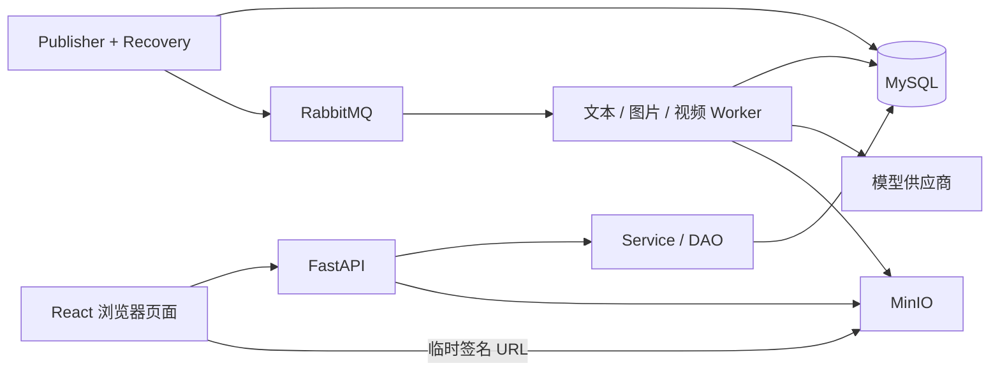

# 系统架构与数据流

Miniart 的品牌数据以 `backend/src/short_drama/core/branding/brand.json` 为唯一来源，图片由同目录 `assets/` 提供。两个前端在构建时读取同一配置，分别注入初始 HTML、品牌模块和带内容哈希的图片 URL；画布初始化后的标题、描述和图标沿用同一数据。后端以包资源读取并缓存配置，API、MCP、邮件及助手身份共用名称；不再从 `APP_NAME` 读取品牌。修改后重新构建前端、重启后端各进程，操作细则见[品牌配置维护](品牌配置维护.md)。

方法目录仍按100项分页，版本身份每页批量读取，保留冻结归属和手选覆盖。会话SSE满100项立即续读，有输出但不足页时等200ms；随后空页按400ms、800ms、1秒退避，初始空页等1秒，每次读取仍使用短Session重新鉴权并维护cursor／resync。reasoning沿既有200ms／8KiB批量边界按2048字符拆delta，保持连续UTF-8 offset，同批delta使用即将落库的同一block_version，批末仅写一次最新块；4MiB归档上限、total_bytes及归档状态事务保持原义。工具kind收敛到现有presentation／ToolSpec元数据，未知历史工具展示为tool且默认可见，执行仍受严格目录准入。managed引用及Chat／Responses内联图片统一按detail估算：low为2048，高／auto／默认4096，真实模型context_profile继续生效。

记忆恢复候选只排除同范围成功retry child且已进入连续extract水位或summary覆盖内的历史failed父记录；父记录保留失败审计，不再重读纯历史来源或过时summary CAS。当前未覆盖来源变化仍先校验，子stale、父子sending／unknown与连续水位／CAS边界继续有效。

前端按AgentTurn及text_parts去重持久／流式正文，用户回答或补充输入作为助手段的边界。过程和sandbox明细的展开选择按持久活动／块身份保存在当前会话内；前一用户尚未加载时，补历史仍可改变显示段key，但恢复原展开选择及阅读位置，块身份及parent/scope归属保持不变。选择不持久化，切换会话或访问结束时清理。resync按原snapshot_cursor／resume_cursor重建，保留暂存正文并按turn／offset去重，权限结束仍清私有缓存。Operation历史保存每Task补页水位，普通快照合并返回操作及active_operation，连续事件更新已缓存尾部，缺口重建重新核对。限页快照只为实际返回的Operation／active_operation及trace块建立实体覆盖水位，各历史页也只标记返回实体且不推进全局消息水位；未覆盖实体的迟到事件继续按自身版本／终态保护合并。损坏本机请求记录可重读及明确清理，读异常不等同损坏；重读得到有效未知记录时恢复原键核对，已受理清理失败继续反馈。

正式图初始化读取触发消息之前的合格阶段摘要及覆盖水位后的历史；摘要携真实来源身份，撤回／遗忘／主体权限与完整工具组约束继续核对，历史重答不得读取未来摘要。不把旧未使用的84KB硬限额接入正式图，容量仍由模型context_profile和实际provider预算准入。失败维护因旧模型失效或当前来源变化而恢复时，保留旧审计并从相同连续水位安全重建；原sending／unknown不自动重发。来源48KB是批量目标，单条完整来源继续经真实预算准入，不截断伪造覆盖。

续租使用 claim 的真实 lease_until 作为本地边界；异常只在最后已确认有效期内重试，到期抛 LeaseRenewalUnavailable 交持久恢复，真实失租不能覆盖新Worker。约1秒的只读控制查询与完整续租事务分离，读取 stop_pending／delete_pending／cancel_requested／deleting 后取消本地图和沙箱。取消时不再主动drain补齐raw；底层同步IO仍可能继续收尾，stopping不承诺即时终态。已发送但不完整的回执仍保留unknown与预占。终态持fence按turn和连续UTF8 offset结算未入正式消息的assistant.delta，存为带interrupted_response引用的narration；history_projection排除正文，记忆来源仅有不完整占位。轨迹对象存储异常单独标不可用，已持久模型raw、usage和成功事实不因展示归档失败改成供应商错误。

2026-11-03 运行恢复边界：`AgentRuntime.execute` 只将已识别的连接失效、MySQL 暂态码和连接池超时交给持久恢复；确定性代码、工具目录或 SQL 契约错误以 `agent_execution_error` 将 Run 结算为 failed，Task 沿现有 paused_error／terminal 语义保留输入和成果。工具 Operation 的 turn_id 由关联 ToolCall 投影；展示快照不再写入公开 Operation DTO 已移除的 summary。ENGINE_VERSION、租约围栏与供应商受理不明的约束继续独立生效。

通用系统提示 `assistant-runtime-v17` 随新 Run 创建冻结，要求依剩余目标、已保存成果与真实回执继续实际工具调用；规模大或阶段性进展本身不是终点，可通过现有工具纠正的失败由模型修正后继续。主模型判断目标是否完成并据实交付，必要输入与业务结果沿原 ask／wait，停止、权限、预算和受理不明仍由现有边界约束；不增加完成审核或续跑循环。

停止后以最新输入确定本轮目标：只读复核先读取并简述已有成果，不自动恢复旧创作或旧追问；明确继续时仍按最新要求和有效授权推进。Skill释放或压缩不撤销真实回答与已完成步骤，摘要漏记或父未见完整子对话不能单独作为重问／再委派依据；事实仍在获准来源、原操作和真实业务成果内核验。显式观察笔记调用已有记录工具，普通说明不算已保存笔记；来源撤回／遗忘、skip及必要ask边界保持原实现。

提示要求委派保留必需操作、方法、来源与验收要求，不能弱化为可选或通用建议；用户明确指定主助手亲自完成的部分由主助手完成。必要方法或工具不可用／不适用时如实说明尝试、阻碍和未完成部分，父按原要求核对交付；普通讨论仍按需选择方法，权限、排除条件和跳过规则继续生效。task 交接保留用户目标、对象范围和交付要求；父助手自行读到的 `storyboard_version` 等集合版本只是临时快照，不成为子任务不可变条件。子写入前自行取得可信当前版本，确认原写入未成功且仅集合版本冲突后，可在原授权内刷新元数据继续未完成目标；用户明确版本、交接对象版本／选区及既有对象权限仍有效。受理不明先查原操作，不换键盲目重发；提示不改变服务端版本守卫或交接结构。

助手指令、工作台操作、媒体生成与长期记忆共用账号级 settings_version，部分 PATCH 自动保存。新 Run 冻结指令、系统提示词、工具版本、Skill L1 目录及单次容量策略；任务不保存用户媒体数量配额。统一受保护模型工厂为主模型、工具选择和框架摘要提供真实模型，每次实际发送均在父 Run 锁内准入与预占输出，所有 scope 共享实际调用／输出和缓存计量，正式运行不设累计硬限；晚到回执可结算，未知发送不重发。可靠用量先于响应可用性校验结算，截断或畸形工具结果仍计入实际输出；无可靠输出用量保留预占，仅确认未受理才释放。

原生媒体归档与业务采用分开授权：已经外发的产物继续保存与结算，图片主图、分镜视频、音色、配音和画布绑定在真正采用前读取当前工作台权限；MCP 使用原令牌独立核验。关闭工作台或来源令牌失效时保留候选与画布私人产物，用户手动采用沿原账号权限执行。只关闭媒体生成阻止新的外发，不阻止已发产物在工作台权限允许下采用；已经完成的采用审计不因随后关闭权限而丢失。

DeepSeek 通过显式 `provider=deepseek` 或精确官方域名 `api.deepseek.com` 识别；官方地址配置为 `custom` 也启用适配，任意自定义端点不按模型名推断。Chat Completions 使用官方 ChatDeepSeek，历史 `reasoning_content` 回填与摘要引用计量共用原投影。Chat 与 Responses 的强制工具选择请求合入 `thinking.type=disabled`，Chat 摘要辅助请求也关闭思考；主模型默认、auto、none 保留思考配置。思考和工具选择冲突使用 `agent_tool_choice_conflict`，不能据此认定模型不支持工具。思考／正文分流、脱敏、typed checkpoint、用量与原始回执重放沿用原路径。

官方 `ModelRetryMiddleware` 保留无效工具选择的恢复，并对已完成真实请求、受理明确的 `invalid_agent_tool_calls` 最多再生成两次；失败响应不修补、不执行，实际用量与调用身份逐次保存。未知受理、取消、预算等其他错误及 `requests=0` 的原始回执重放不由此触发新请求。摘要保留历史只在本次主模型成功返回后加入待持久 compaction，失败尝试的摘要不写入成功回执，避免崩溃恢复时多出旧摘要。该有界恢复沿框架现有循环，不新增项目自管循环。

正式 Run 的模型连接首次等待30秒，仅在未发送请求字节的连接超时后重试5次，连接等待依次为60、90、120、150、180秒。SDK与HTTP库自动重试关闭。重试状态持久化，刷新后仍显示“连接超时，正在重试 1/5”；连接成功或结算后清除。响应等待使用 `AGENT_MODEL_TIMEOUT_SECONDS`（默认120秒、范围1–600秒），从发送前开始，流式正文、思考和工具参数进展刷新空闲期限，HTTP头与心跳不续期。响应超时返回 `agent_response_timeout` 并直接结束，不重发已发送请求；受理不明保留unknown与输出预留。主动停止取消异步HTTP。配置启动读取、重启生效；标题辅助调用使用独立短期限且不作连接重试。 TCP／TLS连接完成后、发送HTTP头之前才登记Turn和预留，连接失败不消耗模型预算。`model.connection`与checkpoint的`model_connections`持久化状态，RunRead投影供刷新恢复。执行中的任务显示实际模型并锁定；错误暂停、预算暂停或停止且控制与操作已结算后，`can_change_model=true`，可选择模型并在同一Task创建新Run继续，旧Run、业务收据与已保存成果保留。原调用受理不明时，须先核对并明确确认继续可能产生新费用。会话失败只展示后端保存的消息。

真实图状态以 scope 隔离消息、输入水位和 Skill activation；仅初始根范围加载 Task 历史，子范围不得回退根状态。历史与新增输入统一使用稳定 TaskInput ID，保证同 Task 新 Run 初始化和再次恢复均按原顺序去重；框架摘要保留活动 Skill 的完整工具调用组，缺失原始组时从 canonical Operation 逐结果恢复，已释放或撤回成员只带无正文的真实终态，各自来源身份不借用活动兄弟。记忆来源遗忘同时撤回相关消息、摘要与方法资格，资源读取校验 frozen activation／path／checksum。凭据和服务连接只在 RuntimeContext 中传递。正式 Worker 只调用 AgentRuntime.execute，由框架完成整次模型／工具循环；下文旧 Harness 流程已标为历史。代码工具通过 OpenSandbox SDK 在独立 Docker 网络执行，按 scope 首次使用时创建环境，持久工作区固定 `/workspace`；等待释放容器，恢复文件和包，不恢复进程内存。

模型回执的 `graph_input_hash` 同时校验输入内容和公开图执行身份（thread_id、checkpoint_id、完整 checkpoint_ns、task_id），查询继续按 Run／scope 分区。同一步结果已提交而图未写回时，重建 Worker 复用该回执；来源撤回后进入的新图任务即使内容相同，也允许新的模型决策。selector／summary 的实际调用账本、未知受理不重发和工具／业务幂等身份保持各自边界。

当前控制 DTO 只有 stop；旧 resume／redirect 及其专用字段在入口返回422，历史 Control 行只保留审计，不创建新 Run。控制回执按原幂等键优先回放；成功 Task 的新 stop 返回409，不修改 Task／Run 终态或新增控制审计。旧中文语法指令授权已退役，写入按实际 scope、显式主体选择和持久业务收据校验。已采用媒体的 Operation.changes 保存原生素材及 canvas／storyboard 的真实 before／after 版本；逆向恢复沿这些事实推进证明链，不能覆盖后续人工修改，也不改写原 submit 结果或复活已终结 Run。

> 2026-10-28：Agent Worker 已统一为 Harness，单 Run 的决策次数和输出 token 有有限预算；停止后发送普通消息创建新 Run。下文关于旧引擎保留及决策／输出无限的描述为历史记录。

根图每次模型前从真实 TaskInput／Message 恢复有界原始目标和最新更正。同一 root pinned Human 保持 task_user_sources 为首 key，随后 current_run.run_id 来自当前锁内 Run，trigger_message_id／trigger_seq 来自其可信启动 Message；不从摘要、最新消息或有界 items 猜测。合格触发身份同时加入原 source_message_ids 元数据，即使正文因原12KiB／条数边界省略也不误报撤回或补正文；restricted 触发只输出 run_id 与 trigger_source_withheld=true，原身份、序号和正文不再注入。后补与已消费答案继续入模且不改 trigger，旧约束不按 seq<trigger 一律丢弃；每轮、摘要后与新 Worker／Session 都从可信行及现有资格重建，child 分支不注入此根投影。工作笔记依据成功读取的 Operation、Turn、结果 checksum 与成功记录操作生成，每个 scope 只注入本 Run 自己记录的笔记，最多32条、估算3000 tokens；固定消息身份使两次及后续框架摘要保留当前投影。读取回执保存服务器来源 epoch、主体范围及来源消息／Skill身份，正文与摘要沿用这些标记；主体移除或不可访问、来源遗忘、方法释放或手选移除会撤回相关上下文，不因旧摘要或父Task笔记重新带入子范围。

真实用户答案从已成功消费的 ask Operation 关联到 user/tool_answer Message，按同一 Task／Run／scope 取最新32条小列身份，再读取原文，先排除 restricted 来源。根范围与已有 TaskInput 按消息顺序合并后沿原12KiB来源投影；子范围仅把自己的答案并入原 delegation-sources Human，与冻结委派目标同时提供给 selector 和主模型。完整 Skill AI／Tool 组仍按原资格撤回，不为保留答案复活问题参数、已撤回正文或 AI 推导。

内部工作笔记使用带专用标记的 AIMessage，原生工具选择器仍读取最后一份 HumanMessage 来源投影；根来源随输入 revision 替换旧投影，始终只保留当前一份。子范围从已受理 task 调用的冻结 description 恢复有界委派目标，同时保存接收时的 memory_epoch；来源 epoch 失效后仅保留撤回提示，不回读父历史或兄弟状态。框架摘要保留真实业务消息和活动方法完整调用组的原相对顺序，防止旧加载决策移到新图片结果之后；明确标记的内部上下文放在末尾，笔记在当前范围的目标 HumanMessage 之前。方法图片沿已有 HydrationIntent 进入同一水合链；水合忽略明确标记的内部笔记，仍以真实助手决策为一次性交付边界；成功响应才记录像素交付，截断响应不记成功交付。

同一来源 Human 独立携带 current_skill_activations：投影当前图 state 中合格的 activation_id、skill_id、content_version、body_operation_id、active，最多沿原32条激活边界，按 Task／scope／restricted／excluded 过滤，不含用途、问题或方法正文；因当前mode／policy不再兼容的项可携带issue，模型可据此纠正。历史 canonical ToolMessage 保持原 activation／active 当时值；新旧当前活动状态由此投影表达，不修改历史回执，也不建立第二份进度账本。

Skill load／release在已有Run短事务中读取同scope／turn已提交的activation_updates，与调用者旧state合并后核对8个／8000正文估算tokens；完整结果和激活增量同存原Operation.result，异常回滚不占额度，结算前重试复用原正文与身份。reducer保留失活与manual优先。上下文边界先撤回mode／policy不兼容项的正文及派生完整组，再恢复其他合格正文；同组每份正文均核对冻结checksum。缺档或非法正文日志只记operation_id／scope_id／reason。

统一执行投影由 `agent/runtime/events.py::AgentEventAdapter` 接受携真实调用身份的 SDK 可见内容与框架流，复用 AgentEvent 保存 `trace.block/trace.delta`。公开 reasoning 独立成块，主范围普通正文继续走 `assistant.delta/Message`，子范围、选择和摘要正文不进入主会话。主范围工具决策的正文为空或全为空白时不创建 narration 消息，非空叙述按原文保存；原模型回执、ToolCall、用量结算与检查点回放保持同一正式链。工具 SPEC 的展示解析器从冻结目录、Skill activation 和可信业务目标生成 action／target／title，整份公开展示统一脱敏，私有冻结引用保留实际路径与有效读取范围。`ToolTraceVisibility.VISIBLE/HIDDEN` 由工具注册配置统一决定，未配置工具默认可见；隐藏只过滤 UI 过程段，执行、Operation、事件、状态及关联成果继续保留。消息文本段按 turn id、UTF-8 offset 重组，在正文与 delta 完全一致时由持久消息事件发布段起始 seq；工具活动关联 AgentToolCall.turn_id，并保留开始、更新、结果事件序号。运行快照在同一短事务捕获事件水位和最新块，随后从水位续传；前端装入补齐缺口的快照后重放可连续的已保存增量。DAO 在水位内批量合并每块后续增量，分页默认50、最多100。详情只接受块内资源身份，读取冻结 Skill 版本和本次分段或签发短期归档地址，I/O 前后重新验权；终态及恢复不拼接旧模型调用块。契约见[统一执行轨迹](../api/assistant.md#统一执行轨迹)，前端唯一投影在 `features/assistant/runtime/assistant-trace.ts`；`AgentTimeline.tsx` 将文本与活动按 AgentEvent.seq 组成单个助手回复，运行过程自动展开、结束默认折叠，成果保持可见。普通工具行显示结构化动作、对象、摘要和状态；sandbox 可展开执行输出。子轨迹从持久 scope 归属父活动。后台有界通道、冻结片段及受控归档继续保留。历史分页、重连和刷新继续合并同一状态；各 Run 独立使用 next_before_seq／has_more，resync 保留已读块并重建发现游标。

宿主与无限画布均只支持内容视口 ≥1280 CSS px 的桌面浏览器。根布局使用桌面最小宽度；四阶段按钮、设置、助手、声音及检查器统一桌面呈现，不保留设备切换分支。组件内排布、桌面调宽与内部滚动继续工作。现行设计约束见[设计约定](../../frontend/DESIGN.md)。

本文说明当前实现的边界与不变量；启动见[开发与运行](开发运行与验证.md)，请求格式见[接口约定](../api/README.md)，表结构见[数据库设计](../database/README.md)。

2026-10-21 起，作品直接使用项目身份，原标准模式更名创作模式；删除分集、三层素材库关联、成员与邀请。项目资料只有名称，生成参数来自请求／私人草稿／模型默认，成片输出比例在导出设置中管理。当前产品、数据归属和切换约定见[创作模式维护说明](创作模式维护说明.md)。

## 运行结构

MySQL 是任务状态和业务结果的持久化依据。RabbitMQ 承载调度消息，Celery 不保存业务结果；浏览器通过轮询读取状态，离开页面不会停止后台任务。MinIO 保存图片和视频文件，数据库保存稳定定位值和媒体元信息。

> 2026-10-28：独立任务管理页面及其导航、跨页入口已退役，旧 `/tasks/*` 地址替换跳转到项目列表。后台异步任务、生成与批次 API 继续保留，创作流程和画布内仍提供必要的进度、失败与恢复反馈。

主页媒体资产库只查询本人调用 AI 后已归档的图片、视频、音频；手动上传仅保存为输入媒体，不会创建生成资产。列表经 `MediaAssetService` → `MediaAssetDAO.history` 读取 `media_assets`、生成记录和媒体文件，工作台分类通过生成记录 → `async_tasks.project_id` → `projects.workspace_mode` 过滤；页面标签为“生成历史 / 创作模式 / 画布模式”，个人无项目历史只进入“生成历史”。工作台、媒体类型与名称条件在服务端统一作用于 count 和分页，按 `created_at DESC, id DESC` 稳定排序，账号范围继续由资源权限过滤。

前端以 URL 保留工作台、媒体、名称和分页条件，每页 24 项、桌面六列；名称搜索框为 32px 高，与媒体类型按钮同行。点击先重新读取资产详情获取有效签名 URL，再直接打开图片预览或居中视频／音频播放器；预览只读，关闭停止播放，不提供重命名、采用或任务跳转。已有创作场景的媒体选择与采用仍使用原接口。

## 前后端分层

账号 Session 带可信 Actor，统一 ORM 查询过滤与事务内写入检查保护私人资源和项目资源。两种模式均由所有者独占；其他账号不能读取项目及其后代。系统 Session 仅用于认证、Worker 和运维迁移，不由 HTTP 输入开启。

前端 `app` 管路由和布局，`pages` 组合页面，`features` 管业务组件与编辑会话，`api/<业务>/<功能>` 封装请求，`types/<业务>/<功能>` 集中具名类型，`shared` 提供公共能力，`integrations/canvas` 提供跨包桥接，`api/http.ts` 统一错误。正文保存、分镜保存、任务轮询分别维护自己的状态；路由离开保护等待未完成的保存。

后端遵循 API → Service → DAO → ORM。Pydantic 校验请求和输出，Service 验证归属及业务条件，并在一次事务内组合多个 DAO；成功提交、异常回滚。独立 Service 调用应使用尚未开始事务的 Session，返回物化 DTO，不依赖事务外的懒加载。

认证中间件只调用 `AuthService`；资源范围查询与会话撤销经 `IdentityDAO`，模型偏好由 `ModelPreferenceService` 持有事务。`TaskRuntimeService` 负责领取租约、提交权限和图片组联动，`TaskRuntimeDAO` 只做锁定查询与续租 SQL。`db/scope/resource_scope.py`、`db/scope/canvas_scope.py` 和 `db/scope/canvas_resource_scope.py` 共用权限父查询、画布校验及复制溯源，不反向调用业务 Service；时间、方法目录常量和纯画布文档转换分别位于 `core/time.py`、`core/skill_catalog.py`、`utils/`。

Agent 的锁、授权判断、工具契约和候选来源快照由独立模块提供，执行器再组合业务工具；声音快照、原生配音上下文、生成策略和渲染工具也各自提供单向依赖入口。前端 types 按业务集中传输 DTO，API 模块只实现请求，配置表单转换位于 `features/ai-config/editor/config-api.ts`，通用预加载组件只接收加载函数。

SQL 外键和 CHECK 约束保护单行及引用完整性；同项目归属、批次一致、生成来源等跨表规则仍由 Service 校验。不能以“外键允许”为依据绕过这些服务。

## 创作内容与候选

| 对象 | 持久化位置 | 操作语义 |
| --- | --- | --- |
| 项目 | `projects` | 名称与模式创建；直接承载创作内容，不分集 |
| 剧本与故事设定 | `project_scripts`、`project_story_settings` | 当前非空剧本保存即生效；故事设定有独立版本，私人候选继续明确采用 |
| 流程素材 | `assets.project_id` | 角色、场景、道具直接属于项目，无跨库关联 |
| 素材图片 | `image_groups` / `image_group_items` | 普通创作生成直接保存组，默认第一张主图；Agent 候选遵守明确采用流程 |
| 分镜 | `shot_scripts`、`shot_assets` | 服务端编辑、关联、排序；提取替换保留软删除历史，无手动归档入口 |
| 当前分镜媒体 | `shot_images`、`shot_videos` | 采用结果；替换旧结果进入回收记录 |
| 生成输出 | `ai_generation_records`、`media_assets` | 与当前业务内容分开，未采用结果仍保留 |

剧本页仅提供 script_rewrite 选区改写，冻结选文及前后各最多 2000 码点；模型输出和当前稿、版本、回执同事务结算。小说、大纲及其专属生成链已删除。Agent 私有候选仍须明确采用；结构化分镜先保存候选，追加或替换后才写活动镜头。

`WritingGenerationService` 在项目锁内冻结来源和目标指纹，按活动文本任务推导目标锁；所有正文写入入口使用同一项目锁与活动任务 current read。模型执行不持有数据库事务。原始输出先持久化，目标正文、并发版本、业务回执及任务成功同事务提交；锁序为 Project → Task → Document。改写使用码点半开区间，服务器精确拼接，取消、迟到或过期目标拒绝回填。前端 `useWritingGeneration` 负责原体原键核对及任务轮询，`WritingSession` 刷新保留非目标未保存输入；只有基线未变才安全续接全局版本。见[写作契约](../api/writing-workspace.md)。

素材提取只调用文本模型。服务端校验类别、原文依据和结构；用户可编辑候选、选择部分创建或复用素材。AI 输出不直接获得修改已有素材的权限。

创作工作台以左侧40px满高图标导航切换剧本创作、资产生成、分镜制作、成片预览，路由仍为source/assets/storyboard/assembly。剧本为960px最大宽度的“故事设定 / 剧本正文”双标签，正文与两侧统一近黑背景（#181818），故事设定输入框为稍浅灰色（#202020）、聚焦无边框，无导入／导出和固定底栏。正文仍由WritingSession串行保存并维护项目content_version，保留中文输入法、撤销与选区改写；任务进度与停止位于标题行，页面已移除“让助手起草剧本”和“最近变更”按钮。故事设定经story-settings GET/PUT、Service→DAO→ProjectStorySettings持久化，四字段使用独立row_version，首次读取返回空值与版本0而不插库；首次保存0→1，后续CAS递增，409保留本机输入。ResourceEditingSession复用串行保存、账号隔离、本机恢复、保存状态与导航屏障，不回填旧小说／大纲，也不自动加入AI提示词。资产库和分镜表支持按账号记忆的列表／宫格，列表及底部创建高45px；主页面提取入口移除，已有任务、历史候选及采用流程保留。成片内部和AI创作助手沿用现有实现。

标准工作台的错误与警告由StudioFeedback发布到公共Message并登记恢复详情。页面通过保存状态访问，原生Dialog使用自己的Provider与标题详情入口；仅在反馈详情展开时解除Dialog外壳裁剪，内容区继续内部滚动，使读取失败后的重试可点击且不挤压编辑器。

## 项目 AI 创作助手

创作模式与无限画布共用本人项目会话，已受理 Task 保持真实项目／画布目标。新 Run 冻结提示词、工具和 Skill 目录、模型与有限调用／输出预算；Task 只保留产品手选元数据，当前 Skill activation 和正文属于 scope graph state。

新会话保留默认标题“新对话”。Worker 领取首条用户消息时冻结其正文，`AgentRuntime` 与首轮任务并行使用同一受保护模型和父 Run 账本生成标题；自动标题及失败时的首条消息截短兜底均最多 12 个字符，命名提示词位于 [conversation_title.md](../../backend/src/short_drama/ai/prompts/assistant/conversation_title.md)。标题请求受理不明保留账本记录但不阻塞主任务或恢复，也不重复外发。标题更新仅在会话仍为默认标题且版本未变化时落库，并通过 `conversation.title.updated` 推送前端；会话版本变化表示用户已手动改名，自动生成不会覆盖。

Worker 的 `AgentRuntime.execute(run_id, message_version)` 在短事务领取唯一租约，只桥接一次 async 图运行。唯一 `build_agent`、受保护模型与公开 middleware 驱动完整循环；普通工具完成不经过 broker 重投。每个工具边界先登记 ToolCall／Operation，业务写入及幂等回执同事务提交，随后公共结算保存真实 ToolMessage／Command，下一模型轮即可读取本范围成果与版本。Run 终态或等待只在完整 astream 和同步 checkpoint／pending writes 退出后结算。

公共结算为 `READ_TOOLS` 与 `WRITE_TOOLS` 的实际 ToolMessage 写入 `receipt_operation_id=AgentOperation.id`，并保存同一消息供检查点恢复回放；后续模型可直接按原写操作身份调用现有回执／成果读取。`business_invocation_id` 仍标识业务幂等回执，成功 task 的 `business_receipts[].operation_id` 仍指向真实子业务原操作。回执读取中的 `receipt.id`、成果读取中的 `operation_id` 指向被读操作；读取结果自身的 `receipt_operation_id` 不能替代原保存来源。

心跳和图任务并发，停止、失权及租约丢失取消图并禁止后续写入；取消模型连接不能保证供应商不计费，账本保留实际发送和受理不明事实。恢复只投递故障或启动候选，持久等待不因没有租约而重投；无 interrupt 的故障以原 checkpoint 继续，未就绪 interrupt 保持等待。已提交业务效果重放收据，成功 Operation 的状态型 Command 也补回 graph。已发送模型缺少可确认 graph 回执时转 unknown 并暂停，禁止盲目重复请求。

最终纯文本请求途中已受理的新输入由公开 after_model 路由继续到模型；最终 checkpoint 到 finish 的窗口由完成事务与消息受理共用行锁交接。若产品输入水位仍落后，不发布过时最终答复，持锁安排同 Run 下一投递，经公开新调用继续原 graph 状态，只在真实 model_input 推进水位；thread、scope、冻结快照和父预算均保留。实际用量沿该固定 thread 持久累计，交接不重置，也不作为累计硬停止条件。wait 与 finish 共用取消判定与收尾，停止、控制及实时权限优先于等待和输入交接。

正常最终答复直接写入助手消息，不运行强制 reviewer／completion contract。父 Run 账本涵盖主模型、工具选择与摘要，正式运行不因累计 token 或调用次数终止；明确长度截断接续，原生上限及无进展准确报错并保留任务。停止或暂停后普通消息创建同 Task 新 Run，通过真实成功业务收据冻结明确创建资源身份，继续读取已有成果，不混入 sibling／全 Task 操作。历史重答只使用原位置的输入和历史，禁用工具并替换原答复。

摘要在公开 model-call middleware 中读取 selector、Skill 依赖和委派扩展之后的最终 system／tools／messages。共享平台 UTF-8 JSON 字节估算与输入限计算：窗口扣单次输出、4096 工具余量和 2048 安全余量；system、实际工具 schema、活动 Skill 完整组和 pinned 来源／笔记先计固定成本。剩余空间的 70% 触发官方 SummarizationMiddleware，保留目标为 25%；固定成本已达输入限，或最多两次整理后仍超限时返回 agent_context_budget_exhausted；大工具原结果先持久保存再投影并可按页回读，整理与接续状态通过run.recovery按scope同步。规范化预估不等于供应商 tokenizer，也不承诺三协议 wire 完全同字节，最终 SDK body 准入仍为权威。摘要与最终 AI 消息一并存入已有 Turn 回执，回执已提交而 graph Command 尚未写入时，恢复补回同一压缩结果，不重复付费。

最新纯文本完整 AI／Tool 组超过保留容量时，使用已有的真实 pinned 目标 Human 作为官方公开 keep 边界，让完整组整体进入摘要，不拆配对；无 I/O 资源投影表明仍有待交付媒体时保留真实完整组，不以文本摘要替代像素交付。公开 summarizer 回调按摘要模型自己的窗口、输出和提示包络选择连续片段，将前次摘要与下一片段合并，全部选中历史成功处理后才替换原组；任何片段无法容纳便明确拒绝。摘要继续保留来源、Skill 与主体元数据，内部 helper 分批数独立记录，不替代独立上下文压缩次数。预算拒绝沿现有 Run.error 保存 fixed／helper／post_summary／main／selector 阶段、source、窗口和数量估算，不保存正文、密钥或上游原文；SDK 发送前拒绝不创建已发送 Turn 或扣除虚构用量。

活动 Skill 的正文锚点只来自含 `instructions` 且被当前活动身份引用的 canonical 原加载组；该 AI 的兄弟调用和结果仍完整保留。独立 metadata-only reload／already_loaded 组交回原生摘要，默认阈值未触发时也可留在历史，不强制删除或改写旧回执。当前身份、真实问答和撤回资格继续由原有 Task17 投影与来源规则决定。

预算终态在 `finish_locked` 对 Run.error 收窄后由 run.finished 复用；新 Session 的 ORM 重读保留相同事实。白名单只接收既有 phase／source／fixed_kind 枚举和非负整数的窗口、预留、估算、消息／完整组数量及 helper 字符游标，排除 bool、未知字段和任意正文／URL／供应商原文。公共 RunRead.error 维持原 code 投影，未新增 API／DTO 字段；发送前拒绝不创建 Turn，已发送 helper 的父账本用量保留。

每片 helper 输出先去除首尾空白并确认非空，再覆盖前次摘要、推进历史游标。空文本或纯空白以 `agent_summary_empty` 失败，不发布替换 Command 或 `graph_compaction`，检查点保留原消息；已发送 helper 的正常回执和真实用量仍留在父 Run 账本，不重试该摘要。

摘要计量通过模型 callbacks 显式接收 GraphResources 的无 I/O 投影和请求作用域。一次模型调用在摘要前用完整消息确定本轮 ToolMessage 的消息 ID 与调用 ID，固定／候选计量及摘要后的真实水合共用该身份，不因候选删掉较新的 AI 而重选旧组。作用域沿现有 ContextVar 模式隔离并在 finally 恢复，不进入 checkpoint。投影共用实际水合的协议媒体块与冻结 ResourceRef，包含 low／high allowance；Chat 额外生成的临时 Human 媒体块不参与按消息条数配对。过时或已撤回的媒体组不计为即将交付的像素；固定／候选历史的多次计量不读存储、不持久媒体字节，新合成摘要照常计量。真正水合仍在 SDK 请求前实时验权并校验冻结对象，最终准入 guard 保留。

工具选择使用官方 LLMToolSelectorMiddleware 的公开 system_prompt，模板 `ai/prompts/assistant/tool_selection.md` 通过 registry 加载，创建 Run 时保存正文与版本；跨 Worker 恢复沿原冻结模板。首次 claim 在同一事务固定 permitted_tool_names 与 `assistant_settings.tool_descriptions`，正式构图以该正文创建独立工具实例；根／子助手、selector 和 Skill 追加能力共用此实例池，原生 task 经公开 task_description 参数接收冻结正文。已创建但尚未 claim 的 Run 使用首次 claim 时的描述，已领取 Run 恢复仍用原文；prompt 的创建时快照不变。描述目录不授予调用权限，实时权限检查继续生效，不冻结 handler 代码或 schema。

工具按完整多阶段和条件目标选择读、写、核验能力，问答等待不免除原保存目标。`read_current_script` 只读本次授权的 ProjectScript 项目原稿或选区，原稿修改由提案及审阅采用流程保存；`apply_standard_patch` 的 create_shot.values.script 保存 ShotScript 分场正文，新建分场不要求原稿引用。写入前通过 describe_creation_target 获取 patch.storyboard_version，关联或修改既有对象仍需对象授权。工具选择保持自主，真实业务回执继续证明保存。

官方 selector 的精确非法名称 ValueError 由公开 ModelRetryMiddleware 最多重试两次；每次 helper 调用仍经过同一受保护 SDK、实时准入及父预算，在 child 保留自己的 scope。耗尽保存 failed／invalid_agent_tool_selection，故障重投不再请求；其他异常继续沿既有错误与持久恢复处理。

运行中补充先进入 graph，再推进产品输入水位，稳定 TaskInput ID 保证顺序与去重。遗忘推进 memory epoch，撤回含旧正文的 graph 消息、摘要和后续推导，再从合格输入与收据重建。图片仅在读工具后的下一主模型请求临时水合；typed checkpoint、Operation 和 Turn 冻结请求保存引用，不保存像素。沙箱的 started／log／finished／artifact 事件关联 scope、ToolCall 和 Operation；可见命令输出默认最多 64 KiB，大日志最多归档 4 MiB 并返回授权 ResourceRef。普通成果以 MIME／大小／checksum／locator 写入 Operation 与事件，不创建媒体实体；图片／音频／视频复用既有内容检查、StorageService 上传与 MediaFileService 落库，返回本人私有媒体身份及 ResourceRef，同当前 Operation 关联。检查及上传不持 SQL 事务，上传后再次校验执行租约和账号权限，失败补偿只删除确认未被引用的上传。删除会话沿 purge 删除未采用且无独立引用的私有媒体与普通文件；其他会话附件、业务外键引用及已采用媒体保留。

原生媒体提交立即返回身份，显式 `runtime__wait_generation` 按 scope／call 幂等登记 Operation.wait_state；首次未完成便固定经过 interrupt，重建 Worker 不重新提交。所有依赖终态后读取真实状态、失败和成果引用。旧已受理媒体的完整结算由 operations/media_settlement Service 保留，coordinator 只扫描结算与等待就绪。saver 将真实 interrupt id、namespace、checkpoint 和 task 身份与 pending writes 同事务保存，子图冒泡不覆盖首次暂停位置；消费标记只在真实工具结果持久写入后推进。完成先于绑定、绑定后崩溃或多个并行等待均按各自身份定向恢复。根图仍执行时只记 ready，全部分支退出后才释放租约并安排恢复。

006 离线切换只把旧 Run 下仍被结算／撤销消费的四个持久工具名补为 workbench__ 前缀，原名写入各自 result.historical_runtime_audit.tool_name；参数摘要与幂等身份不变。媒体 collector 的等待与终态回写均保留审计。已有 provider_task_id 的 sent／poll 原生任务可继续查询、归档与历史撤销，人工修改造成采用冲突时保留候选；prepared／submit 在旧 Run 终结后拒绝新付费外发并释放预占。两条路径均不复活旧 Run。

`runtime__ask_user` 复用同一等待机制，问题字段保存在 Operation.arguments，答案走独立的 `/assistant/operations/{id}/answer`，在验权、版本及字段校验后保存 role=user、kind=tool_answer 消息和真实回答者，发布 answered／ready 事件并唤醒原 Run，不新建 TaskInput。答案工具结果携带 answer_message_id，遗忘可撤回其正文与后续推导；活动 Skill 恢复同组调用时也逐结果保留来源资格。全部可执行分支暂停后，有未答问题则 Run／Task 为 waiting_input，只有生成等待时 Run 为 waiting_generation、Task 为 waiting_media；仍运行的兄弟分支保留 running。快照 pending_questions 提供 scope、版本及可答状态，仅可答时携带 request，已答或不可答时 request 为 null；停止将等待 Operation 结算为 failed／agent_cancelled，ToolCall 为 cancelled，终态不再唤醒。

前端 `questions/AssistantQuestionDock.tsx` 将 pending_questions 按 operation_id 汇总在聊天滚动区外，吸附在输入框上方。Agent 每题提供 2–4 项与推荐标记，支持单选、多选及 1–12 题前后切换，界面统一追加“其他…”；并行问题组分别保稿和提交。成功或核对到已处理后隐藏面板，聊天保存自然语言答案，结构化答案继续用于原图恢复。草稿及未知答案原请求按账号／会话／Operation 保存，提交携版本与固定幂等键。未知先读 taskState，缺项再读原 OperationDetail，不能按 pending 缺失推定成功；409 保稿，停止后禁答，普通消息续跑语义保持不变。

配置页位于工作台壳内的 `/settings`，以左导航和右内容区组合模型、助手三页及 MCP。助手设置会话跨页保留串行队列，文本 600ms、开关立即同步；409 或结果未知保留输入并先核对服务端，迟到响应不覆盖后续编辑。工作台父开关控制修改能力，开启后显示媒体总开关；只读分析用户引用的资料不受关闭影响。账号级长期记忆不绑定作品或对话，开关代次在排队、模型外发和提炼落库处核验，关闭不删除、重开不补抽。记忆管理按条目版本自动保存及删除。MCP 六列表格从 options 读取连接及工具目录，创建幂等，secret 只在首次响应弹层内存中保留。

桌面侧栏、素材选择、实际运行模型、成果状态和明确采用沿现有交互；删除会话时，无租约的持久问答或生成等待先沿停止收尾结算，再应用删除控制；持租约图须由 Worker 完整退出后完成删除。已受理原生媒体继续独立归档，原生作品保留。当前实现入口与历史机制见[框架运行机制](AI创作助手Harness运行机制.md)，HTTP 合同见[助手 API](../api/assistant.md)。

历史说明：2026-10-30 以前的逐轮 Harness、Task 当前 Skill 与强制验收

> 以下原文仅保留历史背景；旧逐轮、reviewer、无限预算和停止等待媒体等描述不适用于当前正式执行链。

创作模式与无限画布共用 V3 助手，会话由本人账号及 `project_id` 共同限定。切换项目读取该项目的会话、本机选择和草稿，同项目切阶段不更换会话。兼容路径仍为 `/assistant/global/...`；历史 `project_id=NULL` 的 V3 保留原身份，不猜测归属或自动合并到项目。

新创作任务自动绑定会话所属项目作为写入目标并读取该项目记忆；画布任务还须绑定当前画布。服务端在幂等回执查找后补入默认值并校验模式、项目和画布真实归属，原请求哈希不受默认值影响。补充及排队恢复沿用已受理任务的冻结目标，跨项目、跨模式或修改原画布均拒绝。标准助手已移除当前剧本引用入口，新消息不绑定正文或选区；历史已受理引用仍校验来源版本，记忆不授予作品写入权限。

桌面创作侧栏默认 380px、可在 320–560px 内调节，按账号保存在本机并为编辑区留出空间；助手统一桌面停靠。模型旁的添加菜单承接图片、文本、当前画布节点和资产库，Skill 使用同一可搜索多选列表。用户消息下不显示编辑或重新回答，回复等待状态使用动态省略号并尊重降低动效偏好。新 Harness 任务由 LangGraph 控制工作流，LangChain 单次模型调用自主选择 function calling 工具；前端按 `interruptions_supported` 区分新旧引擎。新任务支持边界停止，不提供立即改向及旧 resume 控制，运行中补充在下一边界应用；停止、错误或旧预算暂停后发送普通消息会在原 Task 下创建新 Run，恢复已结算工具历史与活动 Skill，来源撤销及遗忘仍生效。Harness 不设累计决策、工具、输出和活动时长上限，单次请求及上下文／媒体配额继续生效；历史任务保留原冻结引擎及停止水位。任务完成后下一条消息自动开始新任务；输入区不再显示当前任务栏，独立会话从标题栏“新对话”创建。`/` 检索 Skill，Enter 只确认选择，方法以输入框内高亮块显示。前端不提供任务设置、上下文管理和记忆管理弹窗；摘要、记忆抽取和读取在后台继续运行，内部记忆工具不进入用户操作轨迹。删除对话保留作品成果，受理不明仍使用原请求及原幂等键核对。详见[助手 API](../api/assistant.md)。

助手输入的素材条限高并内部滚动，短桌面窗口的移除及发送入口保持可达。模型选择只用于新任务：任务运行、停止或暂停时，输入区显示同任务运行记录中的模型及锁定说明；缺少对应运行记录时显示“沿用当前任务模型”，不使用其他任务或本机偏好冒充。`@` 对宿主对象与画布节点按名称过滤，再与服务端资产结果去重。交错时间线中，运行和失败步骤默认展开，成功组自动折叠；手动展开/收起在普通刷新中保留，不同错误原因不合并。成果卡按等待、成功、失败/冲突显示图标与状态文字，并尊重减少动效偏好。

删除会话必须等 Task 及全部在途 Run 进入终态，才投递私人正文清理；Task 提前停止不能跳过模型段收尾。历史 V3 恢复水位过期返回明确错误，前端清理未受理控制，不自动越过其他标签页的新停止。会话仍监听后续事件，终态任务不显示持续连接加载。

新任务的引用、水合、Skill 配额、轻检查点、提示词和恢复边界见 [Harness 运行机制](AI创作助手Harness运行机制.md)。L1–L5 的 MySQL 来源、作用域、遗忘、水位线与 CAS 保持原有架构。

Harness 在现有 Task 状态内维护用户来源交付要求、有来源工作笔记、启用的工具组和有界进度投影。Agent 的候选最终答复先保存在内部 Turn，再由独立模型 Turn 提交结构化完成检查；程序核对来源、真实操作、保存类别及数量、答复引文和媒体实际交付。缺项回到原 Agent，检查通过才发布最终回复。检查共用冻结请求、原始回执及恢复账本，不创建第二套任务或业务工具执行器。模型仍负责自然语言意图和创作质量判断，结构校验不等于完整语义证明。

已有交付要求按 key 核验，由服务端读取权威定义；登记要求、观察笔记与业务成果分别计数。用户输入被 L4 压缩后，额外提供最多 32 条、约 4000 估算 tokens 的原文来源投影，支持精确引用和按 seq 继续读取；遗忘规则继续生效。

近期历史先查询有界 ID，再读取正文；恢复只读取冻结 manifest 的精确组。旧读取摘录增量写入 Task，不每轮重扫全部历史，活动 Skill 正文另行保留。稳定系统提示和已启用工具 schema 放在请求前部，动态任务状态靠后；模型容量声明参与平台预算，估算和供应商实际输入／缓存用量分别记录。自动 Skill 可在阶段结束后释放，再激活时复用可用的原正文回执。媒体水合错误作为本轮结构化工具反馈，模型可修正裁剪等参数；持久历史继续只保存媒体引用。

## Skill 管理与文件预览

独立 `/skills` 页面经现有 Agent API 导入 Markdown／ZIP、发布完整包与保存个人启停。适用模式继续使用 `modes` 数组，通用对应两种模式；隐藏标签保留在导入导出与版本数据中，不进入显示或搜索。数据结构与运行时不再按自动／手动触发字段筛选，任务实际来源仍记入激活审计。

列表启停位于卡片右下角，搜索与筛选控件等高。详情摘要仅包含用途、适用模式及操作，不渲染适用边界和来源；这些元数据仍随包保存，未改变接口与历史版本。开关复用 Ant Design Switch，并在 Skill 范围内隔离原生按钮最小高度样式。

预览先在内存解析并检查包，正式写入重复检查文件类型、路径、相对引用、体积与工具模式兼容性；脚本和未知格式拒绝整个包。有效资源先在 MinIO 暂存并核验，再以短事务发布不可变版本。详情只返回目录，前端使用 DirectoryTree／Splitter 和 CodeMirror 6 读取准确版本的资源，校验分段内容，取消切换前的请求，不提供在线修改。旧 AI 配置管理组件已删除，旧链接仅路由替换跳转；账号旧草稿仍可下载，已受理创建由原幂等键只读核对。

## 并发与幂等

后台记忆维护与创作 Task 分开计次。凭据／配置和明确鉴权失败直接结束；限流及抽取任务已持久化的无效输出可以退避，最多三次发送；此类抽取耗尽后以 `abandoned` 结束并允许水位越过。一般失败及受理不明不跳过范围，受理不明不自动重发。数据库 CHECK 与接口枚举共同约束该状态，见[记忆作业增量](../database/migrations/2026-10-26-agent-memory-retry/README.md)。

| 版本/标识 | 保护范围 |
| --- | --- |
| `projects.content_version` | 剧本正文及有效编辑稿操作；内部并发令牌；可恢复操作的历史另存 project_script_revisions |
| `projects.storyboard_version` | 分镜集合的添加、编辑、排序、提取替换与图片采用 |
| 分镜 `row_version` + `context_hash` | 单镜头内容与关联素材上下文 |
| 素材、配置、媒体资产 `row_version` | 各自实体的修改或采用 |
| `Idempotency-Key` | 生成、显式重试、新建素材/分镜及提取候选采用 |

过期版本返回 409；客户端应保留用户输入、重新读取并核对，不能自动以新版本覆盖。写入超时不能视为确定失败：正文会话先读取服务器核实，生成请求使用同一请求及幂等键查询/重放。项目创建没有通用幂等保障。

项目名称输入保存在组件草稿中，仅 Enter 或失焦时提交并退出编辑，Escape 丢弃本次输入；提交失败或版本冲突由编辑会话保留本机名称供核对。成片显式刷新媒体时释放旧音频缓存，使用最新地址重新准备当前预览位置；常规轮询只更新展示地址，不中断播放。配乐压低区间合并显式区间与未静音的对白。片段预览按 `source_in_ms` 定位素材入点，显式静音音量 `0` 不回退到默认值。声音和成片的读取、预览与导出快照只构建本次投影，不回写草稿；声音引用检查按媒体与说话人批量读取。

分镜生图冻结已保存的文字、时长及关联素材快照；本次完整提示词和生成参数来自请求、本人草稿或所选模型默认。已确认素材的图片自动作为参考图；图片采用同时比较当前媒体、行版本和上下文。创作内容改变后，旧图仍保存，但需要重新核对。历史来源允许的显式确认不能跳过当前版本冲突检查。

素材生图通过 `asset_image` 来源记录真实素材 ID、提交版本与内容快照。任务历史按项目内素材 ID 和生成者读取；哈希只覆盖影响生成的素材文字字段，不包含当前图片或确认状态。旧结果采用的判断复用同一哈希规则，素材入口与媒体库入口都执行版本、旧来源及项目范围校验。归档中原素材消失时仍保留媒体输出并返回警告；保存恢复可补齐图片组，不重复调用模型。

项目及其全部内容只对所有者开放，候选与生成历史仍按可信 Actor 的创建人／发起人校验。剧本和媒体的 `published_at` 记录作品发布，素材图片候选独立保存 `created_by`；无法证明作者的历史输出隔离保留。声音与成片提供当前作品投影，读取仍校验所有者权限。Agent 附件和自定义 Skill 归属个人，消息与执行快照冻结附件校验值及 Skill 版本；图片压缩、视频采样与音轨处理在服务端完成，模型 SDK 接收受控字节，离线回放不访问网络。

## 异步生成生命周期

1. API 校验模型配置、业务来源和参数，冻结输入快照，事务内创建 `async_tasks` 与调用记录。
2. Publisher 领取投递租约，向对应队列发布消息并处理确认；Recovery 根据持久化证据恢复过期租约与后续动作。
3. Worker 领取任务，执行 `submit`、`poll` 或 `save`。已知供应商任务 ID 优先用于查询；已有文本或媒体 manifest 优先恢复本地归档。
4. 媒体写入 MinIO 并保存元数据；素材与分镜生图在同一个受任务租约保护的数据库事务中关联图片组并标记归档完成。文本保存原始结果及校验后的业务结果。
5. 普通创作素材图、分镜图、分镜视频及新写作场景按各自规则自动保存当前作品；素材／分镜结构化文本与 Agent 候选保持明确审核和采用。迟到结果不能覆盖新输入或手动选择。

Agent 原生结果收集先在数据库筛选已结束的生成任务，再应用批量上限；领取对应运行锁后再次核对终态与结算标志，避免前面的运行中任务长期占满候选窗口。

对外任务状态只有 `queued/running/succeeded/failed/cancelled`。调用记录可以有 `prepared/sent/unknown` 等内部状态；`unknown` 表示无法确定供应商是否受理，不是可无条件重发的失败。

- `cancel` 是尽力取消，不保证远端供应商停止，也不保证没有费用。
- `resume` 使用可恢复证据继续投递、查询或本地保存；是否允许以返回的 `can_resume` 为准。
- `retry` 在允许时创建新任务，复用原输入快照，可选择新的同类模型配置；可能产生新的模型调用费用。
- 想使用编辑后的最新正文，应重新生成，而不是重试旧任务。

内部 `GenerationService.generate_scripts/generate_shots` 负责将已经取得的内容和来源记录原子入库，不调用模型；其 `batch_id` 重放规则与 HTTP 异步生成的 `Idempotency-Key` 不同。

## 模型协议与提示词

`ai/adapters/` 按文本、图片、视频、音频及工具协议划分，支持 OpenAI 兼容 Chat/Responses/Images、方舟图片/视频、百炼图片/视频。配置中的供应商显示名不保证协议可用；实际选择还依赖地址和缓存。未知视频协议和不支持的参数会被拒绝。

OpenAI Images 无参考图采用 generations 协议，有参考图采用 multipart edits 协议。方舟、百炼按模型区分图片编辑、视频首尾帧、分辨率和时长能力。不能把同一组 UI 参数视为所有模型都支持。

业务提示词位于 `backend/src/short_drama/ai/prompts/`，由 registry 组合，通过 `business_prompts` 调用；模板随 Python 包分发。请求记录模板版本和输入快照。结构化输出的最终约束由 Pydantic 定义；提示词不能替代服务端校验。

## 存储、密钥与边界

媒体定位值如 `minio://image/2026/09/23/123.png`，不存临时签名或 Blob URL。签名 URL 在读取时生成，客户端需能访问所配置的 MinIO 地址。未采用生成结果仍保留；回收记录删除不等于物理文件删除，不存在自动垃圾回收承诺。

素材上传已实现实际图片格式、大小、像素检查与 SHA-256 计算；对象写入与数据库事务不能原子提交，失败时按定位值检查后补偿。底层 `StorageService.upload` 本身只验证传输参数和调用方声明的 MIME，不能取代业务上传校验。

声音素材和成片素材上传失败后，补偿使用独立数据库会话确认持久化引用；已经提交引用或无法确认提交结果时保留对象，无法核实时记录日志，避免提交确认丢失时误删有效文件。通用 Service 数据库异常记录 Service、读写操作、请求／项目标识、错误类型及整数驱动错误码，不记录 SQL、参数或驱动原始消息，对外仍返回统一业务错误。

AI Key 使用 AES-256-GCM 加密信封，主密钥来自 `ENCRYPTION_KEY`。配置读取只返回 `has_api_key`。更换主密钥前需要迁移已有密文，不能直接覆盖。上游地址受公开 IP 校验和精确主机白名单约束；模型调用不自动跟随跳转，媒体下载单独校验。

账号与项目权限由可信 Actor、所有者查询范围及事务内校验共同保证，`created_by/updated_by` 不能替代权限检查。业务正文和采用结果以服务端为准。

## 后续开发边界

分镜制作已接入全能参考图视频的业务来源、候选和采用。`shot-video-context-v2` 组合分镜上下文、已采用参考图、全能参考模式、视频用户提示词和视频设置，排除当前采用视频及并发版本；仅编辑视频提示词不会让分镜图过期。参考图支持单图或宫格，新任务冻结系统/用户提示词、参考图排版与素材快照，历史任务保持原输入。旧首帧任务的摘要与新模式不同，作为历史候选采用时需核对来源。

视频 Worker 通过对象存储读取图片。ModelHub 全能参考图使用 multipart 文件上传；通用首尾帧请求保留方舟/百炼的 Base64 输入。单图最多 10 MiB，检查真实 PNG/JPEG/WebP 格式，避免供应商读取本机签名 URL；图片数据只存在于发送阶段，不写入任务 JSON。

ModelHub 使用独立的 `modelhub_video.v1` 适配器，仅自动识别 `api.modelhub.cc`。当前验证的参数合同是 `seedance-2.0-mini`：`POST /v1/videos/generations` 上传 `image_file_1`，分镜视频固定 `functionMode=omni_reference`，`ratio` 使用本人保存的视频设置或模型默认；通过 `GET /v1/videos/tasks/{task_id}` 查询结果。原生时长范围 4–15 秒、480p/720p；视频时长可在 `video_settings.duration_ms` 独立保存，缺省沿用分镜时长，设置后可使用完整的 4–15 秒范围，不修改分镜脚本时长或使分镜图过期。能力来自公开文档，不代表账户权限或实时渠道可用性，真实付费生成效果仍需验收。

成片合成使用独立的 `project_assemblies` / `project_assembly_clips` 草稿及 `project_render_jobs` 任务。一个分镜可对应多个独立剪辑片段，删除保留来源记录以支持撤销，保存采用版本校验和请求回执。前端多轨编辑器以 30fps 帧坐标分割、裁剪、排序，由两个视频元素预加载并连续预览；后台合成预览和正式导出使用相同冻结快照，播放器可查看实际输出及其只读时间轴。

调度器按正式导出、素材探测、合成预览的顺序向独立 render 队列投递（不抢占运行中任务）。单并发 Worker 下载已管理素材，探测实际时长并生成预览代理和缩略图。FFmpeg 使用原素材逐片段按帧裁剪，以 PCM 音频中间文件拼接后统一编码 AAC，避免短片段积累音频填充误差，最终归档至 MinIO。租约隔离过期进程，失败重试复用校验后的成片。该渲染流程不调用 AI 模型。音频、字幕、多轨剪辑与图片组沿各自模块实现；成员协作已退役。输出比例默认自动跟随实际参与视频，导出时可显式选择，尺寸在受理时冻结。

## 剧本待审写入和业务同步

`project_script_revisions` 持久保存 AI 替换、整篇导入、助手采用和恢复的前后正文／格式；不为每次普通自动保存建立历史。Writing Service 在同一项目事务内更新正文、递增版本和记录快照。摘要分页只查轻字段，详情按需读取正文。恢复使用当前版本 CAS、写作任务互斥和所有者校验，恢复前的正文再保留一条，刷新页面仍可找回。

标准助手已移除“引用当前剧本”按钮、正文／选区绑定与草稿引用开关；普通聊天不再为剧本引用执行 flush，显式素材引用仍保留保存屏障与版本校验。标准新消息发送 `script_reference=null`，在新输入应用时解除旧任务的剧本绑定；待核对的原消息仍以冻结体和原键重放。后端 `script_reference` 及读取／待审建议接口保留兼容，历史已受理任务仍按原绑定版本执行；用户预览历史建议差异后可经 `AssistantScriptService` 采用，同事务保存正文、历史、回执和事件。原文或版本改变返回409并保留当前输入，过期建议由剧本正文手动核对修改。

助手运行中补充使用完整普通消息合同；停止和暂停续跑保留同Task、创建新Run。需求key含消息身份；用户更新消息明确修订数量时替代旧定义，验收只检查有效要求。已知明确未受理拒绝解除本机待确认，未知回执保留冻结体与原键。

前端从成功写入、媒体结算及撤销回执按指纹发出项目业务失效事件。资产／分镜重读列表、详情及媒体，干净表单更新，存在本机脏稿则停自动覆盖并进入冲突。剧本采用事件也使其他标签页同步。候选提取入口显示待核对数量并保留重新提取，最新导出与当前采用独立可播，生成阻断在按钮旁保留恢复动作；桌面阶段按钮可进入全部四阶段。

目录搬迁与职责边界见[目录与职责维护](目录与职责维护.md)。拆分不引入额外事务提交、全局状态或替代请求链，关键保存、权限与幂等边界使用中文注释。

## 执行图持久化与执行范围

助手 saver 的线程身份固定为 `owner:<账号ID>:run:<Run ID>`，恢复投递版本仅作为租约 fence，不改变图线程。根与子图使用框架完整 namespace；MEDIUMTEXT 保存原文，SHA-256 BINARY(32) 进入唯一索引，查询同时比对原文。checkpoint 和 pending writes 使用禁用 pickle 的 JsonPlus typed serializer、codec/LONGBLOB；媒体实体禁止进入状态，单条序列化上限 16 MiB，metadata 仍是校验后的框架 JSON。每次同步或异步 I/O 在执行线程内部创建短 Session，按 Project → Conversation → Task → Run 锁顺序核对账号、Run、版本和租约。恢复查询在同一事务与 Run 锁下对 checkpoint 和 pending writes 均使用 `FOR UPDATE` 当前读，避免 MySQL 默认 REPEATABLE READ 下锁等待前的快照漏掉其他事务刚提交的节点回执或 interrupt。

`agent_execution_scopes` 是原 Run 内的执行关联。根键为 `root`，子键为 `tool:<父委派 ToolCall 数据库ID>`；父子范围各自绑定沙箱工作区，不增加子 Run 或调度器。Turn、ToolCall、Operation 带同 Run 的 scope 外键，ToolCall 保留供应商调用 ID。任务级 active_operation 唯一约束已经移除，多个委派操作可并存，停止和删除按全部在途操作判断结算边界。旧单数展示投影仍暂存于现行 DTO，不能作为运行控制依据。

正式 task 由上游 SubAgentMiddleware 同步调用唯一通用 compiled 子图，首版一层、按冻结设置最多三个并发；第四个等待共享 Semaphore。调用局部 ContextVar 绑定持久 scope，恢复沿同一父 ToolCall 重绑；子图继承父 saver，按调用隔离 namespace 和私有 state，不接收父历史、不创建子会话。子工具池排除再次委派、会话历史和全局记忆，Skill 不能补回。父子所有模型费用共用 Run；Task 的 media_usage 按全 scope 真实原生受理收据统计，不作为用户媒体数量配额。叶子 generation／user_input interrupt 派生父委派轨迹并定向恢复，全部分支已暂停后才释放租约；停止取消全部分支。

会话 purge 在执行终态后同事务清理所有 Run、所有 namespace 的图检查点与 pending writes，并清空 Operation.wait_state 中的问题、答案和恢复绑定；必要实体身份及独立业务成果继续保留。数据库部署及历史 Run 回填见[迁移说明](../database/migrations/2026-10-29-assistant-runtime/README.md)。

## 工具、业务身份与调用回执

每项工具在独立模块导出 SPEC，目录显式汇总且拒绝重名。业务工具保存原 InputModel；LangChain 工厂通过公开 dict JSON schema 支持隐藏 ToolRuntime，真实 ToolNode 由签名注入 context 与供应商调用 ID。共同调用入口只用同一个原 DTO 校验一次，再向 Service 传入 typed values。33项内部能力中32项绑定真实 BaseTool，task 元数据绑定上游中间件构造器，仅组合时生成真实工具；12项业务工具的MCP暴露资格逐项声明，不由读写effect自动推断。4项新增项目／素材／分镜目录读取为MCP-only，唯一目录45项，内部助手原41项；expose_assistant、执行模式、冻结池和Skill lookup共同限制内部可用能力。Service不反向依赖工具目录。

工具用途说明按现有功能目录放在工具实现同级的 `<tool>_description.py`，以统一章节编译进 `ToolSpec.description`；输入字段含义直接放在对应 Pydantic schema 的 JSON Schema description，覆盖嵌套对象与多态动作。注册目录检查工具说明章节，契约测试检查45项实际 LangChain 工具描述与所有模型可见字段均带语义说明。返回值用途、状态及回执身份写入工具契约；LangChain `response_format` 只负责 ToolMessage content/artifact 编排，不代表有返回值 JSON Schema。

基础 ActorContext 来自当前有效且已验证的真实账号；浏览器会话、CSRF、logout、模型探测和 SSE 额外要求 SessionActorContext。Worker 不构造零会话身份。业务入口先检查工具、项目与当前账号状态，再在单一短事务中核对对象、版本与权限。selected 的空集合表示没有获准对象；图片组／图位只赋予实际选中的冻结图片范围，不扩为父素材编辑权。项目列表和总数同时应用授权项目交集。

业务写入先锁 Project，再锁 User，与原生 Worker 和助手公共入口保持相同顺序；账号锁继续串行同账号跨令牌首次受理。全局会话没有 project_id 时，公共工具入口从可信 Task.execution_target 预锁目标作品，再锁 Run 与账号；业务项目权限只取该目标，越界参数不能锁定另一作品。入口必须持有非空 fence 和 token，并核对当前输入版本、相同 token 与未过期租约后才进入 handler。

补充消息保留 Conversation／Task 写锁；目标、历史剧本引用、主体选入和附件来源校验不在会话锁后再请求 Project 写锁，继续核对项目存在、归属、模式、画布及归档状态。长期记忆只按账号获取，不保存项目或对话范围，删除对话不删除账号记忆。引用与快照仍为 JSON 上下文，全局私有附件保留原媒体资源限制，被拒绝的引用不会使并发合法作品保存回滚。

剧本纯引用向 Project／ProjectScript 的 DAO 透传 `for_update=False`；真实业务读取、建议与采用保留默认写锁及版本复核。主体冻结以 `lock=True, lock_project=False` 分开项目读取和版本稳定性，仍锁定主体、图片组和图位，画布私人版本、声音和对白版本锁同样保留。实际业务入口继续按作品优先的顺序加锁并核对当前权限，图片采用的默认项目锁不变。

助手 InvocationScope 由已应用用户输入的主体快照、当前 scope 成功 Operation 及成功 task 可信交付的子业务收据构造；子 scope 的初始输入仅取父真实授权与明确交接的交集，不默认继承全 Task 快照或全部祖先成果。保存、对白、声音和画布私人参数均核对冻结版本；本范围自己的已保存结果及已交付子成果可连续推进版本，猜中用户后来修改的新版本仍会拒绝。生成状态仅能查询本范围提交、成功子任务交付或明确交接的 generation_ids，并核对所属授权主体；图片目录只加入原生任务不可变输出，用户后来换入图位的其他媒体不会扩权。父回执须全部 result_refs 在子交接白名单中，平级回执不可读。子成果交付由真实成功业务 Operation／BusinessToolInvocation 生成来源清单并核对父调用关系，父可读回、修改及再次明确交接，不从文本摘要授权身份或开放任意子 Operation。交接冻结在父委派 Operation.result，恢复复用；子剧本提案也只取显式 script 交接的冻结引用。跨 scope 文件仍须完整 ResourceRef 明确导出／交接／导入。

business_tool_invocations 以 `(owner_user_id, tool_name, request_id)` 唯一，不按令牌分区。同键同参数返回已保存结果，变参返回409；内部键由 Run、执行范围与框架调用 ID 稳定生成。Operation 只关联该业务回执及成果引用。外部业务调用不创建 Conversation、Task、Run、Operation 或 AgentMediaRequest。清理对话时清空关联回执中的私人结果正文及变更快照，原生业务成果保持保留。

新媒体工具只受理原生 AsyncTask 并立即返回任务身份；供应商执行仍由现有 Worker 负责，后续状态工具按原生任务与不可变产物查询。已有 AgentMediaRequest 继续保留历史查询与结算。图片内容提供任务无关的授权字节读取入口：短事务取得受管定位和校验值，结束事务后读 MinIO 并校验 SHA-256；媒体字节不进入 checkpoint 或业务回执。

媒体受理事务在原生生成记录的 config_snapshot 写入可信 business_invocation_id。Worker 在新付费发送前核对账号、成功收据及原生任务／项目引用，并在账号锁后以 `FOR UPDATE` 当前读复核媒体总开关，避免 MySQL REPEATABLE READ 的旧快照放行。该来源不依赖旧 AgentMediaRequest、Operation 或 Run 父链；已受理原生任务不因 Run 停止或连接令牌撤销而取消。已外发工作继续沿原生 poll／保存流程完成。

同一 read_image_content 业务定义支持素材／分镜的图组、图位、媒体身份以及画布 source_key、节点和媒体身份。画布 selected 范围仅读取冻结节点媒体及本范围原生输出；project 范围仍核对媒体属于该实际节点，画布 ID 本身不授予整张画布任意媒体读取权。Skill 资源采用相同的事务外准备步骤；活动索引通过原成功 Operation 引用正文，重复加载返回 canonical 回执而不复制正文。

`/api/v1/account/mcp-tokens` 经浏览器身份管理本人具名令牌，options 来自统一目录，创建以 key 幂等，不选择项目。密钥只在首次成功响应返回，持久化摘要、工具范围及可选到期／IP 条件；每次访问按账号当前有权访问的项目动态验权。令牌与内置助手开关独立，工具执行及最终外发复核令牌有效性与工具权限；已外发归档不受后续撤销影响。`/mcp` 父 ASGI 中间件在重定向和每个协议请求前验证唯一 Bearer，工具前通过独立短 Session 认证；旧 Session 不能绕过撤销。

MCP 调用复用业务 handler 和按账号／工具／稳定请求身份的幂等收据，无内部助手 Run。四个新增目录工具只对 MCP 可见，内部助手仍沿冻结工具池与 Skill lookup；媒体提交的 project 策略仅批量核对本批参考媒体归属，selected 冻结目录边界保留。图片按授权读取实际字节，以 MCP ImageContent 返回，存储 I/O 在事务外。成功只读也写 AuditEvent，目录读取关联令牌对象；source／token_id 为 nullable，历史审计不回填来源。完整工具及 HTTP／MCP 错误语义见 [MCP API](../api/mcp.md)。

来源 IP 只解释一次：启动 Uvicorn 关闭 proxy headers，MCP 默认使用连接 peer；只有 peer 位于 `MCP_TRUSTED_PROXY_CIDRS` 时才从右向左解析可信 X-Forwarded-For 链。未配可信代理时伪造来源头不会改变 IP 白名单判断。
