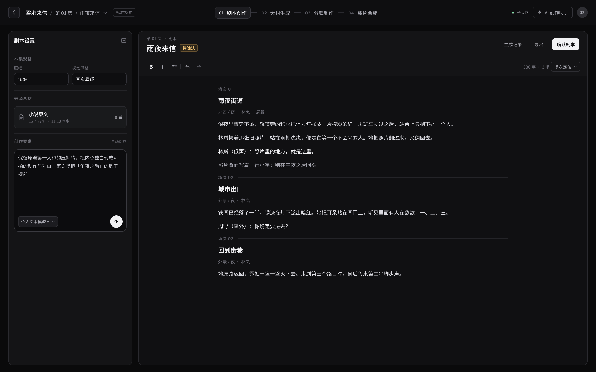
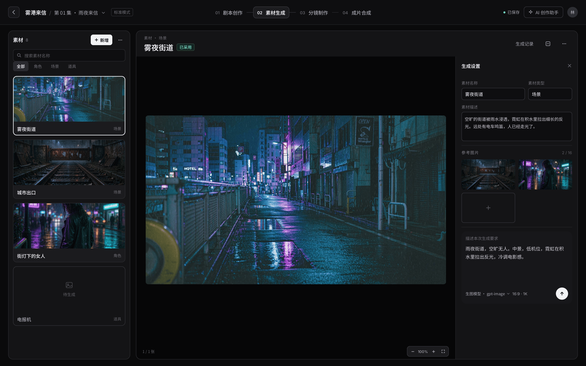
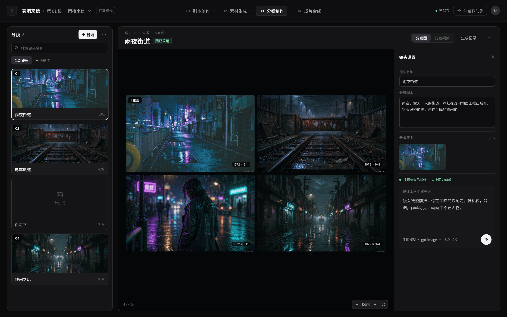
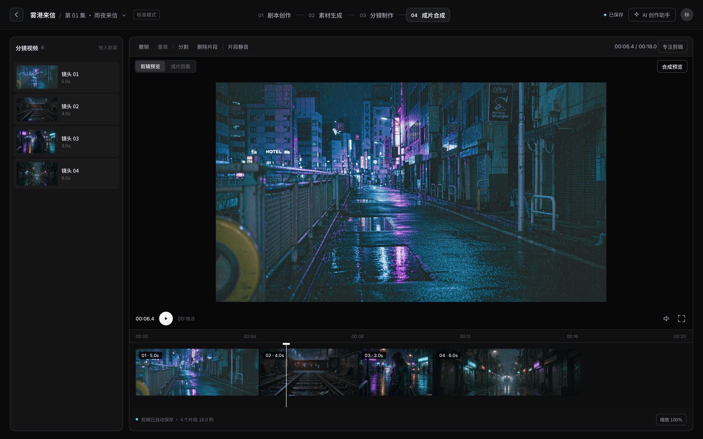

# 标准模式创作流程 UI 改版 · 实施计划（V2）

> 状态：**仅保留 Step 1 单层头部，其余界面改动已恢复；最终 fast 与全部普通 browser 复验完成，无遗留失败**（2026-10-19）。当前范围覆盖下文原计划，Step 2–4 不再执行；恢复与验证结果见第 11 节。
> 设计稿：Ardot `https://ardot.tencent.com/file/738041789352690`（S1 `2:1` / S2 `2:178` / S3 `2:394` / S4 `2:601`，均 1440×900 @2x）
> 设计依据：[UI 改版提案](../../design/2026-10-19-标准模式UI改版提案.md)；产品事实见 [PRODUCT.md](../../../frontend/PRODUCT.md)；设计约定见 [DESIGN.md](../../../frontend/DESIGN.md)。
> 读者：执行本次改造的开发 agent。按 Step 顺序做，每步都可独立提交与回滚。

---

## 0. 一页速览

本节列出当前范围，第 2 节逐屏设计及 Step 2–4 保留原 V2 方案作为历史背景。当前只保留 60px 单层头部、四步居中和去状态，以及相应抽屉/遮罩偏移；列宽、卡片、生成输入、图片组角标与脚注均使用实施前的值。

```
┌ 60px 单层头部 ───────────────────────────────────────────────────────────────┐
│ ← 项目 / 第01集 ▾ [标准模式] │ 01 剧本创作 ─ 02 素材生成 ─ 03 分镜制作 ─ 04 成片合成 │ ● 已保存  AI 助手  头像 │
└───────────────────────────────────────────────────────────────────────────┘
│ 对象列 250 ┃ 主面板、卡片与图片组沿用原值 ┃ 设置 324.44（1440 档）           │
```

| 项 | 当前 | 实施前 |
| --- | --- | --- |
| 头部高度 | **60px 单层** | 53 + 52 = 105 |
| 头部布局 | Grid `minmax(0,1fr) minmax(0,auto) minmax(0,1fr)` | flex + 独立 nav 行 |
| 步骤内容 | 编号 + 名称 | 编号 + 名称 + 状态 + 勾选 |
| 步骤按钮最小宽 | 0（自适应） | 171px |
| 对象列 | 250px（已恢复） | 250px |
| 设置列 | 324.44px（`--creation-settings-base: 292px`，已恢复） | 324.44px（292） |
| 卡片 | 224×187（图 147 / 名称行 38 / 边线 2，已恢复） | 224×187（图 147） |
| 生成输入 | 180 高 / 圆角 16 / 边框 `#505050` / 背景 `#101010` / 正文 12·1.8（已恢复） | 同左 |

---

## 1. 范围与硬约束

**当前范围**：头部合并 + 四步居中 + 去状态，及相关偏移适配。列宽与卡片规格、生成输入样式、图片组角标与脚注的 V2 改动已撤回。
**不做**：接口与数据模型；不新增缩放/全屏；不改 AI 助手面板内部；不动已废弃的 `StageNav`。

四条硬约束（需求方确认，不可改）：

| # | 约束 |
| --- | --- |
| 1 | 头部合并为一层，**流程几何居中**，**不显示任何步骤状态**（剧本待确认 / 已有主图 12/17 / 图\*/\* / 待合成 全删） |
| 2 | 生成输入**保持在右侧设置栏内**，不搬到底部通栏 |
| 3 | 生成按钮**保持 30px 圆形图标 + 现有配色**，不改文字按钮、不加专色 |
| 4 | 步骤栏右侧「16:9 · 都市写实」**直接删除** |

---

## 2. 设计基线（逐屏）

### S1 · 剧本创作



- 单层 60px 头部：左「返回 / 项目 / 分集 / 标准模式」，中四步，右「已保存 / AI 助手 / 头像」。
- 四步只剩编号与名称；当前步是**浅底 + 细边线**的圆角块，其余是中性灰文字，没有勾选、没有计数。
- 左栏 300 保持「画幅 + 风格 → 来源素材 → 创作要求」，生成按钮仍是右下角的**白色圆形图标**。
- 正文 700px 居中、14px/1.95，一直延伸到面板底部；不设底部状态条，保存看顶栏、字数场次看工具栏。

### S2 · 素材生成



- 舞台 + 右侧 300 设置栏；生成输入仍在设置栏底部，标签「描述本次生成要求」只在输入框内以占位形式出现。
- 设置栏自上而下：素材名称/类型 → 素材描述 → 参考图片 → 生成要求 → 共享/移除。
- 卡片 274×150，一屏完整 4 张；列表不加计数脚注。

> 稿中舞台底部的「缩放 · 全屏」胶囊是示意。图片组视图当前没有缩放能力，**本次不实现**，只保留现有的「张数 + 刷新」脚注。

### S3 · 分镜制作



- 画面区是 2×2 图片组，首图左上角带主图标记，每张右下角标实际像素。
- 对象栏一行「镜头 01 · 全景 · 5.0 秒」，右端是「分镜图 | 分镜视频」切换与生成记录。
- 设置栏：镜头名称 → 镜头脚本 → 参考图片 → 视频参考状态 → 生成要求。

> 主图徽标与像素角标**实现里已有**（`.image-primary-badge` / `.image-subject-size`），本步只调样式，不新建结构。

### S4 · 成片合成



- 与前三步共用同一套头部（这是本次最直接的收益：成片页上方少 45px，全部给监视器）。
- 左素材仓 / 中监视器 / 下时间轴；片段宽度即真实时长，与标尺同一比例。

---

## 3. Step 1 · 头部合并（P0，必须一次提交）

> 这是唯一的结构性改动。改完四屏同时受益，也是回归面最大的一步。

### 3.1 JSX

| 文件 | 位置 | 改动 |
| --- | --- | --- |
| `frontend/src/pages/projects/EpisodePage.tsx` | `:256-270` | `<TopStepNav>` 从 header 的**兄弟节点**移入 `header.episode-top` 内部，放在 `.episode-project-location` 与 `.episode-project-actions` **之间**；只传 `currentStage={step}`、`onStageChange={goToStep}` |
| 同上 | `:270` | 删除 `workflow` / `projectId` / `episodeId` 三个 prop（`workflow` 变量在 `:91、:112` 仍用，保留） |
| `frontend/src/pages/projects/episode/TopStepNav.tsx` | `:1-6` | 删 `useState`、`CheckOutlined`、`EpisodeWorkflow`、`assetLibraries`/`storyboardApi`/`assemblyApi`；保留 `useEffect`、`useRef`、`Fragment`，当前步骤滚动可见性仍使用 effect |
| 同上 | `:12-15` | 签名收窄为 `{ currentStage, onStageChange }` |
| 同上 | `:16-57` | **整段删除**：`status`/`revision` state、`creation-workflow-updated` 与 `focus` 监听、三个状态请求 |
| 同上 | `:69-77` | `aria-label={step.label}`；删 `.episode-step-status`、勾选、`.episode-step-context`；保留编号/名称/连接线 |
| 同上 | `:58-68` | 保留 `reveal()` 滚动可见性 |
| `frontend/src/pages/projects/episode/StoryboardStage.tsx` | `:425` | 删 `window.dispatchEvent(new Event('creation-workflow-updated'))`（删监听后无人消费） |

> `projectId`/`episodeId` 在被删的三个请求之外无引用，可安全移除。

### 3.2 头部 CSS（`frontend/src/features/projects/episode-creation.css`）

| 行 | 改动 |
| --- | --- |
| `:3` | `.episode-top` → `flex:0 0 60px; height:60px; min-height:60px; display:grid; grid-template-columns:minmax(0,1fr) minmax(0,auto) minmax(0,1fr); align-items:center; gap:12px; padding:0 20px;`（删 `justify-content:space-between`） |
| `:4-5` | `.episode-project-location` 加 `min-width:0; overflow:hidden;`；`.episode-project-actions` 由 `flex:0 0 auto` 改为 `justify-self:end; display:flex; align-items:center; gap:13px; min-width:0;` |
| `:29` | `.episode-top-step-nav` 删 `flex/height/padding/border-bottom/background`，改 `height:100%; min-width:0; gap:10px; justify-content:safe center; overflow-x:auto; scrollbar-width:none;` |
| `:30` | `.episode-step-button` `min-width:171px → 0` |
| `:37-40` | 删 `.episode-step-status` / `.episode-step-check` / `.episode-step-context` |

**为什么用 Grid 而不是 flex 三区**：`.episode-top` 在 `studio.css` / `web.css` / `workbench.css` / `identity.css` 还有 7 处 `height/display/flex-wrap/gap` 覆盖（都服务于已不存在的 `.episode-heading`/`h1`），flex 方案要反复打补丁才不会被左侧内容顶偏。Grid 的 `1fr auto 1fr` 让中列位置只由轨道决定。

`justify-content: safe center` 是必须的：普通 `center` 在 768px 溢出时会裁掉第一项。

### 3.3 连带偏移（漏改会露 7–9px 缝隙或盖住头部）

| 文件 | 行 | 原值 → 新值 |
| --- | --- | --- |
| `episode-creation.css` | `:61` | 助手遮罩 `inset:53px 0 0` → `60px` |
| 同上 | `:116` | 分镜设置 backdrop `inset:51px 0 0` → `60px` |
| 同上 | `:141` | ≤999 助手侧栏 `top:53px` → `60px` |
| 同上 | `:146` | ≤700 header `51px` → `60px` |
| 同上 | `:162` | `.is-source .episode-work-stage` `100dvh - 119px` → `- 80px` |
| 同上 | `:174` | 移动端设置抽屉 `top:51px` → `60px` |
| 同上 | `:178` | 剧本设置面板 `top:51px` → `60px` |
| 同上 | `:180-181` | 助手侧栏 `top` / backdrop `inset` `51px` → `60px` |
| `novel-editor.css` | `:119` | `100dvh - 119px` → `- 80px` |
| `episode-assets.css` | `:158-159` | `inset:51px` → `60px` |
| `storyboard-layout.css` | `:188,190` | `top` / `inset` `51px` → `60px` |

### 3.4 清理旧布局规则（否则窄屏打架）

| 文件 | 行 | 动作 |
| --- | --- | --- |
| `frontend/src/app/identity.css` | `:98` | 删 `--episode-header-height:112px` |
| 同上 | `:99-105` | 删 ≤680 的 `.episode-top { display:grid; grid-template-columns:…; grid-template-rows:44px … }` 整块（引用了不存在的 `.episode-heading`） |
| `frontend/src/app/web.css` | `:97`、`:211-216`、`:315-317`、`:495-497` | 删 `.episode-top` 的 height/display/flex-wrap/padding/gap 覆盖；`:315` 的 `background` 也删 |
| `frontend/src/app/workbench.css` | `:142-144`、`:409` | 删 `height:62px`、`height:auto; min-height:62px; flex-wrap:wrap` |
| `frontend/src/app/studio.css` | `:2715-2717`、`:2812-2823` | 删 `.episode-top` padding 与 680 档 `display:grid` |
| 同上 | `:762-791` | 保留（被更高优先级覆盖），只需确认无 `height` 冲突 |

### 3.5 预期视觉变化

合并后整个头部用 `workbench.css:119` 的 `background: var(--navigation)`（`#161616`）。原来步骤栏的 `var(--canvas)` + 下边线消失，头部成为一条统一导航面。这是设计稿效果，验收时不要当成「漏了分隔线」。

### 3.6 验收

- 1440 / 1280 / 1024：`|(nav.x - header.x) - (header.right - nav.right)| <= 1`
- 四步内无状态文字、无勾选；头部右侧无「16:9 · 都市写实」
- 768px：四步完整可见，或 nav 内部横向滚动且首项可达
- `documentElement.scrollWidth <= innerWidth + 1`

---

## 4. Step 2 · 列宽与卡片（已恢复，不执行）

### 4.1 变量（`episode-creation.css:2` 与断点块）

| 断点 | `--creation-list-width` | `--creation-settings-base` | `--creation-card-height` |
| --- | --- | --- | --- |
| ≥1700（`:122`） | 280 → **336** | 314 → **290**（渲染 322） | 203 → **163** |
| 1440–1699（`:2` 基础） | 250 → **300** | 292 → **270**（渲染 300） | 187 → **150** |
| ≤1439（`:125`） | 220 → **264** | 268 → **248**（渲染 276） | 150 |
| ≤1279（`:128`） | 208 → **250** | 252 → **233**（渲染 259） | 173 → **140** |
| ≤1099（`:134`） | 200 → **240** | 继承 | 140 |
| ≤700（`:145`） | 200（不变） | 继承 | 171 → **148**（移动端不按比例缩，避免过扁） |

换算：素材卡宽 = 300 − 24（`.standard-assets-scroll` padding）− 2（border）= **274**；图高 = 150 − 2 − 38 = **110**。

### 4.2 其它文件

| 文件 | 行 | 改动 |
| --- | --- | --- |
| `episode-assets.css` | `:33` | `.standard-asset-card` fallback `187px → 150px` |
| 同上 | `:47-48` | 骨架卡 fallback `187 → 150`；`.ant-skeleton-image` 高 `104 → 110` |
| 同上 | `:149` | ≤700 的 `.standard-asset-card { height:171px }` 硬编码覆盖了变量，**删除该行** |
| `storyboard-layout.css` | `:148-152` | 不改（已用变量 + caption 38） |

### 4.3 验收

- 素材页 1440：卡片 274×150、图 110、名称行 38，一屏完整 4 张
- 分镜页卡片同步 150，镜号 `top:8` / 时长 `bottom:7` 不重叠
- 设置栏收起展开时按 `EpisodeCreationWorkspace.tsx:60` 的阈值正常重排

---

## 5. Step 3 · 生成输入样式（已恢复，不执行）

`frontend/src/features/projects/episode-creation.css`

| 行 | 改动 |
| --- | --- |
| `:89` | `border:1px solid #505050` → **`1px solid transparent`**；`border-radius:16px → 12px`；`background:#101010 → #17171A`；`padding:10px → 10px 12px` |
| `:90` | 删 `:focus-within { border-color:#aaa }` |
| `:91` | `height:180px → 178px`；`font-size:12px → 11.5px`；`line-height:1.8 → 20px` |
| `:143` | 矮窗口 `160px → 158px` |
| `:105-106` | **不动**（30px 圆形 + `var(--ink)`） |

`frontend/src/features/projects/novel-editor.css` `:86`：特异性更高的 `height:180px` → `178px`（不改则剧本页不生效）。

两条必须遵守：

1. **保留 1px transparent 边框**，不要写 `border:0`。素材、分镜输入使用 `:has(:focus-visible)` 换边框色；小说输入沿用原有无额外焦点装饰约定。
2. **不要加 `box-shadow` 焦点环**：`novel-quill.spec.ts:99-100` 断言聚焦前后 `appearance` 一致，加阴影会红。

`GenerationComposer.tsx` **不改**：非 novel 用途的 label 本就 `visually-hidden`，符合「不加可见标题」。

### 5.1 验收

- 三个用途（剧本 / 素材 / 分镜）底块颜色、圆角一致，无可见外描边
- 发送按钮仍是 30px 圆形、白底深箭头
- 素材、分镜输入支持键盘焦点边框；小说输入保留原有光标反馈，不增加边框或阴影装饰

---

## 6. Step 4 · 图片组（已恢复，不执行）

| 文件 | 行 | 改动 |
| --- | --- | --- |
| `image-tools.css` | `:14-16` | `.image-subject-label` 增加 `.is-primary` 单 chip 样式（统一底色与内边距）；`.image-primary-badge` 保留 |
| 同上 | `:17` | `.image-subject-size`：`font-size:10px → 9px`；`background:#181818 → rgb(0 0 0 / 65%)` |
| 同上 | `:24-25` | `.image-group-caption`：`flex:0 0 40px; height:40px; font-size:11px → 10px`（刷新按钮 24px 不变） |
| `ImageGroupPreview.tsx` | `:97` | 给 `.image-subject-label` 加 `is-primary` 类，视觉合并为一个「1 主图」chip |

**硬约束**：`.image-primary-badge` 的文本必须**仍是「主图」**。`image-tools.spec.ts:32,37` 与 `standard-assets-workflow.spec.ts:337` 都有 `toHaveText('主图')`，改成「1 主图」会让两处同时红。合并靠 CSS，不靠改文本。

---

## 7. 当前测试与原型基准

### 7.1 单层头部

- 四个阶段使用精确名称“剧本创作 / 素材生成 / 分镜制作 / 成片合成”，不再在可访问名称中附加步骤状态。
- 头部高 60px，导航是头部直接子节点；桌面轨道几何居中，窄屏在自身容器内滚动并显示当前步骤。
- 助手、原文、素材与分镜设置的抽屉和遮罩同步使用 60px 偏移；手机小说正文高度为视口减 80px。
- 分集标题定位真实分集选择器；跨阶段操作走顶部导航，保留自动保存和离开保护。

### 7.2 非头部恢复基准

| 项目 | 当前断言（1440px 档，断点沿用实施前） |
| --- | --- |
| 对象列 / 设置列 | 250px / 324.44px（基础变量 292px） |
| 素材卡 / 图片 | 224×187px / 147px，名称行 38px |
| 生成输入 | 180px、12px 字号、1.8 行高、16px 圆角、10px 内边距、原边框和背景 |
| 图片组 | 原主图编号与独立角标、10px 像素角标、11px 脚注，单图预览继续可用 |
| 小说设置 | 保留原有 12px 间距；原型补齐该既有窄屏间距，不修改产品布局 |

图片组 CSS 与组件已按实施前备份逐字节恢复；列宽、卡高、生成输入的各断点规则由恢复审计核对。原型同步恢复这些值，只保留单层头部及必要偏移。几何对照覆盖 390×844、768×900、1024×768、1280×800、1440×900、1920×1080、1440×600 七档。

### 7.3 回归中发现的旧用例与夹具

旧用例需沿用当前真实流程：展开附件工具、打开原文抽屉、使用共享素材编辑面板、显式填写私人创作要求，图片组来源提示使用真实 notice。共享夹具创建素材时分配不重复的字符串 ID。

账号用例保留项目页的可见入口验证；手机分集的账号入口在实施前已隐藏，验证隐藏状态及账号页返回来源，不强制点击隐藏元素。返回地址包含自动选中的 asset / shot 查询参数。

已有后端改动已让作品保留而不随后续参数修改失效；旧过期断言改为验证作品仍可用、冻结快照不变，同时继续校验当前目标版本、媒体、上下文、参数冲突、归档和幂等。MySQL 外键测试同时接受隐式与显式 RESTRICT，并逐条精确比较 SQL。

---

## 8. 验证顺序

工作区包含其他任务，先按功能预览并完成定向验证；为覆盖共享头部、公共夹具及已发现失败，最终扩大至全仓 fast、全部标准浏览器及全部画布 browser。MySQL、infra、live、performance、runtime 层不由这些命令隐式开启。

```powershell
node scripts/test.mjs --changed --dry-run
node scripts/test.mjs --all --level fast
npm.cmd --prefix frontend run test:e2e -- --all -- --workers=2
node scripts/test.mjs --check
npm.cmd --prefix frontend run build
```

画布 browser 按 test-map 选出的 5 个文件以单并发运行，避免多台 Vite 同时冷编译造成资源争用。Python 静态检查在 backend 目录使用现有虚拟环境的 Ruff 执行。实际结果、报告及验收边界记录在第 11 节。

---

## 9. 风险与回滚

| 风险 | 影响 | 处置 |
| --- | --- | --- |
| 干掉 `creation-workflow-updated` | `StoryboardStage.tsx:425` 派发无人消费 | 同批删除派发；全仓确认仅 `TopStepNav` 监听 |
| 专注剪辑隐藏整个头部 | `assembly.css:10` 用 `:has(.is-focused) > .episode-top { display:none }`，合并后步骤一起消失（以前只隐藏项目栏） | 默认接受「专注 = 全屏」；若不接受，改为只隐藏左右两区、保留 nav |
| nav `aria-label="分集制作流程"` | 5 个 e2e 用它定位 | **不要改名**，只改每一步的 `aria-label` |
| `safe center` 兼容性 | 老浏览器退化为 `center`，溢出裁首项 | Chromium 已支持；必要时 `@supports not (justify-content: safe center)` 回退 `flex-start` |

**回滚**：本次未创建提交。以任务开始前的文件备份为边界回滚；P0 的头部结构、抽屉偏移、旧布局覆盖与原型必须整体回滚，不可只回滚一半，也不可重置工作区内其他任务的改动。

---

## 10. 明确不做

- 不改 `creation_draft` 存储结构、不新增接口字段
- 不给图片组加缩放/全屏
- 不改 AI 助手面板内部布局与宽度
- 不动 `StageNav` 与其遗留测试
- 不做手机端逐屏视觉重排（沿用现有断点推导）

---

## 11. 实施记录（2026-10-19）

### 11.1 最终保留与恢复范围

- 保留 Step 1：60px 单层头部、四步居中、移除步骤状态与冗余请求，保留真实分集切换、保存状态、助手入口和窄屏当前步骤可达。
- Step 2–4 已恢复：所有列宽、卡高、骨架、生成输入、图片组角标及脚注回到实施前；仅保留抽屉、遮罩与手机正文配合头部所需的偏移。
- 使用任务开始前的 26 文件备份核对，未重置整个工作区。图片组 CSS 与组件逐字节一致；恢复审计及差异位于 .runtime/ui-v2-header-only/。
- 同步原型、产品与设计说明。未新增依赖、API 字段或数据库变更，未改变画布业务源码。

### 11.2 测试失败修复

除第 7.3 节的旧流程与业务预期外，全仓回归发现畸形 source 会在图片工具识别阶段触发 AttributeError。is_image_operation 先判断来源类型，让原校验返回受控 GenerationError；已有失败用例已由红转绿。原关键堆栈为 ai/image_operations.py:11：AttributeError: 'list' object has no attribute 'get'。相关四文件 84 项定向测试通过，全局 Ruff 检查与 869 文件格式检查通过。

全仓 fast 首轮的旧预期已按实施前现有业务校正：图片组外键接受 MySQL 隐式/显式 RESTRICT 的等价语义并精确比较定义；作品保留与历史来源测试保留当前版本、媒体、上下文和参数冲突保护。未为通过测试修改 ORM 或已有作品保留逻辑。

画布夹具补齐来源画风契约，并让已移除角色的在途读取返回 404，避免夹具抛出未处理异常。两个懒加载夹具继承了全应用扫描和预热，结束时仍有无关模块在转换；在 configResolved 覆盖预热已太晚。现将扫描限定到各自夹具入口，并在 config 钩子关闭全应用预热；释放挂起请求，保留 10 秒有界关闭检查。两项单独复验通过，无取消或跳过；未修改画布业务源码。

本轮最终复验发现共享助手对话列表的真实行高缺陷：AntDX Conversations 默认固定行高，三行按钮内容溢出，后一条遮挡前一条，普通点击被拦截。仅在 ai-assistant.css 的现有列表项规则增加 height:auto，保留原最小高度与其他样式；agent-runtime.spec.ts 增加两条记录不重叠的几何断言，并将旧 article 定位同步为实际列表项。原有对话切换、在途响应和草稿保护断言保留。新增断言修复前实际失败，修复后及完整回归均通过。

另一项失败来自旧测试 DOM 定位：新回复气泡增加包装层，`.ai-assistant-log > .ai-assistant-reply p` 找不到已正确显示的“保留雨夜”，关键错误为 `expect(locator).toHaveText: element(s) not found`，堆栈位于 agent-runtime.spec.ts:237。将两处定位同步为 `.ai-assistant-log .ai-assistant-reply p`，正文、cursor=10000、首批事件=1、累计事件=2和请求顺序断言均保留。全量运行结束后，原失败用例定向复验通过；原始失败报告保留，不改写为通过。

### 11.3 最终验证

用户确认另一任务完成后，重新运行下列验证。本轮对 1144 个前端源码与测试文件的初始快照审查显示，仅上述行高修复和对应测试两文件变化，无缺失或意外变更；另一任务的助手改动完整保留。产品源码在修复后构建及最终完整 browser 期间保持稳定，之后仅同步旧测试定位。

| 验证 | 最终实际结果 |
| --- | --- |
| 全仓 fast，255 个文件 | **3871 通过、0 失败、0 跳过、0 取消**；Python 3035、标准 Node 255、画布 Node 569、工具 12 |
| 标准前端全部普通 browser，34 个文件 | **318 个用例均有通过证据，无遗留失败或跳过**：全量运行 317 通过、1 项旧定位失败；修正后该项定向复验 1 通过。包含当前助手新增用例与生产 preview 页面 |
| 画布全部普通 browser，5 个文件 | **17 通过、0 失败、0 取消、0 跳过**；单并发完整运行，此前受影响的助手引用用例通过 |
| 对话列表缺陷 | 新增防重叠断言实际由红转绿；完整回归中的普通点击、草稿与在途响应保护通过 |
| 统一 build | 两包类型检查与生产构建通过；有既有大 chunk 提示 |
| Ruff check / format --check | 全局通过，869 文件符合格式 |
| 测试映射 | 通过：525 测试、140 辅助文件、41 功能；最终再次执行 --check 通过 |
| 恢复审计 | 26 文件核对通过；图片组 CSS/TSX 逐字节恢复，列宽、卡高与 composer 各断点符合实施前值 |
| 布局对照 | 本轮标准 browser 包含 7 档原型几何对照；此前四阶段 × 五视口共 20 组合检查通过 |

最终报告与复现：

- fast：`.runtime/test-results/2026-10-19T08-31-06.237Z-cf926adf/summary.json`；命令 `node scripts/test.mjs --all --level fast`。
- 标准 browser 全量：`.runtime/test-results/2026-10-19T08-44-35.192Z-7e336a3a/summary.json`；命令 `node scripts/test.mjs --scope frontend --runner playwright --level browser --all -- --workers=2`。该原始报告保留 1 项旧定位失败，未宣称单次全量全绿。
- 长对话修正后复验：`.runtime/test-results/2026-10-19T09-01-54.439Z-25e61b49/summary.json`；命令 `node scripts/test.mjs --scope frontend --runner playwright --feature standard.agent --level browser -- --grep 'reopening a long conversation' --workers=1`。
- 标准 browser 使用 Chrome、`PLAYWRIGHT_EXTERNAL_SERVER=1` 与 `PLAYWRIGHT_PRODUCTION_URL=http://127.0.0.1:4176`；测试 Vite 为 4175，修复后的生产 preview 为 4176。
- 画布 browser：`.runtime/ui-v2-final-recheck/canvas-browser-final.log`；在 frontend/canvas 执行 `node --test --test-concurrency=1 --test-reporter=tap`，传入 `e2e/characters/character-current.test.mjs`、`e2e/compat/dependency-compat.test.mjs`、`e2e/compat/emotion-lazy.test.mjs`、`e2e/compat/markdown-lazy.test.mjs`、`e2e/document/host-canvas.test.mjs`。
- 行高缺陷红/绿证据：`.runtime/test-results/2026-10-19T08-39-39.687Z-2746a5b7/summary.json` 与 `.runtime/test-results/2026-10-19T08-40-09.718Z-65d889f9/summary.json`；对应日志在 `.runtime/ui-v2-final-recheck/history-regression-red.log` 与 `history-regression-green.log`。
- 最终汇总：`.runtime/ui-v2-final-recheck/final-validation.json`；该目录还保存完整运行日志、build-final.log、Ruff 日志、post-history-fix-snapshot.json 与 restoration-final-readonly-review.json。
- 恢复差异及布局证据：`.runtime/ui-v2-header-only/restoration-audit.json`、`remaining.patch`、`visual/geometry.json`。

更早受并行热更新影响、按用户要求中止或因修复中止的运行保留作诊断，不计作最终通过。未新增依赖、API 字段或数据库变更，未修改画布业务源码，未执行 git commit。

### 11.4 验收边界

本次验证覆盖全部 fast 与普通 browser 层。未执行 MySQL、RabbitMQ/MinIO infra、live、独立 performance/runtime 层，以及真实供应商生成和真实成片播放验收。浏览器 API 与供应商使用测试替身；自动化、构建及截图结果不代表真实供应商或画布一比一完整验收。
