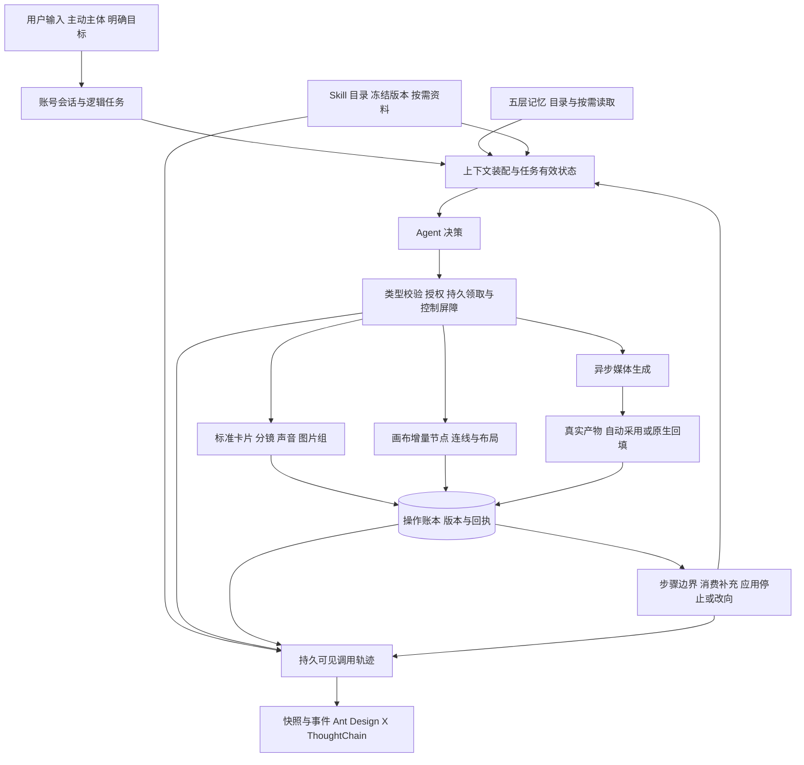

# AI 创作助手系统设计总览

状态：产品决策已确认；整体实施按用户要求暂停，尚未完成。设计日期：2026-10-21；进度快照：2026-10-22。实际进展、验证证据与[未完成工作登记](2026-10-21-AI创作助手实施与验证记录.md#未完成工作登记2026-10-22)见[实施记录](2026-10-21-AI创作助手实施与验证记录.md)。

本方案覆盖独立上下文、无 embedding 记忆、全局会话、业务工具、Skill、执行控制及前端呈现。本文保存确认的设计基线；表中的“应实现”与“需要补齐”不代表当前已有能力，运行行为以代码、维护说明及实施记录的直接证据为准。

## 1. 方案导航与适用关系

| 专题 | 核心问题 | 设计文档 |
| --- | --- | --- |
| 上下文 | 不再自动理解作品工程；用户选主体、任务级快照与按需读取 | [独立上下文与主体选择](2026-10-21-Agent上下文与主体选择设计.md) |
| 记忆 | MySQL 无 embedding、五层记忆、中文关键词召回与无感压缩 | [记忆系统修订版](2026-10-21-Agent记忆系统设计修订版.md) |
| 会话 | 账号全局会话、逻辑任务、补充与独立任务、历史及删除 | [会话与任务管理](2026-10-21-Agent全局会话与任务管理设计.md) |
| 工具 | 标准卡片／分镜、画布四类节点与连线、图片组、生成与撤销 | [创作工具系统](2026-10-21-Agent创作工具系统设计.md) |
| Skill | 内置与个人、账号 CRUD、手动／按需自动、版本与资料模板 | [Skill 管理系统](2026-10-21-AgentSkill管理与按需调用设计.md) |
| 执行 | 完整工具边界停止／改向、补充水位、明确继续与故障恢复 | [执行与中断](2026-10-21-Agent执行中断与修改方向设计.md) |
| 前端 | 工具／Skill 可感知、ThoughtChain、输入与控制、快照和事件恢复 | [前端交互与事件](2026-10-21-Agent前端交互设计.md) |

本总览记录集中确认结果，各专题展开技术设计；如旧草案与本轮规则冲突，以用户最新要求及本轮确认结果为准。[原记忆草案](2026-10-21-Agent无Embedding记忆系统设计.md)与[原选型决策](2026-10-21-Agent记忆系统存储分层决策.md)保留为讨论来源，当前采用修订版。历史文档和源码用来核对现状，不自动变成新方案的产品约束。

## 2. 整体产品边界

| 方面 | 已确认规则 |
| --- | --- |
| 助手形态 | 支持讨论和明确授权执行；会话属于账号，独立于标准项目与画布页面 |
| 上下文 | 不自动装入小说、当前剧本、卡片或节点正文；用户明确选入主体才读取获准字段 |
| 三类范围 | 参考主体、作品记忆作用域、工具写入目标分别管理，不相互扩权 |
| 记忆存储 | 采用现有 MySQL，无 embedding、pgvector 或向量数据库；文本模型可用于整理与查询词展开 |
| 执行授权 | 明确创建、修改或生成指令授权对应范围，范围内直接执行，不逐项重复确认 |
| 搭建与生成 | “搭建流程”只创建结构、内容和提示词；实际生成须符合用户任务及媒体开关 |
| 媒体策略 | 总开关放在 AI 配置，默认开启；Agent 读取、执行端复核；已保存的关闭设置不被重置 |
| 结果使用 | 标准模式有效新媒体始终自动采用并留历史；画布保持原生生成回填、直接应用／提议确认边界 |
| 工具重点 | 标准素材／分镜及关联；画布文本、图片、视频、音频节点和有效连线；首期图片组 |
| Skill 内容 | 内置与个人；指令、参考资料和模板，经平台工具执行；首期无用户脚本 |
| Skill 管理 | AI 配置下按账号 CRUD；在线、Markdown、ZIP 三种添加；内置只读、可复制个人修改 |
| Skill 调用 | 启用库按需自动，每项可仅手动；手动覆盖完整任务，可自动补充，手动方法优先 |
| Skill 生命周期 | 新增有效条目默认启用且允许自动；停用／删除阻止新加载，原任务按冻结版本继续，可单独停止 |
| 中断 | 当前已开始工具完整结束后才停止／改向；媒体包括生成与回填，不在拿到任务 ID 时放行 |
| 补充与继续 | 普通消息默认补充当前任务；当前工具结束后处理；停止后补充保留，明确继续才恢复 |
| 成果与撤销 | 停止和改向保留成果；只有明确要求才按批次撤销，后续编辑及引用冲突受保护 |
| 前端感知 | 工具和 Skill 调用有持久事件与快照，用 Ant Design X ThoughtChain 展示真实阶段和结果 |
| 首期排除 | 无会话归档、回收站、分支；无脚本执行；成片剪辑、字幕及导出后续扩展 |

## 3. 批量确认的 18 项决策

用户对其余选项采用推荐，并明确覆盖第 7 项为默认开启、第 11 项为首期图片组。以下完整保留最终结果，不再逐项重新询问。

| 编号 | 决策项 | 最终规则 |
| --- | --- | --- |
| 1 | 主体持续时间 | 本次完整任务有效，包括补充与改方向；新任务不继承，用户可再次选入 |
| 2 | 选入后的编辑 | 保留实际读取快照，不自动跟随编辑；发现新版本提示刷新，写入验证当前版本 |
| 3 | 连续补充修正 | 最新明确修正优先，兼容要求累积；无法确定冲突含义时再具体询问 |
| 4 | 多任务并发 | 同会话串行，不同会话可并行；相同冲突对象写入串行 |
| 5 | 浏览器离开 | 刷新、换页、关闭浏览器后服务端继续，重新进入恢复真实状态 |
| 6 | 明确失败 | 有限技术重试耗尽后暂停，保留成果；处理条件或明确继续后重新规划 |
| 7 | 媒体开关默认值 | 默认开启；沿用已有个人关闭设置，开关不扩张本次任务授权 |
| 8 | 默认输出数量 | 每个明确目标默认 1 个结果，不自行扩增数量或目标范围 |
| 9 | 多输出主结果 | 开始前固定主输出，默认按稳定序号取首个有效结果，其余留历史，不按回调先后选择 |
| 10 | 预算能力 | 首期可选图片、视频、音频数量上限，不足／达到边界暂停；金额预算待价格可靠后扩展 |
| 11 | 图片组 | 首期加入生成、读取、主图设置和历史引用；不是第四类素材 |
| 12 | 修改与删除 | 明确范围内直接执行；额外关联删除先展示影响并确定范围 |
| 13 | 部分撤销 | 展示安全项和冲突项，用户选择后只撤销可安全处理部分 |
| 14 | 内置 Skill | 原件只读，可复制为个人版本；个人启停和调用方式独立 |
| 15 | 历史编辑／重答 | 纯讨论支持；已执行工具及其依据不可改写，以新消息纠正；首期无分支 |
| 16 | 删除活动会话 | 等当前工具完整结束并停止后删除，作品成果保留 |
| 17 | 删除与记忆 | 清理本会话摘要和会话级记忆；账号偏好、明确作品记忆保留，提供一并清理选项 |
| 18 | 删除恢复 | 首期无回收站，删除前确认；产品不提供删除后恢复 |

停止、改向和删除中的完整工具边界一致。已开始工具仍拥有完成和回填许可，未开始旧工具不能再领取；“已收到停止请求”不能让当前有效媒体提前失效。停止后普通补充及页面重连均不等于继续。

## 4. 实施前能力与缺口快照

| 能力 | 当前源码事实 | 需要补齐 |
| --- | --- | --- |
| 助手决策 | 共享助手分支 tools 为空、max_tool_calls=0，多处限制副作用 | 注册、授权、工具结果回传、决策预算及恢复整条链路 |
| 上下文 | 有来源冻结与版本检查，但旧协议仍绑定 project／canvas、include_document 默认 true | 全局任务级选入、取消自动正文、来源范围隔离及刷新体验 |
| 记忆 | 有任务／历史基础，不等于已具备五层完整记忆 | 记忆模型、目录／ngram 召回、来源修正、后台摘要和删除防复活 |
| 会话 | 有持久消息、运行、state／SSE，仍有项目归属与 archived | 全局会话、task 与 attempt、补充归属、串行队列和完整删除 |
| 业务工具 | 标准服务、画布 commit、图片组、旧 Agent 回执已有可复用基础 | 增量工具适配、目标校验、批次原子性、自动采用和撤销 |
| Skill | 既有目录、选择与冻结机制，以及本地方法归档 | 账号完整管理、不可变资源包、按需自动、手动优先和可见调用 |
| 执行控制 | 当前 stop 为立即取消语义 | 持久控制、启动屏障、完整媒体结算、边界生效及明确继续 |
| 前端 | 已用多个 X 组件，运行 Hook 主要处理文字 delta | ThoughtChain、类型化调用投影、事件重放、结果卡及任务控制 |

本表是方案确认时的源码快照，部分缺口已进入实施；当前进度见实施记录。不把旧框架中已有工具或某个字段存在表述为共享助手已经可用。

## 5. 技术栈与系统职责

| 技术／模块 | 选择 | 责任及边界 |
| --- | --- | --- |
| Web API | Python 3.12+、FastAPI、Pydantic 2 | 可信身份、输入输出契约、权限及结构化结果校验 |
| Agent | 现有 `pydantic-ai-slim[openai]==2.53.0`、模型 Gateway | 工具决策、按需方法和资料、工具结果后继续推理；不另引运行框架 |
| 业务与持久化 | API → Service → DAO → ORM、SQLAlchemy 2、MySQL 8 | 工具效果、操作回执、控制和版本短事务；不跨网络持有长事务 |
| 无向量记忆 | MySQL 精确字段、标签／别名、FULLTEXT＋ngram | 先过滤作用域再检索，目录与正文分离；中文短词有受限兜底 |
| 后台与恢复 | Celery、RabbitMQ、可靠投递与恢复记录 | 媒体等待、摘要整理、租约恢复和幂等结算；浏览器不负责推进 |
| 内容存储 | MySQL＋MinIO | 数据库保存身份、版本与引用；大明细、媒体和不可变 Skill 资源持久存储 |
| 标准适配器 | 现有素材、分镜、声音与图片组服务 | 复用真实业务字段、采用及版本规则，不直接改 URL 绕过服务 |
| 画布适配器 | 现有独立画布、版本化节点能力与连线契约 | 模型提交有界增量，服务端验证与合并，不收模型全图覆盖 |
| Web UI | React 19、TypeScript strict、AntD 5、Ant Design X 1.6.1、现有 Vite | 复用 Conversations／Bubble／Sender／ThoughtChain 等，保留两包边界 |
| 同步协议 | 现有 HTTP、state／SSE 演进 | 快照水位、稳定调用身份、可重复投递、版本合并和按权详情 |

不引入 embedding 模型、向量数据库、额外编排框架或浏览器直连模型。ngram 检索和文本模型整理各有成本及召回限制，实施时用中文真实样本验证，不能宣称等同语义向量召回。

## 6. 统一架构与事实源

| 事实 | 唯一责任 |
| --- | --- |
| 当前任务目标、约束和控制 | 版本化 task／L3，不由旧摘要反向恢复 |
| 工具是否开始、是否完成 | 持久领取与完整回执；队列消息和模型计划不能代替 |
| 业务卡片、图和当前媒体 | 对应业务服务及版本；助手结果卡仅引用 |
| 当前可用长期记忆 | 有来源、作用域和版本的记忆条目；目录是展示和发现投影 |
| Skill 方法与资源 | 已激活的不可变内容版本；账号设置决定新加载资格 |
| 前端进度 | 从任务、调用和回执生成的持久轨迹；不从自然语言猜测 |

五层记忆分别是 L1 原始记录、L2 近期上下文、L3 当前任务、L4 会话摘要、L5 长期记忆。后台压缩只替换已验证覆盖区间的模型输入，保留原始可追溯记录、未闭合工具和当前有效约束；无感表示正常路径后台完成，不承诺模型整理永不失败。

## 7. 一次任务的完整交互

| 阶段 | 统一规则 | 前端呈现 |
| --- | --- | --- |
| 输入 | 选择需要的主体和明确写入目标；讨论可不选目标 | Sender、Suggestion、Attachments 及当前目标标签 |
| 方法 | 按需加载启用 Skill；手动方法覆盖完整任务且优先 | ThoughtChain 显示固定版本、来源和加载结果 |
| 搭建 | “搭建流程”只创建卡片／节点、内容、提示词及有效关联 | 结构工具阶段、真实对象结果卡、定位和批次 |
| 生成 | 指令范围＋媒体开关＋来源／能力／额度均有效才受理 | 同一条目从受理到生成、回填，不提前完成 |
| 补充 | 先持久保存，工具完整结束后统一处理 | 补充归属、待用／已应用状态 |
| 停止／改向 | 阻止下一工具，当前工具完成并保留成果后生效 | 待停止／改向与工具阶段分别展示 |
| 继续 | 明确恢复对应停止／暂停，核对成果和新约束再规划 | 原任务的新 attempt，不重放已完成操作 |
| 离开与返回 | 服务端继续，按快照与事件恢复 | 会话、ThoughtChain、结果卡和输入归属一致 |

同会话串行不意味着停止任务永久占住会话：停止／暂停后释放执行槽，显式新建的其他任务可推进；恢复原任务重新排队，不抢占已经开始的工具。原任务补充和主体不会被其他任务消费。

## 8. 实施依赖与交付建议

每阶段都包含需要的后端、前端 DTO／UI、持久恢复及相应验证，不将前端感知安排为所有工具上线后的补丁。具体字段、批次上限、token 预算、租约、重试和保留窗口是实施参数，不再逐项发起产品确认。

| 阶段 | 前后端交付 | 完成标志 |
| --- | --- | --- |
| 1. 身份与协议基础 | 全局会话、task／attempt、三类范围、调用身份、控制和输入水位；前端类型与状态投影 | 旧会话可读且不继承旧授权，新任务不自动带正文；最小工具边界可验证 |
| 2. 记忆与独立输入 | 五层数据、目录／关键词工具、压缩、来源与删除；主体选择、刷新和记忆详情 | 正常长会话后台压缩，真实引用可回查，未选正文不进入输入 |
| 3. 结构工具闭环 | 标准素材／分镜／关联、画布四类节点／连线／局部布局、图片组读取和主图；回执、ThoughtChain 与结果卡 | 重试不重复写入，步骤边界可停止，两个模式都能定位真实成果 |
| 4. Skill 闭环 | 版本与资源、AI 配置 CRUD、三种添加、手动／自动加载和可见事件；适配首批内置方法 | 新加载遵守个人设置，原任务恢复原版本，方法不能越过工具授权 |
| 5. 媒体与纠偏 | 默认开启开关、任务数量上限、图片组生成及音视频、自动采用／原生回填、完整媒体中断与撤销 | 工具等到生成及回填，停止不丢成果，冲突不覆盖用户编辑 |
| 6. 会话与恢复完整验收 | 历史编辑边界、后台及并发、删除与记忆联动、断线重放、长列表与窄屏 | 删除等待当前工具；无归档／回收站／分支，前端恢复与真实账本一致 |

上述为工程拆分建议，相关阶段可交错推进，但开放写工具前必须先具备可信授权、持久回执和最小中断边界；媒体生成前必须接通真实结算和展示。实施表结构变更时同步 ORM、实际库 DDL、完整 SQL、旧库迁移与维护说明，并在实施记录中列出实际执行证据。

## 9. 验证范围与本轮交付边界

后续实施按 test-map.json 选择功能 fast，并依实际变更追加 mysql、browser、infra；真实模型、供应商及视觉对照独立报告。共享协议覆盖重复／乱序事件、快照水位、停止竞态、迟到回填、账号隔离、自动保存冲突、数量预占、Skill 版本和记忆删除防复活等关键路径。

最初设计交付只检查文档、链接、关键规则和 ThoughtChain 类型；后续代码、数据库、浏览器及真实运行的验证另记于实施记录。不将方案中的验收清单描述为已执行测试，也不将公开参考项目的能力描述为本项目现有实现。
