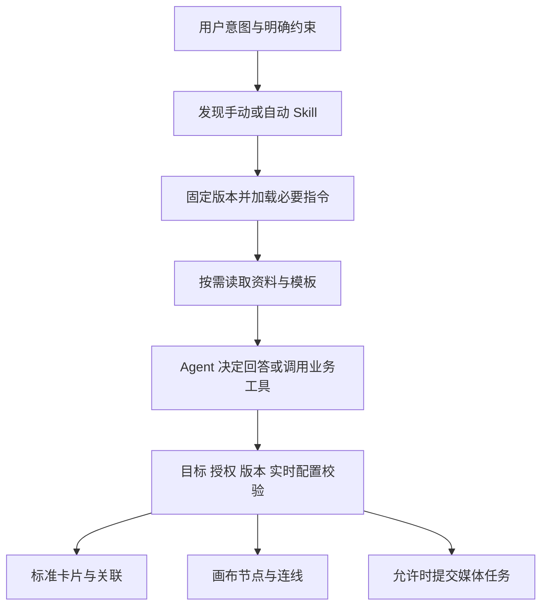

# Agent Skill 管理与按需调用设计

状态：产品规则已确认，系统正在实施与验证；本专题保留设计基线，实际进展与未完成范围见[实施记录](2026-10-21-AI创作助手实施与验证记录.md)。日期：2026-10-21。

本文与[无 Embedding 记忆方案](2026-10-21-Agent记忆系统设计修订版.md)、[创作工具系统方案](2026-10-21-Agent创作工具系统设计.md)配套。当前仅编写方案，不修改业务代码，不安装依赖，不执行 DDL。工具名、接口扩展与逻辑数据对象均为设计命名。

## 1. 已确认的边界

| 项目 | 已确认规则 |
| --- | --- |
| Skill 来源 | 分为系统内置 Skill 和用户自行添加的个人 Skill |
| 首批内置范围 | 覆盖任务规划、小说／剧本、素材、分镜、图片／视频提示词、声音、画布流程和连续性检查，优先适配已有归档中的兼容方法 |
| 首期内容 | 支持指令、参考资料与模板，通过平台工具执行；暂不支持脚本 |
| 添加方式 | 首期同时支持在线新建、上传单个 Markdown 和导入 ZIP 技能包 |
| 调用方式 | 支持手动指定和按需自动调用 |
| 手动持续范围 | 覆盖本次完整任务及期间的补充说明、多步执行；任务结束后恢复按需选择 |
| 组合调用 | 手动指定后仍允许按需补充其他 Skill，手动指定的创作方法优先 |
| 自动选择范围 | 全部已启用的内置与个人 Skill；每项可设置为仅手动 |
| 新增默认值 | 新建或导入的个人 Skill 校验通过且功能兼容后，默认启用并允许按需自动调用 |
| 停用与删除 | 阻止后续新加载；已经加载的当前任务继续使用冻结版本，用户可单独停止任务 |
| 管理入口 | 在宿主「AI 配置」下提供 Skill 管理页面 |
| 管理功能 | 提供新增、查看、编辑、删除；内置内容的维护与个人内容的管理分开设计 |
| 内置编辑 | 内置原件只读，可复制为个人 Skill 修改；本人启停与自动调用设置独立保存 |
| 数据归属 | 个人 Skill 按账号保存在服务端，跨设备及本人的会话可用，不绑定某个作品 |
| 作品正文 | 不因 Skill 加载自动传入小说、当前编辑剧本、标准卡片或画布节点正文；仍由用户选择主体 |
| 前端感知 | Skill 发现、加载、必要资料读取及参与步骤通过可见事件展示，调用过程使用 Ant Design X ThoughtChain |

首期不提供脚本执行工具，也不由 Skill 安装依赖或注册任意外部工具。

下文的具体页面布局、存储对象、导入流程、运行协议及技术限制为设计建议；内置原件只读与复制为个人条目已确认。技术参数与关联方案见第 17 节。

## 2. 当前已有能力与缺口

以当前工作区源码为准，不将历史方案或其他编辑器的技能能力算作全局助手能力。

| 当前实现 | 可以保留 | 需要补齐 |
| --- | --- | --- |
| `agent/tools.py` 中有 8 个内置 Skill，内容为少量硬编码指令 | 稳定身份和现有使用记录 | 独立技能包、使用场景描述、参考资料、模板与发布版本 |
| `AgentSkillService` 支持本人 Markdown 上传、查询、修改、停用和软删除 | Actor 归属检查、行版本、内容版本、校验值 | 在线新建、资源管理、元数据、自动调用策略 |
| 上传为单个 UTF-8 Markdown，最多 64 KiB；选择最多 8 项、正文合计最多 128 KiB | 现有输入和体积保护 | 分开控制技能库规模、激活数量和实际上下文 token，不能只按文件字节控制 |
| `freeze_skills` 冻结所选技能的完整正文和版本 | 已受理任务的内容快照 | 将参考资料、模板和兼容性信息纳入同一不可变版本 |
| `AgentSkillPicker` 提供内置／个人分类、上传、查看和个人编辑 | 对话中的手动选择入口 | 独立的 AI 配置管理页面，避免在发送前完成全部管理操作 |
| 共享助手把所选 Skill 全文放入对话资料，仍是 `tools=[]` | 明确的权限边界 | 目录发现、按需加载，以及与新工具系统的完整执行链路衔接 |
| 旧执行分支有 `read_skill`；集成测试覆盖内置快照的崩溃恢复 | 读取回执、冻结版本和离线重放思路 | 不能把该分支能力直接当作新全局助手的自动 Skill 调用 |
| `docs/skills` 已归档创作方法、参考文档、模板及部分脚本 | 选材与方法论参考 | 逐项适配后发布；归档目录不会自动成为用户可运行技能库 |

现有内置指令还包含“图片／视频不自动采用”“读取当前作品依据”等旧约定。实施时必须按最新工具和上下文方案重新整理，避免新旧指令同时进入模型。

## 3. 技术栈与开源参考

建议采用 **Agent Skills 格式的受限子集 + 现有 PydanticAI + 自有账号与版本管理层**，无需更换 Agent 框架，也不需要 embedding。

| 组成 | 建议与职责 |
| --- | --- |
| Agent Skills 格式 | 使用 `SKILL.md` 的名称、描述、Markdown 指令及相对资源引用；明确声明首期不支持可执行脚本 |
| Pydantic 2 | 校验导入结果、运行时元数据、资源读取请求及工具输出 |
| YAML 解析 | 选择安全的 frontmatter 解析器；PyYAML 可作为候选，须限制体积、别名和标签并拒绝重复关键字段 |
| PydanticAI | 通过目录发现、指令加载及资源读取工具完成按需调用；沿用项目锁定版本核对 API |
| MySQL + SQLAlchemy | 保存账号归属、目录、不可变版本、个人调用设置与激活记录 |
| MinIO | 保存不可变参考资料、模板和必要的导入包；按账号和版本校验读取 |
| React + 现有组件 | AI 配置内的列表、编辑器、导入预览及对话内的技能选择 |

| 参考项目 | 已核对的公开机制 | 本项目取舍 |
| --- | --- | --- |
| [Agent Skills 规范](https://agentskills.io/specification)及[接入指南](https://agentskills.io/client-implementation/adding-skills-support) | 元数据 → 完整指令 → 支持资料的三级渐进加载；托管产品可通过专用工具读取 | 采用格式和加载机制，不要求把服务器文件系统开放给模型 |
| [Deep Agents Skills](https://docs.langchain.com/oss/python/deepagents/skills)及[SkillsMiddleware](https://reference.langchain.com/python/deepagents/middleware/skills/SkillsMiddleware) | 目录发现、手动固定技能、按需读文件及可选工具绑定 | 借鉴调用体验；继续使用当前 PydanticAI，不引入第二套执行框架 |
| [pydantic-ai-skills](https://github.com/DougTrajano/pydantic-ai-skills/)及[工具集文档](https://dougtrajano.github.io/pydantic-ai-skills/api/toolset/) | 提供技能发现、加载、资源读取及脚本执行接口 | 作为可选适配库评估，不能直接注册其完整默认工具集；首期不得开放脚本入口 |

第三方库不替代本项目的账号隔离、版本快照、工具授权及上下文范围检查。`pydantic-ai-skills` 的当前文档与项目锁定的 `pydantic-ai-slim[openai]==2.53.0` 尚未做安装兼容验证，不能宣称可以直接接入。优先实现薄适配层，是否引入该库在实施前用最小验证确定。

## 4. Skill 包的内容与兼容性

已确认首期同时支持在线新建、上传单个 Markdown 和导入包含指令、资料与模板的 ZIP 技能包。以下为具体导入流程建议，尚未实施。

| 添加方式 | 输入与预览 | 保存结果 |
| --- | --- | --- |
| 在线新建 | 填写基本信息、指令，按需添加参考资料和模板 | 校验通过后创建本人 Skill 及首个不可变版本 |
| 单 Markdown | 支持规范的 SKILL.md，以及现有无 frontmatter 的 UTF-8 Markdown；后者以文件名预填名称，由用户补齐用途等必需元数据 | 预览后进入同一编辑和保存流程；无需用户手写 YAML |
| ZIP 技能包 | 识别 SKILL.md、参考资料和模板，展示目录、元数据、资源体积及兼容性问题 | 整包校验通过后发布一个完整版本，不能只保存主指令而遗漏资源 |

三种入口共用内容模型、账号归属校验和版本发布流程。默认创建新身份，不按文件名、显示名称或包内 slug 自动覆盖已有技能；更新本人已有 Skill 时明确选择目标，并使用其 row_version 校验。上传成功和校验预览不等于已经保存为可用 Skill，更不等于激活或执行。

新建或导入的有效个人 Skill 在首次成功保存时，默认写入 `enabled=true`、`invocation_mode=auto`。用户可以在保存前或之后改为仅手动或停用；更新已有 Skill 时保留其个人设置，不因发布新内容版本自动重新启用或改回自动。校验失败或功能不兼容的条目保留问题和修正入口，不进入可激活目录。

建议首期一个 ZIP 对应一个 Skill，允许 SKILL.md 位于 ZIP 根目录或单个外层目录下。发现多个技能根目录时列出原因并提示拆分，不默默选取其中一个。存在不支持的脚本文件、缺失引用或必需的未提供能力时，保留预览和修正入口，不以忽略问题的方式发布为完整可用。

```text
storyboard-planning/
├── SKILL.md
├── references/
│   └── shot-language.md
└── assets/
    ├── shot-template.json
    └── output-example.md
```

`SKILL.md` 示例：

```yaml
---
name: storyboard-planning
description: 将用户提供或主动选入的内容拆解为连续分镜；适用于分镜规划、镜头拆解和镜头衔接。
metadata:
  short-drama-display-name: 分镜规划
  short-drama-modes: standard,infinite_canvas
---
```

正文依次说明适用场景、不适用场景、必要输入、工作步骤、输出格式、自检规则和资料索引。正文应简短，镜头语言大全、案例库等放入参考资料，不整体塞入主指令。

| 内容 | 规则建议 |
| --- | --- |
| 名称 | 格式标识沿用规范中的小写字母、数字和连字符；另设中文显示名称，不要求用户记英文标识 |
| 版本与归属 | 由平台生成和校验，不信任上传内容自称的 owner、系统身份或版本 |
| 使用范围 | standard、infinite_canvas 或两者；只用于匹配能力，不自动获取对应作品正文 |
| 参考资料 | 首期按有界 UTF-8 文本读取，例如 Markdown、TXT、JSON、CSV、YAML；大型二进制资料另行设计 |
| 模板 | 作为静态资料或受限变量替换输入，不执行 Jinja、JavaScript、表达式或模板中的命令 |
| 工具声明 | 只能匹配平台已注册能力；规范中的 `allowed-tools` 是声明，不能给账号和本次任务增加权限 |
| 脚本与依赖 | 不执行 Python、JS、Shell，也不安装包；导入预览明确列出不支持的文件与依赖 |
| 不兼容 Skill | 必须依赖脚本、外部 CLI 或未提供工具时，标记不可用或提供方法论适配版，不能静默删除步骤后宣称完整可用 |

归档资料中的脚本不能作为可执行资源发布。若其他内容可独立使用，应生成有明确来源和适配说明的受限版本；不能原包上传成功就显示“全部功能可用”。

## 5. 按账号保存与身份管理

| 对象 | 存储与访问建议 |
| --- | --- |
| 内置 Skill 内容 | 平台统一发布不可变版本；用户不能修改系统原件，可复制为个人 Skill |
| 内置 Skill 的个人设置 | 按账号保存启停及“按需自动／仅手动”，不影响其他账号 |
| 个人 Skill | 必须带服务端可信 Actor 的 owner_user_id，完整 CRUD 均限定本人 |
| 参考资料与模板 | 跟随 Skill 版本保存；读取时同时检查本人可见性和该版本的 manifest，不仅检查对象路径前缀 |
| 当前任务激活记录 | 绑定会话、任务、技能身份、版本及调用来源，不把整个技能库绑定到作品 |

技能身份与名称分开：个人 Skill 同名不能覆盖系统 Skill，也不能覆盖其他个人条目。现有 `novel.v1` 等内置 ID 可以保留为兼容身份，新的格式标识另设 slug，不因适配文件规范直接破坏历史引用。

切换账号时清理上一个账号的技能目录、选择状态、未保存编辑和资源缓存。浏览器只缓存体验状态，服务端数据库是归属和内容的事实源。前端传入 owner_user_id、任意对象存储地址或系统身份不能作为授权依据。

## 6. AI 配置下的管理页面

### 6.1 入口与布局

页面目标是让本人快速找到、维护和控制技能。采用现有冷黑、紧凑的工作台风格，沿用 PageHeader、ListToolbar、列表、表单和统一 Dialog，不创建独立技能商城。

建议在 `/ai_config` 内增加「模型配置／Skill 管理」视图入口，Skill 视图可使用 `?section=skills` 深链。现有文本、图片、视频、音频仍是模型配置的分类；不要把 Skill 作为新的 `ServiceType` 传入模型接口。

| 页面区域 | 内容与主要操作 |
| --- | --- |
| 页面头部 | AI 配置标题、视图切换；保留经过校验的返回画布入口和 return_to |
| Skill 工具栏 | 「我的 Skill／内置 Skill」分类，名称／描述／标签搜索，启停与调用方式筛选 |
| 主要操作 | 「新建 Skill」为主操作，「导入」为次操作，不在每一行重复放创建入口 |
| 列表 | 名称、用途摘要、适用模式、启用状态、调用方式、版本、更新时间和行操作 |
| 我的 Skill 行操作 | 查看、编辑；更多中提供复制、导出、删除 |
| 内置 Skill 行操作 | 查看、复制为我的 Skill；个人启停和调用方式设置，不修改系统原件 |
| 编辑区域 | 基本信息、指令、参考资料、模板；正文编辑与安全预览，保存动作固定可达 |

桌面使用紧凑列表和页内编辑视图，适合较长指令与多文件资料。窄屏保留名称、状态和主要操作，其余进入详情；编辑改为单列，文件导航可收起，避免整页横向滚动。导入预览与删除使用统一 Dialog，避免编辑器中层层弹窗。

### 6.2 CRUD 流程

| 操作 | 流程与结果 |
| --- | --- |
| 新建 | 输入显示名称、用途描述、适用模式、指令，按需添加资料和模板；校验通过且功能兼容后保存，默认启用并允许按需自动调用 |
| 导入 | 提供 Markdown／ZIP 两种入口，预览解析结果并允许修正元数据；共用在线新建的保存、版本及默认调用设置 |
| 查看 | 先读摘要和目录，再按需读正文／文件；显示版本和来源；查看本身不激活任务 |
| 编辑 | 基于当前 row_version 保存；指令、资料或匹配元数据变化发布新内容版本，历史任务保留旧版本 |
| 删除 | 明确说明对象后删除本人条目，后续不可发现或激活；已加载该 Skill 的当前任务继续使用冻结版本，任务和历史快照保持可追溯 |
| 复制内置 | 生成新的个人身份并保留来源；修改副本不影响系统版本 |
| 启停 | 保存账号级启用设置；停用阻止新加载，已加载的当前任务继续；提供查看并单独停止相关任务的入口 |
| 调用方式 | 「按需自动」允许进入自动候选库；「仅手动」仍可手动选择；停用项不能被新激活 |

名称和用途描述是基本字段；标签、排除场景及工具需求可以放入高级设置。用户无需填写数据库 ID、MinIO 地址或工具内部参数。编辑正文不会自动启动生成、应用到作品或调用付费模型。

新建和导入表单将“启用”默认打开，调用方式默认选择“按需自动”，并说明“仅在任务需要时使用”。保存后进入自动候选库，不立即运行 Skill 或启动创作任务。上传包中自带的启停／调用字段不能覆盖本人在页面中选择的个人设置。

停用和删除时明确说明“后续任务不可加载，当前已加载的任务继续执行”。相关任务入口按实际记录展示，不把停用或删除伪装成已经停止；用户选择停止某个任务时，再调用该任务的独立停止接口。

### 6.3 状态、冲突与反馈

列表具备加载、空态、错误态；个人库为空时提供新建和导入，搜索为空时提供清除筛选。资料文件分别展示上传、校验、可用与失败状态，失败保留当前表单。

保存中防止重复点击；受理不明使用原请求身份核对，不换键重复创建。409 保留当前草稿和服务端版本，提供比较及重新载入，不自动覆盖。离开有未保存编辑的页面时沿用导航保护；正常浏览和日常保存不额外增加审批步骤。

新增界面复用统一主题和反馈组件。操作错误和警告使用有稳定 noticeKey 的 StudioFeedback／useStudioMessage，在当前操作层提供持久详情；列表自身的加载与错误仍在原区域显示。控件具备可访问名称、焦点状态和键盘操作，弹窗支持 Escape、焦点循环和关闭后回焦。

本轮仅设计页面，没有制作 UI、修改路由、更新 PRODUCT／DESIGN 或完成视觉验收。

## 7. 手动与按需自动调用

Skill 的“调用”指选定并加载方法，让 Agent 按此方法工作；不等于启动独立 Agent，也不意味着已经写入作品。

| 方式 | 建议流程 |
| --- | --- |
| 手动点选 | 对话保留轻量技能选择器；只选技能，不在发送前重复维护整个库 |
| 消息中指定 | 通过可检索的技能提及选择真实身份；同名不明确时消歧，不只按显示名称猜测 |
| 自动调用 | 从本人可见、已启用、允许自动、与当前目标能力兼容的全部 Skill 中按需选择 |
| 明确不使用 | 用户本次排除某个技能时，不得再用自动选择把它加回来 |
| 信息不足 | 先确认必要的输入或目标，不因某个 Skill 默认需要作品就自动读取作品正文 |

新增条目的默认启用与自动调用，仅决定它可以被后续任务按需发现和选择，不代表每次发送都激活它，也不赋予其作品读取、写入或媒体生成权限。

手动选择按任务身份保存，覆盖任务期间的补充说明和多步执行，不能按单条消息或一次模型响应划分生命周期。任务结束后移除活动技能投影，历史使用记录继续保留；后续任务仍可再次自动选中同一技能，但不继承之前的手动固定状态。

自动选择分为三层：先按账号可见性和启停规则过滤，再用名称、描述、标签、适用／排除场景发现候选，最后由模型结合用户当前意图决定是否加载。普通闲聊和简单问题可以一个 Skill 都不加载。

“全部可按需选择”不等于“每次传入全部正文”。小目录可注入有预算的元数据；大目录使用分类摘要、分页和关键词发现，全部符合条件的 Skill 仍可被检索，不用静默截断的前 N 项充当完整目录。该检索不需要 embedding。

已确认手动指定后仍允许自动补充其他 Skill，手动指定的创作方法优先。自动补充以当前阶段缺少的具体方法为依据，不能因为描述写了“任何任务都使用我”就永远激活。建议同一阶段只保留必要的主要方法和少量补充方法，具体数量、token 和重选次数是可配置预算，尚未定值。

### 7.1 组合与冲突处理建议

| 场景 | 处理规则 |
| --- | --- |
| 手动分镜规划 + 自动连续性检查 | 保留手动技能的拆解方法和输出格式，自动技能只补充人物、道具和动作连续性检查 |
| 手动方法与自动补充冲突 | 采用手动方法的对应要求；省略自动技能冲突部分，其他兼容部分仍可使用 |
| 用户本次明确要求与技能冲突 | 用户当前明确要求优先；平台执行授权、主体范围、媒体策略仍由服务端校验 |
| 同时手动指定多个互不兼容的方法 | 无法结合当前指令消歧时，展示具体冲突并询问主要方法，不按加载顺序或系统／个人来源猜测 |
| 自动补充之间冲突 | 按当前阶段的用途保留兼容且必要的方法；影响交付方向且无法判断时再询问用户 |
| 相同版本重复命中 | 复用原激活记录和内容，不重复加载；后续被用户手动指定时，记录手动来源并提升对应方法优先级 |

自动补充仍从本人已启用、允许自动且功能兼容的技能中选择，不能借“组合”自动加载仅手动或已停用的技能。每个技能在当前任务中固定一个内容版本；补充不同技能不会更改已有激活版本，也不会重新执行已完成的业务操作。

对话内建议提供可展开的“已使用 Skill”明细，显示手动／自动来源、版本及简短用途，例如“自动补充：人物一致性检查”。记录选择与冲突处理的简短结果，不展示隐藏推理；正常自动补充不增加逐次批准弹窗。活动技能及其主次关系同步进入 L3 当前任务状态，压缩和恢复后保持一致。

前端统一使用 ThoughtChain 展示 Skill 调用过程：已开始加载、已加载／加载失败、所读资料及关联工具步骤。目录命中不等于已激活，已加载也不等于业务执行完成；显示真实 Skill 身份、冻结版本、手动／自动来源、简短用途和资源引用。系统必须发布独立生命周期事件，不能等最终回复自行写“使用了某技能”才让前端感知。具体映射见[前端交互与事件方案](2026-10-21-Agent前端交互设计.md)。

组合调用不增加作品读取范围、生成数量或执行授权。若补充技能要求额外制作媒体，仍需满足用户原任务指令与媒体总开关，不能把一项方法补充升级成新创作任务。

## 8. 三级上下文加载与读取工具

| 层 | 进入上下文的内容 | 时机 |
| --- | --- | --- |
| 目录 | 技能身份、中文名、用途、适用模式及版本 | 在预算内发现候选；不附带全部正文和资料 |
| 指令 | 所选版本的主指令、输出约束及资源目录 | 手动加载或模型按需激活时 |
| 资源 | 精确资料／模板的必要片段 | 当前步骤实际需要时 |

建议提供三个读取入口，内部复用现有回执与运行基础：

| 设计工具名 | 职责与限制 |
| --- | --- |
| `search_skills` | 搜索／分页发现本人可见技能，返回有界元数据；自动模式排除仅手动项，手动选择可展示它们 |
| `load_skill` | 校验调用来源、启用状态和目标兼容性，固定版本，返回主指令与受限资源目录 |
| `read_skill_resource` | 只能读取已激活版本 manifest 中的文件，支持按段读取并返回 checksum 和范围 |

以上是新接口的建议名称。现有 `read_skill` 可在兼容层映射，不要求直接改名并破坏已持久化的调用记录。手动选定项可以由运行侧在首次模型调用前加载，同样记录版本和来源，无需模型重复调用一次。

资源按技能根目录的相对路径解析，拒绝路径穿越、符号链接越界、绝对路径和任意 URL 读取。读取参考资料不会自动打开链接，更不会根据资料中的命令启动程序。

## 9. 与创作工具的关系

Skill 描述“怎样做”，平台工具提供实际业务能力。加载 Skill 不扩大用户本次执行授权、用户选入主体、作品记忆范围或媒体生成开关。



| 用户要求 | Skill 可以指导 | 实际效果 |
| --- | --- | --- |
| “用分镜 Skill 分析这个片段” | 镜头拆解、节奏和连续性分析 | 对话回答；未明确创建时不落卡片或节点 |
| “用它搭建 6 个分镜” | 分镜内容、提示词和关联规则 | 对明确目标调用结构工具；不因模板有媒体槽就生成媒体 |
| “把选中的人物扩成三个镜头” | 基于已选主体设计分镜 | 只读取选入范围，并按授权创建目标内容 |
| “生成这些镜头的视频” | 整理生成参数和参考关系 | 先查媒体策略，再按任务授权提交；执行端再次校验 |

工具可见性按当前任务和目标裁剪。Skill 的工具声明只能进一步约束或请求已提供能力；未知工具不能自动注册，缺少必需能力必须返回原因。多个 Skill 组合也不能把各自的请求拼成更大的授权。

资料里要求额外生成数量、重复计费、任意读取作品或更改方向时，以用户当前指令和平台规则为准。完成情况依据业务工具回执，不能因 Skill 自检通过就声称卡片已保存、媒体已生成。

## 10. 版本、任务生命周期与中断

| 场景 | 建议处理 |
| --- | --- |
| 首次激活 | 固定 Skill 身份、不可变内容版本、manifest 校验值和手动／自动来源 |
| 自动发现后内容变更 | 激活时重新校验版本；必要时刷新目录并重新选择，不悄悄换成未见过的指令 |
| 用户编辑 Skill | 发布新版本；已受理任务继续使用冻结版本，不改变正在执行的步骤 |
| 停用或删除 | 已确认阻止后续新激活；已激活的当前任务按冻结版本继续，可通过独立入口单独停止 |
| 手动调用持续范围 | 已确认覆盖本次完整任务及其子步骤；补充说明关联原任务，结束后不固定到下一任务 |
| 修改方向 | 先记录待改向请求；当前工具结束后增加计划版本，重新检查 Skill 是否适合，不在当前工具内更换方法或参数 |
| 点击停止 | 由服务端阻止后续工具启动；当前工具完整结束后停止，不能等待模型主动“停止 Skill” |
| Worker 恢复 | 读取原激活版本和工具回执，不重新加载最新版、不重做已完成操作 |

“阻止新加载”与“恢复当前任务所需内容”分开处理：已经持久化激活成功、尚未结束且执行代次有效的原任务，可以继续读取其冻结主指令与 manifest 内的参考资料、模板，也可以在压缩或 Worker 恢复后重新装配这些内容。尚未激活的任务，即使此前在目录或计划中见过该 Skill，也不能在停用或删除后首次加载。

激活与停用／删除并发时，由服务端事务校验和持久激活记录确定先后，不能以模型缓存或前端显示为依据。冻结版本和资源按任务及历史记录保留，不随目录软删除立即物理清理；读取仍校验账号、任务身份、激活版本和执行代次，不能凭一个旧技能 ID 访问资源。

停止与撤销沿用工具及[执行方案](2026-10-21-Agent执行中断与修改方向设计.md)：已开始工具先结束，媒体工具包含生成及结果回填，随后停止或切换方向。待生效请求不撤销当前工具许可，也不更换其冻结 Skill 版本。保留已完成成果，只有用户明确要求才按批次撤销。

普通补充不撤回停止，明确继续才恢复。原逻辑任务的停止／暂停是可继续状态；继续创建新的执行尝试，可恢复此前已激活的冻结版本与资料，不因 Skill 在等待期间停用就悄悄换成最新版。仍未激活的技能需要重新校验当前启停设置；已成功结束任务的新要求按新任务选择，不继承手动固定。

Skill 是方法包，没有独立于实际任务的后台持续运行。版本固定不能成为绕过实时媒体开关、目标权限或执行代次检查的理由。

## 11. 与无感压缩和记忆的衔接

技能库和长期记忆分工不同：技能保存可复用方法，记忆保存用户偏好、明确创作设定及任务事实。不能把整份 Skill 自动抽取成用户长期记忆。

L3 当前任务状态保存活动技能的身份、版本、阶段、必要资源引用及用户明确约束。历史消息可压缩，未完成任务需要的有效指令与约束不能只剩一段模糊摘要；需要恢复时按不可变版本重新加载。

上下文装配对同一版本去重，不在每轮把整个技能库、Skill 正文和资料反复追加。原始调用及回执仍完整保存；压缩工具历史必须保持调用／结果协议合法，不能随意删半个工具回合。资源片段记录路径、版本、checksum 和范围，资料不足时继续读取。

技能摘要和内容缓存按账号可见性、技能版本和目录版本管理；不能仅以显示名称为键，也不能让旧缓存绕过最新启停规则。

## 12. 首批内置 Skill 范围与适配清单

已确认覆盖以下核心创作环节，并优先复用已有归档。表中为能力组和适配建议，不要求把每组强行做成一个大包，也不表示这些完整技能已经实现。优先把现有硬编码条目升级为职责清楚的方法包，资料和模板独立按需加载。

| 能力组 | 首批交付物 | 优先参考的本地归档 | 工具衔接 |
| --- | --- | --- | --- |
| 创作任务规划 | 目标、约束、步骤、依赖和预期交付物；区分结构搭建与媒体生成 | [Drama Skills 全流程方法](../../skills/00-pipeline/drama-skills/skills/short-drama/SKILL.md) | 绑定明确目标与授权范围，不默认扩充数量或任务 |
| 小说与剧本创作 | 大纲、正文、人物动机、对白及节奏模板，可按小说／剧本拆分 | [短剧创作方法](../../skills/01-script/ai-short-drama-writer/SKILL.md)、[剧本编写流程](../../skills/00-pipeline/drama-skills/skills/short-drama-write/SKILL.md) | 基于用户提供或选入内容产出文本；写入作品须具备对应业务工具及授权 |
| 素材设计与拆解 | 角色、场景、道具定义，身份锚点和素材提示词模板 | [素材设计流程](../../skills/00-pipeline/drama-skills/skills/short-drama-assets/SKILL.md)、[角色一致性资料](../../skills/03-asset/seedance-2.0/UPSTREAM.md) | 标准素材卡，或画布对应节点 |
| 分镜规划 | 镜头列表、时长、素材关联、衔接依据和分镜模板 | [漫剧分镜方法](../../skills/02-storyboard/manga-script-master/SKILL.md) | 标准分镜卡和关联，或画布分镜结构；参数符合平台契约 |
| 图片提示词 | 主体、构图、风格、光线和参考图组织模板 | [图片提示词流程](../../skills/00-pipeline/drama-skills/skills/short-drama-image-prompts/SKILL.md) | 编辑结构与提示词，图片生成另受策略校验 |
| 视频提示词 | 动作、表演、镜头运动、参考关系与时长模板 | [视频提示词流程](../../skills/00-pipeline/drama-skills/skills/short-drama-video-prompts/SKILL.md)、[通用视频提示词方法](../../skills/04-prompt-performance/awesome-seedance-2.5-prompts/skills/universal-video-prompt-skill/SKILL.md) | 视频节点／分镜参数及真实生成任务，不绑定归档中的外部执行渠道 |
| 配音与声音规划 | 台词、角色音色、情绪及声音结构表 | [多角色配音方法](../../skills/05-audio/multi-voice-dubbing/SKILL.md) | 标准真实声音对象或画布音频节点，按已提供的音频能力执行 |
| 画布流程搭建 | 四类节点、输入关系、兼容连线和局部布局计划 | 本项目[工具方案](2026-10-21-Agent创作工具系统设计.md)及节点能力定义 | 通过画布增量工具创建与连接，不提交整图覆盖 |
| 连续性检查 | 人物、服装、道具、动作、镜头及风格检查清单，具体差异与修改建议 | [审查方法](../../skills/00-pipeline/drama-skills/skills/short-drama-review/SKILL.md)、角色一致性资料 | 仅检查可见输入；修改需要对应授权，不能自动扫描全部作品正文 |

### 12.1 适配与发布要求

每个发布包都应具备适用／排除场景、必要输入、主指令、资料目录、输出模板、自检规则和来源记录。先明确产出，再对应平台现有工具与真实字段；不能把上游 JSON、命令或任务步骤直接当作平台接口。

归档中的分集、默认读取全作品、逐项人工批准、固定供应商和外部 CLI 等约定，按当前单层项目、主动选入正文、平台工具及生成开关规则改写。小说／剧本的文字方法可以先用于对话或文本节点，不凭 Skill 声明新增作品正文写入能力。归档要求的多角色编排也不自动变成新的子 Agent 执行架构。

归档资料逐项复核来源、适配范围和使用条件，保留 UPSTREAM 及必要署名。优先选择已明确许可且能适配的候选；例如 manju-script-generator 的本地来源记录仍未标注许可，不直接作为首批可发布文本来源。脚本、外部平台 Key 和本机 CLI 依赖不进入首期运行能力。

发布前分别核对有输入的正常路径、输入不足、与用户指令冲突、标准／画布目标不匹配及工具能力缺失场景。连续性等检查技能产出可核对的差异，生成类方法使用真实受理与结果回执。首次发布的内容清单和版本独立登记，归档数量不能当作已上线数量；本轮没有进行技能内容改写或运行验收。

## 13. 逻辑数据与接口演进

以下为设计对象，不是本轮已建立的数据库表。可复用现有 AgentSkill、版本检查和工具回执；不能预先承诺只改现有一张表就能覆盖全部需求。

| 逻辑对象 | 关键信息 |
| --- | --- |
| Skill 目录项 | 稳定身份、来源、owner、显示名称、slug、描述、标签、适用模式和当前版本 |
| 内容版本 | 主指令、匹配规则、资源 manifest、整体校验值、兼容状态及创建时间 |
| 资源版本 | 相对路径、类型、体积、checksum、不可变存储引用 |
| 个人设置 | 账号、技能身份、enabled、按需自动／仅手动及 row_version |
| 激活记录 | 任务、技能版本、手动／自动来源、补充关联、方法优先关系、简短用途、阶段、冲突处理及读取过的资源引用 |

内容版本应覆盖所有影响行为的内容，包括描述、适用条件、指令、参考资料与模板。只改变个人启停或调用设置不发布新的系统内容版本。显示名称等非行为字段仍使用行版本保护。

版本发布前先保存并核验不可变资源，再以数据库短事务发布 ready manifest；事务失败留下的暂存资源可回收。不要把 MySQL 与 MinIO 两次写入称为一个原子事务。已激活版本所需的资源必须持久可取，不能只依赖部署目录中可能被升级删除的旧文件。

| 接口方向 | 演进建议 |
| --- | --- |
| 目录列表 | 复用 `/agent/skills`，增加有界搜索、来源、状态和调用方式筛选；列表不返回所有正文 |
| 在线新建 | 增加结构化创建接口，与现有上传分开；受理不明用原创建身份核对 |
| 详情与修改 | 沿用 skill_id 和 row_version；详情按需读取主指令、版本及资源 |
| 删除 | 沿用本人归属、版本校验和软删除，历史快照保持可追溯 |
| 文件与导入 | 设计版本化资源和导入预览接口，整包校验后发布，不把未完成上传当可用版本 |
| 内置个人设置 | 与系统原件分离，服务端按 Actor 写入，不允许修改其他账号设置 |

ZIP 导入需要在解压前后实施有界校验：文件数、压缩及解压体积、单文件体积、深度、重复路径、跨平台路径和可支持类型。导入预览显示将新增／更新的对象及不兼容项，不自动覆盖同名技能。确切配额在实施前确定。

## 14. 实施顺序与后续验收

| 阶段 | 交付建议 |
| --- | --- |
| 1. 内容与数据基础 | 受限格式、账号目录、不可变版本、个人设置、老 ID 兼容及无脚本边界 |
| 2. 管理页面 | AI 配置入口、个人 CRUD、内置查看／复制、资料模板维护与冲突恢复 |
| 3. 手动调用 | 轻量选择、版本冻结、资料按需读取及使用记录 |
| 4. 自动调用 | 全量可选目录、按需匹配、仅手动过滤、去重与预算控制 |
| 5. 工具和恢复闭环 | 与创作工具、执行代次、停止和压缩恢复联调；发布适配后的内置内容 |

阶段可并行准备内容，但没有接通新助手运行链路前，管理页面保存成功不能算“Skill 执行已上线”。

| 验收场景 | 必须满足 |
| --- | --- |
| 两个账号同名技能 | 列表、正文、资源、修改和删除均不能串账号 |
| 跨设备使用 | 同账号读取服务端相同内容和个人调用设置 |
| 内置与个人 CRUD | 内置原件不能被用户改写；复制后具有独立身份 |
| 普通问题 | 可以不激活 Skill，不把所有正文传给模型 |
| 自动／仅手动／停用 | 自动筛选准确，手动加载仍检查启用和版本 |
| 执行中停用或删除 | 新激活被拒绝；原任务按冻结版本继续，仍可读取原资料和模板，也可单独停止 |
| 激活与停用并发、停用后恢复 | 按服务端持久记录判定先后；仅恢复有效原任务的已激活版本，不为新任务绕过停用 |
| 未选作品正文 | Skill、资源或模板都不能触发越界读取 |
| 指令要求执行脚本 | 不提供执行入口；必需脚本依赖明确标记不兼容 |
| 同名、重复导入与并发编辑 | 不静默覆盖，409 保留草稿，受理不明不重复创建 |
| 三种添加入口 | 在线、Markdown、ZIP 最终产生一致的内容对象；普通 Markdown 可补齐元数据，ZIP 资源完整发布 |
| 新增与更新的默认设置 | 新建／导入的有效条目默认启用且允许自动；显式个人选择优先，更新内容不重置已有设置，不兼容项不可激活 |
| 手动与自动组合 | 可补充必要技能；手动方法优先，自动补充不改写任务方向、输出约束或执行范围 |
| 重复命中与多技能冲突 | 同版本只加载一次；多个手动方法有不可消解冲突时具体询问，不以加载顺序覆盖 |
| 参考资料更新或部署升级 | 已受理任务仍使用原版本及可取的原资源 |
| 停止、改方向、Worker 重启 | 当前工具按原版本完成后控制生效；旧方向后续工具不得开始，已完成工具不重复执行 |
| 历史压缩后继续任务 | 还原原版本的必要方法与约束，保留调用／结果协议 |
| 只搭建与实际生成 | 是否加载 Skill 都遵守本次指令和媒体总开关 |
| 页面键盘与窄屏 | 保存和冲突恢复可达，焦点正确，无整页横向溢出 |

上述为将来实施的验收要求。本轮没有运行功能测试、真实模型调用、供应商验收或浏览器视觉验收。

## 15. 与既有方案的衔接

记忆方案继续使用 MySQL 无 embedding，不把 Skill 库变成向量库。工具方案继续负责卡片、节点、连线、媒体、批次回执与明确撤销。Skill 层不重复实现这些业务事务。

会话仍独立于作品且没有归档功能。个人 Skill 属于账号，不因为新建会话丢失；某次任务激活了什么，与整个账号拥有多少技能分别保存。[会话管理方案](2026-10-21-Agent全局会话与任务管理设计.md)接入选择和激活引用，不重新存一份完整技能库。

## 16. 本地源码与维护依据

- [Skill 服务](../../../backend/src/short_drama/service/agent_skill_service.py)、[模型](../../../backend/src/short_drama/domain/agent_context.py)、[契约](../../../backend/src/short_drama/schemas/agent_context.py)。
- [提交时冻结 Skill](../../../backend/src/short_drama/service/agent_run_service.py)、[现有技能工具](../../../backend/src/short_drama/agent/tools.py)、[共享助手纯聊天分支](../../../backend/src/short_drama/agent/assistant_chat.py)。
- [现有 Skill 选择器](../../../frontend/src/features/agents/AgentSkillPicker.tsx)、[AI 配置页面](../../../frontend/src/pages/ai-config/AiConfigPage.tsx)、[模型分类状态](../../../frontend/src/features/ai-config/AiConfigSession.tsx)。
- [当前 Skill 接口说明](../../api/agent.md)、[归档 Skill 说明](../../skills/README.md)、[快照恢复集成测试](../../../backend/tests/integration/standard/agent/test_agent_skill_persistence.py)、[输入边界测试](../../../backend/tests/unit/standard/agent/test_agent_context_contracts.py)。
- [前端产品范围](../../../frontend/PRODUCT.md)、[前端设计约定](../../../frontend/DESIGN.md)、[反馈规则](../../design/创作反馈规则.md)、[后端依赖](../../../backend/pyproject.toml)。

## 17. 实施参数与关联方案

Skill 的核心产品规则已确认；以下是实施前需细化的技术参数及已完成设计的关联方案，不再逐项发起产品确认。

| 项目 | 当前处理 |
| --- | --- |
| 激活预算与资源配额 | 作为可配置技术参数；结合模型输入预算、手动必需方法和资料规模确定初值，超限时保留明确约束并分步读取，不静默丢弃必要方法 |
| 具体接口与存储契约 | 沿用第 13 节逻辑对象，实施前补齐 schema、版本发布和迁移细节，并核对框架兼容性 |
| 执行中断与修改方向 | 按[独立执行方案](2026-10-21-Agent执行中断与修改方向设计.md)执行；工具完成后生效，媒体含生成与回填；补充保留，停止后明确继续才恢复 |
| 会话管理 | 按[独立方案](2026-10-21-Agent全局会话与任务管理设计.md)接入全局会话、原任务明确继续、历史与删除；无归档与回收站 |
| 前端组件 | 按[交互方案](2026-10-21-Agent前端交互设计.md)采用 ThoughtChain 和现有 Ant Design X 组件；版本兼容与资源配额为实施参数 |

账号存储、AI 配置管理入口、CRUD、三种添加方式、无脚本、首批核心创作范围及优先复用归档、全量启用库按需自动选择、新增有效个人 Skill 默认启用并允许自动、手动调用覆盖本次完整任务、允许自动补充且手动方法优先，以及停用／删除阻止新加载且原任务按冻结版本继续，均按已确认规则执行。远程 URL／仓库导入仍不属于首期已确认范围。技术参数和实现建议不写成已完成能力。
