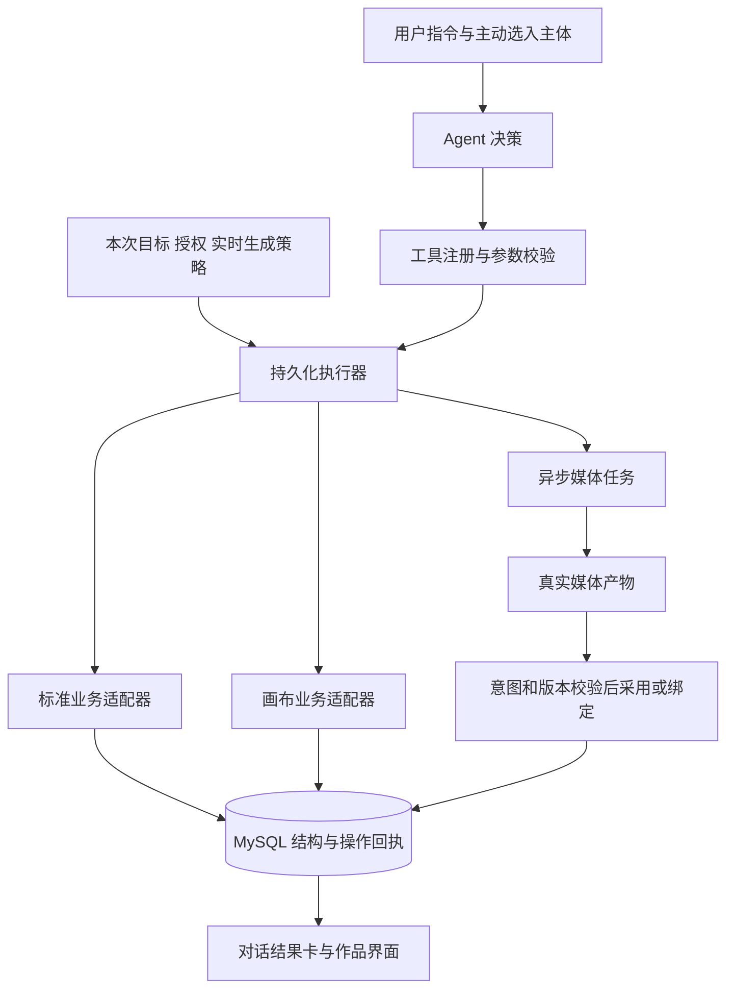

# Agent 创作工具系统设计

状态：产品规则已确认，系统正在实施与验证；本专题保留设计基线，实际进展与未完成范围见[实施记录](2026-10-21-AI创作助手实施与验证记录.md)。日期：2026-10-21。

本文记录本轮已确认的工具系统边界和技术建议。与[无 Embedding 记忆方案](2026-10-21-Agent记忆系统设计修订版.md)及[前端交互与事件方案](2026-10-21-Agent前端交互设计.md)配套；早期创作工具草案仅作为历史背景，其中与本轮确认不一致的规则以本文为准。

本文不表示已开放助手工具、调整授权链路、修改业务代码、执行 DDL、安装新依赖或完成真实供应商验收。工具名、协议与逻辑数据对象均为设计命名，实施时需与现有契约核对。

## 1. 已确认的产品边界

| 项目 | 本轮确认 |
| --- | --- |
| 会话 | 全局会话独立于作品；具体执行绑定本次目标项目或画布；取消会话归档 |
| 作品上下文 | 不自动注入作品正文；主动选入主体覆盖本次完整任务，新任务不自动继承；保留读取快照，发现变化时提示刷新 |
| 三类绑定 | 参考主体、作品记忆范围、工具写入目标分别管理，彼此不自动扩大权限 |
| 执行授权 | 支持讨论与明确授权执行；明确要求创建、修改、生成时，可执行对应范围的操作 |
| 搭建指令 | “搭建流程”等指令只创建结构、填写内容和提示词，不因存在媒体节点就提交媒体生成 |
| 生成开关 | AI 配置提供一个助手媒体总开关，默认开启；Agent 判断需要生成时先读取，执行端再次校验 |
| 开启后的执行 | 在本次授权范围内直接生成，不逐批重复确认；开关本身不扩展任务范围 |
| 标准模式采用 | 助手生成成功的有效新结果始终自动采用，不再要求用户逐次选择采用 |
| 图片组 | 首期纳入图片组生成、读取、主图设置与历史引用，沿用独立组和图位业务契约 |
| 默认数量与主输出 | 未指定数量时每个明确目标一个结果；多输出预先固定主输出，默认按输出序号选第一个有效结果，其余保留历史 |
| 任务预算 | 提供可选的图片、视频、音频数量上限，达到上限暂停；金额预算待价格数据可靠后扩展 |
| 停止与改方向 | 可以随时提出请求；已开始的工具完整结束后才停止或切换，保留已完成成果，不再启动旧计划后续工具 |
| 媒体工具完成边界 | 等待当前工具内的媒体生成及结果回填结束；返回任务 ID 不算工具完成 |
| 执行中新消息 | 普通消息默认补充当前任务，当前工具结束后统一处理；独立新任务单独发起 |
| 停止后的补充 | 普通补充保留但不撤回停止，明确要求继续才恢复 |
| 修改与删除 | 明确范围内直接执行；未包含的关联删除先展示影响并确定范围，不因改计划自动删除成果 |
| 撤销 | 提供按批次撤销入口；只有用户明确要求撤销时执行，停止与改方向不自动撤销 |
| 画布行为 | 沿用现有节点、连线及原生生成回填、直接应用或提议确认的交互边界 |

“有效新结果”指结果属于真实已受理任务，仍对应有效目标、来源及生成意图。取消、目标删除、旧方向失效或版本冲突的处理不能靠“自动采用”绕过，具体见第 9、10 节。

## 2. 当前实现与需要补齐的链路

以当前工作区源码为准，历史计划只能提供背景。当前创作模式是单层项目，两种模式均由所有者独占，画布不再绑定标准创作项目，详见[创作模式维护说明](../../instruction/创作模式维护说明.md)。

| 当前事实 | 设计影响 |
| --- | --- |
| `agent/assistant_chat.py` 的助手分支使用空 tools，`max_tool_calls=0` | 当前共享助手仍是纯聊天；旧执行框架中的工具不等于已向它开放 |
| runtime、authorization、工具执行层也限制助手副作用 | 实施时需同步改造完整调用链、授权状态及工具结果回传，不能只增加工具函数 |
| `agent/tools.py` 将业务效果与工具结果保存在短事务内 | 可复用持久化执行基础，但要覆盖新的目标、批次、撤销和媒体意图 |
| 素材、分镜 Service 已有字段校验、行版本和部分持锁修改入口 | 批量适配应复用业务规则；不能简单嵌套调用多个自带事务的公开方法 |
| `CanvasService.commit` 接收完整画布文档，已有版本校验和写入回执 | 对模型提供增量动作；服务端基于当前版本合成并保存，不能让模型提交全图快照 |
| 前端节点注册表及连线策略已定义节点能力和输入限制 | 后端工具须实施对应校验，不能把浏览器校验视为唯一边界 |
| 画布任务绑定已有 `effect_key` 和 deleted、replaced 等结果状态 | 回填需复用既有绑定语义，保护被删除或替换的节点 |
| 画布局部工具执行已有 claim、heartbeat、executionEpoch 等机制 | 可参考其恢复与 fencing 思路，但它尚不是全局助手的创作工具能力 |
| 标准素材图片采用会设置 `state=confirmed` 并追加版本 | 新策略应通过业务采用服务落地，不能只修改一个图片 URL |
| 标准分镜媒体替换会保留旧媒体记录并推进版本 | 自动采用继续保留历史，避免覆盖后无法追溯 |
| 图片组已有独立 ImageGroup／ImageGroupItem、固定图位序号与主图三类版本校验 | 复用现有组服务，不创建第四种素材类型或让模型写任意媒体地址 |
| 图片生成受理在 agent_managed=True 时不自动激活新组 | 新助手需打通组激活、主图采用及操作回执，不能只拿到 image_group_id 就宣称自动采用完成 |
| 标准配音已有声音文档、台词标识、生成及采用入口 | 音频适配应绑定真实台词或声音对象，不发明“分镜音频槽” |

相关源码入口列于第 16 节。本文不预设工具总数、不宣称现有去重字段足以覆盖全部批量修改，也不预先承诺无需新增表。

## 3. 技术栈与分层

| 组件 | 职责 | 选型建议 |
| --- | --- | --- |
| FastAPI + Pydantic 2 | 目标、配置、执行控制接口及工具参数校验 | 沿用现有分层和统一错误契约 |
| PydanticAI | 结构化工具调用、按需工具暴露、工具结果后的继续决策 | 沿用锁定依赖；具体 API 以项目版本核对 |
| 工具注册层 | 工具 schema、版本、能力描述、可见性与统一返回 | 新增薄层，不在此绕过业务 Service |
| 标准业务适配器 | 素材、分镜、关联、提示词和声音对象的增量操作 | 对接既有业务校验及事务入口 |
| 画布业务适配器 | 节点、连线、布局、媒体任务与结果绑定 | 对接现有画布实现及节点能力 |
| MySQL + SQLAlchemy | 批次、授权、版本、业务效果、回执、媒体意图 | 保证元数据效果与持久回执原子提交 |
| Celery + RabbitMQ | 生成执行、依赖推进、可靠重试及恢复 | 复用异步任务基础，避免长时间占用模型连接 |
| MinIO | 真实媒体、必要的大型结果明细与附件 | 模型使用可信资源引用，不编造媒体地址 |
| React + Ant Design X 1.6.1 + 现有画布子包 | ThoughtChain 调用轨迹、对话结果卡、目标选择、停止、撤销与状态同步 | 复用现有 X 组件，保留自动保存、反馈及画布原生边界 |



本轮无需为工具系统更换 Agent 框架或画布 SDK。外部项目的可借鉴部分见第 15 节。

## 4. 上下文与执行目标

### 4.1 三类绑定

| 绑定 | 包含什么 | 生命周期 |
| --- | --- | --- |
| reference_selection | 用户选入主体的身份、允许字段、实际使用版本 | 本次完整任务；包括补充与改方向，新任务不自动继承 |
| memory_scopes | 当前会话、用户级及明确绑定的作品记忆 | 遵循记忆方案，不随写入目标自动扩展 |
| execution_target | 目标模式、项目 ID、画布 ID、允许操作及必要版本 | 每次执行冻结；修改方向形成新版本 |

前端可以展示当前作品作为本次写入目标。进入页面、选择主体或切换页面均不能自行产生写入授权。目标不清楚时先确定目标；已明确的目标无须反复询问。

### 4.2 主体读取边界

1. 工具只向模型返回用户已选入主体及本任务实际产生的结果；选择清单由服务端验证，不接受模型自报“用户已选择”。
2. 本任务创建的素材、分镜和节点可以用于后续关联、生成和修改，回执提供真实引用。
3. 选中一个节点不默认递归读取全部邻居正文；选中卡片也不默认读取整部小说或剧本。
4. 服务端为归属校验、布局、容量检查和增量保存读取必要结构，不等于将这些内容注入模型。
5. 媒体传给生成模型或多模态模型同样属于资料使用，须校验允许的来源引用；不能借连线自动读取未选入的其他作品内容。
6. 用户取消主体绑定后停止新增读取；已经发送给模型的资料无法撤回，后续摘要和记忆按来源及当前可见范围处理。

工具读取结果使用 token 预算、字段投影与分页。超长正文返回明确的截取范围和继续读取方式，不能静默丢失约束。

主体正文保持实际读取版本。发现后续编辑时提示刷新，不在后台替换已使用资料；写操作独立核验当前版本，不把旧快照当作覆盖新编辑的许可。具体见[上下文管理方案](2026-10-21-Agent上下文与主体选择设计.md)。

## 5. 工具目录与暴露方式

以下为建议工具接口。只向当前决策暴露有目标、有权限且与任务相关的工具；工具隐藏用于降低选择负担，执行器仍须独立校验权限。

| 工具 | 主要输入与输出 | 适用范围 |
| --- | --- | --- |
| describe_creation_target | 返回目标身份、必要版本、可用动作、节点及模型能力摘要 | 标准与画布；不返回作品正文或模型凭据 |
| read_selected_subjects | 按选入引用读取允许字段，返回正文、版本及来源 | 当前允许的主体和任务结果 |
| get_generation_policy | 返回助手媒体总开关、策略版本及当前允许的媒体能力 | 只读；Agent 不能通过工具打开开关 |
| apply_standard_patch | 一批次创建或修改素材、分镜、声音文本，建立关联和调整授权范围内顺序 | 仅标准目标 |
| apply_canvas_patch | 一批次创建或修改节点、连线，布局新增节点 | 仅画布目标 |
| read_image_group | 查询明确选入或本任务产生的图片组、图位及受限历史 | 标准素材／分镜；不扩大到未选入目标的提示词或作品正文 |
| set_image_group_primary | 指定真实组和图位，校验图位、主图及目标三类预期版本后设置主图 | 明确要求换主图时；自动采用由可信结算器完成 |
| submit_generation_batch | 批量受理有明确目标与来源的媒体请求，保存逐项受理回执；生成及回填结束后返回完整工具结果 | 图片、视频、音频；受理回执不作为中断边界 |
| get_generation_status | 查询本次允许的任务、产物和采用状态 | 可跨后台等待恢复；不用模型高频轮询 |
| read_operation_receipt | 按稳定操作 ID 查询已提交、失败或受理不明状态 | 恢复、网络超时和重复投递 |
| undo_operation | 根据批次差异与当前版本进行撤销，返回成功项与冲突项 | 用户明确要求撤销时 |

记忆工具和 Skill 发现、加载工具沿各自方案提供，不能代替创作工具执行。停止与改方向必须具备独立控制 API 和按钮，不依赖模型主动调用一个 stop 工具。

工具本身不提供任意 SQL、Shell、脚本执行或任意媒体 URL 写入能力。新增节点类型、插件和外部工具需有单独的 schema、注册及权限边界。

首期不开放强制取消正在执行媒体的助手工具；统一遵循完整工具边界。普通工具调用、控制 API 与供应商任务内部恢复分别管理。

## 6. 标准模式工具设计

### 6.1 业务动作

| 动作 | 内容 | 保存与执行约束 |
| --- | --- | --- |
| create_asset | 创建角色、场景、道具卡，填写名称、描述、提示词、标签 | 沿用 AssetCreate；scene_time 仅适用于场景 |
| update_asset | 修改明确目标的允许字段 | 必须有预期版本；继承现有编辑后状态及版本规则 |
| create_shot | 创建分镜，填写脚本、标题、景别、时长、顺序 | 当前 duration_ms 为 1000–10000，默认 3000；景别沿用现有枚举 |
| update_shot | 修改指定分镜的正文、提示词及生成设置 | 按各字段实际业务契约保存，不将只读 DTO 字段直接当写入参数 |
| set_shot_assets | 关联或解除本次授权范围内的素材 | 检查同项目、对象有效及引用关系；采用 replace 语义时须明确范围 |
| reorder_shots | 调整授权范围内的分镜位置 | 校验列表版本；追加分镜不自动重排用户已有作品 |
| edit_dialogue | 创建或修改台词、角色和音色等音频生成来源 | 对接真实声音文档及台词标识，保留时间线和声音版本规则 |
| delete_asset／delete_shot | 删除明确指定的素材或分镜 | 复用真实业务删除约束；未授权的关联删除先返回影响范围，不自动级联扩大 |

图片组首期接入独立业务契约，不作为 AssetCreate 的第四种 kind。成片多轨编辑、字幕应用和导出不在首期工具范围。

### 6.2 批次与对话结果卡

同一标准批次可包含“创建素材 → 创建分镜 → 建立关联”，使用临时引用连接新对象，整批校验后一次提交。需要新增持锁批量服务边界时，沿用现有字段校验、DAO、审计及版本推进，不嵌套多个独立事务。

对话中的结果卡由真实回执派生，至少展示对象名称、类型、创建或修改状态、定位入口及所属操作批次。结构保存、媒体生成中、生成成功、自动采用成功、采用冲突分别表达，模型回复不能把“已提交”说成“已生成”。

普通讨论输出文本或方案预览；用户明确执行后，工具提交真实对象并展示结果卡。预览不能冒充已保存的业务对象。

### 6.3 首期图片组工具

图片组依附真实素材或分镜。现有图片生成受理建立组及图位，不提供让模型任意插入空组、伪造图位结果或跨目标搬用媒体的写入口。

| 场景 | 工具与业务衔接 | 完成结果 |
| --- | --- | --- |
| 为素材／分镜生成多张图 | submit_generation_batch 指定真实目标及 count，经公共生成受理建立组 | 回执关联 task_id、image_group_id、各图位、采用状态与真实媒体 |
| 读取当前组或历史组 | read_image_group 接入 current／detail／history，校验选入范围和账号归属 | 分页返回目录，正文及提示词只返回已允许内容 |
| “把第二张设为主图” | set_image_group_primary 使用真实 item_id 及三类预期版本 | 更新主图和对应作品媒体，保留原组及原媒体历史 |
| 恢复已选历史组中的图片 | 显式主图设置，按业务规则恢复该组为当前组 | 不直接覆盖整个历史快照，仍核验目标与当前版本 |
| 图位失败或来源变化 | 记录 partial／failed 或采用冲突 | 成功产物保留，失败原因明确，不伪报全组完成 |

图片组 output_index 沿用当前从 1 开始的稳定序号，不按回调完成顺序重排。默认主输出为第 1 张；其结果尚未明确时不能因第 2 张先返回就改选。第 1 张明确失败后，按稳定序号选择最前的成功项；其余始终保留在组内。图片组主图与素材／分镜当前媒体需保持一致。

现有 ImageGroupService.admit 对 agent_managed 结果使用不激活组的路径，属于旧 Agent 候选语义。新助手实施时需在当前生成意图、目标、来源及版本有效的前提下，使新组激活、旧组转历史、主图更新与采用回执一致提交；不能简单将自动处理标成 manual=True，绕过原来源和当前媒体保护。

组自动采用可以在主图就绪时完成，但整个媒体工具仍需等全部请求图位生成与回填结果明确。部分失败保留成功主图及历史，工具以部分失败结果暂停任务，用户明确继续后再处理缺失项，不自动补发收费任务。

首期图片组能力不意味着全部逐图加工入口自动向 Agent 开放。已有裁切、蒙版、换角度等操作继续按原页面使用，后续接入时逐项定义参数、授权和真实媒体输入，不由 Skill 自行注册。

## 7. 画布工具设计

### 7.1 节点创建

首批覆盖文本、图片、视频、音频节点。使用现有节点定义生成默认尺寸和 metadata，再写入允许的内容、提示词及生成配置；可扩展类型通过能力目录逐个开放。

| 节点角色 | 搭建时的内容 | 真实媒体来源 |
| --- | --- | --- |
| 文本节点 | 用户要求的正文、说明或提示词 | 本次文本内容或允许读取的主体 |
| 媒体生成节点 | 提示词、模型引用、尺寸、时长等生成参数 | 媒体开关与授权允许后由异步任务产生 |
| 媒体结果节点 | 真实产物身份、预览和来源任务 | 只能绑定可信上传、选入媒体或实际任务产物 |

创建空图片节点不等于已经生成图片。按现有 generator、result 语义保留生成与结果的关系，不接受模型伪造的结果地址。

### 7.2 连线及输入校验

| 校验 | 规则 |
| --- | --- |
| 身份与归属 | 两端存在于同一允许画布；可引用本批次临时节点或已有授权节点 |
| 方向与端口 | 输入输出方向、端口及 relation 使用已注册语义，不能任意写字符串 |
| 输入类型 | 图片生成不能接参考视频或音频；视频按所选模型支持的图、视频、音频能力校验 |
| 音频 | 沿当前规则只接受文本或单个角色卡输入，不接图片、视频、音频参考 |
| 容量 | 按有效输入去重计数，结合节点上限和实际所选模型能力；不能只用所有模型中的最大容量 |
| 结构有效性 | 校验重复标识、自连接、父子环及端点存在性；生成依赖图还须可调度且无循环等待 |
| 素材可用性 | 空节点可表达计划结构；真正生成时必须解析到已就绪、被允许使用的资源 |

连线必须影响实际生成输入或业务引用，不能只画视觉线。前后端使用版本化能力契约和对应测试保持一致，不分别依靠提示词复制规则。

### 7.3 批量子图与布局

模型描述“新增哪些节点、连接哪些节点、修改哪些字段”。服务端读取当前版本，解析临时引用，统一校验节点、边和媒体引用，再在短事务内保存本批次差异与回执。

布局首版建议使用确定性的分层、横向流程布局，输入仅包含拓扑、节点尺寸和占位区域。默认只布局新增节点；移动已有节点或全图整理属于独立明确指令。服务端可以读取占位结构完成避让，不向模型注入未选入正文。

文本 → 图片 → 视频 → 配音等流程可以先搭建依赖。执行时只有上游真实产物就绪才推进下游；失败或取消的上游不能用空资源继续提交。依赖关系与画布节点键、任务身份、实际产物引用共同记录，不能仅保留一句自然语言计划。

## 8. 批次协议、幂等与保存

### 8.1 可信执行信封

| 字段 | 来源及用途 |
| --- | --- |
| actor_user_id | 从可信 Actor 注入，模型不能指定账号 |
| conversation_id、run_id | 由运行侧注入，关联本次任务及消息 |
| execution_target | 已确认目标，不能由工具参数切换为其他项目 |
| operation_id | 运行侧在首次执行前持久生成，重试和恢复复用 |
| plan_revision、execution_epoch | 区分方向变更与执行者代次，防止旧计划、旧 Worker 继续写入 |
| expected_versions | 服务器保存的目标版本；新增动作由容器版本保护，修改动作同时保护对象版本 |
| payload_hash | 规范化工具参数的摘要，用于检测同一操作 ID 被换成另一请求 |

数据库 ID 和版本对外使用十进制字符串。画布节点业务键、临时引用、剪辑 UUID 等仍按各自契约使用字符串，不把它们与数据库主键混为一谈。

### 8.2 画布工具参数示意

下面是新工具的语义示例，不是当前 HTTP API，也不是可以直接提交的 CanvasDocument。服务端补齐执行信封并映射为现有节点 metadata 和合法连线字段。

```json
{
  "operations": [
    {
      "op": "create_node",
      "client_ref": "shot_text_1",
      "node_type": "text",
      "title": "镜头 1",
      "content": "雨夜，女主推开房门。"
    },
    {
      "op": "create_node",
      "client_ref": "shot_image_1",
      "node_type": "image",
      "role": "generator",
      "prompt": "雨夜室内，女主推开房门，中景，冷色照明"
    },
    {
      "op": "connect_nodes",
      "client_ref": "input_1",
      "from": {"client_ref": "shot_text_1"},
      "to": {"client_ref": "shot_image_1"}
    }
  ],
  "layout": {"strategy": "flow_right", "scope": "created_nodes"}
}
```

同批次以 client_ref 引用新增对象，回执返回临时引用与真实对象键的映射；后续批次使用真实键。临时引用不能跨批次被当成已存在对象，也不直接作为数据库主键。

### 8.3 提交流程与返回

1. 核验目标、授权及执行代次；检查是否已有相同操作的持久回执。
2. 等待当前参与编辑页面的来源保存完成；未打开页面时按服务端保存版本执行。保存失败或冲突不绕过。
3. 校验全部动作及引用，计算受控差异，按统一顺序加锁并再次核验版本与代次。
4. 在同一短事务内保存全部结构效果、ID 映射、版本及操作回执；事务中不调用模型或外部媒体服务。
5. 返回真实结果并通知界面更新；旧自动保存快照遇到版本变化须保留草稿，不能覆盖 Agent 刚保存的结构。

| 返回情况 | 结构批次 | 媒体批次 |
| --- | --- | --- |
| applied | 本批次全部提交并有回执 | 不用此状态冒充生成成功 |
| rejected 或 conflict | 全批次没有业务写入，返回具体字段或冲突对象 | 按项返回未受理原因 |
| accepted | 不适用 | 本地持久受理并返回逐项任务身份，不代表供应商或生成已完成 |
| outcome_unknown | 不能向用户宣称成功；按操作 ID 核对回执 | 按原请求身份查询供应商或本地任务，不换键重新收费提交 |

媒体批次允许部分任务已受理、其余未受理，必须逐项记录；结构批次不以部分成功隐藏半张图。

### 8.4 幂等与恢复规则

同一操作 ID、同一参数返回原回执；同一操作 ID、不同参数返回 idempotency_conflict。参数摘要用于比较，不能把它拼入唯一键后允许同一逻辑操作被换参执行两次。

创建键只能覆盖部分新建去重，不能替代修改、关联、排序、自动采用和撤销的完整回执。优先复用画布写入回执及 Agent 工具记录；缺少原子性、唯一约束或恢复字段时补齐逻辑操作账本。

持久生成意图与可靠投递记录关联，恢复时先核对原受理结果，再处理缺失步骤。Celery 可能重复投递，外部供应商未必支持幂等，不能承诺跨系统无条件 exactly-once。

建议错误类别包括 scope_mismatch、selection_required、version_conflict、invalid_arguments、invalid_connection、capacity_exceeded、media_disabled、execution_superseded、idempotency_conflict、submission_unknown。参数修正形成新操作；结果不明首先查询回执。

## 9. 媒体生成开关与自动采用

### 9.1 AI 配置

位置：AI 配置 → 创作助手 → 允许生成图片、视频、音频。

已确认使用一个账号级助手媒体总开关，默认开启，三个媒体能力仍按模型配置和实际功能能力分别判断。默认开启不代替任务授权，“只搭建流程”仍不生成媒体。保存过的个人关闭设置保持关闭；升级只为缺少该设置的账号初始化默认值，不重置用户选择。

| 时点 | 核验 |
| --- | --- |
| Agent 规划和决策前 | 读取实时策略，知道当前是否可以提出并执行生成 |
| 任务受理时 | 服务端重新核验总开关、目标、来源、媒体能力、配额和本次授权 |
| 后台实际派发前 | 再检查权限、实时开关和当前工具许可；待停止／改向不撤销当前工具许可，但禁止启动下一工具 |

关闭开关后阻止新的受理与尚未外发的生成；配置停用与普通停止／改向请求分开处理。已经外发的任务继续按真实状态结算及保护性回填，不因关闭开关而默认取消或伪记为已停止。开关不影响助手自身文本推理、提示词撰写或结构搭建，也不是“允许自动读取作品”的开关。

### 9.2 指令矩阵

| 用户意图 | 开关关闭 | 开关开启 |
| --- | --- | --- |
| 讨论方向、分析方案 | 对话或预览 | 对话或预览 |
| 只搭建流程 | 保存授权范围内结构、内容和提示词 | 同左，不自动生成 |
| 创建素材并生成图片 | 完成可用的结构准备，说明生成受限 | 直接生成并自动采用有效结果 |
| 根据选中分镜生成视频 | 不提交媒体生成 | 检查必要来源，受理后自动采用有效结果 |
| 超出本次范围的新任务 | 重新明确任务范围 | 重新明确任务范围，开关不代替授权 |

生成范围可以包含已经明确的多阶段依赖，不需要每个镜头重复确认。未指定数量时，每个明确目标默认一个结果；批量按已指定素材或镜头范围执行，不自行扩增。图片组多图须来自明确数量或已确认任务计划。

已确认提供可选的单任务图片、视频、音频数量上限；任务范围、账号额度和模型能力约束始终有效。实施建议在当前工具开始前预占整个冻结批次的额度，避免执行到一半因内部额度不足被强行中断；上限不足时暂停并保留待执行计划，待用户调整或明确继续。未调整不足的上限时，“继续”不能绕过限制。

新收费生成尝试计入额度；仅查询受理状态或重试采用不重复扣额度。受理不明保留预占，核实明确未提交才释放，不以换键重发突破数量限制。实际重试次数、批次上限和并发作为技术配置；首期不提供不可靠的金额硬预算，待价格数据可靠后扩展。

### 9.3 标准模式始终自动采用

生成成功后，由可信完成处理器尝试自动采用，前端关闭或模型回复结束均不应导致漏采用。生成与采用分别持久化状态，采用失败可以重试采用步骤，不能重新生成一次代替。

| 对象 | 采用方式 |
| --- | --- |
| 素材图片 | 添加真实候选后调用既有采用业务逻辑，更新当前媒体及版本；现有语义会同步设为 confirmed |
| 分镜图片、视频 | 更新对应当前媒体槽，保留旧媒体历史并推进必要版本 |
| 台词配音 | 按真实台词标识、来源内容及声音版本调用采用服务，保留时间线规则 |
| 画布媒体 | 沿原生任务绑定、生成器与结果语义回填，使用真实 task、output_index 和 effect_key |

普通结构创建或文字修改沿用现有状态规则。素材采用时的 confirmed 是业务采用状态，不应在记忆或审计中伪记为“用户已逐项人工审核”。

### 9.4 防止旧结果覆盖新方向

每个采用目标记录稳定的槽位身份及生成意图版本。新请求或用户手动修改当前采用结果时，推进相应意图或采用版本。自动采用时核验：

- 真实任务与产物身份一致，媒体已保存并通过业务校验。
- 目标仍存在，用户仍有权访问，相关来源未失效。
- 生成意图未被取消或新方向取代，结果仍对应当前允许的采用槽。
- 当前媒体及相关版本符合受理时约束，或者存在经验证的同计划前序步骤推进记录。

例如同一目标已生效的新生成意图 B 取代 A 后，A 的迟到结果只能保留历史，不能覆盖 B。执行中的用户改向请求先进入待生效状态；按第 10 节等待当前媒体工具生成及回填结束后才激活 B，不能因为请求已到达就提前使 A 失效。用户仅移动节点位置时，不应直接把媒体来源判为失效；但实际提交仍需使用最新画布版本并通过字段差异校验。实现初期无法证明变更不相关时，保留结果并报告采用冲突，不强行覆盖。

多个任务修改同一目标时不能按回调完成顺序决定“最新”，同一冲突对象的写操作串行。多输出在请求前固定主输出规则，默认按输出序号选第一个有效结果，其余保留历史；主输出仍未明确失败时，不按回调先后跳选。图片组具体遵循第 6.3 节，画布输出索引沿原契约，不混用两种序号。

## 10. 执行、中断、改方向与撤销

### 10.1 执行与媒体任务分离

区分用户任务、执行尝试、结构批次和媒体任务。模型调用完成不等于媒体任务完成；执行 Worker 租约变化也不等于用户撤销已受理任务。授权有效性单独持久记录，不只依据某个 run 的 running 状态判断是否允许回填。

长任务进入后台等待，由任务事件或恢复调度推进已授权的下一步。恢复继续使用原操作回执与真实任务身份，必要时再调用模型，不重放整段自然语言计划。

### 10.2 工具步骤边界中断：已确认

| 动作 | 已确认的处理 |
| --- | --- |
| 点击停止 | 立即记录待停止请求，阻止下一工具启动；当前已开始工具结束后才进入已停止 |
| 执行中修改方向 | 记录新指令及待改向请求；当前工具结束后停用旧计划后续步骤，再基于实际成果重新规划 |
| 明确要求撤销某批次 | 执行按批次撤销；遇到后续编辑或引用冲突时保留冲突 |
| 只停止，没有要求撤销 | 不自动删除卡片、节点、连线或还原修改，不取消当前工具及其媒体任务 |

服务端先持久化 pending control 并关闭后续工具的启动入口，当前工具保留原参数、计划版本及完成许可。不能在收到请求时立即递增计划代次或撤销当前工具的提交／回填权限。当前工具成功或明确失败、回执持久化后，在步骤边界应用停止或新方向；前端 AbortController 只取消连接，不能独自完成停止语义。

工具开始与控制请求通过同一任务锁或条件更新确定顺序：工具先持久领取则先完成整个工具，请求先被记录则该工具不得开始。准备好、已排队或模型已输出调用参数均不代表已经开始。一个结构批次或媒体批次作为一个有界工具步骤，不能在收到请求后偷偷改成内部强制中断。

改方向生效时生成新计划版本，新操作使用新操作 ID，不修改旧工具参数。新计划基于当前工具的真实完成结果和保留成果；旧模型回答、旧 Worker 及旧恢复事件不能再次推进旧方向。回执不明时先核实，不凭超时认定完成并启动冲突操作。界面显示“当前工具完成后停止／切换方向”，不能提前显示“已停止”。

执行中普通新消息默认作为当前任务补充，当前工具结束后统一处理；独立新任务须单独发起。收到补充即保存待处理消息水位并阻止旧计划下一工具启动，但不修改当前工具参数，也不立即视为改方向。边界先消费补充再决定后续计划，详见执行方案第 5.1 节。

停止请求不被后发普通补充撤回，补充保留且不启动后续工具；明确要求继续才恢复。同会话独立任务串行，不同会话可并行，但冲突对象写入串行。关闭浏览器或切换页面后，任务仍由服务端继续执行。

### 10.3 媒体工具完成与回填：已确认

用户已确认：等待媒体生成及结果回填结束，再停止或改方向。工具可以先持久化并展示逐项 task_id，但提交返回不构成完整工具结果或中断边界。后台等待不占用模型连接，也不依赖浏览器持续在线。

当前工具内已冻结的媒体批次继续按原参数完成；待停止／改向本身不触发取消，也不让原生成意图提前失效。有效结果按既有规则自动采用或原生回填，随后应用停止或新方向；不再运行旧计划下游工具。新方向可以再次修改刚完成的成果，但不会自动撤销它。

生成明确失败、目标删除或采用冲突时，保存真实失败／冲突回执后形成工具结束边界，不无限重试或强行覆盖；请求或回填结果不明时进入核实状态，不冒充已结束。技术恢复只修复同一操作，不以新任务重生成替代失败回填。批量工具需等待其中各项生成与回填结果均已明确。

详细状态、并发边界、补充优先级、明确继续及恢复见[执行、中断与修改方向方案](2026-10-21-Agent执行中断与修改方向设计.md)。

### 10.4 按批次撤销

1. 通过操作回执取得本批次新增对象、修改字段、连线差异及提交前后版本。
2. 校验当前对象、后续引用、采用结果和字段版本；不从整张旧快照覆盖当前作品。
3. 安全的批次按反向差异执行；存在冲突时先返回可撤销项和冲突原因，不静默部分撤销。
4. 用户明确选择可撤销范围后形成新的撤销操作与回执；重复撤销返回原结果。
5. 结构撤销与媒体采用回退分别记录，不用撤销中途取消当前媒体工具。撤销不能撤回已发生的供应商费用或删除仍被其他对象引用的媒体。

撤销入口可以放在对话批次结果卡中，明确展示将影响的对象。结构批次允许独立撤销；整次任务撤销涉及多个批次时，需要按依赖反序处理和逐批记录。

## 11. 与记忆、Skill 及会话的协同

| 系统 | 协同规则 |
| --- | --- |
| L1 原始记录 | 保存工具调用、引用、真实回执与错误，不只保留模型的文字总结 |
| L3 任务状态 | 分开保存当前有效目标、待处理补充及消息水位、待生效新指令、控制请求、计划代次、当前工具、已完成批次及采用状态 |
| 会话摘要 | 可以概括历史过程，不能恢复旧执行权、旧目标或已取消的媒体意图 |
| 长期记忆 | 保存用户明确设定或有来源的事实；计划、未执行提议和失败结果不能记成已完成 |
| 系统 Skill | 声明适用任务、所需工具及输入要求，按需加载正文 |
| 用户 Skill | 与内置 Skill 使用统一能力边界，不能自行注册执行代码或打开媒体开关 |
| 手动调用 Skill | 表达本次使用的创作方法；是否产生副作用仍取决于用户执行意图 |
| 自动调用 Skill | 按需求选择并记录所用版本，不因加载 Skill 自动扩大资料范围或执行权限 |

全局会话可以先讨论，再绑定明确创作目标执行。实施时需解除旧会话强项目绑定，同时保留每个任务的真实项目归属及权限核验；不能简单保留所有 scope_version=2 的禁写规则后声称已支持新助手工具，也不能将所有历史聊天自动视为已有执行授权。

Skill 的格式、账号存储、AI 配置管理页、版本、手动入口和自动选择策略见[Skill 管理与按需调用方案](2026-10-21-AgentSkill管理与按需调用设计.md)。首期支持指令、资料与模板，通过平台工具执行，暂不支持脚本；本文只确定工具侧接口边界。

## 12. 逻辑数据与反馈

以下是需要持久化的逻辑对象，不是本轮已创建的表。优先复用具备完整约束的既有记录；是否拆表以实际事务、索引、体积及恢复要求决定。

| 逻辑对象 | 必要信息 |
| --- | --- |
| 执行上下文 | owner、会话、目标、授权来源、有效计划版本、当前工具、待生效控制请求及执行代次 |
| 操作账本 | operation_id、工具版本、参数摘要、状态、真实回执、时间及错误 |
| 批次差异 | 新增身份、前后字段、必要版本、引用依赖、撤销状态及来源操作 |
| 媒体生成意图 | 采用槽、意图顺序、来源身份及摘要、请求与主输出规则、实际 task_id |
| 可靠投递 | 与本地受理事务关联的派发意图、重试及受理不明状态 |
| 助手偏好 | 媒体总开关、策略版本及后续明确的数量、并发或费用限制 |
| 任务媒体额度 | 图片／视频／音频上限、预占、已提交与受理不明占用，关联真实操作及请求 |

工具结果返回可显示的简短摘要及受限明细入口；大正文及重复状态不无限塞回模型上下文。向用户展示结构已保存、任务已受理、生成中、回填中、待停止／改向、已停止、已生成且已采用、采用冲突等真实状态。

每次工具调用都需由服务端提供稳定调用身份、持久阶段事件和快照投影，前端用 Ant Design X ThoughtChain 展示。受理、生成、回填更新同一条目，不能在返回 task_id 时标记完成；Skill 加载及资料读取也接入同一可见协议。事件以可信回执为依据，不解析最终回答来推测调用，具体版本映射、事件族及恢复按[前端方案](2026-10-21-Agent前端交互设计.md)。

反馈遵守[创作反馈规则](../../design/创作反馈规则.md)：使用现有 StudioFeedback 和详情入口，普通状态就地展示，不在编辑器正文中追加进度块。对话结果卡基于真实回执刷新，并提供定位对象、查看任务及明确撤销入口。

## 13. 实施阶段建议

| 阶段 | 交付与依赖 |
| --- | --- |
| 1. 执行基础 | 全局会话与任务目标契约、授权、步骤启动屏障、待生效控制、操作回执及恢复；同步改造当前纯聊天限制 |
| 2. 结构创建 | 标准素材、分镜和关联；首期图片组读取及主图设置；画布四类节点、连线、局部布局；原子批次和结果卡 |
| 3. 媒体闭环 | AI 配置开关、保存屏障、异步受理、真实结果回填、标准自动采用及历史保留 |
| 4. 多阶段与纠偏 | 依赖推进、工具完成后改方向、完整媒体边界、按批次撤销及冲突处理 |
| 5. Skill 协同 | 按已确认 Skill 方案实现按需工具可见性和持久调用记录，前端展示加载及关联步骤，不赋予额外执行权限 |

阶段 2 开始就需要具备最小停止和回执能力，不能在所有写工具上线后才补控制边界。表结构实施时按项目约定同步 ORM、真实库 DDL、完整 SQL、旧库迁移与维护说明；当前只写设计，不执行数据库操作。

## 14. 后续验收清单

| 场景 | 必须满足 |
| --- | --- |
| 讨论或只搭建流程 | 不误提交图片、视频、音频任务 |
| 未选入作品正文 | 模型输入和读取工具均不能自动获得作品正文 |
| 批量素材与分镜关联 | 临时引用正确，关联同项目，版本推进一致 |
| 一批画布节点和连线 | 任一结构校验失败则全批次不落库，无半张图 |
| 不兼容或超容量连线 | 前后端均拒绝，不能靠工具绕过 |
| 重试与重复投递 | 不重复创建、不重复采用、不用新键重复付费提交 |
| 标准生成完成 | 在目标、来源和意图有效时自动采用，旧结果保留历史 |
| 图片组生成与主图 | 稳定图位顺序，主输出失败才回退；组与作品媒体一致，旧组及其他结果保留历史 |
| 新账号与已有关闭设置 | 缺少设置时默认开启，已保存的关闭选择不被升级重置 |
| 数量上限不足 | 当前工具开始前暂停，不部分外发后强行截断；受理不明不释放额度或换键重发 |
| 先请求 A 后请求 B | A 晚到不能覆盖 B，也不能推进已失效方向 |
| 生成中手动编辑 | 保留用户修改，冲突有持久结果，不强制覆盖 |
| 停止或改方向 | 当前工具先完成；媒体包含生成及回填，之后控制生效，旧计划后续工具不再开始，已完成成果保留 |
| 明确撤销 | 只逆转相应批次，保护后续编辑与引用；无明确请求不撤销 |
| 关闭开关 | 后续受理和未外发步骤被阻止，已外发状态如实报告 |
| 刷新、断线、Worker 重启 | 依靠真实回执恢复，不把整段模型输出重新执行 |
| 工具和 Skill 前端感知 | ThoughtChain 按持久阶段与快照恢复，重复事件不重复建项，加载成功与业务完成分清 |
| 多标签页与自动保存 | 页面切换不改变执行目标，旧保存不能覆盖新结构 |
| 账号或目标变化 | 服务端重新核验归属，不能写入另一个账号或作品 |

实施时按 test-map.json 选择功能 fast，并按数据库、界面、基础设施变更追加 mysql、browser、infra；真实供应商验收独立进行。本轮仅检查文档内容、格式和链接，不将上述用例描述为已通过。

## 15. 参考项目与库的取舍

| 项目或库 | 可参考的能力 | 本项目取舍 |
| --- | --- | --- |
| [tldraw Agent Starter Kit](https://tldraw.dev/starter-kits/agent) | 类型化动作、动作校验、批量图形操作与对话呈现 | 借鉴动作契约；继续使用当前画布，不采用其默认视口和全图资料采集 |
| [PydanticAI Deferred Tools](https://pydantic.dev/docs/ai/tools-toolsets/deferred-tools/) | 外部执行、长耗时工具、结果回传后继续决策 | 优先使用现有框架能力；具体 API 和运行 ID 语义以锁定版本核对 |
| [LangGraph Interrupts](https://docs.langchain.com/oss/python/langgraph/interrupts) | 持久状态、中断、恢复与副作用幂等要求 | 参考执行设计，当前不为工具系统再引入一套运行框架 |

调研结论只覆盖公开机制，不用于推断 LibTV、Flova 或 OiiOii 的内部实现。采用现有框架也不能替代本项目对授权、幂等、业务版本和取消的服务端校验。

## 16. 本地源码依据

- [助手纯聊天分支](../../../backend/src/short_drama/agent/assistant_chat.py)、[运行时](../../../backend/src/short_drama/agent/runtime.py)、[授权](../../../backend/src/short_drama/agent/authorization.py)、[旧执行工具](../../../backend/src/short_drama/agent/tools.py)。
- [素材 schema](../../../backend/src/short_drama/schemas/asset.py)、[素材服务](../../../backend/src/short_drama/service/asset_service.py)、[素材图片采用](../../../backend/src/short_drama/service/asset_image_service.py)。
- [分镜 schema](../../../backend/src/short_drama/schemas/shot_script.py)、[分镜服务](../../../backend/src/short_drama/service/shot_script_service.py)、[分镜媒体服务](../../../backend/src/short_drama/service/shot_media_service.py)。
- [声音 schema](../../../backend/src/short_drama/schemas/project_sound.py)、[声音服务](../../../backend/src/short_drama/service/project_sound_service.py)。
- [图片组 schema](../../../backend/src/short_drama/schemas/image_group.py)、[组与主图服务](../../../backend/src/short_drama/service/image_group_service.py)、[图片组接口](../../../backend/src/short_drama/api/v1/image_groups.py)、[前端 DTO](../../../frontend/src/api/modules/image-groups.ts)。
- [画布服务](../../../backend/src/short_drama/service/canvas_service.py)、[任务绑定协议](../../../backend/src/short_drama/schemas/canvas_generation.py)、[画布生成服务](../../../backend/src/short_drama/service/canvas_generation_service.py)。
- [节点能力定义](../../../frontend/canvas/src/lib/canvas/node-registry/node-definition.ts)、[连线策略](../../../frontend/canvas/src/lib/canvas/canvas-connection-policy.ts)、[局部工具持久执行](../../../frontend/canvas/src/services/approved-tool-execution.ts)。

## 17. 本轮确认结果与实施细化

| 项目 | 已确认规则或技术处理 |
| --- | --- |
| 执行与补充 | 工具完整结束后统一处理，停止保留，明确继续才恢复，连续明确修正以最新为准 |
| 媒体默认值 | 总开关默认开启；每目标默认一个结果；多输出主结果预先固定，其他保留历史 |
| 首期范围 | 包含图片组；成片剪辑、字幕及导出后续扩展 |
| 删除与撤销 | 未授权关联先确定影响范围；部分撤销先展示安全项和冲突项，用户选择后执行 |
| 实施参数 | 批次、并发、重试、token 及实例配额在实施时配置，不再逐项请求产品确认 |

全部决策与关联方案见[系统方案总览](2026-10-21-AI创作助手系统设计总览.md)。本文仍是设计，不是已实施的接口或运行验收。
