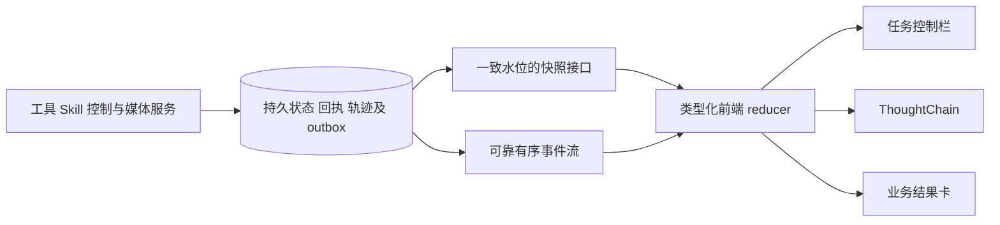

# Agent 前端交互、调用轨迹与 Ant Design X 设计

状态：产品规则已确认，系统正在实施与验证；本专题保留设计基线，实际进展与未完成范围见[实施记录](2026-10-21-AI创作助手实施与验证记录.md)。日期：2026-10-21。

本文与[系统总览](2026-10-21-AI创作助手系统设计总览.md)、[上下文](2026-10-21-Agent上下文与主体选择设计.md)、[会话](2026-10-21-Agent全局会话与任务管理设计.md)、[工具](2026-10-21-Agent创作工具系统设计.md)、[Skill](2026-10-21-AgentSkill管理与按需调用设计.md)及[执行与中断](2026-10-21-Agent执行中断与修改方向设计.md)配套。只编写方案，不修改前端、后端或依赖。

## 1. 前端必须感知什么

用户要求调用工具和 Skill 时前端能够感知，并尽可能复用 Ant Design X。这里展示可验证的执行过程：选择并加载方法、读取获准资料、创建卡片、建立连线、生成媒体、回填结果。ThoughtChain 不展示模型的隐藏推理，也不把模型生成的一段计划当成真实执行记录。

| 展示对象 | 用户应能看到 | 事实来源 |
| --- | --- | --- |
| 当前任务 | 目标、执行目标、选入主体、手动方法、待用补充、停止或暂停状态 | 服务端任务快照及控制记录 |
| Skill 调用 | 名称、固定版本、手动／自动、简短用途、加载结果、所读资料及关联步骤 | Skill 加载器的持久激活与资源读取记录 |
| 工具调用 | 操作名称、目标范围、当前阶段、逐项结果、失败或冲突、保留成果 | 服务端工具执行器和业务回执 |
| 媒体工具 | 受理、生成、产物保存、采用／回填、完整结束 | 真实生成任务及采用／绑定回执 |
| 控制请求 | 已收到、等待当前工具、已经生效，以及补充是否已处理 | 有序控制记录和输入处理水位 |
| 最终回复 | 基于真实结果说明已完成、未完成及后续可操作内容 | 有效模型回复与已持久结果引用 |

Skill 加载成功不等于创作任务完成；媒体返回 task_id 不等于工具完成。界面不得把两者合并成一个通用“完成”状态。

## 2. 当前基础与版本约束

| 当前事实 | 方案取舍 |
| --- | --- |
| 标准前端和画布均锁定 `@ant-design/x` 1.6.1，Ant Design 声明为 `^5.29.3` | 首期沿用当前依赖，不为 ThoughtChain 升级两套前端 |
| 助手已有 XProvider、Bubble.List、Sender、Suggestion、Conversations、Welcome、Prompts；上下文组件已用 Attachments | 在现有助手上扩展轨迹和任务控制，不另造聊天壳 |
| `useAssistantRuntime` 目前以 assistant.delta 追加文字，其他事件主要触发状态刷新 | 增加类型化轨迹投影和快照合并，不从回复 Markdown 中识别调用 |
| 消息正文使用 react-markdown 与 remark-gfm | 继续使用现有渲染，不为本方案强制安装 X Markdown 或 X SDK |
| 画布是独立前端子包，有既有生成与助手图交互 | 共享协议与状态语义，保留独立入口、样式及原生图交互边界 |

已只读核对本地 1.6.1 类型：ThoughtChain 通过 `items` 接收条目，item 的 `status` 仅支持 `pending`、`success`、`error`；支持 `key`、`icon`、`title`、`description`、`extra`、`content`、`footer`。折叠受控参数位于 `collapsible={{ expandedKeys, onExpand }}`，不是顶层参数；item 没有 `children` 属性。

当前官网文档已经面向 2.x，其状态、折叠参数及部分字段不同。实施必须按锁文件和类型编写适配层，不能直接套用官网 2.x 的 `loading`／`abort` 或顶层 expandedKeys。本地 1.6.1 也没有 `ThoughtChain.Item` API。未来依赖升级单独评估，不能将其混入本轮业务改造。

## 3. 页面与组件分工

| 区域 | 优先使用 | 交互职责 |
| --- | --- | --- |
| 助手主题 | XProvider＋现有 AntD ConfigProvider／主题变量 | 沿用紧凑中文工作台和中性炭黑主题 |
| 会话列表 | Conversations | 全局新建、搜索、重命名、删除及运行提示；无归档菜单 |
| 对话正文 | Bubble.List | 用户补充、任务过程、有效回复；历史按需分页 |
| 执行过程 | ThoughtChain | 每项真实 Skill 加载及工具调用的阶段、结果与详情 |
| 输入 | Sender | 执行中仍可编辑、发送补充；发送和停止是不同操作 |
| 主体／Skill 提及 | Suggestion＋既有选择器 | 选择真实身份；自然语言显示名不替代后端 ID 校验 |
| 附件 | Attachments＋既有上传服务 | 上传、失败重试和选入；附件不是自动写入作品的授权 |
| 首次进入 | Welcome、Prompts | 讨论、搭建、生成等示例，明确须选目标或主体，不暗示自动理解全作品 |
| 回复动作 | Actions＋既有按钮 | 复制、允许的编辑／重答、定位成果；不隐式重放有副作用工具 |
| 结构与媒体结果 | 既有业务预览和结果卡 | 素材、分镜、节点、图片组、音视频、批次撤销；不强行塞进通用附件样式 |
| AI 配置／Skill 管理 | AntD Tabs、Table、Form、Input、Upload、Switch、Tag、分页与统一 Dialog | CRUD、导入预览、启停、调用方式、版本和冲突恢复 |
| 任务级状态 | 现有紧凑状态栏、Tag 与按钮 | 待停止、待改向、待处理补充、预算暂停和明确继续 |

Ant Design X 负责对话与调用呈现；业务表单和管理页使用 AntD 及现有公共组件。模型请求、Skill 内容加载和业务工具始终由后端控制，不因库提供 useXAgent／useXChat 就搬到浏览器执行或暴露模型凭据。

## 4. ThoughtChain 的条目模型

每项调用使用稳定 call_id 作为条目身份，另保存 task_id、run_id、step_id／operation_id、顺序和父关联。同一调用阶段变化只更新原条目；技术重试在详情中保留次数，不每次创建一个看似独立的新业务动作。

| 条目类型 | 标题示例 | 默认描述 | 展开详情与结果动作 |
| --- | --- | --- | --- |
| 手动 Skill | 使用「分镜规划」 | 手动指定 · 固定版本 · 已加载 | 版本、用途、必要资料、关联工具 |
| 自动 Skill | 使用「角色一致性检查」 | 按需调用 · 固定版本 · 加载中 | 适用原因的简短说明、加载结果和资源引用 |
| 主体／记忆／资料读取 | 读取已选人物卡 | 读取范围、来源版本、成功／失败 | 受权来源入口及有界结果摘要；正文不作为公开日志 |
| 标准结构工具 | 创建 6 张分镜卡 | 准备中／写入中／已创建 6 张 | 真实卡片列表、定位、关联结果和批次撤销入口 |
| 画布结构工具 | 创建 8 个节点和 7 条连线 | 校验中／提交中／已写入 | 节点及连线列表，按真实节点键定位 |
| 图片组工具 | 为人物卡生成 3 张图片 | 生成 2／3 · 主输出待确定 | 复用图片组预览，显示固定图位、主图、失败项及历史 |
| 其他媒体工具 | 生成镜头视频 | 已受理／生成中／回填中／已结束 | 真实任务、预览、采用状态、用量和错误详情 |
| 撤销工具 | 撤销本次分镜批次 | 检查影响／等待选择／执行／完成 | 安全项和冲突项；用户选择后只处理可安全撤销部分 |

Skill 发现阶段只显示必要的“正在匹配方法”任务提示，不把目录中所有候选都当作已调用。加载器成功冻结激活后才显示“已使用”；失败显示真实失败。通过统一工具触发 Skill 加载时，用同一 call_id 或 parent_call_id 合并呈现，不能出现“调用 load_skill 成功”和“加载 Skill 成功”两个重复业务条目。

关联工具仍保留各自独立回执。1.6.1 不支持 item.children；首期使用同级顺序条目＋Skill 标签表达关系，资料清单放在 item.content。不要为模拟树形 API 改造或升级组件库。

### 4.1 精确状态映射

以下状态属于应用展示模型，不直接扩展 ThoughtChain 的枚举。

| 应用事实 | 1.6.1 item.status | 补充表达 |
| --- | --- | --- |
| 已规划／排队但未开始 | 不设置 | 静态顺序图标、排队标签；与实际调用区分 |
| 工具运行／媒体等待／回填／结果核实 | pending | 用 description 和 Tag 表达具体阶段；不提供虚构百分比 |
| 完整成功，效果与回执均保存 | success | 数量、成果引用及采用／回填状态 |
| 工具明确失败或以回填冲突结束 | error | 真实原因、已保留产物和可恢复动作；冲突不称生成失败 |
| Skill 主指令与所需资源加载成功 | success | 明示“加载成功”，不称“任务完成” |
| 收到停止／改方向请求 | 当前工具原状态 | 任务栏显示“当前工具完成后停止／切换”，不提前变更工具状态 |
| 未开始步骤因停止被跳过 | 不设置 | 静态跳过标记，不伪报成功或工具错误 |
| 任务已停止 | 已完成条目保持原状态 | 任务栏已停止，保留成果及明确继续入口 |
| 数量上限导致暂停 | 已完成条目保持原状态 | 任务栏显示用量和上限，不把成功工具标成错误 |
| 批次部分成功 | 按完整工具回执映射；不可只据成功项记 success | 必需项失败／冲突时标 error，清晰展示逐项结果与保留成果 |

例如用户在图片生成中点击停止：原图片工具保持 pending，描述从“生成中”进入“回填中”，任务栏持续显示“当前工具完成后停止”；真实回填完成后该工具变 success，再把任务更新为已停止。其后普通补充只显示待用，明确继续才重新排队。

## 5. 服务端事件与持久轨迹

事件来自可信的工具执行器、Skill 加载器、媒体结算器和控制服务。调用轨迹是执行事实的可恢复展示投影，不作为业务执行许可，也不依赖模型自己声称“我已调用”。原始模型工具参数、业务操作和展示摘要各自保留职责。

| 建议事件族 | 产生时机 | 前端处理 |
| --- | --- | --- |
| step.prepared | 参数和范围已校验，但尚未持久领取 | 展示准备状态；不称已经开始 |
| step.started | 当前工具已持久领取、参数冻结 | 建立／更新工具条目为 pending |
| step.waiting_media | 真实生成任务已绑定 | 原条目进入生成阶段，展示实际进度 |
| step.settling_result | 产物已生成，等待采用／回填 | 原条目显示回填中，不提前成功 |
| step.stage_changed | 查询、受理核实、有限重试等其他阶段变化 | 更新原条目的阶段及有界说明 |
| step.finished | 工具已保存完整终结回执 | 按成功、失败、冲突或部分结果渲染 |
| skill.load.started／succeeded／failed | 加载请求、固定版本激活及失败回执 | 建立／更新唯一 Skill 条目 |
| skill.resource.read | 所需资料或模板已读取／读取失败 | 更新关联 Skill 的资料清单，保留真实读取记录 |
| control.requested／applied | 控制持久接收／在边界正式应用 | 更新待生效与生效状态，不提前改变工具许可 |
| task.stopped／paused／resumed、plan.redirected | 任务处置及有效计划实际变化 | 更新任务栏、输入归属、继续及排队状态 |
| task.input.received／applied | 补充保存／其水位已被处理 | 标明补充已收到、待用或已应用 |
| operation.updated | 后续采用、撤销或其他有版本的回执变化 | 更新真实成果信息，不倒退原始工具完成事实 |

这是逻辑事件名，实施时与现有协议统一，不能同一事实同时发布两套 tool.* 与 step.* 让前端重复建项。事件记录或 outbox 与对应状态变化在同一短事务提交；随后可靠发布，投递可重复。外部媒体请求不能被描述为与 MySQL 同一个原子事务。

| 事件字段 | 设计约束 |
| --- | --- |
| event_id／cursor、seq | 复用现有有序游标契约；明确唯一性、排序和可重放窗口 |
| conversation_id、task_id、run_id | 固定归属；切换页面或当前任务不改变历史事件归属 |
| call_id、parent_call_id、step_id、operation_id | 关联和去重；非适用字段可空，不以名称作为身份 |
| state_version／trace_version、plan_revision | 区分实体更新和任务计划，不用到达时间覆盖新版本 |
| kind、phase、outcome、step_order | 使用后端枚举，顺序不取决于 SSE 到达先后 |
| occurred_at | UTC 时间，展示时本地化；不能代替版本控制 |
| display_payload、result_refs | 白名单摘要、计数、脱敏错误、获准详情引用，不广播原参数全文 |

数据库 ID、行版本及计划版本对外使用十进制字符串；画布节点键保持原字符串。事件序号按现有契约选择类型，不将 Snowflake ID 转为 Number。客户端不拿到内部 Worker、密钥或供应商请求全文；详情接口按可信 Actor 再次检查本人会话、Skill 与成果权限。

## 6. 快照、SSE 和断线恢复

1. 进入会话读取快照：当前／历史任务、工具与 Skill 轨迹、补充和控制、成果摘要、消息分页信息及一致的 snapshot_cursor。轨迹分页使用同一水位或稳定版本，避免漏掉快照与订阅之间的调用。
2. 从快照水位之后订阅事件，按 event_id／cursor 去重，按实体版本合并；重放覆盖过的轨迹事件不能重复建项或倒退状态。
3. assistant.delta 的文本恢复与轨迹恢复分别处理。复用现有 resume_cursor 时，明确哪些消息文字尚需补齐、哪些轨迹已由快照覆盖，不因较早文本游标回放而重复工具条目。
4. SSE 断开仅显示连接状态并按策略重连，任务继续。重连不重发用户消息、工具或生成请求；收到游标过期／显式 resync 时重新取一致快照。
5. 终结工具条目不被旧 pending 事件回退。停止后继续建立新 attempt 时，原操作仍指向原回执；新业务操作才分配新身份，技术恢复不伪造第二次调用。
6. 多标签页共享服务端事实；本地发起的请求以稳定 client_request_id 对齐回执。旧标签页响应、延迟快照和已删除会话事件不能覆盖当前新版本。

前端 reducer 只归并数据，不直接执行工具或反向触发后续媒体。重复事件不得触发自动点击生成、再次采用、再次撤销。浏览器存储只保存允许保留的显示偏好和必要草稿，不成为任务事实源；切换账号时清理本人缓存和订阅。

## 7. 输入、停止、补充与继续

| 用户场景 | 界面反馈 | 行为边界 |
| --- | --- | --- |
| 正常讨论 | Sender 正常发送、Bubble 展示回答 | 无明确执行要求时不凭 Skill 或开关扩展任务 |
| 当前工具执行中发送消息 | 输入区标“补充当前任务”；消息标“当前工具完成后处理” | 立即保存，原工具参数不变，阻止遗漏补充的旧下游 |
| 点击停止 | 按钮提交 loading，受理后“当前工具完成后停止” | 不调用前端 abort 代替后端停止，不取消当前媒体 |
| 请求改方向 | 展示待生效要求和原工具阶段 | 当前工具结束并回填后切换，保留成果 |
| 已请求停止后继续补充 | “已保留，任务停止后待用” | 补充不撤回停止 |
| 明确继续 | “核对成果／排队继续”，恢复后展示新 attempt | 同会话串行，不重做完成项，不绕过权限或额度 |
| 单独发起新任务 | 独立任务入口和明确目标选择 | 新 task，不继承原主体及执行授权；同会话排队 |
| 来源已变更 | 主体标签提示有新版本，提供刷新引用 | 不自动更新快照；工具运行中刷新在边界应用 |
| 删除活动会话 | 统一 Dialog 说明不可恢复及记忆选项；提交后保留删除中状态 | 等当前工具完整结束并停止，再从列表移除 |

发送、停止、继续和删除各自拥有受理不明的核对入口；短提示关闭不表示问题已解决。纯讨论重答使用受控入口，已经作为工具依据的历史不能原地编辑后偷偷重新执行。

实现时区分“本条消息正在提交”和“服务端任务正在执行”：不能把整段任务运行态直接映射为 Sender.disabled。利用当前版本的 actions／footer 与现有按钮同时提供发送补充和请求停止；控件 loading 分别绑定各自请求。若使用 Sender.onCancel，也必须调用同一服务端控制接口，不能只关闭文字流。

## 8. AI 配置、Skill 与记忆管理

在现有 AI 配置中增加 Skill 管理区域，账号内容在服务端存储，标准与画布读取同一账号配置。不把 Skill 上传成只在某个浏览器可见的本地记录。

| 页面部分 | 组件与内容 | 必须保留的状态 |
| --- | --- | --- |
| 媒体策略 | AI 配置用 AntD Switch 设置总开关；任务设置用 Form 配置本任务图片／视频／音频数量上限 | 总开关默认开启；已保存关闭设置不重置；开关不等于本次生成指令，单任务额度不混成全账号共用消耗 |
| 目录列表 | Table、搜索、来源和状态筛选、分页 | 内置／个人、名称、适用模式、版本、启用、自动／仅手动 |
| 新增入口 | 在线新建、Markdown、ZIP | 三种方式统一校验；导入先预览，默认启用且允许按需自动调用 |
| 内置详情 | 只读主指令、资料和模板清单、复制为个人 | 原件不可编辑或删除；个人启停／调用方式独立 |
| 个人编辑 | Form、文本编辑器、资料模板管理、统一 Dialog | 行版本、保存 loading、错误保留草稿、409 明确恢复 |
| 删除／停用 | 明确影响说明、逐项提交状态 | 阻止新加载；当前任务按原冻结版本继续，可单独停止任务 |
| 调用选择 | 轻量 Skill 选择器、Suggestion 和当前任务标签 | 手动覆盖完整任务；自动可补充，手动方法优先 |

导入校验展示不支持文件、缺失资源、同名冲突和配额问题，不把未完成的包标为可用。首期不提供运行脚本、远程仓库执行或任意 Python／JS 的编辑入口。保存成功保持安静，失败和冲突按现有反馈规则处理。

### 8.1 记忆、主体与任务设置入口

| 能力 | 建议入口与组件 | 用户可感知的边界 |
| --- | --- | --- |
| 长期记忆查看／纠正／遗忘 | AI 配置内的记忆管理区域，AntD Table、筛选、Form 与统一 Dialog | 区分账号／会话／明确作品作用域，显示来源和版本；纠正用新版本，遗忘阻止旧来源再抽取 |
| 会话摘要状态 | 助手任务／会话详情，紧凑说明和按需展开 | 显示覆盖区间及必要异常；正常后台压缩保持安静，不要求用户反复点击整理 |
| 当前选入主体 | Sender 邻近的选择标签和详情入口 | 显示实际读取版本、有新版本／已移除／不可用；刷新不等于自动覆盖写入目标 |
| 写入目标与作品记忆绑定 | 当前任务设置，分别选择和展示 | 切换页面不改变已有任务目标；绑定作品记忆不自动选入作品全文 |
| 单任务数量上限 | 当前任务设置，Form 与用量提示 | 展示图片／视频／音频预占及已用量，调整不足条件后明确继续；不隐式提高上限 |

记忆管理必须调用与 Agent 相同的作用域、版本和遗忘服务，不提供前端直接改存储的捷径。删除会话时同屏说明记忆默认保留范围及一并清理选项，冲突有具体来源和处理入口；无会话回收站。

## 9. 结果卡、反馈与两种创作模式

| 场景 | 结果呈现 | 与原工作台协同 |
| --- | --- | --- |
| 标准素材／分镜 | 创建或修改数量、真实对象入口、关联和批次 | 定位现有卡片，遵守自动保存和版本冲突规则 |
| 标准媒体 | 预览、当前采用状态、历史和真实任务 | 有效新结果自动采用，不再添加逐次候选采用流程 |
| 首期图片组 | 复用 ImageGroupPreview、固定图位、主图和失败信息 | 主输出预先固定，按稳定序号决定；不按回调先后选主图 |
| 画布节点与连线 | 图修改摘要、节点定位和原生媒体状态 | 保留源既有直接应用／提议确认、连线策略和回填行为 |
| 部分成功／冲突 | 成功产物、未完成项、具体原因和恢复入口 | 生成完成但未采用应明确区分，不以成功短提示掩盖冲突 |
| 按批次撤销 | 影响预览、安全项／冲突项选择和真实撤销结果 | 只有明确撤销才执行，不因停止自动删除作品 |

过程放在助手的消息区及详情，不向小说、提示词、分镜和预览文档流插入进度块。标准模式继续使用 StudioFeedback／useStudioMessage 和稳定 noticeKey，遵守[反馈规则](../../design/创作反馈规则.md)；画布保留原交互边界。自建详情层使用统一 Dialog 的局部反馈宿主。

标准与画布共享事件 DTO、状态映射及可测试的纯数据投影；各包在自己的 React root 和主题内渲染，避免跨包复用 CSS、Provider 或重写源画布。私有会话和 Skill 轨迹不随共享图广播。

## 10. 折叠、长任务与可访问性

当前调用、待处理控制和失败详情优先可见，历史成功条目可折叠；折叠不删记录。长任务按任务和调用分页，详情与媒体预览按需加载，不把全部参数和资源正文一次塞进 DOM。

用户停留在底部时跟随新增内容；向上阅读时不强制滚动，提供“有新进展”入口。键盘可发送、选择主体／Skill、展开详情、停止和继续；菜单关闭后恢复焦点。窄屏折叠会话列表，保留当前步骤、输入和停止／继续；不整页横向溢出。aria-live 仅播报阶段和结果变化，节流进度，不逐 token 或心跳朗读；遵守减少动画偏好。

列表、轨迹、详情、Skill 表单均有 loading／空／错误三态。错误文案说明失败操作与原因，并保留草稿、请求和持久详情；界面展示摘要，不输出凭据或未经处理的供应商响应。

## 11. 实施顺序与验收

| 阶段 | 前后端一起交付 |
| --- | --- |
| 1. 统一状态契约 | task／call／operation 身份、控制状态、事件白名单、版本和快照水位；前端类型及 reducer |
| 2. 可见执行闭环 | 结构工具及 Skill 真实事件、持久回执、ThoughtChain、详情与断线恢复 |
| 3. 媒体完整过程 | 首期图片组、音视频阶段、自动采用／原生回填、主输出及失败／冲突卡 |
| 4. 任务控制 | 边界停止／改向、补充待用、明确继续、独立任务、删除等待与跨页面恢复 |
| 5. 管理与优化 | AI 配置 Skill CRUD、三种导入、个人设置、分页、键盘和窄屏验收 |

未来验收必须包括：每次真实工具／Skill 调用可追踪；无调用时不伪造轨迹；加载成功与任务成功分清；task_id 返回仍在等待；重复和乱序事件不重复建项；快照与 SSE 无缺口；文本补流不重放工具；刷新不重启生成；停止等待完整回填；停止后补充不恢复；冲突保留用户编辑；图片组稳定选主图；账号隔离；两包组件类型和样式均符合已锁定版本。

实施后按 test-map.json 选择功能 fast，以及对应 browser、mysql、infra；纯数据投影覆盖重连、版本和控制优先级，浏览器覆盖真实可用操作和主要恢复路径。本轮仅核对文档、组件类型和公开资料，未运行页面、功能测试或真实供应商验收。

## 12. 本地与外部依据

- [标准前端依赖](../../../frontend/package.json)、[锁文件](../../../frontend/package-lock.json)、[画布依赖](../../../frontend/canvas/package.json)、[画布锁文件](../../../frontend/canvas/package-lock.json)。本次另只读核对已安装 1.6.1 的 ThoughtChain 类型，没有修改依赖。
- [助手面板](../../../frontend/src/features/ai-assistant/CreativeAssistantPanel.tsx)、[消息列表](../../../frontend/src/features/ai-assistant/AssistantConversationBody.tsx)、[输入](../../../frontend/src/features/ai-assistant/AssistantMentionTextarea.tsx)、[会话历史](../../../frontend/src/features/ai-assistant/AssistantHistory.tsx)、[正文渲染](../../../frontend/src/features/ai-assistant/AssistantMessage.tsx)、[运行状态 Hook](../../../frontend/src/features/ai-assistant/useAssistantRuntime.ts)。
- [上下文组件](../../../frontend/src/features/agents/AgentContextComposer.tsx)、[Skill 选择器](../../../frontend/src/features/agents/AgentSkillPicker.tsx)、[AI 配置](../../../frontend/src/pages/ai-config/AiConfigPage.tsx)、[图片组预览](../../../frontend/src/features/image-tools/ImageGroupPreview.tsx)。
- [产品范围](../../../frontend/PRODUCT.md)、[设计约定](../../../frontend/DESIGN.md)、[反馈规则](../../design/创作反馈规则.md)。
- [ThoughtChain 官方文档](https://x.ant.design/components/thought-chain/)、[2.x 升级指南](https://x.ant.design/docs/react/migration-v2/)。官网当前版本与本项目不同，来源用于核对组件用途与升级差异，不代替本地 1.6.1 类型。
