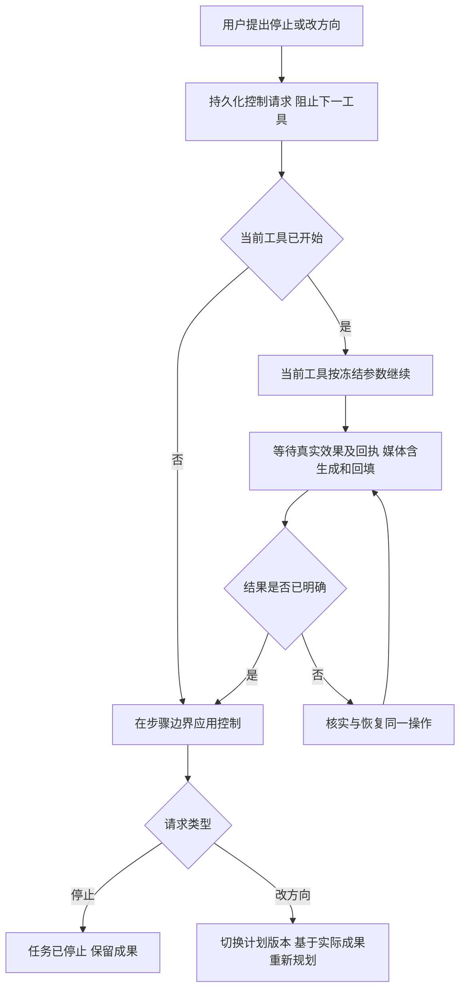

# Agent 执行、中断与修改方向设计

状态：产品规则已确认，系统正在实施与验证；本专题保留设计基线，实际进展与未完成范围见[实施记录](2026-10-21-AI创作助手实施与验证记录.md)。日期：2026-10-21。

本文与[工具系统](2026-10-21-Agent创作工具系统设计.md)、[Skill 管理](2026-10-21-AgentSkill管理与按需调用设计.md)、[无 Embedding 记忆](2026-10-21-Agent记忆系统设计修订版.md)配套。当前只编写方案，不修改业务代码、不执行 DDL、不安装依赖；下述名称为逻辑设计，并非现有 API 或已上线能力。

## 1. 已确认的产品规则

| 项目 | 已确认规则 |
| --- | --- |
| 提出请求 | 用户在执行过程中可以提出停止或修改方向 |
| 生效边界 | 已开始执行的工具先执行完，再停止或改方向 |
| 媒体工具 | 等待媒体生成及结果回填结束；返回任务 ID 不算工具执行完 |
| 普通新消息 | 执行中默认补充当前任务，在当前工具结束后统一处理，不改动当前工具参数 |
| 独立新任务 | 用户单独发起；不能将执行中每条普通补充自动建为新任务 |
| 连续修正 | 最新明确修正优先，兼容要求累积保留；无法判断时再询问 |
| 停止与继续 | 普通补充不撤回停止，明确要求继续才恢复；补充仍保留在原任务 |
| 多任务 | 同会话串行，不同会话可并行；同一冲突对象写操作串行 |
| 后台执行 | 切换页面、刷新或关闭浏览器后，任务由服务端继续，重新打开恢复真实状态 |
| 明确失败 | 有限技术重试失败后暂停任务，保留成果，用户处理或明确继续后再规划 |
| 后续步骤 | 控制请求被记录后，不再启动旧计划的下一工具 |
| 当前成果 | 当前工具正常完成并保留成果，包括有效媒体的自动采用／原生回填 |
| 自动撤销 | 停止或改方向不自动撤销；仅用户明确要求时按批次撤销 |
| 执行范围 | 新方向仍受主体选择、写入目标、执行授权及实时媒体开关约束 |
| Skill | 当前工具保留原参数和冻结版本；改向在边界生效后再检查后续方法 |

这里的“节点”指 Agent 的工具执行步骤，不是某一个画布节点。一个工具可能创建多张卡片、多个画布节点或一批媒体；该工具的有界批次整体构成步骤，不在收到停止后改变其粒度。

用户说“停止”表达的效果是“当前工具结束后停止”。不默认调用供应商取消，不把正在执行的工具直接标为 cancelled，也不将已有成果回滚。

## 2. 当前实现与差异

以下依据当前工作区源码，而不是历史计划；具体入口见第 12 节。

| 当前机制 | 需要调整的方向 |
| --- | --- |
| `AgentRunService.stop` 写入 cancel_requested，将未完成工具设为 cancelled，并结束 run | 改为先保存待生效控制请求；有已开始工具时保持其可完成状态 |
| runtime 在领取、发送、心跳及保存结果处检查 cancel_requested | 分开“禁止开始下一步”和“当前步骤完成许可”，避免待停止使心跳或回执保存失败 |
| `execute_tools` 在循环中逐项执行，业务效果与工具结果共短事务 | 保留原子回执；补齐工具开始领取与控制请求的原子排序 |
| run 已区分 waiting_generation 等状态 | 增加媒体工具跨提交、等待、采用及结算的完整逻辑生命周期 |
| 共享助手当前为空 tools，执行链路仍限制副作用 | 本方案依赖工具方案整体开放，不能只替换 stop 方法就宣称完成 |
| 当前有事件、运行状态快照及恢复基础 | 增加待生效控制、当前工具和边界已应用的信息；刷新后仍展示真实状态 |

不直接复用 cancel_requested 同时表示“停止请求已收到”和“当前工具已失效”，这两个事实在新规则下不同。

## 3. 执行单位与完成定义

| 单位 | 定义 | 完成依据 |
| --- | --- | --- |
| 用户任务 | 一项完整创作目标，可包含多轮补充和多个工具 | 目标完成、停止或明确失败；不由单次模型回答决定 |
| 计划版本 | 当前有效目标、约束及后续步骤的版本 | 改方向在边界生效时切换 |
| 工具步骤 | 已持久领取、参数冻结的一次工具调用 | 效果或明确失败／冲突及回执均已持久化 |
| 结构批次 | 一次工具内的卡片、节点与连线修改 | 业务修改与批次回执原子提交，或明确失败 |
| 媒体批次 | 一次工具内冻结的有限媒体请求集合 | 各项生成与回填均有明确终结结果，完整工具回执已保存 |

工具开始以服务端的持久领取记录为准。模型已提出调用、参数校验已通过、消息已入队均不能单独证明开始。领取与控制记录共用任务锁／条件更新；先领取的当前工具可完成，请求先记录则工具不得开始。

首期同一任务的业务工具串行执行。模型一次提出多个调用时也逐项领取；尚未领取的调用受 pending control 阻挡。同会话独立任务串行，不同会话允许并行；相同冲突对象的写入通过执行领取与对象版本约束串行。未来若开放同任务并行，控制生效须等待全部已开始工具结束，不能沿用只有一个 active_step 的实现。

媒体批次开始后，不因待停止／改向而删掉批次中尚在派发的原有项；它们仍属于当前冻结工具。实际受理和派发仍校验实时权限、媒体开关及额度，失败项保存真实原因。批次上限与预先展示范围用于控制等待时间，不能为了快速停止而中途重新划分工具。

## 4. 待生效控制与运行状态

建议分开保存四个维度，避免把所有情况塞进一个 running／cancelled 字段。

| 维度 | 建议值或信息 | 责任 |
| --- | --- | --- |
| 执行阶段 | deciding、tool_running、waiting_media、settling_result、reconciling、at_boundary、terminal | 表达当前实际工作 |
| 控制状态 | none、stop_pending、redirect_pending | 表达用户请求；不是当前工具状态 |
| 输入处理 | 最新已接收消息序号、已应用消息水位、待处理补充列表 | 普通补充先排入原任务，不提前判为改方向 |
| 任务结果／处置 | 未结束、succeeded、stopped、paused_error、paused_budget；执行尝试可 failed | 停止／暂停后可明确继续，不预先映射现有枚举 |

建议至少持久化 active_step_id、active_plan_revision、control_request_id、control_seq、requested_after_step_id、source_message_id、requested_at、applied_at，以及操作及媒体回执引用。待改向内容保存为新消息／意图记录，不覆盖当前正在执行的参数或来源快照。

待生效请求需要更新自身的控制版本，但**不能立即推进有效计划版本或废除当前工具许可**。Worker 租约代次与计划版本分别管理；租约到期允许恢复者继续同一操作，不表示用户取消。

普通补充可通过 input_revision／applied_input_revision 或等价消息水位表示。存在未处理补充时，同样阻止旧计划下一工具领取；它不自动等同于 redirect_pending，更不能撤销当前工具许可。边界消费补充后，再判断是保留方向、增加约束还是切换计划。

| 收到请求时的位置 | 设计建议 |
| --- | --- |
| 工具尚未开始 | 在启动屏障应用控制，不再领取旧工具 |
| 当前工具已开始 | 标为待停止／改向，允许当前工具完成，禁止下一工具 |
| 正在等待媒体或回填 | 继续等待当前工具的完整结束，界面保留待生效提示 |
| 没有工具在运行，仅模型思考或输出文字 | 停止旧模型输出／结果应用，在决策边界处理控制；旧输出不能领取新工具 |
| 当前工具结果不明 | 保持核实状态及启动屏障，先核对真实回执 |
| 任务已停止或暂停 | 补充保留并绑定原任务，未明确继续不恢复；单独新建任务不混入原任务 |
| 任务已成功结束 | 返回真实终态；新的创作要求作为后续任务处理 |

无副作用模型输出的停止策略为技术建议；不改变已确认的“工具不可中途打断”。

## 5. 停止与改方向的处理流程



1. 接收请求时，在短事务内校验本人任务归属，按稳定请求 ID 去重，保存新消息及控制记录，关闭下一工具启动入口。
2. 返回当前工具和待生效状态；此响应不是停止完成回执。
3. 已开始工具继续使用冻结参数；控制请求不得使它丢失完成／回填许可，不得让下一工具借用其许可。
4. 工具成功或明确失败／冲突后保存真实结果。边界结算读取最新控制记录，优先应用控制，不能先派发旧下游。
5. 停止时关闭任务后续执行；改向时切换有效计划版本，重新检查目标和授权，再基于实际保留成果规划。
6. 记录 applied_after_step_id、已保留成果及新计划身份，发送可恢复事件；重复消费返回同一结果。

工具结果与控制生效能够放在同一数据库事务时原子处理；跨服务回填时通过持久工具终态和幂等边界结算收敛，不能在两个阶段之间留出旧下游可被领取的空隙。

改向后的新操作使用新 operation_id；原工具的身份、参数、结果及 Skill 版本均保持不变。新方向需要额外主体或超出原执行范围时，只补齐缺失边界，不重复确认已明确授权的操作。

### 5.1 执行中新消息默认补充原任务：已确认

| 场景 | 处理规则 |
| --- | --- |
| 执行中直接发送普通消息 | 默认归属当前任务，立即保存并显示“当前工具完成后处理” |
| 新消息补充内容、风格或数量要求 | 当前工具不变；结束后结合真实成果统一更新后续要求 |
| 新消息明确要求停止／改方向 | 记录对应控制意图，仍按相同工具完成边界生效 |
| 正在生成媒体时补充 | 等本工具生成与回填结束，再处理补充；不替换已提交提示词 |
| 用户单独发起独立新任务 | 建立独立任务，不混入原任务；同会话排队，不同会话可并行，保护冲突对象 |

建议接收消息时在同一短事务中固定其 task_id、消息序号、选入主体和幂等请求身份，并标记存在待处理输入。前端显示任务归属；明确的独立任务通过单独入口或服务端验证的发起意图区分，不只依据模型猜测悄悄改变归属。

当前工具终结后，先检查停止及恢复状态；存在尚未解除的停止请求时仅保留补充，不规划或启动后续执行。可继续时读取尚未应用的补充消息及真实回执，冻结本轮处理的消息水位，再统一更新目标、约束及后续计划。规划完成、下一工具领取前核验水位；期间又有新消息则先处理新增补充，不能执行遗漏最新输入的旧计划。已消费的消息水位和相应计划更新可靠关联，重复事件及 Worker 恢复不得重复应用。

补充只约束后续操作。例如正在生成第一个镜头的写实图片时，用户说“后面改成动画风”，先完成并回填当前图片，再按动画风处理后续镜头；若明确要求把刚完成图片也改成动画风，则在新步骤中执行相应修改或生成，保留原结果。

所有补充仍受原任务授权和主体范围约束。进入消息记录不等于正文已获得读取授权，也不把每条补充自动写成长期记忆。连续补充保留全部原文和顺序，兼容约束合并，同一要求的最新明确修正优先；不能判断的冲突具体询问，不靠消息被后台处理的先后覆盖。

### 5.2 停止、保留补充与明确继续：已确认

| 操作顺序 | 结果 |
| --- | --- |
| 停止 → 普通补充 | 当前工具完成后仍停止；补充保留，不能自动恢复 |
| 停止 → 新方向，但没有明确继续 | 新方向保留待用，不以改方向名义绕过停止 |
| 停止 → 明确继续／“继续并按新要求执行” | 记录恢复意图；当前工具尚未结束则先等结束，随后处理补充并恢复 |
| 继续 → 再次停止 | 新停止请求生效，旧恢复事件不能重新启用任务 |
| 已停止 → 刷新页面或重连 | 保持停止，不把恢复连接当作继续执行 |

建议以有序控制记录保存 stop 请求、resume 请求及其关联版本。恢复只能解除明确指向的停止／暂停，不能把一条旧“继续”作为以后所有停止的豁免。明确文字继续与“继续任务”按钮使用同一控制服务；不要求模型先决定是否接受按钮操作。

继续时先核对已完成工具、保留成果、当前目标版本、原主体快照及待处理补充，重建后续计划，不重做已完成操作。来源变化时提示刷新，权限、配置或数量上限仍阻止执行时说明具体原因，“继续”不绕过这些约束。逻辑任务可保留身份，新的执行尝试另建记录，原停止／失败尝试与回执保持不可变。

停止／暂停任务释放会话的执行槽，可由已明确新建的其他任务使用；继续原任务时遵循同会话串行队列，不抢占已经开始的工具。停止时保留的补充不会被其他任务消费。

### 5.3 明确失败与数量上限暂停

可恢复的传输、状态查询或回填故障在同一操作内有限重试；明确失败且重试耗尽后保存失败回执，将任务置 paused_error，停止下游，保留已有成果和待处理补充。恢复时重新判断失败项，不自动绕过它完成任务。受理不明进入核实，不盲目重发收费请求。

任务媒体数量上限不足时，在工具开始前暂停为 paused_budget；当前已开始工具已预占所需额度，仍按完整边界结束。达到上限的提示给出已用及待用数量，调整上限或明确缩小范围后才能继续，普通继续按钮不能直接越限。预算细节见工具方案。

## 6. 媒体工具的完整生命周期

```text
持久领取工具 → 保存生成意图和可靠投递 → 受理／派发
→ 后台生成 → 保存真实产物 → 自动采用／原生回填
→ 保存完整工具回执 → 应用停止或改向 → 按需启动新方向
```

任务 ID、供应商完成状态、文件已下载、卡片／节点已回填是不同阶段。只有生成及回填均结束或已有明确失败／冲突，才能释放该工具的边界。

| 情况 | 当前工具如何收敛 |
| --- | --- |
| 生成成功且目标、来源和意图有效 | 标准模式自动采用；画布沿原生绑定回填，然后保存工具终态 |
| 生成明确失败 | 保存失败和已发生的真实结果／用量，再到边界；不为完成工具自动无限重试 |
| 部分项成功、部分项失败 | 保存逐项结果，成功部分按规则回填，所有项明确后结束该批次 |
| 文件已生成，但回填暂时失败 | 重试同一采用／绑定操作，不重新生成媒体；等待回填明确结果 |
| 目标被删除、相关来源被修改或用户主动采用了其他结果 | 保护用户编辑，产物留存历史并记录终结冲突；不强行覆盖，不无限等待 |
| 提交或回填响应超时、供应商状态不明 | 进入 reconciling，查询原请求、真实 task_id 和操作账本，不把未知记成失败或已完成 |
| 浏览器关闭、SSE 断开、Agent Worker 重启 | 后台继续当前工具及结果处理，控制请求不丢失；不重新提交一份生成任务 |

用户请求 B 改方向时，若当前 A 仍生成中，界面应显示“A 生成中，完成并回填后切换 B”。A 的有效结果先按规则采用，之后才使 B 生效；不能因 B 消息已经到达就提前使 A 的生成意图失效。B 可以在后续工具中重新生成或修改 A 的成果。

普通停止／改向不触发取消当前供应商任务。若未来单独开放“取消媒体任务”，应另定产品能力与异常边界，不能作为当前中断按钮的隐藏行为。

## 7. 幂等、并发与故障恢复

| 风险 | 设计要求 |
| --- | --- |
| 停止与工具同时开始 | 同一任务上的锁／CAS 确定先后；已领取工具完成，请求先到则不领取 |
| 一次模型返回多个工具 | 顺序领取；控制到达后未开始的调用不执行，历史保存明确跳过结果以保持调用协议闭合 |
| 当前工具刚结束，旧下游也被调度 | 调度、领取、边界结算均检查 pending control，队列消息不是执行许可 |
| 普通补充到达但尚未处理 | 输入水位与下一工具领取原子核验；先处理补充，不能因没有 stop_pending 就启动旧下游 |
| 重复点击停止或网络重试 | 请求 ID、控制序号和应用记录去重，不能重复新建任务或执行撤销 |
| 停止后补充、旧恢复消息迟到 | 普通补充不清除停止；恢复请求绑定对应控制版本，新停止优先于旧恢复 |
| Worker 租约失效 | 拒绝旧 Worker 再推进状态；恢复者读取同一工具账本，不把租约变化视为新操作 |
| 媒体事件重复或乱序 | 按真实任务、产物、操作及版本处理，终态不被过时事件回退 |
| 工具已完成但边界结算未执行 | 恢复器发现未应用控制，先补结算，再决定新方向，不重做工具 |
| 外部效果可能已发生但本地回执缺失 | 进入核实；没有可验证幂等或查询能力时不盲目重发 |

等待媒体不应持有数据库长事务或长时间占用 Agent Worker、模型连接。建议沿用 Celery、RabbitMQ、MySQL 的可靠投递／恢复基础，以事件推进为主、有限轮询兜底；媒体结算器使用当前操作的持久许可，不能只凭 run 仍为 running 或旧 Worker 租约判断是否允许回填。

供应商故障需要超时、有限重试和运维可见状态，但时间阈值本身不能证明外部效果不存在。未核实的执行不能解除冲突目标屏障、假装已停止；未知结果的进一步处置策略需在实施时按供应商能力细化。

## 8. 控制接口与事件建议

以下为建议操作，不固定 URL 或替换现有协议；实施前统一 FastAPI、Pydantic、前端 DTO 及接口说明。

| 操作 | 关键输入 | 关键输出 |
| --- | --- | --- |
| 请求停止 | task_id、client_request_id | 控制请求 ID、当前工具、pending／applied、保留成果引用 |
| 请求改向 | task_id、client_request_id、新消息及主体／目标引用 | 新消息身份、待生效控制、当前工具及计划版本 |
| 补充当前任务 | task_id、client_request_id、消息及主动选入主体 | 原任务身份、消息序号、待处理水位及当前工具；不返回一个新建任务 |
| 明确继续 | task_id、client_request_id、预期停止／暂停版本 | 新执行尝试或排队状态、保留成果及待处理补充水位 |
| 读取任务快照 | task_id、事件游标 | 阶段、当前工具、媒体进度、pending control、已应用边界 |
| 读取操作回执 | operation_id | 参数身份、真实效果、媒体与采用状态、错误及版本 |

控制接口由服务端执行，不让模型解释一个“停止工具”后才生效。账号、会话、目标及任务归属由可信 Actor 校验；ID 与版本对外保持十进制字符串。

建议事件包括 control.requested、step.started、step.waiting_media、step.settling_result、step.finished、control.applied、task.stopped、task.paused、task.resumed、plan.redirected；工具和 Skill 还需公开可见的调用生命周期，见[前端交互与事件方案](2026-10-21-Agent前端交互设计.md)。事件由事务后的可靠发布或可追溯的现有事件流暴露；不能先显示应用成功，再尝试落库。

## 9. 前端交互建议

| 状态 | 对话内表达 | 可用动作 |
| --- | --- | --- |
| 正在执行结构工具 | “正在创建 6 个分镜” | 提出停止／改方向 |
| 媒体生成中 | “镜头 1 图片生成中” | 查看任务、提出停止／改方向 |
| 待停止 | “当前工具完成后停止” | 查看当前步骤和已保留成果 |
| 待改向 | “当前工具完成并回填后，按新要求继续” | 查看待生效指令 |
| 待处理补充 | “补充已收到，当前工具完成后统一处理” | 查看原消息和所属任务 |
| 回填中 | “媒体已生成，正在回填” | 查看结果，不提前显示已停止 |
| 核实中 | “正在核实当前工具结果，后续步骤暂停” | 查看详情，不用重复提交推进 |
| 已停止 | 显示实际保留成果与待用补充 | 明确继续、定位成果、按明确请求撤销 |
| 失败／预算暂停 | 真实错误或数量用量，以及已保留成果 | 修正条件、调整上限、明确继续 |

停止按钮提交后有就地 loading 和待生效状态，重复操作幂等。页面切换不重新绑定执行目标。状态从持久快照和有序事件恢复，不能仅由本地 AbortController 或 SSE 断开决定。

沿用[创作反馈规则](../../design/创作反馈规则.md)，在助手对话与任务详情展示进度，不向作品编辑区插入挤压正文的状态块。标准模式使用现有反馈宿主；画布保留原交互边界。新增 UI 实施时再按前端设计约定验收。

调用过程由 Ant Design X ThoughtChain 展示，工具和 Skill 激活有独立稳定条目；当前媒体工具的“受理、生成、回填”更新同一条目的阶段。停止请求作为任务级待生效状态，不把当前工具错误标成取消。具体组件版本、事件投影及断线恢复见前端方案。

## 10. 与记忆、Skill 和会话衔接

| 系统 | 必须保存或遵守 |
| --- | --- |
| L1 原始记录 | 用户新消息、控制请求及应用事件、工具调用／结果和真实媒体引用 |
| L3 当前任务 | 当前有效目标、待处理补充及水位、待生效方向、当前工具、计划版本及已完成成果分开记录 |
| 摘要与压缩 | 待停止不写成已停止；待改向不覆盖当前有效目标；未闭合工具不被摘要拆散 |
| Skill | 当前工具使用原版本；边界后重新判断后续适用性，手动方法优先规则保持 |
| 全局会话 | 普通新消息默认归属执行中的当前任务，工具结束后统一处理；独立新任务单独发起 |
| 会话删除 | 先关闭新增输入与排队领取，等当前工具完成并停止，再删除会话；作品成果保留 |
| 撤销 | 独立、明确的用户操作；停止结果卡保留按批次撤销入口 |

普通新增消息的默认归属已确认，但补充不一定改变方向。应保留消息原意及应用状态，不能把它一律当作新任务或直接废除当前工具。

## 11. 实施与验收建议

| 阶段 | 交付 |
| --- | --- |
| 1 | 控制记录、工具持久开始、启动屏障和边界结算；替换当前立即取消语义 |
| 2 | 结构工具串行、原子批次回执、重复请求及 Worker 恢复 |
| 3 | 媒体跨提交／生成／回填的完整工具生命周期和核实状态 |
| 4 | 对话待生效状态、快照恢复、明确改向及 Skill／L3 联动 |
| 5 | 普通补充、连续修正、停止优先级、明确继续、失败／预算暂停与 ThoughtChain 联动 |

未来验收至少覆盖：

- 请求先于领取，工具不开始；领取先于请求，整个工具先结束。
- 一次模型输出多个调用，控制后未开始工具均不执行，调用历史保持完整。
- 结构批次提交期间请求停止，批次与回执完整保留，下一批次不启动。
- 图片／视频／音频拿到 task_id 后收到请求，仍等生成和回填结束才应用控制。
- 媒体结果有效时先自动采用／原生回填；手动编辑冲突则保留结果与冲突回执，不覆盖用户修改。
- 混合成功／失败批次、回填重试及受理不明均展示真实状态，不重复付费生成。
- 工具完成与控制应用之间重启，恢复先应用控制，不执行旧下游。
- 多标签页、重复消息、事件乱序和断线重连不丢控制、不重复执行。
- 执行中普通新消息归属原任务，当前工具结束后统一消费；不产生独立排队任务，不中途改参。
- 补充处理期间继续收到新消息，下一工具领取前检测消息水位，不遗漏输入或重复应用。
- 显式新任务单独保存，不作为原任务补充；任务之间不混用主体、Skill 和执行授权。
- 停止后普通补充不恢复任务；明确继续消费原任务补充，新停止不被旧恢复事件覆盖。
- 同会话串行、跨会话并行时，冲突对象的实际写入不重叠，版本冲突保留用户编辑。
- 有限重试后明确失败则暂停，数量上限不足在下一工具开始前暂停；继续不绕过未解决条件。
- 工具和 Skill 生命周期进入持久可见轨迹，刷新后 ThoughtChain 能还原，不靠回复文本猜测。
- 压缩、Skill 停用和版本更新不改变当前工具参数，不让摘要提前应用改向。
- 无明确撤销请求时，停止或改方向均不删除已完成成果。

本轮只核对文档内容、格式和本地链接。未来实施按 test-map.json 选择 fast，并依变更补充 mysql、browser、infra；真实模型与供应商验收单独报告，不将这些用例表述为已经通过。

## 12. 源码与参考机制

- [运行控制服务](../../../backend/src/short_drama/service/agent_run_service.py)、[运行时](../../../backend/src/short_drama/agent/runtime.py)、[工具执行与回执](../../../backend/src/short_drama/agent/tools.py)、[共享助手分支](../../../backend/src/short_drama/agent/assistant_chat.py)。
- [运行状态契约](../../../backend/src/short_drama/schemas/agent.py)、[控制接口](../../../backend/src/short_drama/api/v1/agent.py)、[Agent 恢复](../../../backend/src/short_drama/agent/recovery.py)、[现有停止测试](../../../backend/tests/unit/standard/agent/test_agent_stop_artifacts.py)。
- [PydanticAI Deferred Tools](https://pydantic.dev/docs/ai/tools-toolsets/deferred-tools/)：参考异步工具结果跨执行段回传；受理回执与逻辑工具最终完成由本项目定义，实施时核对锁定版本。
- [LangGraph Interrupts](https://docs.langchain.com/oss/python/langgraph/interrupts)：参考持久状态与恢复时副作用幂等；不直接将其节点重跑语义用在媒体提交，也不为本方案引入第二套运行框架。

外部机制沿用前序方案的调研依据，不表示当前项目已安装或验证对应实现。主体、版本、原子回执和恢复仍由平台服务层保证。

## 13. 本轮确认与实施参数

| 项目 | 处理 |
| --- | --- |
| 补充与修正 | 原任务内统一处理，最新明确修正优先，兼容要求保留 |
| 停止与恢复 | 普通补充不撤回停止；明确继续，先核对真实成果，不重做已完成工具 |
| 失败与后台 | 明确失败后暂停；浏览器断开不停止服务端任务 |
| 前端感知 | ThoughtChain 展示工具和 Skill 的可见调用轨迹，快照及事件共同恢复 |
| 技术细化 | 租约时长、重试次数、批次上限和事件保留窗口由实施配置决定，不再逐项询问 |

本轮产品决策已经统一确认，完整清单见[系统方案总览](2026-10-21-AI创作助手系统设计总览.md)。用户已明确要求完整实施与验证，后续按实施记录维护进展；验收清单本身不作为通过证据。
