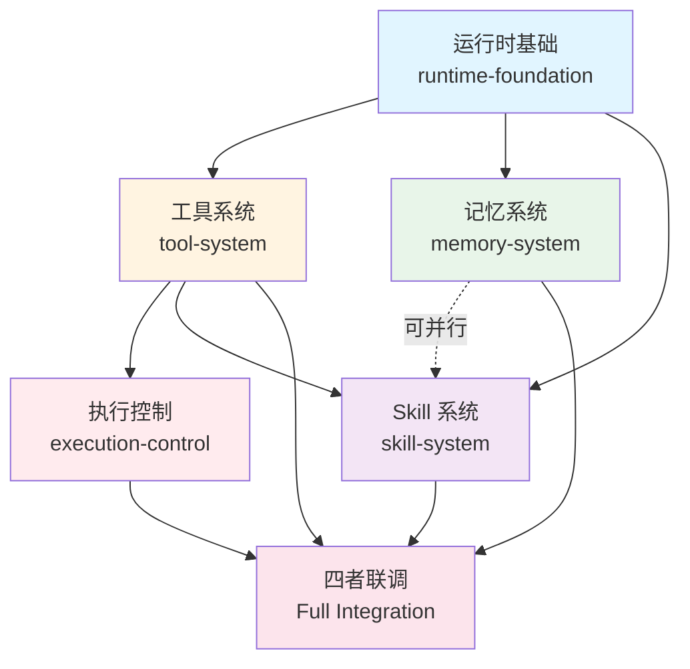

# Agent 运行时基础改造方案

状态：前置依赖方案，尚未实施。日期：2026-10-21。

本文定义助手从"纯聊天"到"可执行工具"的运行时改造，是[工具系统](2026-10-21-Agent创作工具系统设计.md)、[Skill 管理](2026-10-21-AgentSkill管理与按需调用设计.md)、[执行控制](2026-10-21-Agent执行中断与修改方向设计.md)、[记忆系统](2026-10-21-Agent记忆系统设计修订版.md)四个方案的共同前置依赖。

当前仅编写方案，不修改业务代码、不执行 DDL、不安装依赖。

## 1. 当前状态与核心问题

以当前工作区源码为准。相关入口见第 11 节。

| 当前实现 | 具体表现 | 阻碍的能力 |
| --- | --- | --- |
| 共享助手强制空工具 | `assistant_chat.py` 使用 `tools=[]`、`max_tool_calls=0` | 无法调用业务工具创建素材、分镜、节点 |
| runtime 禁止工具回传 | 多处检查并拒绝助手的副作用操作 | 无法保存工具调用结果与业务效果 |
| 缺少工具注册机制 | 没有"根据目标和权限动态裁剪工具"的入口 | 无法按标准/画布模式暴露不同工具 |
| 缺少持久领取记录 | 工具调用可能没有"开始执行"的持久化标记 | 无法判断"停止请求 vs 工具开始"的先后顺序 |
| 缺少 deferred 结果支持 | 媒体工具受理后必须等待生成完成才返回 | 阻塞模型连接，无法继续对话 |
| 缺少运行状态管理 | 只有简单的 running/cancelled 状态 | 无法区分"待停止""正在回填""核实中" |

工具系统方案第 2 节（32-38 行）明确："当前共享助手仍是纯聊天；runtime、authorization、工具执行层也限制助手副作用。实施时需同步改造完整调用链、授权状态及工具结果回传"。

Skill 系统方案第 2 节（38 行）："本方案依赖工具方案整体开放，不能只替换 stop 方法就宣称完成"。

执行控制方案第 2 节（29-36 行）："不直接复用 cancel_requested 同时表示'停止请求已收到'和'当前工具已失效'，这两个事实在新规则下不同"。

记忆系统方案第 3 节（113 行）："现有助手为纯聊天，多处强制 tools 为空且禁止工具回传。实施时必须同步调整工具注册、模型调用预算、deferred 结果回传、运行状态校验与恢复路径"。

## 2. 改造目标

本次改造使助手从"纯文本对话"升级为"可执行业务工具的创作助手"，但**不改变产品边界**：
- 保留工具系统方案定义的权限与边界检查
- 保留执行控制方案定义的停止与改方向规则
- 保留 Skill 系统方案定义的方法加载与工具协同
- 保留记忆系统方案定义的上下文装配

本次只改造**运行时基础设施**，不实施具体工具、Skill 加载或记忆读取。

## 3. 改造范围

### 3.1 核心能力

| 能力 | 改造内容 | 服务的方案 |
| --- | --- | --- |
| 工具注册与可见性 | 支持动态注册工具；按目标模式、权限、任务裁剪可见工具 | 工具系统第 5 节、Skill 系统第 9 节 |
| 工具执行与回执 | 持久化工具开始领取、参数、结果、业务效果；支持原子回执 | 工具系统第 8 节、执行控制第 3 节 |
| 异步工具支持 | 媒体工具受理后返回任务引用，不阻塞模型连接 | 工具系统第 9 节、执行控制第 6 节 |
| 运行状态管理 | 三维度状态（执行阶段/控制状态/任务结果）；pending control 检查 | 执行控制第 4 节 |
| 权限与边界检查 | 目标归属、主体读取、媒体开关、作用域校验 | 工具系统第 4、11 节 |
| 故障恢复 | 基于持久状态和回执的恢复；租约与 fencing | 执行控制第 7 节 |

### 3.2 不改造的部分

| 不改造项 | 原因 |
| --- | --- |
| 具体工具实现 | 属于工具系统方案，本次只提供注册框架 |
| Skill 加载与资源读取 | 属于 Skill 系统方案 |
| 记忆目录与检索 | 属于记忆系统方案 |
| 全局会话改造 | 属于工具系统方案第 2 节（133 行） |
| 媒体生成配额与开关 UI | 属于工具系统方案第 9 节 |

## 4. 技术栈与复用

| 组件 | 职责 | 沿用或新增 |
| --- | --- | --- |
| PydanticAI | Agent 主循环、工具调用、结构化输出 | 沿用现有 `pydantic-ai-slim[openai]==2.53.0` |
| FastAPI + Pydantic 2 | 工具参数校验、运行控制接口 | 沿用现有分层 |
| MySQL + SQLAlchemy | 运行状态、工具回执、控制请求 | 沿用现有事务基础 |
| Celery + RabbitMQ | 异步工具执行、恢复调度 | 沿用现有基础设施 |
| MinIO | 大型工具结果明细 | 沿用现有基础设施 |

不新增 Agent 框架、向量数据库或其他运行时依赖。

## 5. 工具注册与可见性

### 5.1 工具注册协议

```python
# 设计示意，不是最终 API
from typing import Protocol, Literal

class AgentTool(Protocol):
    """工具契约"""
    name: str
    description: str
    parameters: Type[BaseModel]
    
    # 可见性
    supports_standard: bool
    supports_canvas: bool
    requires_permissions: list[str]
    
    # 执行
    async def execute(
        self,
        params: BaseModel,
        context: ExecutionContext
    ) -> ToolResult
```

### 5.2 动态裁剪

```python
def get_visible_tools(
    execution_target: ExecutionTarget,
    user_permissions: set[str],
    task_phase: str
) -> list[AgentTool]:
    """根据目标、权限、阶段返回可见工具"""
    all_tools = registry.list_tools()
    
    # 1. 按目标模式过滤
    if execution_target.mode == "standard":
        tools = [t for t in all_tools if t.supports_standard]
    elif execution_target.mode == "canvas":
        tools = [t for t in all_tools if t.supports_canvas]
    else:
        tools = []
    
    # 2. 按权限过滤
    tools = [
        t for t in tools 
        if all(p in user_permissions for p in t.requires_permissions)
    ]
    
    # 3. 按任务阶段过滤（如：只读阶段不暴露写工具）
    if task_phase == "read_only":
        tools = [t for t in tools if t.is_read_only]
    
    return tools
```

工具系统方案第 5 节（103-120 行）："只向当前决策暴露有目标、有权限且与任务相关的工具；工具隐藏用于降低选择负担，执行器仍须独立校验权限"。

## 6. 工具执行与回执

### 6.1 持久领取

执行控制方案第 3 节（49 行）："工具开始以服务端的持久领取记录为准"。

```python
async def claim_tool_execution(
    tool_call: ToolCall,
    execution_context: ExecutionContext
) -> str:
    """持久化工具领取，返回 operation_id"""
    async with db.transaction():
        # 1. 检查 pending control
        if await has_pending_control(execution_context.task_id):
            raise StopPendingError("任务有待生效的停止/改向")
        
        # 2. 生成 operation_id（幂等）
        operation_id = await get_or_create_operation_id(
            task_id=execution_context.task_id,
            tool_name=tool_call.name,
            params_hash=hash_params(tool_call.params)
        )
        
        # 3. 持久化领取记录
        await save_tool_claim(
            operation_id=operation_id,
            tool_name=tool_call.name,
            params=tool_call.params,
            claimed_at=utcnow(),
            execution_context=execution_context
        )
        
        return operation_id
```

### 6.2 原子回执

工具系统方案第 8.3 节（235-248 行）："在同一短事务内保存全部结构效果、ID 映射、版本及操作回执"。

```python
async def save_tool_result(
    operation_id: str,
    business_effect: Any,
    tool_result: ToolResult
):
    """原子保存业务效果与工具回执"""
    async with db.transaction():
        # 1. 保存业务效果（如：创建的素材、分镜、节点）
        await save_business_effect(business_effect)
        
        # 2. 保存工具回执
        await save_tool_receipt(
            operation_id=operation_id,
            status=tool_result.status,
            created_ids=tool_result.created,
            updated_ids=tool_result.updated,
            errors=tool_result.errors,
            committed_version=tool_result.committed_version
        )
        
        # 3. 更新运行状态
        await update_run_state(
            task_id=execution_context.task_id,
            last_completed_step=operation_id
        )
```

## 7. 异步工具支持（Deferred Tools）

### 7.1 Deferred 结果

工具系统方案第 9 节（262-313 行）和执行控制方案第 6 节（110-131 行）：媒体工具受理后返回任务引用，后台生成完成后自动采用。

```python
class DeferredToolResult:
    """异步工具结果"""
    operation_id: str
    status: Literal["accepted", "rejected"]
    task_ids: list[str]  # 异步任务的真实 ID
    message: str
    
    # 后续通过事件推进
    def __init__(self, ...):
        # 注册完成回调
        register_completion_handler(
            task_ids=self.task_ids,
            callback=self._on_completion
        )
    
    async def _on_completion(self, results: list[MediaResult]):
        """媒体生成完成后的处理"""
        # 1. 自动采用（工具系统第 9.3 节）
        for result in results:
            if result.is_valid():
                await auto_adopt(result)
        
        # 2. 保存完整工具回执
        await finalize_tool_receipt(
            self.operation_id,
            media_results=results
        )
        
        # 3. 触发边界结算（执行控制第 5 节）
        await settle_boundary(self.operation_id)
```

### 7.2 模型继续对话

```python
async def run_with_deferred_tools(
    agent: Agent,
    user_message: str,
    tools: list[AgentTool]
):
    """支持 deferred 工具的运行循环"""
    # 1. 第一轮：模型决策并调用工具
    result = await agent.run(user_message, tools=tools)
    
    # 2. 如果有 deferred 工具，立即返回受理结果
    deferred_calls = [
        call for call in result.tool_calls 
        if isinstance(call.result, DeferredToolResult)
    ]
    
    if deferred_calls:
        # 返回"已受理"消息，不等待生成完成
        return {
            "type": "deferred",
            "message": "已受理 3 个图片生成任务，生成完成后自动采用",
            "task_ids": [c.result.task_ids for c in deferred_calls]
        }
    
    # 3. 普通工具：立即保存结果并继续
    return result
```

参考 [PydanticAI Deferred Tools](https://pydantic.dev/docs/ai/tools-toolsets/deferred-tools/)；具体 API 以锁定版本核对。

## 8. 运行状态管理

### 8.1 三维度状态

执行控制方案第 4 节（56-79 行）："建议分开保存三个维度，避免把所有情况塞进一个 running／cancelled 字段"。

```python
class AgentRunState(BaseModel):
    """运行状态"""
    task_id: str
    
    # 维度 1：执行阶段
    execution_phase: Literal[
        "deciding",         # 模型决策中
        "tool_running",     # 工具执行中
        "waiting_media",    # 等待媒体生成
        "settling_result",  # 结算结果
        "at_boundary",      # 步骤边界
        "terminal"          # 已终止
    ]
    
    # 维度 2：控制状态
    control_status: Literal[
        "none",             # 无控制请求
        "stop_pending",     # 待停止
        "redirect_pending"  # 待改向
    ]
    
    # 维度 3：任务结果
    task_outcome: Literal[
        "active",           # 进行中
        "succeeded",        # 已完成
        "stopped",          # 已停止
        "failed"            # 已失败
    ]
    
    # 当前工具
    active_step_id: Optional[str]
    active_plan_revision: int
    
    # 待生效控制
    pending_control_id: Optional[str]
    pending_control_seq: int
    requested_after_step_id: Optional[str]
```

### 8.2 状态转换

```python
async def update_run_state(
    task_id: str,
    **updates
):
    """更新运行状态，校验转换合法性"""
    current = await get_run_state(task_id)
    
    # 校验状态转换
    if current.execution_phase == "terminal":
        raise InvalidStateTransition("终态任务不能再次更新")
    
    if updates.get("control_status") == "stop_pending":
        if current.execution_phase == "tool_running":
            # 工具运行中收到停止：保持 tool_running，标记 stop_pending
            updates["execution_phase"] = "tool_running"
    
    await db.update(task_id, **updates)
```

## 9. 权限与边界检查

### 9.1 执行上下文

工具系统方案第 8.1 节（187-198 行）："可信执行信封"。

```python
class ExecutionContext:
    """执行上下文（每次工具调用冻结）"""
    # 归属
    actor_user_id: int  # 由可信 Actor 注入，模型不能指定
    conversation_id: str
    run_id: str
    task_id: str
    
    # 目标与授权
    execution_target: ExecutionTarget  # 标准 or 画布，包含 project_id / canvas_id
    allowed_operations: set[str]
    
    # 版本与幂等
    plan_revision: int
    execution_epoch: int
    operation_id: str
    
    # 选入主体
    reference_selection: list[SubjectRef]
    
    # 实时策略
    media_policy: MediaPolicy
```

### 9.2 权限检查

工具系统方案第 11 节（297-302 行）："所有写工具校验 owner_user_id、project_id、canvas_id，归属不符按对象不存在处理"。

```python
async def check_tool_authorization(
    tool: AgentTool,
    params: BaseModel,
    context: ExecutionContext
):
    """工具执行前的权限检查"""
    # 1. 目标归属
    if context.execution_target.mode == "standard":
        project = await get_project(context.execution_target.project_id)
        if project.owner_user_id != context.actor_user_id:
            raise UnauthorizedError("项目不属于当前用户")
    
    elif context.execution_target.mode == "canvas":
        canvas = await get_canvas(context.execution_target.canvas_id)
        if canvas.project.owner_user_id != context.actor_user_id:
            raise UnauthorizedError("画布不属于当前用户")
    
    # 2. 主体读取权限
    if tool.name == "read_selected_subjects":
        for ref in params.refs:
            if ref not in context.reference_selection:
                raise UnauthorizedError(f"主体 {ref} 未被选入")
    
    # 3. 媒体开关
    if tool.name == "submit_generation_batch":
        if not context.media_policy.enabled:
            raise MediaDisabledError("媒体生成开关已关闭")
    
    # 4. 操作权限
    if tool.requires_permissions:
        missing = tool.requires_permissions - context.allowed_operations
        if missing:
            raise UnauthorizedError(f"缺少权限：{missing}")
```

## 10. 故障恢复

### 10.1 租约与 Fencing

执行控制方案第 7 节（136-144 行）："Worker 租约失效：拒绝旧 Worker 再推进状态；恢复者读取同一工具账本，不把租约变化视为新操作"。

```python
async def acquire_worker_lease(
    task_id: str,
    worker_id: str,
    lease_duration: timedelta = timedelta(minutes=5)
) -> int:
    """获取 Worker 租约，返回 epoch"""
    async with db.transaction():
        current_lease = await get_current_lease(task_id)
        
        # 检查是否已被其他 Worker 持有
        if current_lease and not current_lease.is_expired():
            if current_lease.worker_id != worker_id:
                raise LeaseHeldError("任务被其他 Worker 持有")
        
        # 分配新 epoch
        new_epoch = (current_lease.epoch + 1) if current_lease else 1
        
        await save_lease(
            task_id=task_id,
            worker_id=worker_id,
            epoch=new_epoch,
            expires_at=utcnow() + lease_duration
        )
        
        return new_epoch
```

### 10.2 恢复

```python
async def recover_task(task_id: str):
    """恢复中断的任务"""
    state = await get_run_state(task_id)
    
    # 1. 检查待生效控制
    if state.pending_control_id:
        # 先应用控制，再决定是否继续
        await apply_pending_control(task_id)
        return
    
    # 2. 检查未完成工具
    if state.active_step_id:
        operation = await get_operation(state.active_step_id)
        
        # 如果有回执，说明已完成
        if operation.receipt:
            await settle_boundary(state.active_step_id)
            return
        
        # 如果是媒体工具，检查任务状态
        if operation.tool_name == "submit_media_tasks":
            await reconcile_media_tasks(operation)
            return
        
        # 其他工具：受理不明，需要核实
        await mark_reconciling(state.active_step_id)
        return
    
    # 3. 正常恢复下一步
    await continue_execution(task_id)
```

## 11. 逻辑数据与接口

以下是实施前的逻辑设计，不是已执行 DDL。

| 对象 | 建议调整 | 主要字段 |
| --- | --- | --- |
| agent_runs | 增加三维度状态、pending_control_id、active_step_id | execution_phase, control_status, task_outcome |
| agent_tool_calls | 增加持久领取记录、operation_id、claimed_at | operation_id, claimed_at, params_hash |
| agent_tool_receipts | 新表或扩展 agent_tool_calls | operation_id, status, created_ids, updated_ids, committed_version |
| agent_control_requests | 新表 | control_id, task_id, control_type, source_message_id, requested_at, applied_at |
| agent_worker_leases | 新表或复用现有租约 | task_id, worker_id, epoch, expires_at |

建议接口（设计示意）：

| 接口 | 职责 | 关键输入/输出 |
| --- | --- | --- |
| POST /agent/tasks/{task_id}/stop | 请求停止 | client_request_id → control_id, pending_status |
| POST /agent/tasks/{task_id}/redirect | 请求改向 | new_message, client_request_id → control_id |
| GET /agent/tasks/{task_id}/snapshot | 读取任务快照 | → execution_phase, control_status, active_step |
| GET /agent/operations/{operation_id}/receipt | 读取工具回执 | → status, created, errors, committed_version |

## 12. 实施顺序

| 阶段 | 交付 | 依赖 |
| --- | --- | --- |
| 1. 移除纯聊天限制 | `assistant_chat.py` 允许工具注册；runtime 允许工具回传 | 无 |
| 2. 工具注册框架 | 工具注册协议、动态裁剪、可见性检查 | 阶段 1 |
| 3. 执行与回执 | 持久领取、原子回执保存、权限检查 | 阶段 2 |
| 4. 运行状态管理 | 三维度状态、pending control 检查 | 阶段 3 |
| 5. 异步工具支持 | Deferred 结果、后台完成回调 | 阶段 3, 4 |
| 6. 故障恢复 | 租约与 fencing、恢复器、reconciling | 阶段 4, 5 |

每个阶段完成后应通过独立测试验证，不等全部完成再验收。

## 13. 验收清单

| 场景 | 必须满足 |
| --- | --- |
| 工具注册 | 标准模式看到 9 个工具，画布模式看到 8 个工具，工具列表符合可见性规则 |
| 权限检查 | 跨账号写入被拒绝，未选入主体读取被拒绝，媒体开关关闭时生成被拒绝 |
| 工具执行 | 业务效果与回执原子保存，幂等键重复提交返回原回执 |
| 持久领取 | 工具开始有持久记录，停止请求到达后未领取工具不执行 |
| Deferred 工具 | 媒体工具受理后立即返回，不阻塞模型连接，后台完成后自动采用 |
| 运行状态 | 三维度状态正确转换，工具运行中收到停止标记 stop_pending 不是 cancelled |
| 故障恢复 | Worker 重启后读取原回执继续执行，不重复领取已完成工具 |
| 租约 Fencing | 旧 Worker 租约失效后不能推进状态，新 Worker 获得更高 epoch |

本轮只核对文档内容、格式和本地链接。未来实施按 test-map.json 选择 fast，并依变更补充 mysql、infra；真实模型与供应商验收单独报告。

## 14. 本地源码依据

- [共享助手入口](../../../backend/src/short_drama/agent/assistant_chat.py)、[运行时](../../../backend/src/short_drama/agent/runtime.py)、[工具执行](../../../backend/src/short_drama/agent/tools.py)。
- [授权检查](../../../backend/src/short_drama/agent/authorization.py)、[运行状态](../../../backend/src/short_drama/agent/state.py)、[恢复](../../../backend/src/short_drama/agent/recovery.py)。
- [运行控制服务](../../../backend/src/short_drama/service/agent_run_service.py)、[运行契约](../../../backend/src/short_drama/schemas/agent.py)、[控制接口](../../../backend/src/short_drama/api/v1/agent.py)。
- [PydanticAI 依赖锁定](../../../backend/pyproject.toml)、[现有停止测试](../../../backend/tests/unit/standard/agent/test_agent_stop_artifacts.py)。

## 15. 与四个方案的关系

| 方案 | 依赖本方案的能力 | 实施顺序 |
| --- | --- | --- |
| 工具系统 | 工具注册、可见性、执行、回执、权限检查 | 本方案 → 工具系统 |
| 执行控制 | 持久领取、pending control、三维度状态、恢复 | 本方案 → 工具系统 → 执行控制 |
| Skill 系统 | 工具注册（Skill 读取工具）、执行 | 本方案 → 工具系统 → Skill 系统 |
| 记忆系统 | 工具注册（记忆读取工具）、执行 | 本方案 → 工具系统 → 记忆系统 |

建议实施路径：
1. **本方案**（运行时基础）
2. **工具系统**（业务工具实现）
3. **执行控制**（停止与改方向）
4. **Skill 系统** + **记忆系统**（可并行）
5. **四者联调**

本方案完成后，四个方案才能落地。

## 16. 参考机制

- [PydanticAI Tool Definition](https://ai.pydantic.dev/tools/)：参考工具注册与参数校验；具体 API 以锁定版本核对。
- [PydanticAI Deferred Tools](https://pydantic.dev/docs/ai/tools-toolsets/deferred-tools/)：参考异步工具结果跨执行段回传；具体 API 以锁定版本核对。
- [LangGraph Persistence](https://docs.langchain.com/oss/python/langgraph/persistence)：参考持久状态与恢复；不引入第二套运行框架。

参考项目的机制与本项目设计分开记录，不根据公开资料推断供应商没有同类机制，也不宣称本文已经复现其效果。

---

# 附录：五个方案的完整实施顺序

本附录定义运行时基础、记忆系统、工具系统、Skill 系统、执行控制五个方案的实施顺序与依赖关系。

## A.1 方案依赖关系图



**图例**：
- 实线箭头：强依赖（必须先完成前者才能开始后者）
- 虚线箭头：可并行（两者可同时开发，但需联调）

## A.2 强依赖关系说明

| 依赖方 | 被依赖方 | 依赖原因 |
| --- | --- | --- |
| 工具系统 | 运行时基础 | 需要工具注册框架、执行与回执、权限检查 |
| Skill 系统 | 运行时基础 | Skill 加载工具（`load_skill`、`read_skill_resource`）需要工具注册能力 |
| 记忆系统 | 运行时基础 | 记忆读取工具（`search_memory`、`read_memory`）需要工具注册能力 |
| 执行控制 | 工具系统 | 停止与改方向需要工具批次、回执、媒体生命周期 |
| Skill 系统 | 工具系统 | Skill 指导 Agent 调用业务工具，需要工具能力先就绪 |

## A.3 推荐实施顺序

### 顺序 1：运行时基础（第 0 步）
**工期估算**：2-3 周
**交付物**：
- 工具注册框架与动态裁剪
- 持久领取、原子回执
- 三维度运行状态
- 权限与边界检查
- 异步工具支持（Deferred Tools）
- 租约与恢复基础

**验收标准**：
- 可以注册测试工具，按模式裁剪可见性
- 工具执行有持久领取记录和回执
- 媒体工具受理后立即返回，不阻塞模型
- 停止请求与工具领取的原子排序正确
- Worker 重启后能读取原回执恢复

**关键风险**：
- `assistant_chat.py` 与 `runtime.py` 的改动可能影响现有助手功能
- 需要增加数据库表（`agent_tool_receipts`、`agent_control_requests`）

### 顺序 2：工具系统
**前置依赖**：运行时基础
**工期估算**：3-4 周
**交付物**：
- 契约层（批次语义、返回结构、错误码）
- 标准适配器（素材、分镜、关联）
- 画布适配器（节点、连线、布局）
- 媒体任务受理与回填
- 批次撤销

**验收标准**：
- 标准模式可创建素材、分镜、建立关联
- 画布模式可创建节点、连线
- 临时键正确映射为真实键
- 批次校验失败不写入任何数据
- 媒体开关关闭时生成被拒绝
- 撤销能反向操作，遇冲突时保留冲突

**关键风险**：
- 全局会话改造（解绑 `project_id` 强关联）
- 5 个产品未决事项需要先解决

**可并行开发**：
- 记忆系统（不依赖工具系统，可同时开发）

### 顺序 3：执行控制
**前置依赖**：运行时基础、工具系统
**工期估算**：2-3 周
**交付物**：
- 待生效控制（stop_pending / redirect_pending）
- 媒体工具完整生命周期（8 种收敛规则）
- 边界结算与控制应用
- 停止与改方向接口
- 前端状态展示

**验收标准**：
- 停止请求后，已开始工具先完成
- 媒体生成中收到停止，等待回填后才应用
- 改方向后，旧计划不再执行
- 并发停止与工具领取，原子排序正确
- Worker 重启后先补边界结算

**关键风险**：
- 3 个产品未决事项需要先解决（普通新消息归类、多请求合并、继续入口）
- 媒体取消的默认行为需要确认

**可并行开发**：
- 记忆系统（可同时开发，联调时集成 L3 状态）
- Skill 系统（可同时开发，联调时集成版本冻结）

### 顺序 4A：记忆系统（可与 Skill 并行）
**前置依赖**：运行时基础
**工期估算**：3-4 周
**交付物**：
- L1-L5 五层记忆
- 作用域与分类（user / conversation / project）
- 目录发现、关键词检索、正文读取工具
- 后台摘要与抽取
- 遗忘规则与冲突处理

**验收标准**：
- 用户偏好跨会话使用
- 创作设定默认隔离在当前会话
- 目录不包含条目时仍可检索
- 中文别名、专有名词可验证召回
- 纠正后旧抽取任务迟到不覆盖新版本
- 摘要期间追加消息，旧区间摘要仍可激活

**关键风险**：
- 中文关键词召回质量需要真实数据验证
- MySQL FULLTEXT + ngram 需要实例配置

**可并行开发**：
- Skill 系统

### 顺序 4B：Skill 系统（可与记忆并行）
**前置依赖**：运行时基础、工具系统
**工期估算**：3-4 周
**交付物**：
- Skill 包内容与兼容性（SKILL.md、参考资料、模板）
- 按账号保存与身份管理
- AI 配置管理页面（CRUD、导入、启停）
- 手动与按需自动调用
- 三级上下文加载（目录 → 指令 → 资源）
- 首批内置 Skill（3-5 个核心）

**验收标准**：
- 三种添加方式（在线/Markdown/ZIP）都可用
- 内置 Skill 不能被用户修改
- 两个账号同名技能不串账号
- 自动调用筛选准确，手动加载仍检查启用
- 指令要求执行脚本时明确标记不兼容
- Skill 指导工具调用，不绕过权限

**关键风险**：
- 3 个产品未决事项需要先解决（停用影响、预算配额、多技能冲突）
- 归档 Skill 适配工作量未评估
- `pydantic-ai-skills` 库兼容性未验证

**可并行开发**：
- 记忆系统

### 顺序 5：四者联调
**前置依赖**：运行时基础、工具系统、执行控制、记忆系统、Skill 系统
**工期估算**：1-2 周
**交付物**：
- 记忆偏好 + Skill 方法 → 工具参数的完整链路
- 执行控制与记忆 L3 的协同
- Skill 版本冻结与执行控制的协同
- 端到端场景验收（创建分镜 → 生成视频 → 中途改方向 → 撤销）

**验收标准**：
- 用户说"用上次的风格创建 10 个分镜"，能从记忆读取风格，加载分镜 Skill，调用工具创建
- 停止或改方向时，Skill 版本不变，记忆摘要不提前应用控制
- 工具调用、Skill 使用、记忆读取都有完整回执
- 压缩后恢复，记忆、Skill、工具状态一致

## A.4 并行开发策略

### 阶段 1：运行时基础（串行）
**周 1-3**：必须先完成，所有后续方案依赖它

### 阶段 2：工具系统 + 记忆系统（并行）
**周 4-7**：
- **团队 A**：工具系统（契约层、标准适配器、画布适配器）
- **团队 B**：记忆系统（五层记忆、作用域、检索）
- **协调点**：
  - 周 5：对齐执行上下文、Actor、权限检查接口
  - 周 6：对齐 L3 任务状态的字段
  - 周 7：联调"记忆读取工具"与"工具注册框架"

### 阶段 3：执行控制 + Skill 系统（并行）
**周 8-11**：
- **团队 A**：执行控制（待生效控制、媒体生命周期、边界结算）
- **团队 B**：Skill 系统（管理页面、三级加载、首批内置）
- **协调点**：
  - 周 8：对齐运行状态三维度定义
  - 周 9：对齐 Skill 版本冻结与控制应用的时序
  - 周 10：联调"Skill 加载工具"与"执行控制"
  - 周 11：联调"Skill 指导工具调用"与"工具权限检查"

### 阶段 4：四者联调（串行）
**周 12-13**：端到端场景验收

## A.5 关键里程碑

| 周 | 里程碑 | 交付物 |
| --- | --- | --- |
| 3 | 运行时基础完成 | 工具注册、执行、回执、异步支持 |
| 7 | 工具系统 + 记忆系统完成 | 可创建素材/分镜/节点，可读取记忆 |
| 11 | 执行控制 + Skill 系统完成 | 可停止/改向，可加载 Skill |
| 13 | 四者联调完成 | 端到端场景通过 |

## A.6 风险与缓解

| 风险 | 影响范围 | 缓解措施 |
| --- | --- | --- |
| 产品未决事项未解决 | 工具系统、执行控制、Skill 系统 | 在阶段 1 期间完成全部 11 个产品决策 |
| 全局会话改造复杂度高 | 工具系统 | 在阶段 1 完成表结构设计，阶段 2 先改造再开发工具 |
| 中文召回质量不足 | 记忆系统 | 准备"召回不足"的降级方案（用户手动标记关键记忆） |
| `pydantic-ai-skills` 不兼容 | Skill 系统 | 在阶段 2 完成最小验证，不兼容则自行实现薄适配层 |
| 四者联调发现接口不一致 | 全部 | 阶段 2、3 的协调点必须对齐接口，不能到阶段 4 才发现 |

## A.7 总工期估算

| 策略 | 总工期 | 说明 |
| --- | --- | --- |
| 完全串行 | 13-17 周 | 3 + 4 + 3 + 4 + 3 + 2 = 19 周，扣除并行节省 2-6 周 |
| 推荐并行 | 13 周 | 如上文阶段划分 |
| 激进并行 | 11 周 | 工具、记忆、Skill 三者同时开发（风险高，不推荐） |

**推荐策略**：按上文"阶段 1-4"执行，总工期 **13 周**（约 3 个月）。

## A.8 人力需求估算

| 阶段 | 前端 | 后端 | 测试 | 总人力 |
| --- | --- | --- | --- | --- |
| 阶段 1：运行时基础 | 0 | 2 | 1 | 3 人 × 3 周 = 9 人周 |
| 阶段 2：工具 + 记忆并行 | 1 | 3 | 1 | 5 人 × 4 周 = 20 人周 |
| 阶段 3：执行控制 + Skill 并行 | 1 | 3 | 1 | 5 人 × 4 周 = 20 人周 |
| 阶段 4：四者联调 | 1 | 2 | 1 | 4 人 × 2 周 = 8 人周 |
| **总计** | | | | **57 人周** |

**说明**：
- 阶段 2、3 的"并行"需要 2 个后端开发者分别负责不同模块
- 前端主要在阶段 2（工具结果卡、Skill 管理页面）和阶段 3（执行控制状态）参与
- 测试贯穿全程，负责功能测试、集成测试、真实模型验收

## A.9 实施建议

1. **先解决产品未决事项**：在阶段 1 开始前，完成全部 11 个产品决策（工具 5 个、执行控制 3 个、Skill 3 个）
2. **阶段 1 是关键路径**：运行时基础必须高质量完成，否则影响全部后续方案
3. **阶段 2、3 严格对齐接口**：并行开发的团队必须在协调点对齐接口，不能各自为战
4. **每个阶段独立验收**：不等全部完成再测试，阶段 1-3 各有独立验收标准
5. **预留联调时间**：阶段 4 的 2 周是必要的，不能压缩为 1 周

---

## A.10 附：五个方案的快速对比

| 方案 | 长度 | 评分 | 技术难度 | 核心优势 | 核心风险 | 状态 |
| --- | --- | --- | --- | --- | --- | --- |
| 运行时基础 | 本文档 | - | ★★★★☆ | 四个方案的共同基础 | 影响现有助手功能 | 新方案 |
| 记忆系统 | 252 行 | 8.5/10 | ★★★☆☆ | 边界清晰、职责分层 | 中文召回质量 | 方案已确认 |
| 工具系统 | 454 行 | 8.8/10 | ★★★★☆ | 产品+技术完整 | 未决事项多、全局会话改造 | 持续讨论中 |
| Skill 系统 | 368 行 | 9.0/10 | ★★★☆☆ | 安全优先、体验设计 | 内容建设、预算配额 | 持续讨论中 |
| 执行控制 | 237 行 | 9.2/10 | ★★★★★ | 异步一致性、优雅停止 | 产品未决项、媒体取消 | 边界已确认 |

**实施建议**：运行时基础 → 工具系统 + 记忆系统（并行）→ 执行控制 + Skill 系统（并行）→ 四者联调。
