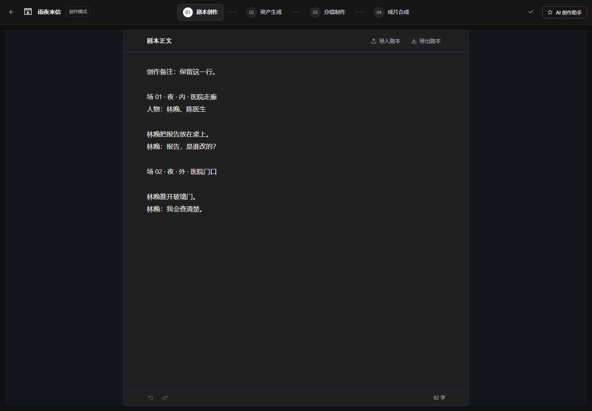
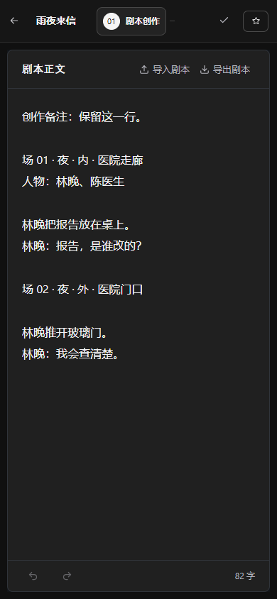
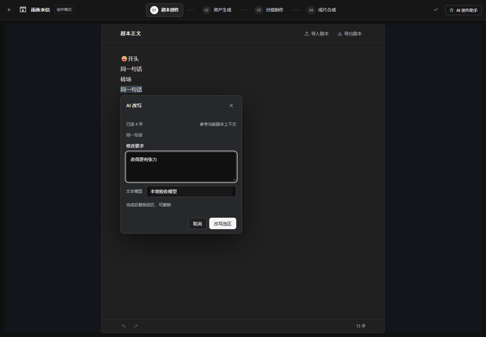
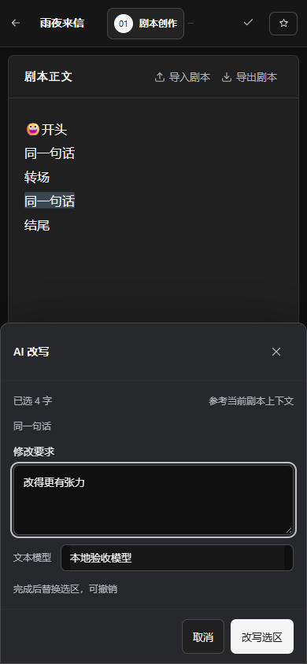

# 剧本单页聚焦改版验收

日期：2026-10-27。对应[单页聚焦设计](../design/2026-10-27-剧本正文单页聚焦设计.md)，适用创作模式 `/projects/:id/source`。

## 已实施范围

- 移除小说／大纲／正文目录及窄屏目录抽屉、整篇生成和重复的下一阶段按钮；唯一正文在实际剩余区域内居中。标题行只有“导入剧本”“导出剧本”，全局阶段、保存与独立助手保留。
- 840px 文档、16px／1.9 连续正文，纸面 `#202020`、两侧 `#121519`；实际容器变窄时减小内距。标题和底栏固定，正文内部滚动。
- 原生选字、就近 AI 改写入口、Ctrl/Cmd+K、范围与首尾摘要、要求及实际文本模型；取消保留同选区要求并恢复焦点，改写成功短暂高亮，一次撤销还原。触屏和窄容器使用底栏入口，手机要求层贴底并监听可视视口。
- TXT 导入先校验编码及原始／UTF-8 字节上限，再保存已有输入、一次替换并保存；可撤销／重做。导出使用安全的作品文件名，包含当前可见的未保存文本。
- 保留整篇目标锁、精确 Unicode 码点区间、串行保存、版本冲突保稿、原请求幂等及恢复。任务进度和停止位于原底栏，受理不明显示待核对；导入禁用，导出仍可用。
- 服务端新改写移除隐藏大纲，仅冻结选区及前后各2000码点，提示词升级为 `script-rewrite-v2`。已受理任务继续使用原快照；历史小说、大纲、整篇生成兼容 API 和表结构保留。

本次没有新增依赖、变更表结构或主动提交 Git；保留工作区其他未提交改动。README、PRODUCT、DESIGN、项目概览、架构、创作模式维护及写作接口说明已同步，测试清单已重新生成。

## 实际验证

| 验证 | 结果与范围 |
| --- | --- |
| `node scripts/test.mjs --changed --dry-run` | 已预览影响；工作区包含其他任务，因此实际执行限定本次功能 |
| `node scripts/test.mjs --feature standard.writing --level fast` | 通过：139项 Python、64项前端 Node 测试 |
| 写作浏览器测试3文件 | 通过：25项，覆盖文件动作、自动保存、长文与滚动、中文输入、精确改写、撤销、停止、离页、冲突和恢复 |
| 最后调整后的定向浏览器复验 | 通过：未保存导出与 GB18030 转码超限保稿、受理不明同请求恢复、切资产阶段后保留正文；3个场景 |
| 前端 `npm run typecheck` | 通过 |
| 前端 `npm run build` | 通过：宿主与画布两包类型检查、生产构建及画布产物复制；最后调整后再构建宿主并恢复 `dist/canvas-app`，归档桥接文件存在。仅有大包体积及既有动静态导入提示 |
| 改动的后端3文件 Ruff | `check`、`format --check` 均通过；使用现有 `.venv/Scripts/ruff.exe` |
| `node scripts/test.mjs --inventory`、`--check` | 通过，清单为527个测试文件、144个辅助文件、41个功能 |
| `node scripts/check-docs.mjs` | 通过：32份维护文档、120张表、34个路由模块 |
| `node scripts/check-quality.mjs` | 通过：911个源文件，0处已知结构问题；规模信号为非阻断提示 |
| 本次范围空白与链接检查 | `git diff --check` 通过；新增验收链接和截图路径存在 |

浏览器使用本机 Chrome、项目 Playwright 配置及真实反馈 Provider，但业务 HTTP 与模型响应为测试替身。服务端快速测试使用隔离测试数据库，不等同于真实供应商、生产 MySQL、消息队列或 Worker 全链路验收。

本次完整写作浏览器报告：`.runtime/test-results/2026-10-27T10-22-33.299Z-5a7f8d13/summary.json`；快速报告：`.runtime/test-results/2026-10-27T10-17-58.318Z-878fcdae/summary.json`。定向复验中，阶段切换和受理不明见 `.runtime/test-results/2026-10-27T10-27-01.691Z-7d5ced20/summary.json`；该轮导入断言错误已修正，导入复验见 `.runtime/test-results/2026-10-27T10-28-40.506Z-5c002af8/summary.json`。

## 浏览器截图与布局核对

已在1440、1920、1024、390px执行居中、溢出与文字层几何检查；桌面和手机截图一起检查，集中修复手机改写层宽度及入场位移后完成一次确认。截图为本轮实现页面，剧本和模型名称是测试数据。

| 桌面 | 手机 |
| --- | --- |
|  |  |
|  |  |

## 未验证边界

- 未调用真实模型，不评价改写质量；没有启动实际 Worker 执行供应商任务。
- 手机验证为390px浏览器视口；实体手机的系统选字手柄、虚拟键盘、系统文件选择器及200%浏览器缩放尚未实机验收。
- 未执行其他阶段全量回归、无限画布交互回归或生产库迁移；本次未改动相关业务与表结构。

